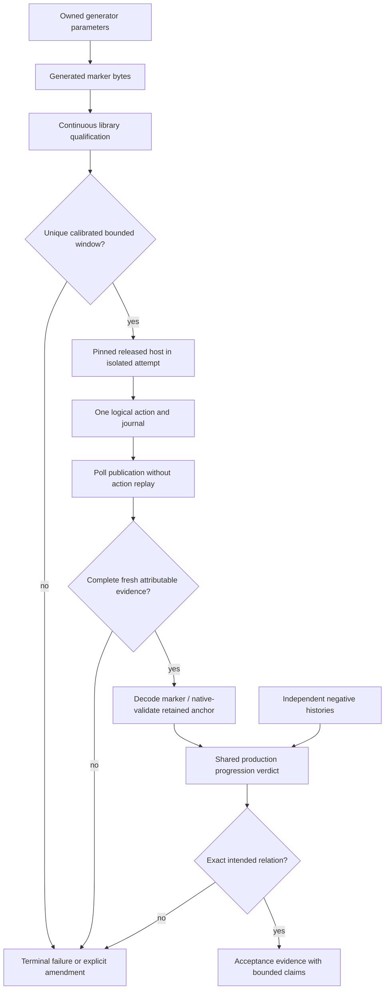

# Phase 16: Host evidence and roadmap - Research

**Researched:** 2026-10-13
**Domain:** Owned C/CTest evidence tools, pinned RetroArch transport, support metadata, milestone operating contract
**Confidence:** HIGH for current repository and fresh narrow probes; MEDIUM for implementation architecture; runtime gate pending

<user_constraints>
## User Constraints (from CONTEXT.md)

### Locked Decisions
DATA_8Q4J1B7P_START
### Exact progression and save origins

- **D-01:** Use a small owned, generated NROM fixture with a visible frame marker for the exact real-host progression sequence. Existing Nesteroids adjacent duplicate pictures cannot prove individual advances; even a globally consistent chain with exact endpoint anchors can hide a dropped step followed by a doubled step. Keep existing game, battery, deterministic claim-level and portable state/audio coverage. The marker has its own identity and invocation; it does not replace the Nesteroids special-control role.
- **D-02:** Qualify the fixture over the entire bounded capture, rewind and run-ahead window. Map its guest/display marker explicitly to the library's absolute frame number, including startup and rendering latency. Require distinguishable zero/one/two-step outcomes, no marker wrap or collision in that window, and failure outside it. Calibration is an implementation-time gate, not a fact established here. Use owned generated bytes and existing fixture patterns; generation needs no assembler dependency. Build artifacts remain untracked; any committed ROM bytes require manifest admission.
- **D-03:** One shared production verdict consumes the real-host observations and independently specified offline controls. All branches refer to the same retained save origin; do not choose a different image candidate for each relation. An ambiguous or merely compatible history cannot pass an exact assertion. Controls include intended progress, isolated dropped/doubled advances, compensated drop/double with identical pictures and matching endpoint anchors, wrong valid same-ROM load origin, inconsistent branch origins and stale/out-of-order observations. The identical-picture control must fail as unproven even when a correct-looking candidate chain exists.
- **D-04:** Preserve the original and rewound state files before slot replacement. Bound and validate the observed uncompressed host container, then validate its extracted core payload through the existing public state loader on an isolated same-content instance. Bind each anchor to expected content, state format/behavior revision, absolute frame and calibrated marker. Magic, existence, a changed checksum or CRC alone does not establish the intended origin or freshness. Reuse native whole-state validation; do not duplicate all machine invariants in CMake. Container layout remains a pinned released-binary observation and is not a universal format contract.
- **D-05:** Confirm a paused load as an explicit compound: one `LOAD_STATE_SLOT 0`, followed by exactly one planned `FRAMEADVANCE`, then the calibrated marker at saved origin plus one. With run-ahead, include the separately calibrated display lead. Historical 1.22.2 evidence says paused load does not redraw; do not demand an immediate saved-frame screenshot or claim independent load completion before the probe advance. Choose a current position and wrong-load origin that distinguish a dropped load. Both actions are one-shot. Do not require disk saves after every advance: that pin historically ignores `SAVE_STATE` there.
- **D-06:** Keep quantities and claims separate: committed core state, displayed frame, command completion and fresh capture. The network run-ahead lane proves the prescribed displayed continuation/lead; screenshots cannot prove speculative-audio correctness or every machine field. Existing portable tests retain those proofs and the supported savestate claim. The fixed rewind burst proves bounded backwards progress followed by exact advances; it does not prove exactly one rewind per datagram. Keep the established coarse bound unless a measured replacement is justified.

### Bounded, attributable commands

- **D-07:** Start with existing `sh`/`nc`. Retry only exact parsed read-only requests within their budgets. A `GET_CONFIG_PARAM savestate_directory` reply must match the expected isolated path and establishes readiness only; it is never a completion fence for earlier actions. Keep `GET_STATUS` excluded because the prior pin probe crashed, and do not add memory descriptors or achievements transport. Documentation advertising a command does not establish safe support in the pinned binary.
- **D-08:** Send mutations once and confirm a discriminating observable postcondition before the next unrelated mutation. `FRAMEADVANCE`, `PAUSE_TOGGLE`, `REWIND` and `RUNAHEAD_TOGGLE` are never blindly retried. Default `SAVE_STATE`, `LOAD_STATE_SLOT`, `SCREENSHOT` and `QUIT` are also one-shot: their apparent idempotence does not protect against a delayed operation crossing a later boundary. Poll for evidence without replaying the action. The load/advance compound and prescribed rewind burst are explicit logical operations, not retry exceptions. An unconfirmed action fails the attempt and CI; no automatic restart or retry-to-green controller is selected.
- **D-09:** Account for subprocess/receive/decode/poll time within actual elapsed deadlines, with an overall attempt limit, per-operation limits, process-liveness checks and bounded cleanup/reaping. Current readiness counters omit up to one second of `nc` time per iteration; the stated 30 seconds can approach 150 seconds before overhead. Measure installed-tool behavior and successful/failing paths before selecting budgets, keeping an outer timeout as a final guard. A narrow owned test-only deadline/receive helper is permitted only when a concrete control demonstrates that installed tools cannot meet the bound simply. No generic retry framework or exactly-once UDP claim.
- **D-10:** Keep one outstanding capture/publication request per logical boundary in an isolated owned attempt tree. Attribute fresh complete images and states to that boundary, validate their formats and expected relations, retain original artifact identities and reject stale/extra/partial/contradictory evidence. A new filename, mtime, count increase or unchanged picture alone is insufficient. If attribution cannot be established, fail conservatively. A qualified changing marker and separated fresh captures provide bounded pause evidence; static-picture equality does not. Record local-session assumptions rather than claiming arbitrary delayed duplicates can be excluded universally.
- **D-11:** Focus offline controls on actual driver/verdict failures: lost read with safe recovery, wrong/malformed readiness reply, dropped/doubled actions and unsafe-retry mutants, wrong-load origin, ambiguous identical images, stale/extra/truncated artifacts, corrupt/wrong-origin anchors, dead host and exhausted nested/overall deadlines. Verify bounded cleanup and one-QUIT behavior. Negative tests require their intended failure reason; unrelated crashes, missing fixtures or parse failures do not count as successful semantic discrimination. Do not multiply every fault across every mapper or build an arbitrary-network simulator.
- **D-12:** Retain a concise command journal with step/class, send count, elapsed budget, expected/observed result, artifact identity and terminal reason. Preserve failure logs, sanitized generated configuration, first-failure evidence, original/converted screenshots, retained anchors, marker/verdict results and pinned host/core/content identities through existing CI artifacts. Keep paths relative or sanitized and collect only the owned attempt tree. Measure added hosted cost before changing timeouts under the existing policy. Finite retention and exact record formatting remain planning discretion.

### Fixture identity and MMC3 metadata

- **D-13:** Replace both full-path substring selectors in `tests/libretro/libretro_host.c` with exact final-component, case-sensitive matching for the existing special fixtures. Parent names and similar basenames cannot select another role. Cover supported platform separator behavior and paths with spaces without introducing realpath canonicalization. Preserve the serializer battery checks and full Nesteroids run-ahead controls, their counts and existing coverage.
- **D-14:** The registered CTest boundary verifies the actual supplied/copied special input against its existing manifest SHA-256 using CMake before host invocation. Checking the original source fixture alone is insufficient. A recognized special basename with wrong bytes fails; a generic fixture under a misleading parent remains generic. Generated marker content is checked against the independently generated expected artifact/parameters and gets a distinct role. Do not hand-write crypto, use FNV as authentication or claim arbitrary direct host CLI calls now authenticate content. In-process canonical-reference arguments and a generic role registry are not selected.
- **D-15:** Correct the frontend-visible description to include NTSC MMC3 support limited to mapper 4 submappers 0/4, excluding MMC6 and four-screen. Detailed existing PRG/CHR/RAM limits remain in README/header comments; admission of NEC submapper 4 is not an all-tests-pass claim. Use the existing `.info` parser and a small localized support clause/facts for automated consistency, coupled to existing loader accept/reject evidence. Check positive support meaning and exclusions, not merely the token `MMC3`. Independent metadata/doc mutants must fail while harmless surrounding wording edits pass. No global mapper registry, full prose snapshot or natural-language validator. Verify packaged metadata agrees; published-release wording waits for actual publication evidence.

### Rolling direction

- **D-16:** Verify the already installed product roadmap and milestone-boundary contract with existing commands and a one-time link/structure/evidence check recorded in normal Phase 16 verification. Credit the actual v4 opening reconciliation. Check four horizons, stable approved RM IDs, commitment statuses, acceptance/promotion evidence, seed dispositions, unresolved debt and instructions for both opening and closeout. Preserve historical reconstruction dates and the distinction between milestone and package versions. This proves current installation, not future compliance.
- **D-17:** Do this upkeep inside the invoked milestone step, as AGENTS rule 8 and the preparation handoff already require. Do not simulate a future closeout, run an extra lifecycle command, edit global GSD workflows, change future priorities without evidence, mark Phases 17/18 shipped or mandate a recurring validator. A structural validator remains optional only if upkeep is repeatedly missed. Existing seed source files and recurring SEED-006 remain credited correctly.

### Agent discretion and research gates

- Small file/helper splits, fixture encoding/generation details, the bounded qualification window, localized clause spelling, test grouping, artifact format and measured budgets are implementation choices within these decisions.
- Planning needs a bounded marker/host-sequence prototype and installed-tool deadline measurements. Reuse prior pinned-binary evidence; remeasure only observations affected by the new fixture/driver. Additional broad research has diminishing returns.
- If the prototype cannot discriminate the accepted sequences, adjust the fixture/oracle within scope or record a concrete plan/context amendment. Do not quietly weaken EVID-01/02, add host APIs or convert uncertainty into success.
- No matching pending todos or prior phase checkpoint/SPEC/plans existed at discussion start. No behavior requirement is completed by this context.
DATA_8Q4J1B7P_END

### Agent discretion
The “Agent discretion and research gates” subsection above is copied verbatim with the implementation decisions; it is the controlling discretion/gate text.

### Deferred Ideas (OUT OF SCOPE)
DATA_2T9K5M8R_START
New memory descriptors/status transport, arbitrary-network reliability, automatic restart/recovery controllers, broader real-host OS coverage, a fixture database/global mapper registry, and recurring roadmap validation absent repeated missed upkeep are not Phase 16 work. PAL/Dendy, more boards, conformance migration and execution fuzzing retain their approved roadmap placement. Existing unrelated debt remains recorded, not absorbed into a cosmetic sweep.
DATA_2T9K5M8R_END
</user_constraints>

## Project Constraints (from AGENTS.md)

The following are binding project directives, verified by reading AGENTS.md in this session. [VERIFIED: AGENTS.md:1-69]

- Own all emulation/test code; only the existing vendored libretro header is permitted. Core links only C memory functions.
- Ship library, headless runner and libretro adapter. Window/device code belongs to the host.
- Admit tracked binary content through the test-ROM manifest; no personal identities/paths in tracked records. Use the prescribed noreply commit identity and hygiene gates.
- Clean room: hardware docs and test behavior; never inspect or retain GPL/LGPL emulator implementation source. Released reference binaries are permitted.
- Deterministic integer-only instance state; retain platform frame/audio hash evidence.
- Every behavior change carries the normal CI workflow test and README/public-header comments in the same change.
- Work on the phase branch; one GSD step per command, then stop/report; Conventional Commit PR title and PR merge.
- Perform rolling-direction reconciliation inside each invoked milestone opening/closeout, including project state/audit/seeds/release evidence, all four horizons, promotion triggers, debt, ordering rationale and preferred/alternative scope. Commit/archive that direction with the step. Only approved scope is committed.
- Use small plain C modules, fixed-width integers, source-cited hardware comments and the remove/reuse/standard-library/platform/minimum-owned-code ladder. No dependency is justified here.

<phase_requirements>
## Phase Requirements

Descriptions below are copied from the current requirement definitions. [VERIFIED: .planning/REQUIREMENTS.md:13-16,34-35]

| ID | Description | Research Support |
|---|---|---|
| EVID-01 | The real-host progression check rejects dropped, doubled or wrong-load sequences using distinguishable frames or absolute state anchors, including negative controls for identical-image ambiguity. | Injective marker, retained native-validated anchors, shared verdict and reason-specific negatives |
| EVID-02 | Network-driven checks confirm bounded completion of safely retried requests and fail/restart unconfirmed non-idempotent actions; no blind FRAMEADVANCE or PAUSE_TOGGLE retry. | One attempt, one-shot mutations, elapsed deadlines, strict readiness parse, attribution and cleanup controls; selected design fails without automatic restart |
| EVID-03 | Fixture selection uses exact content identity/basenames, and adversarial parent-directory names cannot change the selected path. | Exact basename role selection and SHA-256 of actual supplied bytes at registered CTest boundary |
| EVID-04 | Released libretro metadata describes the implemented MMC3 support truthfully and agrees with documented supported profiles. | Local support clause, independent semantic mutants, existing cartridge admission proof and staged/package comparison; publication remains separately evidenced |
| DIR-01 | The repository has a product roadmap with Immediate/Near/Mid/Long horizons, stable outcome IDs, evidence and promotion triggers linked from the project instructions and preparation handoff. | One-time installed-link/structure/evidence check |
| DIR-02 | New-milestone and complete-milestone instructions require the agent to reconcile and refresh that roadmap within the invoked step, preserving delivered seed evidence and unresolved debt. | Verify both installed boundary instructions and credit actual opening reconciliation; do not fabricate future closeout |
</phase_requirements>

## Summary

Use the existing owned C tools and CMake boundary. The current network lane identifies sets of possible frames and accepts surviving one-step chains; the second save is retried and the first save is overwritten. These are the precise evidence seams to replace, not a reason to change core emulation. The portable serialize/run-ahead matrices and existing game/battery/automatic-state lanes remain the stronger whole-machine/audio evidence. [VERIFIED: tests/retroarch/run_retroarch.cmake:571-648; tests/retroarch/state_session.sh:110-186; tests/libretro/libretro_host.c:2020-2044,2395-2405]

A bounded scratch prototype established cheap marker feasibility: a 16-bit NMI counter rendered as binary background tiles has a stable measured mapping after startup in the tested library build. Installed netcat timing also confirms why counting sleeps is insufficient. A fresh installed released-host launch failed before readiness, so host calibration and the full changed sequence are explicitly pending. Neither historical observations nor the scratch library result is a completed host requirement. [VERIFIED: fresh scratch probes, 2026-10-13, measurement record below]

**Primary recommendation:** Plan a dependency-ordered marker/native-anchor/shared-verdict slice, then a bounded driver slice with offline fault controls, then exact fixture/metadata guards and one-time roadmap evidence. Require the hosted gate before accepting real-host exactness.

## Architectural Responsibility Map

This is the recommended ownership map within locked Phase 16 scope.

| Capability | Primary Tier | Secondary Tier | Rationale |
|---|---|---|---|
| Generated ROM and calibrated visible marker | Owned test fixture/tool | Library oracle | Guest renders independently decoded boundary identity; library reports absolute frame |
| Whole-state validity and content identity | Existing core state API | Test-only envelope reader | Reuse machine invariants; envelope belongs to observed host format |
| Exact progression verdict | Owned portable C test module | Hosted evidence consumer | Same production logic must reject independent controls |
| Commands, deadlines, artifact publication | Test-only shell driver | Narrow helper only after failed shell control | Host owns actions; driver owns attributable observations and terminal failure |
| Special fixture role and SHA-256 boundary | Owned basename helper + CMake wrapper | Existing host matrices | Role selection and supplied byte identity are distinct |
| MMC3 support facts | Local metadata/doc declaration | Existing loader tests/package checks | No mapper behavior or global registry change |
| Product direction/upkeep | Existing Markdown instructions/ledger | Normal phase verification | Proves current installation and actual opening evidence |

## Standard Stack

No install is recommended. Version observations below are local measurements or explicit existing requirements, not upgrade targets. [VERIFIED: fresh environment probe, 2026-10-13]

| Tool/component | Version/boundary | Use |
|---|---|---|
| Owned C | “set(CMAKE_C_STANDARD 17)” | Fixture generator, decoder, state-anchor reader, shared verdict; [VERIFIED: CMakeLists.txt:12-14] |
| CMake/CTest | “cmake_minimum_required(VERSION 3.25)”; local 4.4.3 | Supplied-file SHA-256, wrappers, existing test registration; [VERIFIED: CMakeLists.txt:1; fresh cmake version probe] |
| POSIX shell + installed BSD nc | System tools, present | Single-send mutations and bounded read-only retries; fresh timing below |
| RetroArch released binary | “test \"$version\" = 1.22.2” | Hosted-only integration, retaining existing pin; [VERIFIED: .github/workflows/ci.yml:203-222] |
| sips + existing BMP/PPM reader/converter | System sips present | Strip color metadata and validate converted image; [VERIFIED: tests/retroarch/run_retroarch.cmake:518-530] |
| Owned check helpers/iNES builder/state API | Current repository | No test framework, assembler, crypto or networking package |

**Package Legitimacy Audit:** Not applicable: no new external package or installation is selected by the context. [VERIFIED: 16-CONTEXT.md, Phase Boundary] Python was used only to author scratch research bytes and supervise measurements; it is not a proposed build dependency.

**Evidence lookup:** The research-plan seam selected Jina for three questions; no Jina/Context7 tools or ctx7 CLI were available. Used official-page browsing as fallback. The confidence seam returned LOW for webfetch and MEDIUM for verified websearch. Official documentation is therefore cited as MEDIUM rather than inflated to a fresh runtime result. Research cache writes were deferred because this agent owns only the research artifact. Graph context is disabled; configured agent skills are empty. [VERIFIED: research-plan/classify-confidence/graphify tool outputs and .planning/config.json read this session]

## Architecture Patterns

### System architecture diagram



### Component responsibilities and concrete seams

Existing file identifiers below were opened, not inferred. New helper/file splits remain planner discretion; avoid creating a generic registry or framework.

| Existing seam | Change to plan | Source grounding |
|---|---|---|
| Network shell driver | Explicit attempt/operation clocks; one-send counts; reply parser; publication ledger; retained states; fail/reap | [VERIFIED: tests/retroarch/state_session.sh:31-203] |
| Hosted CMake orchestration | Separate marker invocation from preserved game/automatic-state lanes; replace exact-net set chain with common verdict; keep log checks/snapshot | [VERIFIED: tests/retroarch/run_retroarch.cmake:475-652] |
| Frame/image tools | Reuse conversion/readers; add separately decoded marker validity and qualification; do not reinterpret native frame hashes as RGB hashes | [VERIFIED: tests/retroarch/frame_index.c:1-16,120-173] |
| Test registration | Normal portable qualification/verdict/identity/metadata controls, existing fixture setup and reason-specific failures | [VERIFIED: tests/retroarch/CMakeLists.txt:1-83; tests/CMakeLists.txt:1317-1344] |
| Host fixture selectors | Replace both substring tests with exact final-component match | [VERIFIED: tests/libretro/libretro_host.c:2029-2032,2395-2405] |
| Metadata parser | Add localized support meaning check and selftest mutants without narrowing all prose | [VERIFIED: tests/cmake/info_claims.cmake:36-69,117-139] |
| CI lane/artifacts | Distinct marker content/attempt wiring, preserve pin and full failure tree; measure before changing timeout | [VERIFIED: .github/workflows/ci.yml:191-222,269-295] |

### Fresh bounded prototype and measurement record

**Measured this session, scratch only:** Authored a 24,592-byte one-bank NROM image with CHR-ROM blank/solid tiles, 16-bit counter in guest RAM, NMI updates during vblank, nametable bit row and restored scroll. No assembler or downloaded code was used. An owned scratch C harness linked the existing CI static library and decoded native pixel centers at row 35. These measurements establish feasibility of this prototype only; the final owned C generator/decoder must reproduce and qualify its own output. [VERIFIED: fresh scratch generator/harness run, 2026-10-13]

```text
DATA_7N3V6C9A_START
frame=1 marker=0 pixel=0
frame=2 marker=0 pixel=0
frame=3 marker=0 pixel=0
frame=4 marker=1 pixel=48
frame=5 marker=2 pixel=15
frame=12 marker=9 pixel=48
frame=1500 marker=1497 pixel=48
qualification frames=12..1500 nonunit=0 final=1497
DATA_7N3V6C9A_END
```

Measured prototype mapping is marker = absolute library frame minus 3 after startup. The harness checked every unit transition in frames 12..1500; it did not validate every pixel, run all platforms, bind retained native states or exercise rewind/run-ahead. Recommend qualifying all final frames from first accepted marker through a chosen bound that covers every permitted startup/resume/rewind/display-lead outcome. Decode both bit values and complete tile/guard patterns, reject invalid colors/dimensions/partial markers, and verify injectivity including counter carry. Extend the window or shorten overall attempt before allowing a larger frame excursion; never silently accept a marker outside qualification. [VERIFIED: fresh scratch measurement; recommendation within D-02 discretion]

**Installed nc measurements:** Using a neutral loopback scratch UDP endpoint, subprocess elapsed time included shell startup and receive. [VERIFIED: fresh scratch timing probes, 2026-10-13]

| Case | Flags | Elapsed seconds | Result |
|---|---|---:|---|
| No listener | -u -w0 | 0.0119 | exit 0, no reply |
| No listener | -u -w1 | 0.0103 | exit 0, no reply |
| Open silent receiver | -u -w0 | 0.0305 | exit 0 |
| Open silent receiver | -u -w1 | 1.0353 | exit 0 |
| Immediate matching local response | -u -w1 | 1.0137 | response returned, exit 0 |

An unreachable closed port is therefore a bad surrogate for read timeout. The initial no-listener timings cannot justify subsecond successful-read budgets. The shell currently permits 120 probes plus quarter-second sleeps, despite its “30 s” message; measured one-second receives make that approximately 150 s before overhead. [VERIFIED: tests/retroarch/state_session.sh:95-102, quote “within 30 s”; fresh measurements]

**Fresh host attempt:** Installed app plist reported 1.22.2. Launched its released binary with isolated scratch HOME/XDG/config, copied built core/info and generated marker; it exited with return code -6 before readiness, and the captured log was empty. Cleanup reaped the original child. This is an unsuccessful launch observation, not proof of GUI cause, pinned DMG identity, command incompatibility or marker-host behavior. No host source was read. [VERIFIED: fresh bounded host scratch attempt, 2026-10-13]

### Fail-closed hosted execution gate

Plan this as early bounded execution work before declaring the new host assertions proven. It is an automated evidence gate, not a person waiting to approve normal work.

1. Verify the existing CI asset hash/version and generated content identity; run final fixture qualification and independent decoder tests. Record build/core/content/config identities and final accepted frame interval.
2. On the existing logged-in hosted surface, run the final marker through base and claim-level display lanes. Bind startup mapping to reported absolute frame and native state payload, not a guessed offset.
3. In one isolated attempt, establish exact path readiness; pause and collect complete separated captures of the qualified changing marker. Save once at the supported initial boundary, retain and native-validate it before slot overwrite.
4. Confirm each planned advance with unique marker identity. Drop and double selected advances via focused control modes and demand the expected progression failure reason.
5. Load the retained origin with one load plus one planned advance, at a current position that makes a dropped load distinguishable. Use a valid same-content wrong-origin control. Neither an echoed slot nor immediate post-load screenshot is a completion claim.
6. Resume without run-ahead, confirm forward progress, pause again, use the existing fixed rewind burst, and retain/native-validate the rewound save before any subsequent advance. Verify coarse backward bound and exact post-rewind advances.
7. Toggle run-ahead while paused, then one load/one advance. Qualify the display lead for this generated fixture/claim level and distinguish wrong-load and doubled-probe outcomes. Never resume after the toggle on this pin.
8. Send QUIT once; observe exit and bounded reap. Retain first failure/extra/partial evidence. A missing artifact, crash, unqualified frame, ambiguous attribution or timeout fails the attempt and requirement; do not restart to green.

Historical evidence supports the chosen boundaries but does not discharge this gate: paused slot load redraws only after an advance; save after advance is ignored; running run-ahead can lose commands; rewind burst is coarse. [VERIFIED: read historical measurement record .planning/milestones/v3-phases/13-rewind-and-run-ahead-in-retroarch/13-RESEARCH.md, flags 3a-3e; current driver comments:150-151,179-180] No locked decision has been shown unimplementable; amend only on a concrete failed final gate that cannot be repaired within fixture/driver discretion.

### Shared verdict contract

Recommend one bounded evidence representation: calibration identity/window; ordered boundary identity; send count/class; artifact source identity; displayed absolute frame; retained anchor identity/frame; run-ahead display lead; intended relation; terminal reason. Exact representation is discretion, not an existing schema.

The verdict should require one unambiguous decoded marker per boundary, the same retained original anchor across all original-save branches, and the same rewound anchor across rewind/load/run-ahead branches. Evaluate original + advance count, original + load-probe count, rewound + post-rewind count, and rewound + one + separately calibrated display lead. Reject missing, stale, contradictory, duplicate, out-of-order and out-of-window evidence before semantic success. Provide distinct parse/identity/attribution/progression/ambiguity/deadline reasons so a negative cannot pass on an unrelated failure.

Independently encode these controls rather than deriving them by mutating outputs of the same happy-path model: intended pass; isolated drop; isolated double; valid same-ROM wrong origin; inconsistent branch origin; stale/out-of-order evidence; wrong display lead; and A,A,B at intended states 10,11,12 versus actual 10,10,12 with identical pictures and matching endpoint anchors. That last case must be unproven/failure even if an existential correct-history chain exists. [VERIFIED: 16-CONTEXT.md D-03 and Specific Ideas, verbatim counterexample “pictures A,A,B at states 10,11,12: actual states 10,10,12 after drop/double show the same pictures and endpoints”]

### State anchors: validate native state, then prove origin

The public layout explicitly records “16  4  behaviour revision”, “32  8  frame_number” and “48 16  reserved, zero”; the loader documents “The behaviour revision is recorded and not enforced”. The helper must therefore explicitly require the expected current behavior revision in addition to loading on a separate same-content instance; successful native load alone does not satisfy that binding. Save/loading on that oracle must not advance or mutate the live host. [VERIFIED: include/nesturbator.h:455-500, quoted values above]

The current observed envelope check uses “5241535441544501”, “4d454d20” and “894e54530d0a1a0a”, extracts the core at byte 16 and reads frame at file byte 48. It accepts size between S+8 and S+32. These are inherited observed values, not a universal RASTATE specification. [VERIFIED: tests/retroarch/run_retroarch.cmake:444-467, quoted constants above]

Plan a narrow bounded extractor whose accepted full layout/trailer is settled by actual retained pin files. Reject bad length arithmetic, truncated/oversized input, unsupported compression, duplicate payloads and unexplained trailing bytes. Query expected native payload size after loading final content; pass exact bytes to the public loader. Assert content, format, behavior revision and absolute origin against the calibrated boundary, preserve originals before replacement, and compare uninterrupted native reference state/continuation where applicable. CRC-valid wrong-frame same-content state must remain a semantic negative, distinct from corruption rejection. Do not copy all state machine invariants into CMake.

### Elapsed deadlines and attribution

Start with the existing shell/nc seam. Retry only the read, accepting exactly the requested parameter/path after a complete parse. Preserve spaces by parsing prefix then exact remainder; arbitrary nonempty replies cannot establish readiness. Official NCI documents the request/response parameter form; no action-completion claim follows from reading configuration. [CITED: https://docs.libretro.com/development/retroarch/network-control-interface/]

Recommended timer contract: attempt deadline, nested operation deadline, subprocess deadline and cleanup reserve; each operation uses the minimum remaining budget and checks clock/liveness before and after every subprocess, parse, poll and sleep. Pacing is not evidence. Shell wall-clock seconds may suffice with conservative resolution/backward-clock failure and guarded children; validate that experimentally. If a stalled receive/decode/child control cannot stay bounded with installed tools, introduce only a narrow owned test helper for monotonic timing/process supervision. Current measurements prove nc latency, not that this helper is necessary. Helper adoption remains conditional.

Keep one outstanding screenshot/state publication request. Inventory an empty isolated publication area, send once, admit exactly one new complete valid candidate, retain its original filename and hash, and bind its decoded relation to the active journal boundary. Reject extras and contradictions rather than picking the first glob match or deleting them. Stable length/hash across a poll is a useful complete-write check but not standalone freshness proof. Confirm subsequent actions only after validation; unconfirmed publication terminates the attempt. Delay/duplication/reordering cannot be ruled out universally by finite waits; record local isolated-session assumptions. [CITED: https://www.rfc-editor.org/rfc/rfc8085.html#section-3.3]

Required driver controls: read lost then recovered; malformed/wrong path; dropped action and unsafe-retry mutant; action done but missing observation; stale/extra/truncated artifacts; dead host; nested deadline consuming overall budget; stuck child; cleanup/reap and one-QUIT behavior. Use short deterministic clock/fault seams plus one measured wall-clock integration. Keep semantic failures reason-specific and preserve first failure. No arbitrary-network simulator.

### Exact fixture boundary

Two current selector literals are “M1_P128K_C128K_S8K” and “nesteroids” inside full-path substring calls. Existing registered inputs use final components “M1_P128K_C128K_S8K.nes” and “nesteroids.nes”. [VERIFIED: tests/libretro/libretro_host.c:2029,2395; tests/CMakeLists.txt:1321-1324,1338-1340, quoted literals above]

Use a small owned final-component helper, case-sensitive equality, slash handling and Windows backslash handling under supported platform rules. Preserve trailing-separator/empty-name rejection and spaces; no realpath resolution. Tests must show misleading parents/similar basenames stay generic, exact copied basenames retain their intended role, and battery/control counts remain unchanged.

At registered CTest invocation, hash the actual input after copying/preparing it, then compare to the corresponding manifest record before host invocation. Existing manifest checker uses “file(SHA256 \"${root}/${path}\" actual)”. Reuse that algorithm, not its source-only boundary. [VERIFIED: tests/cmake/manifest_sha256.cmake:55-62, quoted invocation] Official CMake file hashing supports this directly. [CITED: https://cmake.org/cmake/help/latest/command/file.html]

Require wrong copied bytes under either special name to fail identity, valid generic bytes under misleading parents to remain generic, both path separators/platform behavior and spaces, and same-content wrong state to reach progression failure. Do not hash only the original, use FNV for trust, or claim direct CLI authentication. Preserve full special-game run-ahead and serializer battery matrices.

### Localized MMC3 contract and package evidence

Current description is “Accuracy-focused NES core: NROM, MMC1, UxROM, CNROM and AxROM, with battery saves.” It omits implemented MMC3. [VERIFIED: libretro/nesturbator_libretro.info:24, verbatim quote]

Current admission defines “if (submapper != 0u && submapper != 4u)” and rejects the alternative; header says “MMC6, other submappers, four-screen and mappers 118, 119, 206 and 249 are refused.” Existing rows include “valid-mmc3-sub4”, “mmc3-submapper-1” and “mmc3-four-screen”. This is admission proof, not an all-pass NEC hardware test claim. [VERIFIED: src/cartridge.c:128-144; include/nesturbator.h:301-309; tests/core/test_cartridge.c:591-617, quoted values above]

Recommend one positive stable support clause declaring NTSC MMC3, mapper 4, submappers 0/4, no MMC6/four-screen in metadata and corresponding localized doc facts. Parse the description using the existing parser; check clause facts, not full prose or occurrence of one token. Couple to existing cartridge accept/reject tests. Mutants remove positive support, broaden profiles, remove either exclusion, contradict README/header facts and duplicate the description key; harmless surrounding wording edits must pass. Keep existing detailed size/RAM limits and capability flags unchanged.

Check staged/package metadata matches source and guard release packaging. Passing staging is evidence of package contents, not publication; released wording requires the actual normal release artifact/publication evidence. Official core docs describe frontend metadata; they do not imply every board works merely from extension acceptance. [CITED: https://docs.libretro.com/development/cores/developing-cores/]

### One-time direction contract verification

Installed statuses are “committed”, “proposed”, “shipped”, “parked” and “retired”; current approved IDs are “RM-001”, “RM-002”, “RM-003”. “SEED-006 is recurring” and “never globally marked complete.” [VERIFIED: .planning/PRODUCT-ROADMAP.md:18,26-28,93-102, quoted values above]

Use normal read/link checks to verify all horizons, stable IDs, statuses/evidence/triggers, seeds/debt and links from instructions/project/preparation index/handoff. Credit the explicit 2026-10-13 opening review. Verify both milestone boundary instructions include refresh and commit/archive inside the invoked step, with approved scope only. Record this once in phase verification. Do not alter future priorities, simulate closeout, rewrite historical reconstruction dates, mark later outcomes shipped or add a standalone/recurring validator. [VERIFIED: .planning/PRODUCT-ROADMAP.md:107-117; .planning/preparation/GSD-HANDOFF.md:23-43; AGENTS.md rule 8]

## Don't Hand-Roll

| Problem | Use instead | Why |
|---|---|---|
| Whole-state validity | Existing public loader on isolated instance | Already owns complete validation and all-or-nothing restore |
| Content authentication | CMake SHA-256 and existing manifest | Avoid duplicated cryptography; actual supplied bytes matter |
| Pixel/color/container image parsing | Existing owned readers/converter | Preserve parity and reject malformed dimensions before decode |
| General reliable UDP or action ACK protocol | One-shot tested local observations and conservative failure | Host protocol cannot acquire stronger semantics from client retries |
| Fixture database/mapper registry/prose parser | Exact basename helper and local support facts | Phase scope needs two roles and one support clause |
| Roadmap service/workflow patch | Installed Markdown operating contract + one-time check | Current installation can be proven without claiming future compliance |

## Runtime State Inventory

This phase refactors test evidence rather than renaming production identity. The answers are restricted to owned attempt state; no global runtime-state absence is claimed.

| Category | Items found / inspected | Required action |
|---|---|---|
| Stored data | Driver slot state and screenshot files within isolated attempt | Retain both origins, validate native payloads, reject stale publication; no user-data migration |
| Live service config | Generated host configuration in owned attempt; global services not inspected | Regenerate isolated config, sanitize journal/artifact copy |
| OS-registered state | Driver child process/trap inspected; unrelated registrations not inspected | Track original PID, bounded kill/reap; no registration rename selected |
| Secrets/env vars | HOME/XDG overrides in driver; no renamed secret selected | Keep isolation and never collect user environment |
| Build artifacts/packages | Existing built core, staged info/content and image conversions | Regenerate outputs; generated ROM stays untracked, no package installation |

Grounding: isolation/process/artifact creation in the driver and hosted script. [VERIFIED: tests/retroarch/state_session.sh:25-32,90-93; tests/retroarch/run_retroarch.cmake:502-509,527-530] No broader runtime migration is inferred.

## Common Pitfalls

- **Startup counter mistaken for absolute frame:** first three prototype pictures did not carry a unique accepted marker. Fail startup/out-of-window instead of guessing calibration. [VERIFIED: fresh scratch measurement]
- **Valid state mistaken for intended state:** loader accepts recorded historical behavior revision and valid same-ROM wrong-origin payloads. Explicitly bind revision/origin/marker. [VERIFIED: include/nesturbator.h:475-478]
- **Existential chain mistaken for exact commands:** compensated drop/double can agree with every picture and endpoint. Keep independent ambiguity negative. [VERIFIED: 16-CONTEXT.md D-03]
- **Read reply mistaken for mutation fence:** the documented response supplies config value; it does not establish earlier action execution. [CITED: https://docs.libretro.com/development/retroarch/network-control-interface/]
- **Timeout clock counts only sleeps:** successful and silent reads consume about one second. Include all nested work and reap. [VERIFIED: fresh nc timing measurements]
- **Delayed image renamed to next step:** current code picks first glob and removes extras. Preserve all identities and fail ambiguous publication. [VERIFIED: tests/retroarch/state_session.sh:58-74]
- **Fixture copied but original hashed:** runtime supplied byte identity remains unverified. Hash the supplied argument in wrapper. [VERIFIED: tests/cmake/manifest_sha256.cmake:55-62; selected D-14]
- **Run-ahead display conflated with committed state/audio:** the documented speculative loop saves/restores while rendering ahead. Keep independent portable state/audio lanes. [CITED: https://docs.libretro.com/guides/runahead/]
- **Metadata/package/roadmap verification called release/future compliance:** preserve separate publication and future boundary evidence. [VERIFIED: selected D-15 through D-17]

## Code Examples

Existing owned patterns, with proposed variable names rather than invented repository constants:

```cmake
# Proposed wrapper sketch. SUPPLIED and EXPECTED_SHA are wrapper inputs,
# not existing source-of-truth variable names.
file(SHA256 "${SUPPLIED}" actual)
if(NOT actual STREQUAL EXPECTED_SHA)
  message(FATAL_ERROR "fixture identity mismatch")
endif()
# Only now invoke the existing host with SUPPLIED.
```

This sketch is recommended design; official file hashing syntax is documented. [CITED: https://cmake.org/cmake/help/latest/command/file.html] The existing equivalent invocation is quoted above from the manifest checker.

```text
# Recommended logical progression model, not an existing schema.
original_anchor = validated retained initial save origin
advance[n].display = original_anchor.frame + n
load_probe.display = original_anchor.frame + 1
rewind_anchor.frame <= pre_rewind.display - coarse_bound
rewind_advance[n].display = rewind_anchor.frame + n
ahead_load_probe.display = rewind_anchor.frame + 1 + calibrated_display_lead
```

Do not hard-code the scratch minus-three mapping into this model. Qualification supplies final mapping, interval and lead.

## State of the Art

| Existing evidence seam | Selected replacement | Scope |
|---|---|---|
| Set-valued adjacent-picture chains | Qualified injective marker plus absolute saved origins | Exact prescribed displayed progression |
| Retried second save/checksum change | One save plus attributed retained/native-valid origin | Bound origin proof without action replay |
| Full-path substring roles | Final-component equality plus supplied-file SHA-256 | Registered test boundary |
| MMC3 omitted from description | Local truthful support clause + semantic mutants | Existing implementation only |
| Installed roadmap/advisory alternatives | Verify actual opening/installed instructions | No future compliance claim |

These are phase recommendations grounded in current code and locked decisions, not externally dated ecosystem transitions.

## Environment Availability

| Dependency | Observation | Version / fallback |
|---|---|---|
| C compiler | Present | Apple clang 21.0.0; normal CI compilers remain authoritative |
| CMake | Present | 4.4.3; minimum remains 3.25 |
| sh/nc/sips | Present | System binaries; nc flags measured above |
| Existing CI library/core/runner build | Present | Scratch harness linked successfully; final build must rebuild changed tools |
| RetroArch installed app | Plist 1.22.2; scratch launch -6 before readiness | Existing required hosted binary lane; local app asset identity not freshly verified |
| Logged-in usable host session here | Not established by failed attempt | Hosted macos-15 execution gate |
| Context7/Jina tools and ctx7 CLI | Not callable/found in this session | Official web documentation fallback |

[VERIFIED: fresh environment and scratch launch probes, 2026-10-13]

No package installation is needed. Missing usable local host execution does not justify skipping integration; use the existing required hosted lane. Keep pinned archive evidence and measured job policy. Existing job has “timeout-minutes: 12” based on sampled successes; the state-net subprocess has “TIMEOUT 150”. These ceilings are current values, not measured budgets for the changed driver. [VERIFIED: .github/workflows/ci.yml:191-194; tests/retroarch/run_retroarch.cmake:506-509, quoted values above]

Validation Architecture and Security Domain template sections are intentionally omitted because configuration explicitly has “nyquist_validation”: false and “security_enforcement”: false. Ordinary required behavior tests and safe bounded parsing remain mandatory. [VERIFIED: .planning/config.json:25,49, quoted values above]

## Assumptions Log

| ID | Claim | Risk / resolution |
|---|---|---|
| A1 | [ASSUMED] Final generated marker can preserve the prototype calibration on all portable builds and pin host modes. | Fresh library prototype is positive but incomplete; exhaustive final qualification and hosted gate required |
| A2 | [ASSUMED] Existing shell/tools can meet selected operation/overall bounds without an owned helper. | Stalled subprocess/read/decode cleanup controls must prove it; permit narrow helper only after concrete failure |
| A3 | [ASSUMED] One outstanding publication request plus isolated local session can attribute final host artifacts sufficiently for bounded claims. | Exercise stale/extra/partial/delayed controls; terminal ambiguity if attribution cannot be established |
| A4 | [ASSUMED] Final changed hosted cost fits current job ceiling. | Measure hosted added cost and existing timeout-policy sample before any adjustment |

These are execution-validation hypotheses, not permission to relax decisions. No additional locked policy or dependency is inferred.

## Open Questions (RESOLVED)

**Reconciled:** 2026-10-15, from completed implementation and retained hosted evidence. These dispositions settle the original preplanning choices; the research/probe descriptions above remain the dated 2026-10-13 record. A resolved disposition does not assert that a known runtime limitation is repaired or that planned execution has passed.

1. **Final fixture calibration interval and display lead — RESOLVED by qualification (D-01/D-02/D-05/D-06).** [Plan 01 summary](16-01-SUMMARY.md#final-hosted-observations) records all 9997 absolute frames in **4..10000 inclusive**, absolute = guest + **3**, and a separately measured run-ahead display lead of **1**. Retained native origin 150 continues at 151. [Hosted run 38457185699](https://github.com/szTheory/nesturbator/actions/runs/38457185699) on `a46f76cba7f7753ba115b546591dac1ce039fc3d` qualified the final generated fixture; this supersedes the scratch-only window. Startup/out-of-window observations fail, and wall time does not establish frame excursion. [Plan 03](16-03-SUMMARY.md#accomplishments) subsequently proved the actual complete network sequence through the shared verdict. Screenshots establish displayed progression/lead; portable tests retain machine-state/audio claims.

2. **Accepted complete host envelope/trailer and publication behavior — RESOLVED for the pinned released binary (D-04/D-08/D-10).** [Plan 01](16-01-SUMMARY.md#final-hosted-observations) records native format **1**, behavior revision **6**, native size **4895 bytes**, and complete envelope **4920 = 16 + roundup8(4895) + 8 bytes**: `RASTATE1`, one `MEM ` payload, zero pad-to-eight, then the eight-byte `END ` trailer with zero size. Its retained actual anchor was independently loaded through the public loader on an isolated same-content instance and bound to the expected origin/continuation. This is a pin-specific observation, not a universal container contract. [Plan 03](16-03-SUMMARY.md#accomplishments) implemented one-shot publication with independently validated captures and retained original/rewound anchors; the intended hosted sequence had **18 screenshots, 79 sends and 16 boundaries**. Stale/extra/truncated/ambiguous evidence remains rejected; the bounded isolated-session attribution assumptions remain explicit.

3. **Driver clock/resolution, nested budgets and cleanup — RESOLVED as an implemented contract plus bounded regression-repair disposition (D-07 through D-12).** [Plan 03](16-03-SUMMARY.md#verification) established shell/installed-tool supervision using Perl `Time::HiRes::clock_gettime(CLOCK_MONOTONIC)` rounded to milliseconds. The implemented driver defaults are **120000 ms attempt, 30000 ms operation/readiness, 5000 ms publication/cleanup**, with a **5000 ms readiness-child slice** enclosing the **1-second nc receive timeout**; nested work uses remaining operation/attempt budget and preserves cleanup reserve. Its focused stalled-action control reached `ATTEMPT_DEADLINE` at **29040 ms** with **953 ms remaining** and reaped child/host. [Hosted run 38651381295](https://github.com/szTheory/nesturbator/actions/runs/38651381295) on `46543ad84b62fc866c096882950abb7c8b2fa7b0` passed the intended sequence in **235.697 s** (**235.515 s attempt**, using the measured test/host enclosure), plus reason-specific negative controls. These are historical passing observations, not a guarantee for later heads.

   The later native PR [run 38740783575](https://github.com/szTheory/nesturbator/actions/runs/38740783575), head `30a009838b741a429863e7cb5143526fbaad8ed7`, exposes a **new delivery regression**: `readiness-response-stall` took **26632 ms** against the strict **less-than-25000 ms full-prefix assertion**. Its exact reply, send/journal count, operation interval and owned-child/host reaping assertions passed; the preceding delayed case took **20728 ms**. The [delivery record](16-RELEASE-DELIVERY.md#native-pr-ci-failure-and-recovery) distinguishes the actual stall from the inherited JSON's incorrect delay label. The Intel slowdown cause remains **unproven**. [Plan 09](16-09-PLAN.md) selects a bounded measured reduction of repeated journal subprocess work, with source-bound before/after evidence and fresh review. It preserves all production defaults and existing test bounds: delay **greater than 1200 and less than 4500 ms**, stall **at least 4500 and less than 7000 ms**, each full prefix **less than 25000 ms**, the test's **30000 ms attempt/operation/readiness and 1000 ms cleanup**, and existing child/nc supervision. If the repair cannot satisfy them, execution stops for a bounded amendment rather than changing limits or declaring success. No helper adoption or new budget choice remains open here; no repair result, platform-cause proof or future native CI success is claimed. Plan 07 still requires fresh passing native PR CI on the repaired head before merge consent.

4. **Local signal-6 launch and required host proof — RESOLVED by explicit hosted-fallback disposition, not by fixing local launch (D-01/D-09/D-11).** The local abort's root cause remains unknown; it never passed readiness and supplies no semantic negative. [Plan 01](16-01-SUMMARY.md#issues-encountered) records the required proof from the pinned **RetroArch 1.22.2 / macos-15** hosted lane, archive SHA-256 `81b79121ba26d539064ae13b4d0419a120c3d165afbe656cf5f5412b15fdb434`; [Plan 03](16-03-SUMMARY.md#verification) supplies the complete hosted progression/control proof. The [verification record](16-VERIFICATION.md) also binds passing run **38676328559** to source `841434b46b202dd04ffbdeb0ac4c4bcbd0b07159`. Local GUI usability is not asserted, required hosted coverage is not waived, and those older passes cannot substitute for the repaired PR head's CI.

5. **Localized support clause spelling — RESOLVED by implemented support facts (D-15).** [Plan 05](16-05-SUMMARY.md#accomplishments) implemented the clause **“Supported NTSC MMC3: mapper 4, submappers 0/4; MMC6=no; four-screen=no.”** in the frontend description, with localized README/header consistency, independent semantic mutants and harmless surrounding-prose controls. Staged-install and extracted-package byte/support checks passed. This settles spelling/validation, not publication: the [delivery record](16-RELEASE-DELIVERY.md#accepted-implementation-and-remaining-gap) retains stale published `v0.1.10` as the EVID-04 gap. Plans 07/08 require normal release delivery and actual downloaded-byte evidence; neither this reconciliation nor Plan 09 closes it.

## Sources

**Primary repository evidence (HIGH for what this tree does):** current AGENTS/context/requirements/config/product roadmap; owned driver, hosted script, image tools, test registration, metadata parser/manifest checker, cartridge acceptance rows/native state source/public header; current CI pin and artifact wiring. Archived Phase 13 probes are historical binary measurements, explicitly not rerun outcomes.

**Fresh measurements (HIGH only within measured scope):** scratch authored marker C harness through 1500 frames; installed nc closed/silent/immediate-response timings; installed app plist and failed bounded isolated launch. Neutral scratch files remain outside tracked tree and are not production assets.

**Official documentation (MEDIUM):**
- https://docs.libretro.com/development/retroarch/network-control-interface/ — read syntax and advertised commands, accessed 2026-10-13.
- https://docs.libretro.com/guides/runahead/ — conceptual speculative display distinction; detailed explanation dated 2020-07-20.
- https://docs.libretro.com/development/cores/developing-cores/ — frontend metadata boundary.
- https://cmake.org/cmake/help/latest/command/file.html — supplied-file hashing.
- https://www.rfc-editor.org/rfc/rfc8085.html#section-3.3 — loss/duplication/reordering/delay limitations, March 2017.

## Metadata

**Confidence breakdown:** stack HIGH (no installs, observed tools); architecture MEDIUM (selected owned seams, final host gate pending); pitfalls HIGH for current script and narrow measurements, MEDIUM for public conceptual documentation.
**Research validity:** Recheck immediately on host pin, generator/calibration, state format/behavior revision or driver changes; current source guidance stable for 30 days.
**Commit:** Deferred to parent orchestrator as requested. No source/test/workflow/state/roadmap edits or git mutations were made by this research agent.
