# Phase 17: Complete pinned conformance baseline — Research

**Researched:** 2026-10-23  
**Domain:** C test harness, pinned ROM inventory decoding, bounded conformance observation, regression evidence  
**Confidence:** MEDIUM — source facts and current production seams are verified; migrated results, campaign duration and acceptable runtime remain unmeasured and must be established during execution.

<user_constraints>
## User Constraints (from CONTEXT.md)

### Locked Decisions

- **D-01:** Move the ROM pin, manifest hash/licence, compressed-name decoder, inventory, affected ROM-specific expectations and protected-key migration together in one reviewable change. The approved new pin is `6bee919529289c555803b612b8c9e4f7eaaeeabb`; the retained old pin is `673ef550db296136d52229961e7d39366116882a`. Independently check exact selected bytes/licence during implementation. Research streamed the new upstream asset to a digest without storing it: SHA-256 `8ac8904a3cf26fbdfa6be501e414d45886ff4478d30dee8e58fa436cf5fd5adc`. The old manifest/local fixture hash is `4fe8c2bc9abc6f4d418da47b73f62cba89fcacd950fae763097a1681d650e839`. Research observations are inputs to validation, not a substitute for it. Do not follow moving upstream HEAD.
- **D-02:** Derive the full directory from the pinned ROM rather than maintaining another address/name list. Decode both page titles and row names, including the new F0–F4 tokens, with bounded input scans and expanded output. Reject unsupported encodings, truncation, empty/oversized names, invalid pointers/fields and ambiguous or duplicate scored identities. Validate all 22 pages and the complete expected inventory, not just a matching total. Exactly five DRAW entries use the shared `$03FF` sentinel; their intentional shared address must not be rejected as duplicate scored results. Validate scored result addresses and routine pointers against the selected ROM's documented layout. Never truncate a name into a colliding key.
- **D-03:** Keep readable `accuracycoin/<decoded name>` keys scoped by pin identity. Preserve source order/page/row/address information for navigation and diagnostics; sort only the report view where useful. A result address or table ordinal is not a stable identity across pins. At these two pins all 17 protected labels occur once and retain their named result/routine symbols, so an opaque new ID registry is unnecessary. If future data makes names ambiguous, fail explicitly and review that migration rather than inventing suffixes silently.
- **D-04:** Retain the old pin's 17 passing rows, raw codes, counts and provenance as comparison evidence; record the 144-scored-plus-five-DRAW old inventory separately from the new 146-plus-five. Account explicitly for every protected key in the migration. Label continuity is not semantic equivalence: upstream APU paths, including frame-counter synchronization, changed despite retained labels. Review relevant assertion/routine changes and record unchanged, renamed, changed-meaning or removed dispositions with sources and new observations. Use ordinary reviewed migration data in the phase PR, not a bespoke approval mechanism. Cross-pin totals or old raw bytes never silently establish a new passing baseline, and changed meanings do not authorize unnamed hardware repairs.
- **D-05:** Prefer independent cold-loaded instances for all 22 page attempts, using the ROM's normal page-header A control. This prevents one page's hang from hiding every later page. Verify readiness, selected page/cursor and attributed start; release controls before controller-sensitive assertions. Preserve boot-time vblank/DMA pretests and startup observations. Source supports row selection and individual A execution; use that as a bounded fallback only where blocked page tails justify it and representative prerequisite/selection behavior has been qualified. Do not mandate an escalating run-all/page/test retry chain. No ROM patches, direct guest-RAM writes or test-specific saved starts to manufacture execution.
- **D-06:** Select finite boot/navigation/execution guest-frame caps from measured representative behavior, with a documented total campaign bound. Add an outer wall deadline for stalled host calls/processes using existing facilities. Record which bound stopped progress; wall time is a resource guard, not a performance or accuracy score. A page timeout must not prevent subsequent independent page attempts. An actual startup failure can leave that page's scored tests not-run with its cause; increasing caps until green is not the acceptance policy.
- **D-07:** Give every scored entry exactly one final `pass`, `fail`, `skip`, `not-run` or `timeout` classification with retained raw observations and cause. Decode `$FF` as skip before interpreting its low running bits; `$00` is not-run; low bits `01` and `10` represent pass and fail. A running marker is not terminal completion: distinguish an observed active attempt exhausting its bound from untouched later rows. Preserve protocol-valid upper variant bits (for example the existing `$41` pass); do not turn every nonzero upper code into failure or accept malformed results as variants. Validate status/raw-byte consistency against the pinned protocol without inventing a second hardware oracle.
- **D-08:** Inventory completeness, attempted execution and trustworthy terminal observations are separate claims. Retain each attempt and its origin when qualified fallback adds observations; do not cherry-pick a successful retry to hide contradictory results. An outer watchdog kill or process crash cannot supply unseen per-test raw bytes, a falsely completed report or an invented active-test identity. Preserve available diagnostics, mark unobserved rows with an honest cause, and fail the harness/infrastructure verdict. Do not call those bytes observed zeros. Valid runner-emitted guest timeouts and their downstream not-run rows remain baseline data.
- **D-09:** Extend the existing small owned text/TSV reporting path. Bind reports to ROM commit and full hash, inventory/schema version, tested source/behavior identity, run mode, input/start policy and budgets. Keep per-entry key, page/row, status, raw byte when observed, consumed frames and cause/attempt linkage; keep elapsed host time as diagnostic metadata. Prefer a small metadata sidecar over repeated large fields or a new serialization dependency. Exact field layout/module split is planning discretion. Store paths relative or sanitized. Retain raw result snapshots and first-failure/menu/start diagnostics through the existing build/CI artifact path; commit a compact canonical baseline and migration comparison so ordinary artifact expiry does not erase the result.
- **D-10:** The human summary reports `pass/146`, all five mutually exclusive status counts summing to 146, attempted/observed coverage and five separately listed DRAW entries. DRAW is never scored, and skip/not-run/timeout never shrink the denominator or imply a passing observation. Do not label this a cross-pin accuracy ranking, percentage of games playable or hardware proof. Retain the old-pin summary alongside it with its own denominator.
- **D-11:** Separate observation mode from strict regression enforcement. Successfully producing a complete, validated, honest baseline can exit 0 with known fail/skip/not-run/guest-timeout rows; no all-pass gate is added. Malformed inventory/results, untrusted/missing artifacts, output errors, crashes and outer-watchdog failures exit as failures. Protected regressions also fail. Keep the existing strict page command's documented failure behavior unless an explicit tested/documented interface migration replaces it. Reuse current `RUNNER_EXIT_TABLE` conventions (0 done, 1 failure, 2 usage); do not repurpose reserved 3/77 or change unrelated runner modes.
- **D-12:** Preserve CI's protected-main baseline authority. Fetch the prior scoreboard and its pin metadata from the same protected revision; do not let a candidate-only snapshot or pin-field edit authorize a reset. Same-pin prior protected passes must remain mapped and measured passing: fail a missing row, fail, skip, not-run or timeout for those keys, even if the candidate committed file still says pass. Keep raw-code changes visible; accept variant changes only under the pinned protocol with their meaning explained, rather than requiring raw equality for every valid pass. A real pin/meaning/denominator transition uses the explicit reviewed migration from D-04, never a blanket cross-pin bypass. Refresh the six-row local fallback to account for all 17 current protected passes. Establish new protected passes from actual measured evidence through the same ordinary reviewed scoreboard workflow.
- **D-13:** Always put parser/classifier/inventory checks and actual protected-pass execution in normal `cmake --workflow --preset ci`, retaining existing six-platform parity, hygiene, sanitizer and perf coverage. Prefer one complete required PR run if its measured cost fits; do not automatically multiply all 22 attempts across six lanes. If even one full PR run is too expensive under existing measured-budget policy, retain the actual initial full bounded campaign and automate recurring pinned full observation in the existing nightly lane. Record that choice and the resulting detection delay. In either placement, phase acceptance needs a real complete inventory/report with diagnostics; an unexecuted scheduled configuration is insufficient. No network fetch is added to normal committed-fixture CI.
- **D-14:** Use focused discriminating controls: missing/duplicate/substituted inventory rows, malformed/unknown tokens and pointers, truncated tables, decoded-key collisions, DRAW entering the denominator, `$FF` versus running, valid pass variants, fake completion/wrong selection, held input, active timeout versus untouched tail, missing raw evidence, outer kill, missing/unfetchable baseline, same-pin lost PASS and an undisposed pin transition. Exercise production parser/classifier/verdict paths; require the intended rejection reason, not an unrelated setup crash. Reuse plain C tests, `tests/check.h` and CTest/CMake seams. Do not replicate every fault across every page or build a generic simulator.
- **D-15:** Pair behavior changes with project-required tests, README and public-header comment updates in the same change. Correct superseded preparation pin/encoding/status descriptions with clear historical/current distinctions. If ROM-bound hashes move because the fixture changed, retain old identities and explain the new expected data; do not erase unrelated determinism/state/parity checks. No new runtime or test dependency is approved. Hardware failures discovered by this baseline become named future findings, not an implicit repair obligation. Diagnose concrete harness defects within the authorized phase; no extra proof-transport framework, global GSD/config change or repeated administrative planning loop.

### the agent's Discretion

Exact CLI spelling for inventory/observation, bounded helper/module boundaries, report schema details, permitted token expansion mechanics, cap values, artifact retention settings and CI placement remain implementation choices within these decisions. Research must verify the new ROM with the project decoder, review protected APU semantics, qualify controller/start behavior and measure runtime before locking budgets. A per-test fallback needs evidence of valid startup prerequisites before its results can serve as acceptance. No new-ROM score, campaign duration, full platform comparison or migrated protected outcome was measured during this discussion.

### Deferred Ideas (OUT OF SCOPE)

- Named NTSC hardware repair clusters selected from the baseline; no all-pass obligation.
- Accepted-program execution/lifecycle fuzzing and JAM policy work remain Phase 18.
- PAL/Dendy, new boards, expansion audio, FDS, external leaderboard submission and reference-emulator integration remain separate scope.
- Existing nightly vectors-full failure remains separate unresolved debt; this discussion neither repairs nor waives it.
</user_constraints>

<phase_requirements>
## Phase Requirements

| ID | Description | Research Support |
|----|-------------|------------------|
| CONF-01 | The AccuracyCoin pin, licence/hash, compressed-name decoder and protected-key migration are validated together, retaining the old-pin comparison. | Exact pin/hash and license evidence, current parser gaps, decoder model and protected-key migration sources below. |
| CONF-02 | The runner inventories every scored test and DRAW entry at that immutable pin; missing or duplicate entries and malformed result tables fail validation. | Full-table parsing recommendations and inventory/parser negative controls. |
| CONF-03 | A bounded automated run gives each scored test an explicit pass/fail/skip/not-run/timeout classification with retained results and diagnostics; DRAW is excluded from the score denominator. | Cold-page attempt protocol, status model, report shape, evidence retention and runtime measurement plan. |
| CONF-04 | Previously protected passing keys remain mapped and accounted for; same-pin pass regressions fail, while changed upstream meanings or denominator changes require an explicit reviewed disposition. | Verbatim 17-key current scoreboard, stale six-key fallback, protected-main CI fetch seam and semantic review recommendation. |
</phase_requirements>

## Summary

Implement the baseline as a bounded extension of the existing headless C runner and plain C/CTest harness. Parse the exact approved ROM image to construct the complete directory, decode page titles and row names with a small checked helper for the pinned token table, classify observations separately from strict regression checks, and report the attempt evidence with the pin and run policy attached. The upstream README at the new immutable pin describes an NTSC RP2A03G/RP2C02G test suite with 146 scored rows and five DRAW rows; the old pin describes 144 scored plus five DRAW. [CITED: [new pinned README](https://raw.githubusercontent.com/100thCoin/AccuracyCoin/6bee919529289c555803b612b8c9e4f7eaaeeabb/README.md), [old pinned README](https://raw.githubusercontent.com/100thCoin/AccuracyCoin/673ef550db296136d52229961e7d39366116882a/README.md)]

The current production path only parses a requested page, stores up to 32 rows in 64-byte name fields, copies compressed bytes as names, and treats a page's non-pass results as command failure. Those are useful seams but do not implement complete inventory or honest observation. [VERIFIED: runner/main.c:550-554, 579-630, 738-760, 812-870] A safer plan is to preserve the existing strict page command, then introduce the smallest owned inventory/report helpers and a distinct observation path if needed. Full campaign runtime, page start qualification, and whether all pages fit a required PR lane are execution measurements; do not invent caps or place the full run based on guessed timings. [VERIFIED: .planning/phases/17-complete-pinned-conformance-baseline/17-CONTEXT.md:28-31, 42-48]

**Primary recommendation:** First prove the pinned decoder and complete static inventory, then trace one compressed-name page through the production runner and report, then perform measured cold attempts for each of the 22 pages; retain all known outcomes without making all-pass the acceptance gate.

## Architectural Responsibility Map

| Capability | Primary Tier | Secondary Tier | Rationale |
|------------|-------------|----------------|-----------|
| Pinned ROM identity and complete inventory | Runner/test harness | CTest | The source table is embedded in the licensed test ROM; the host parser can validate it without adding state to the emulator core. [VERIFIED: runner/main.c:579-630; CITED: [pinned assembly](https://github.com/100thCoin/AccuracyCoin/blob/6bee919529289c555803b612b8c9e4f7eaaeeabb/AccuracyCoin.asm)] |
| Page execution and RAM sampling | Headless runner | Core API | The runner owns input pulses, guest-frame limits, RAM reads and process diagnostics; no window or device layer belongs in this measurement. [VERIFIED: runner/main.c:638-870; CITED: [AGENTS.md](../../../AGENTS.md)] |
| Status classification and durable report | Runner/test harness | CI artifact path | Classification must preserve observation truth, while CTest/CI decides strict regression outcomes and uploads raw diagnostics. [VERIFIED: tests/CMakeLists.txt:693-706, .github/workflows/ci.yml:113-133] |
| Protected-pass migration | CTest scoreboard check | Protected-main fetch | A candidate's own data cannot reset the regression authority; the existing fetch step already loads the baseline before candidate CTest setup. [VERIFIED: tests/cmake/prepare_scoreboard_baseline.cmake:21-59, .github/workflows/ci.yml:113-117] |

## Standard Stack

### Core

| Component | Version / source | Purpose | Why this is the right fit |
|---|---|---|---|
| C | C17, no extensions | Owned bounded parser, classifier, report writer, focused tests | Project constraint; quote: “C17 without extensions; the core links only the C memory functions”. [VERIFIED: .planning/PROJECT.md:100-103] |
| CMake and CTest | Project minimum CMake 3.25; existing CTest presets | Register production-path checks and run the existing workflow | Quote: `"cmakeMinimumRequired": { "major": 3, "minor": 25, "patch": 0 }`; the workflow preset runs configure, build, test and package steps. [VERIFIED: CMakePresets.json:1-3, 151-158] |
| In-repo C test helpers | tests/check.h and CTest | Parser, classifier, scoreboard and production-path negative controls | Project explicitly uses plain C executables without a test framework dependency. [VERIFIED: .planning/preparation/ENGINEERING.md:52-63] |
| Existing runner helpers | runner/sha256.c, runner/clock.c, runner/exit_status.h | Pin digest, host timing metadata, established process status behavior | These are the project-owned helpers already identified for this subsystem. [VERIFIED: .planning/phases/17-complete-pinned-conformance-baseline/17-CONTEXT.md:77-81; runner/exit_status.h:1-24] |

### Supporting

| Component | Purpose | Guidance |
|---|---|---|
| Existing text/TSV and sidecar approach | Human-readable protected summary plus full run metadata and diagnostics | Extend the small owned reporting path. Do not introduce JSON/serialization libraries or an independent evidence service. [VERIFIED: .planning/phases/17-complete-pinned-conformance-baseline/17-CONTEXT.md:35-38] |
| Existing CI artifact upload | Retain full report, raw result snapshots and first-failure diagnostics | Extend the current build artifact path. Existing uploads retain archives and hashes; add the new artifacts alongside those uploads. [VERIFIED: .github/workflows/ci.yml:124-133] |

### Alternatives Considered

| Instead of | Could use | Tradeoff |
|---|---|---|
| Owned parser/report helpers and existing CTest | A new parser, schema or test framework dependency | No demonstrated need justifies a dependency; project policy prefers a small owned helper and keeps `libretro.h` as the only vendored file. [VERIFIED: AGENTS.md, .planning/preparation/ENGINEERING.md:52-53] |
| One cold page attempt per page | A single whole-suite Start action | One hang can hide later pages and their diagnostics; independent page attempts let later pages still be observed. [VERIFIED: .planning/phases/17-complete-pinned-conformance-baseline/17-CONTEXT.md:28-31] |
| Explicit reviewed migration per pin/meaning change | Blindly replace the candidate baseline or compare only counts | Counts and raw bytes from the old pin do not prove the new pin's result semantics. [VERIFIED: .planning/phases/17-complete-pinned-conformance-baseline/17-CONTEXT.md:24, 38] |

**Installation:** None. No external runtime or test package is approved or needed. [VERIFIED: .planning/phases/17-complete-pinned-conformance-baseline/17-CONTEXT.md:43-44]

## Architecture Patterns

### System Architecture

```mermaid
flowchart LR
  R[Exact pinned ROM and manifest identity] --> P[Bounded directory parser and token decoder]
  P --> I[22-page inventory: 146 scored plus five DRAW]
  I --> A[Cold instance per page; verify menu and page-header A start]
  A --> O[RAM samples, guest frames, attempt diagnostics]
  O --> C[pass / fail / skip / not-run / timeout classifier]
  C --> E[TSV summary, metadata sidecar, retained raw evidence]
  E --> G[Same-pin protected-pass check and reviewed migration]
  G --> T[CTest in normal CI; upload full evidence]
```

The pinned README documents page/header controls: D-pad moves, A on a row runs the row, A on a page header runs its page, Start runs the suite, and B skips. [CITED: [new pinned README](https://raw.githubusercontent.com/100thCoin/AccuracyCoin/6bee919529289c555803b612b8c9e4f7eaaeeabb/README.md)] **Inference:** Use the page-header A action for the preferred cold-page attempt because it maps one independent process/instance to one directory page while retaining the upstream menu's intended execution path; individual row-A is only a qualified fallback. [INFERENCE from the pinned README and D-05: [new pinned README](https://raw.githubusercontent.com/100thCoin/AccuracyCoin/6bee919529289c555803b612b8c9e4f7eaaeeabb/README.md), .planning/phases/17-complete-pinned-conformance-baseline/17-CONTEXT.md:28]

### Recommended Project Structure

Keep the implementation within existing ownership seams:

| Responsibility | Existing seam to extend |
|---|---|
| Directory byte parsing, page/name decoding, identity validation | `runner/main.c` current AccuracyCoin parser, extracting a small owned helper only if this reduces coupling. [VERIFIED: runner/main.c:550-636] |
| Input, frames, RAM read and attempts | `runner/main.c` AccuracyCoin execution helpers. [VERIFIED: runner/main.c:638-870] |
| Report schema and observations | Existing TSV scoreboard/report path and runner output. [VERIFIED: tests/accuracy/test_scoreboard.c:21-89; runner/main.c:847-870] |
| Focused parser/classifier/report regressions | `tests/accuracy/`, `tests/check.h`, and registrations in `tests/CMakeLists.txt`. [VERIFIED: tests/CMakeLists.txt:693-706, 924-950; .planning/preparation/ENGINEERING.md:52-63] |
| Protected-main baseline provenance | `tests/cmake/prepare_scoreboard_baseline.cmake` and `.github/workflows/ci.yml`. [VERIFIED: tests/cmake/prepare_scoreboard_baseline.cmake:21-59; .github/workflows/ci.yml:113-117] |

Do not add core state, public library APIs, libretro behavior, a generic simulator, or another administrative evidence transport. The phase context identifies this as runner-only; the public library ABI and state format need no change. [VERIFIED: .planning/phases/17-complete-pinned-conformance-baseline/17-CONTEXT.md:77-87]

### Pattern 1: Parse the ROM directory as the source of truth

**What:** Validate the iNES mapping and pointer table, scan each page title and its entries with a bound, decode the pinned compressed-string tokens, and emit owned decoded names plus source page/row/address/pointer provenance. The upstream assembly maps F0 through F4 to the Indirect, ZeroPage, Absolute, Immediate and UnofficialInstructions text tokens; FF terminates strings and page tables. [CITED: [new pinned assembly](https://github.com/100thCoin/AccuracyCoin/blob/6bee919529289c555803b612b8c9e4f7eaaeeabb/AccuracyCoin.asm)]

**When to use:** Every inventory, report, run and migration key must come from the selected ROM bytes. Do not maintain a second hand-copied name/address table. [VERIFIED: runner/main.c:579-630; .planning/phases/17-complete-pinned-conformance-baseline/17-CONTEXT.md:21-24]

**Implementation sequence:**

1. Verify selected ROM bytes against manifest SHA-256 and pinned licence/source; retain the previous pin and digest in migration evidence. The current manifest entry is old pin `673ef550db296136d52229961e7d39366116882a`, MIT and hash `4fe8c2bc9abc6f4d418da47b73f62cba89fcacd950fae763097a1681d650e839`. [VERIFIED: tests/roms/manifest.txt:14-18]
2. Parse all 22 page pointers and every table in source order; reject bounds errors, missing terminators, unknown tokens, zero-length decoded names, expansion overflow, bad pointers/fields and key collisions. Verify the exact expected new inventory shape: 146 scored rows plus five DRAW entries. The shared `$03FF` is permitted only for those five DRAW records, not a general duplicate-result exception. [VERIFIED: .planning/phases/17-complete-pinned-conformance-baseline/17-CONTEXT.md:21-24; CITED: [new pinned README](https://raw.githubusercontent.com/100thCoin/AccuracyCoin/6bee919529289c555803b612b8c9e4f7eaaeeabb/README.md), [new pinned assembly](https://github.com/100thCoin/AccuracyCoin/blob/6bee919529289c555803b612b8c9e4f7eaaeeabb/AccuracyCoin.asm)]
3. Compare the structured old-pin and new-pin inventories while preserving readable decoded labels and pin scope. Address and row ordinal are provenance, not cross-pin identity. [VERIFIED: .planning/phases/17-complete-pinned-conformance-baseline/17-CONTEXT.md:23-24]

Current parser bounds are not suitable evidence that the entire pinned directory fits: the opened source says:

    #define ACCURACY_MAX_TESTS 32u
    typedef struct accuracy_test {
        char name[64];
        uint16_t result_address;
    } accuracy_test;

[VERIFIED: runner/main.c:550-554]

The parser currently insists on 22 pointers, but reads only one requested page; it treats bytes before FF as literal names, uses the field above as a maximum of 32 page entries / 63 name bytes, checks result addresses are below `$2000`, and advances past the routine pointer without validating it. It does not build global inventory, decode tokens or distinguish DRAW. [VERIFIED: runner/main.c:579-630] Plan a bounded decoded output size based on measured maximum expansion at the approved pin, with explicit overflow rejection; do not assume 64 bytes or truncate on collision.

### Pattern 2: Separate observed status from regression policy

The pinned protocol and user decision define the raw interpretation: `$FF` is skip and must be checked before its low bits; `$00` is untouched/not-run; low bits `01` and `10` mean pass and fail; `11` means running; protocol-valid upper bits may qualify a result such as `$41`. [CITED: [new pinned assembly](https://github.com/100thCoin/AccuracyCoin/blob/6bee919529289c555803b612b8c9e4f7eaaeeabb/AccuracyCoin.asm); VERIFIED: .planning/phases/17-complete-pinned-conformance-baseline/17-CONTEXT.md:30]

The current production logic is:

    if (results[i] == 0u || (results[i] & 3u) == 3u)
        complete = 0;
    uint8_t code = results[i] & 3u;
    const char *status = code == 1u ? "pass" : (results[i] == 0xffu ? "skip" : "fail");

[VERIFIED: runner/main.c:812-856]

The completion loop treats `$FF` as incomplete because its low bits are `11`, even though the later output classifier names it skip. It lumps most other terminal non-pass values into fail, does not distinguish a running active row timing out from untouched rows, and couples non-pass observation to strict command failure. [VERIFIED: runner/main.c:812-870] Implement raw-byte validation/classification on the report path; keep strict regression checks in a separate verdict step. An observed active row that remains running at its measured guest cap becomes timeout; untouched later rows remain not-run with the reason. Startup failure records the page attempt and reason without claiming result bytes that were not read. A complete honest report can succeed even if it contains known fail/skip/not-run/guest-timeout outcomes, while malformed data, process failures and protected-pass regressions fail. [VERIFIED: .planning/phases/17-complete-pinned-conformance-baseline/17-CONTEXT.md:30-38]

The current process exit table is an interface contract; quote from the source:

    X(RUNNER_EXIT_DONE, 0, "done")
    X(RUNNER_EXIT_FAILURE, 1, "failure")
    X(RUNNER_EXIT_USAGE, 2, "usage error")
    X(RUNNER_EXIT_SAVE_SIZE, 4, ".sav size mismatch")
    X(RUNNER_EXIT_STATE_REJECTED, 5, "state rejected")
    #define RUNNER_EXIT_RESERVED_TEXT "3 and 77 are reserved"

[VERIFIED: runner/exit_status.h:13-20] Keep the strict page command's current failure semantics and these assignments; do not reuse reserved statuses. If observation needs different success semantics, expose it as a distinct mode rather than quietly changing strict checks. [VERIFIED: .planning/phases/17-complete-pinned-conformance-baseline/17-CONTEXT.md:37]

### Pattern 3: Tie every attempt to its evidence and pin

Write one row per scored key with pin and inventory identity in the report metadata. Include attempt id/origin, page/row, decoded key, status, raw byte only if sampled, guest frames, start policy, cap used, cause, and diagnostic links. Keep elapsed host time as diagnostic metadata, not as an accuracy or performance score. Keep five DRAW records visible outside the 146-row denominator. An inventory, an attempted page, and a trustworthy terminal raw value are separate evidence states. [VERIFIED: .planning/phases/17-complete-pinned-conformance-baseline/17-CONTEXT.md:31, 35-37]

Report summary should show pass/146, five mutually exclusive status counts whose sum is 146, attempted/observed coverage, and five separate DRAW entries. Preserve raw snapshots plus boot/menu/page/start diagnostics as CI artifacts, and commit a compact canonical summary and protected-key migration so artifact expiry does not erase the baseline. [VERIFIED: .planning/phases/17-complete-pinned-conformance-baseline/17-CONTEXT.md:35-36]

**Code example — proposed field mapping, not a fixed schema:**

| Report concept | Suggested value |
|---|---|
| Run identity | ROM commit, full SHA-256, inventory schema, tested source identity |
| Attempt policy | mode, page-start policy, guest-frame caps, total campaign bound |
| Entry identity | decoded key, source page, row order, result address, routine pointer |
| Observation | status, raw byte if observed, consumed frames, cause, attempt id |
| Diagnostics | relative path to raw result snapshot and first failure/menu/start record |

This is a schema sketch for planning only; names and encoding are discretionary. Keep paths relative or sanitized. [VERIFIED: .planning/phases/17-complete-pinned-conformance-baseline/17-CONTEXT.md:35, 48]

### Pattern 4: Migrate the protected keys using same-pin measured outcomes

The currently committed main scoreboard has 17 protected passes. Its exact content is:

    accuracycoin/Absolute Indexed	pass	0x01	-	-
    accuracycoin/CHR ROM is not writable	pass	0x01	-	-
    accuracycoin/Delta Modulation Channel	pass	0x01	-	-
    accuracycoin/Frame Counter 4-step	pass	0x01	-	-
    accuracycoin/Frame Counter 5-step	pass	0x01	-	-
    accuracycoin/Frame Counter IRQ	pass	0x01	-	-
    accuracycoin/Indirect	pass	0x01	-	-
    accuracycoin/Indirect, X	pass	0x01	-	-
    accuracycoin/Indirect, Y	pass	0x01	-	-
    accuracycoin/Length Counter	pass	0x01	-	-
    accuracycoin/Length Table	pass	0x01	-	-
    accuracycoin/PPU Read Buffer	pass	0x41	-	-
    accuracycoin/PPU Register Mirroring	pass	0x01	-	-
    accuracycoin/PPU Register Open Bus	pass	0x01	-	-
    accuracycoin/Palette RAM Quirks	pass	0x01	-	-
    accuracycoin/Relative	pass	0x01	-	-
    accuracycoin/Zero Page Indexed	pass	0x01	-	-

[VERIFIED: tests/accuracy/scoreboard.txt:1-17]

The local fallback currently contains only:

    accuracycoin/Delta Modulation Channel	pass	0x01	-	-
    accuracycoin/Frame Counter 4-step	pass	0x01	-	-
    accuracycoin/Frame Counter 5-step	pass	0x01	-	-
    accuracycoin/Frame Counter IRQ	pass	0x01	-	-
    accuracycoin/Length Counter	pass	0x01	-	-
    accuracycoin/Length Table	pass	0x01	-	-

[VERIFIED: tests/accuracy/scoreboard-main.txt:1-6] Refresh it to the full protected set. Keep `$41` visible as a currently passing variant and check it against the new pinned protocol instead of reducing all passes to `$01`. [VERIFIED: tests/accuracy/scoreboard.txt:12; .planning/phases/17-complete-pinned-conformance-baseline/17-CONTEXT.md:30, 38]

The old/new assembly comparison identifies changed APU setup/synchronization paths, including Frame Counter IRQ and Frame Counter 4-step paths using OAMDMAWithPage2 where the old path directly wrote `$4014`. That is sufficient evidence that label continuity alone is not enough; inspect each protected assertion and its setup/prerequisites, and record a source-backed migration disposition and a new observation. [CITED: [pinned old-to-new source comparison](https://github.com/100thCoin/AccuracyCoin/compare/673ef550db296136d52229961e7d39366116882a...6bee919529289c555803b612b8c9e4f7eaaeeabb); VERIFIED: .planning/phases/17-complete-pinned-conformance-baseline/17-CONTEXT.md:24]

Today the scoreboard executable compares candidate rows against the protected baseline and requires each baseline pass to remain present and pass; it does not bind the baseline to a ROM pin or compare against measured raw observations. [VERIFIED: tests/accuracy/test_scoreboard.c:91-145] The CI setup fetches only `tests/accuracy/scoreboard.txt` from `FETCH_HEAD` and runs before candidate CTest setup. Its source of truth is explicit:

    COMMAND git fetch --no-tags origin refs/heads/main
    COMMAND git ls-tree FETCH_HEAD -- tests/accuracy/scoreboard.txt
    COMMAND git show FETCH_HEAD:tests/accuracy/scoreboard.txt

[VERIFIED: tests/cmake/prepare_scoreboard_baseline.cmake:21-59; .github/workflows/ci.yml:113-117]

Extend that same protected revision handoff to carry the pin metadata with the scoreboard. Gate same-pin protected `pass` keys against the actual observation report, even when the candidate file still says pass. For a pin, meaning or denominator change, require explicit per-key reviewed dispositions; do not enable a blanket baseline bypass. Permit protocol-valid raw variants, but retain their changes and explain their meaning. [VERIFIED: .planning/phases/17-complete-pinned-conformance-baseline/17-CONTEXT.md:24, 38]

## Don't Hand-Roll

| Problem | Don't build | Use instead | Why |
|---|---|---|---|
| AccuracyCoin directory names and pointers | Another source-coded list | Parse the approved pinned ROM table | The existing parser already derives page entries from the ROM, but only for one page; retain the source-of-truth direction and expand it to complete inventory. [VERIFIED: runner/main.c:579-630] |
| Serialization framework | New package or general document format | Small text/TSV plus a compact sidecar | No demonstrated complexity needs another dependency; full evidence can remain a CI artifact. [VERIFIED: .planning/phases/17-complete-pinned-conformance-baseline/17-CONTEXT.md:35, 44] |
| Regression proof transport | New CI evidence service | Existing protected-main fetch and artifact upload | Existing workflow already fetches protected scoreboard bytes and uploads build artifacts. [VERIFIED: tests/cmake/prepare_scoreboard_baseline.cmake:21-59; .github/workflows/ci.yml:113-133] |
| Emulator behavior oracle | GPL/LGPL emulator source or reference-emulator integration | MIT test ROM behavior plus hardware documents and project code | Clean-room requirement forbids opening GPL/LGPL emulator source; no oracle integration is in scope. [VERIFIED: AGENTS.md; .planning/phases/17-complete-pinned-conformance-baseline/17-CONTEXT.md:99-102] |

**Key insight:** The tricky problem is preserving the distinction between ROM-declared inventory, rows actually attempted, raw values observed and regressions that policy rejects. A single pass/fail scoreboard cannot honestly represent that evidence. [INFERENCE from current runner and locked D-07–D-12: runner/main.c:812-870; .planning/phases/17-complete-pinned-conformance-baseline/17-CONTEXT.md:30-38]

## Common Pitfalls

### Pitfall 1: Treating compressed names as raw identity

**What goes wrong:** Keys stay encoded, or expansion truncates into another row's name.  
**Why:** Current code copies the bytes verbatim into a fixed name buffer and only checks the encoded input length. [VERIFIED: runner/main.c:613-623]  
**How to avoid:** Decode page titles and row names with checked source and output bounds, reject unknown token bytes and overflow, then detect collisions on fully expanded names. Do not suffix ambiguous keys silently. [VERIFIED: .planning/phases/17-complete-pinned-conformance-baseline/17-CONTEXT.md:22-23; CITED: [pinned assembly](https://github.com/100thCoin/AccuracyCoin/blob/6bee919529289c555803b612b8c9e4f7eaaeeabb/AccuracyCoin.asm)]

### Pitfall 2: Declaring completeness because a page/count matches

**What goes wrong:** Missing, duplicated or substituted table rows pass an aggregate count check.  
**Why:** Page-local parsing and count validation do not establish global identity or the DRAW denominator. [VERIFIED: runner/main.c:579-630]  
**How to avoid:** Validate every page, every row, decoded identities, field/pointer bounds, expected scored-vs-DRAW classification and global duplicate rules. Check total shape as a second invariant, not sole proof. [VERIFIED: .planning/phases/17-complete-pinned-conformance-baseline/17-CONTEXT.md:22]

### Pitfall 3: Treating all nonzero rows as terminal, or every non-pass as a failure

**What goes wrong:** A skipped `$FF` can look like a running marker because its low bits are `11`; active rows and untouched rows are confused; a valid guest timeout aborts before later independent pages.  
**Why:** The current runner considers zero or low-bit `11` incomplete, then labels non-pass terminal results generically and returns failure on required non-pass. [VERIFIED: runner/main.c:812-870]  
**How to avoid:** Check `$FF` first; distinguish never-started `$00`, terminal pass/fail and observed active timeout; classify downstream rows not-run; execute independent page attempts even when another page times out. [VERIFIED: .planning/phases/17-complete-pinned-conformance-baseline/17-CONTEXT.md:28-31]

### Pitfall 4: Using candidate scoreboard data to bless itself

**What goes wrong:** A candidate deletes or rewrites protected keys, then compares the new file only against its own claims.  
**Why:** Current CI uses protected-main data, but that data is only a scoreboard and does not include pin metadata or measured attempts. [VERIFIED: tests/cmake/prepare_scoreboard_baseline.cmake:21-59; tests/accuracy/test_scoreboard.c:91-145]  
**How to avoid:** Fetch scoreboard plus pin metadata from one protected revision before candidate CTest config and require same-pin prior passes in the measured report. Pin migration uses reviewed key mapping/dispositions, not a candidate-only reset. [VERIFIED: .planning/phases/17-complete-pinned-conformance-baseline/17-CONTEXT.md:38]

### Pitfall 5: Guessing frame or CI budgets

**What goes wrong:** Too-short bounds mislabel valid rows timeout; overly long bounds monopolize the six-platform required matrix or CI job.  
**Why:** No new-pin page run, campaign duration, migrated result or cross-platform run was measured during context gathering. [VERIFIED: .planning/phases/17-complete-pinned-conformance-baseline/17-CONTEXT.md:48]  
**How to avoid:** Measure boot, navigation, start and test frames per representative page and wall durations, then set finite component caps, total campaign bound and outer process deadline. Follow the repository's sampled successful job runtime policy. Prefer one full required PR lane if measured cost fits; otherwise keep parser/classifier/inventory and protected-pass checks in normal CI and schedule recurring full observation in the existing nightly workflow, recording the detection delay. [VERIFIED: .planning/preparation/ENGINEERING.md:68-86; .planning/phases/17-complete-pinned-conformance-baseline/17-CONTEXT.md:29, 42]

### Pitfall 6: Letting one page hang hide the rest

**What goes wrong:** A whole-suite Start action hangs in one test, leaving all later tests without a result.  
**Why:** The suite is menu-driven and tests run sequentially; a single attempt does not isolate later page behavior. [CITED: [pinned README](https://raw.githubusercontent.com/100thCoin/AccuracyCoin/6bee919529289c555803b612b8c9e4f7eaaeeabb/README.md)]  
**How to avoid:** Start each page from a fresh instance using its normal page-header A control and continue the campaign across pages. Verify menu ready, selected page/header cursor and attributed start before recording a page attempt. Release input between pulses. Use row-level A only as a bounded, qualified fallback after prerequisites and navigation are verified. [VERIFIED: .planning/phases/17-complete-pinned-conformance-baseline/17-CONTEXT.md:28-29; runner/main.c:762-811]

## Code Examples

### First end-to-end tracer

After static decoder/inventory checks, use the page containing compressed unofficial-instruction names as the first production-path tracer. Page 3 is a useful initial candidate because it exercises token expansion, inventory-to-key linkage, cold menu selection, page-header start, raw classification and report output together. This is a tracer to expose integration gaps, not a runtime representative or an asserted pass outcome. [CITED: [pinned assembly](https://github.com/100thCoin/AccuracyCoin/blob/6bee919529289c555803b612b8c9e4f7eaaeeabb/AccuracyCoin.asm); INFERENCE from its compressed-name table and page controls]

Then add focused negative controls against the production parser/classifier/verdict helpers: truncated tables; unknown tokens and pointers; malformed fields; expansion overflow/collision; missing, duplicate or substituted rows; DRAW counted; `$FF`/running ordering; valid upper-bit pass; wrong page/cursor or fake start; held input; active timeout versus untouched tail; absent raw observation; outer kill; missing protected baseline; same-pin lost PASS; and an undisposed pin transition. Assert the intended failure classification/reason, not merely a nonzero process exit. These cases are locked scope. [VERIFIED: .planning/phases/17-complete-pinned-conformance-baseline/17-CONTEXT.md:43]

## CI Placement and Verification

The current test registrations are limited to pages 2, 14 and 17 and use a 60-second CTest timeout:

    foreach(page IN ITEMS 2 14 17)
      add_test(NAME accuracycoin.page${page}
      set_tests_properties(accuracycoin.page${page} PROPERTIES TIMEOUT 60)

[VERIFIED: tests/CMakeLists.txt:693-706] Existing scoreboard checks are `accuracy.scoreboard`, `accuracy.scoreboard.no_lost_pass`, `accuracy.scoreboard.ci_missing_baseline` and `accuracy.scoreboard.ci_empty_baseline`. [VERIFIED: tests/CMakeLists.txt:924-950]

Use the established project verification commands:

    cmake --workflow --preset ci
    ctest --preset ci -R 'accuracycoin.page|accuracy.scoreboard' --no-tests=error

The command pattern follows the CMake workflow and CTest selection syntax. The actual registered names shown above should be used when selecting focused cases. [VERIFIED: .planning/config.json:21-60; CMakePresets.json:80-88, 151-158; CITED: [CMake workflow presets](https://cmake.org/cmake/help/latest/manual/cmake.1.html), [CTest selection](https://cmake.org/cmake/help/latest/manual/ctest.1.html)] These are recommendations for the plan/execution; no test command was run during this research.

Runtime policy should be turned into measurable tasks, not preset values made up in planning:

1. Use the first tracer and one representative per page behavior to measure cold boot/readiness, navigation, start and execution guest frames plus repeated wall duration on the primary required Linux lane.
2. From those observations select and document boot/navigation/execution caps, a campaign maximum and an outer wall deadline. Ensure a timed-out page leaves room for later page attempts, and record startup failures without fabricating observed raw bytes.
3. Compare the full run against the existing measured CI job budget policy. The repository policy sets job timeouts to twice the slowest successful run in a rolling sample, rounded to minutes, and applies a floor for short network jobs. [VERIFIED: .planning/preparation/ENGINEERING.md:84]
4. If one full page campaign fits the budget, place exactly one complete required PR run, not 22 page runs multiplied across six platform lanes. If it does not fit, put inventory/parser/classifier and actual protected-pass execution in normal CI and full observation in the existing nightly lane; record the resulting detection delay. [VERIFIED: .planning/phases/17-complete-pinned-conformance-baseline/17-CONTEXT.md:42]
5. Upload the report, raw samples and startup/first-failure diagnostics through the existing CI artifact mechanism. Do not add network fetches of the ROM to committed-fixture normal CI. [VERIFIED: .github/workflows/ci.yml:113-133; .planning/phases/17-complete-pinned-conformance-baseline/17-CONTEXT.md:35, 42]

Keep the pre-existing nightly `vectors-full` failure out of this phase. [VERIFIED: .planning/phases/17-complete-pinned-conformance-baseline/17-CONTEXT.md:99-102]

## Project Constraints (from AGENTS.md)

- **Own code:** all emulation and test code is written in this repository; `libretro.h` is the only vendored file; the core library links only the C memory functions. [VERIFIED: AGENTS.md:14-20]
- **Three deliverables:** library, headless runner and libretro adapter only; no window, audio-device or input-device implementation. [VERIFIED: AGENTS.md:21-24]
- **Clean tree:** no ROM or BIOS bytes except manifest-listed test ROMs; no personal paths, emails or names; GitHub noreply commit identity; hygiene checks run on commits and pushes. [VERIFIED: AGENTS.md:25-29]
- **Clean room:** use hardware documentation and test behavior; do not open or retain GPL/LGPL emulator source. [VERIFIED: AGENTS.md:30-33]
- **Deterministic core:** integer-only; instance-owned state; same inputs must yield the same frame/audio hashes on every platform. [VERIFIED: AGENTS.md:34-37]
- **Test and document together:** behavior changes include tests run by `cmake --workflow --preset ci`, README and public-header comment updates in the same change; checks are automated. [VERIFIED: AGENTS.md:38-42]
- **One step at a time:** one GSD step per command, work on a phase branch and merge by PR with a Conventional Commit title. [VERIFIED: AGENTS.md:43-46]
- **Rolling direction:** read and reconcile PRODUCT-ROADMAP only during new-milestone and complete-milestone steps; this Phase 17 research/plan does not run those lifecycle steps. [VERIFIED: AGENTS.md:47-55]
- **Style and dependency ladder:** small C modules, plain control flow and fixed-width types; hardware comments explain behavior and cite their source; prefer removing need, existing code, standard library and platform facilities before a minimum owned helper; add dependencies only for a demonstrated need. [VERIFIED: AGENTS.md:56-62]

## Environment Availability

| Dependency | Required by | Available | Version / evidence | Fallback |
|---|---|---|---|---|
| CMake | Existing configure/build/test workflow | Yes | 4.4.3, read-only local probe | None needed |
| CTest | Existing CTest presets and focused case selection | Yes | 4.4.3, read-only local probe | None needed |
| Git | Protected baseline and source pin metadata | Yes | 2.41.0, read-only local probe | None needed |

No external package is introduced. The local probes checked tool availability only; this research did not configure, build or run the test suite. [VERIFIED: read-only environment probes, 2026-10-23]

## Security Domain

Security enforcement is explicitly disabled in this planning configuration, so no ASVS checklist applies to this phase. The task still needs strict malformed-input bounds and provenance validation as conformance requirements; this is not an authentication, session, access-control or cryptography feature. The config states `"security_enforcement": false`. [VERIFIED: .planning/config.json:49]

## Assumptions Log

| # | Claim | Section | Risk if wrong |
|---|---|---|---|
| A1 | Page 3 is the most useful first integration tracer because it covers compressed unofficial-instruction tokens. | Code Examples | The first run may not exercise the expected decoder path; check the pinned table before implementation and choose a token-bearing page if needed. |
| A2 | Current local CMake/CTest/Git versions are sufficient for planning the existing project workflow. | Environment Availability | No impact on source design; CI remains authoritative across configured platforms. |

## Open Questions

1. **What guest caps and wall deadline meet the measured suite behavior?**
   - What we know: context requires finite caps and a documented total bound; no new-pin campaign duration was measured. [VERIFIED: .planning/phases/17-complete-pinned-conformance-baseline/17-CONTEXT.md:29, 48]
   - What's unclear: per-page boot, navigation, execution and full-campaign distributions.
   - Recommendation: measure during execution before storing any budgets or timeout properties.
2. **Does a full campaign fit an existing required CI budget?**
   - What we know: runtime placement depends on measured cost and must avoid multiplying the full campaign across six lanes. [VERIFIED: .planning/phases/17-complete-pinned-conformance-baseline/17-CONTEXT.md:42]
   - What's unclear: total cold-page runtime on the primary required runner.
   - Recommendation: decide after a complete bounded run; if it does not fit, use the existing nightly lane for recurring full observation while keeping inventory and protected-pass checks in normal CI.
3. **Which protected labels have unchanged versus changed semantics at the new pin?**
   - What we know: 17 current protected passes; old/new source shows APU synchronization changes, including the two frame-counter routines. [VERIFIED: tests/accuracy/scoreboard.txt:1-17; CITED: [pinned source comparison](https://github.com/100thCoin/AccuracyCoin/compare/673ef550db296136d52229961e7d39366116882a...6bee919529289c555803b612b8c9e4f7eaaeeabb)]
   - What's unclear: reviewed disposition and new observed result for each key.
   - Recommendation: trace each key to the pinned assertion/routine, then record measured new evidence and a specific disposition in migration data.

## Sources

### Primary sources — HIGH confidence for source facts

- [Phase 17 CONTEXT.md](17-CONTEXT.md) — locked decisions, unresolved measurements, canonical upstream refs and current integration seams.
- [REQUIREMENTS.md](../../REQUIREMENTS.md) — exact CONF-01 through CONF-04 requirements.
- [AGENTS.md](../../../AGENTS.md), [PROJECT.md](../../PROJECT.md), [ROADMAP.md](../../ROADMAP.md), [STATE.md](../../STATE.md) — ownership, constraints and project state.
- [CONFORMANCE.md](../../preparation/CONFORMANCE.md), [LIBRETRO-AND-RUNNER.md](../../preparation/LIBRETRO-AND-RUNNER.md), [ENGINEERING.md](../../preparation/ENGINEERING.md) and [preparation README](../../preparation/README.md) — protocol, runner/process, CTest and CI patterns.
- [AccuracyCoin new pinned README](https://raw.githubusercontent.com/100thCoin/AccuracyCoin/6bee919529289c555803b612b8c9e4f7eaaeeabb/README.md), [new pinned assembly](https://github.com/100thCoin/AccuracyCoin/blob/6bee919529289c555803b612b8c9e4f7eaaeeabb/AccuracyCoin.asm), [new pinned MIT license](https://github.com/100thCoin/AccuracyCoin/blob/6bee919529289c555803b612b8c9e4f7eaaeeabb/LICENSE) — new pin controls, row counts, token table, result protocol and license.
- [AccuracyCoin old pinned README](https://raw.githubusercontent.com/100thCoin/AccuracyCoin/673ef550db296136d52229961e7d39366116882a/README.md), [old pinned assembly](https://github.com/100thCoin/AccuracyCoin/blob/673ef550db296136d52229961e7d39366116882a/AccuracyCoin.asm), [old-to-new source diff](https://github.com/100thCoin/AccuracyCoin/compare/673ef550db296136d52229961e7d39366116882a...6bee919529289c555803b612b8c9e4f7eaaeeabb) — retained baseline and semantic migration review.
- [CMake workflow preset manual](https://cmake.org/cmake/help/latest/manual/cmake.1.html), [CTest manual](https://cmake.org/cmake/help/latest/manual/ctest.1.html) — workflow and test selection syntax.

### Verified source coverage

- Read production `runner/main.c`, `runner/exit_status.h`, `tests/accuracy/test_scoreboard.c`, `tests/accuracy/scoreboard.txt`, `tests/accuracy/scoreboard-main.txt`, `tests/cmake/prepare_scoreboard_baseline.cmake`, `tests/CMakeLists.txt`, `CMakePresets.json`, `.github/workflows/ci.yml`, and the manifest before making recommendations.
- Streamed the new pinned ROM directly to SHA-256 without storing a second ROM copy; observed digest: `8ac8904a3cf26fbdfa6be501e414d45886ff4478d30dee8e58fa436cf5fd5adc`. The implementation must repeat the check against the selected bytes and license.
- No GPL/LGPL emulator source was opened. No new-ROM campaign, cap qualification, migrated pass result, or full platform comparison was performed; these remain execution evidence.

## Metadata

**Confidence breakdown:**

- **Source pin and upstream test behavior:** HIGH for the exact pinned README/assembly/license content and streamed asset digest; implementation must verify its selected fixture again.
- **Architecture and current code seams:** HIGH for files read and line-cited here.
- **Runtime, startup qualification, caps and CI placement:** LOW until measured in execution; recommendations are intentionally conditional.
- **Migration outcomes:** LOW until each protected key has a source review and measured new-pin result.

**Research date:** 2026-10-23  
**Valid until:** Stable for this pinned-source planning cycle; re-check only if approved pin, runner protocol or CI budget policy changes.
