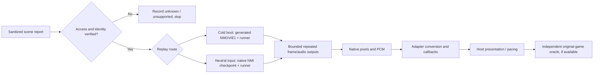

# Phase 23: Reproduce and report a scene - Research

**Researched:** 2026-10-30  
**Domain:** C runner, deterministic fixtures, reproduction documentation and output-layer triage  
**Confidence:** HIGH for in-repository contracts; MEDIUM for external frontend boundaries

<user_constraints>
## User Constraints (from CONTEXT.md)

### Locked Decisions

The owner selected all relevant areas and delegated resolution: use focused
subagents, examine relevant roles and adversarial alternatives, synthesize a
coherent recommendation, and follow it without routine preference questions.
Three specialist reviews and bounded follow-ups covered report/privacy,
replay/controls and triage/progress safety. Existing milestone discovery was
reused; no broad ecosystem sweep or runtime campaign was needed. These are
planning constraints, not new runtime verification.

### One report route with explicit evidence limits

- **D-01:** Prefer one canonical `docs/reproduction.md` with the copyable player
  report first, a completed permitted-fixture example, then developer replay and
  triage. Link directly from README troubleshooting and the relevant runner,
  testing and progress guides. Keep detailed runner/API/progress contracts at
  their existing canonical homes; link rather than duplicate them. Equivalent
  naming is planner discretion. No docs framework or issue-service automation.
- **D-02:** The report records title/region/content revision or digest; actual
  loaded core/build and host/version/launch route; exact scene and verified
  access method; ordered inputs and ports; expected and observed behavior;
  repeatability, start conditions, relevant settings, and untried conditions.
  Distinguish a title-level observation from reaching the exact reported scene.
  An unreached scene or failed access attempt is not scene acceptance evidence.
- **D-03:** Allow explicit unknown, withheld, not tried and unavailable values.
  A useful observation need not already be a deterministic reproduction. Label
  its limits; do not invent identity, assume a known menu version proves the
  loaded module, or make a player supply a hardware diagnosis. Required identity
  checks must succeed before claiming qualified executable checkpoint replay.
- **D-04:** Use digests and sanitized build/release/source identities as public
  metadata; keep personal module paths, device/account/connection identifiers,
  commercial media, saves, checkpoints, raw captures/traces and raw private logs
  local and outside public Git/CI artifacts. The permitted worked example
  includes its content digest. A commercial digest may be shared as metadata;
  when withheld, retain it locally and report the limit explicitly. A digest
  distributes no ROM bytes and does not establish permission to share artifacts.
- **D-05:** Expected behavior needs provenance: source, scene, content revision/
  region and confidence. Record known original quirks when documented. Unknown-
  provenance video or remembered behavior is a lead, not a hardware oracle.
  Retain existing commercial observations/access limits in their dated evidence
  files; this phase does not relabel them as diagnosed or fixed.

### Supported replay demonstrations, not a new replay engine

- **D-06:** Demonstrate cold-boot input-movie replay and supported native
  checkpoint continuation as separate, explicitly described routes. Current
  `--movie` plus `--load-state` is unsupported. Use a neutral-input continuation
  where necessary; do not imply arbitrary recorded non-neutral input resumes
  through that CLI combination. No runtime expansion solely to hide this limit.
- **D-07:** Reuse owned/permitted fixtures and existing generators/controls.
  Inspect `tests/roms/manifest.txt` before choosing assets. The existing played
  movie/boot-to-play controls and owned NMI checkpoint fixture are candidates,
  not a requirement to create another ROM or framework. Generated owned ROMs
  remain disposable build/scratch outputs; commit no new binary asset.
- **D-08:** Public examples must work from the public checkout and documented
  build facilities without local private helpers or media. Existing owned test
  targets may be documented with their build and invocation steps; do not assume
  they ship in release archives. Demonstrate any remaining access/orchestration
  gap before writing a small owned helper. Keep it local to this example and
  reuse C/CMake/CTest and platform facilities; no new core dependency or daemon.
- **D-09:** Repeat identical runs and compare explicitly identified frame and
  audio outputs. Loaded-state frame numbers are absolute: resume after K through
  end frame N, not N additional frames. Compare audio from the same suffix and
  boundaries; a whole cold-boot audio hash cannot equal a shorter resumed window
  by assumption. Native pixels, RGB dumps, transition streams and PCM are
  different representations and need separately named comparisons.
- **D-10:** Credit existing input-sensitive and stale/omitted-load controls
  when they establish the exact invariant; do not duplicate them for a new
  documentation claim. The control must detect an independently chosen wrong
  input or continuation, rather than just compare two equally idle runs. Current
  output hashes show repeatability; guest markers or independent expectations
  establish their own narrower properties, not general hardware correctness.
- **D-11:** Preserve NMOVIE1 validation, two-port masks and current option/error
  semantics. Do not call the runner a recorder. Explain the supported generation
  route and default/neutral inputs. Treat recording from a host, converting
  foreign movies, and checkpoint-plus-movie continuation as unsupported unless
  a distinct existing supported route is actually demonstrated.

### Scratch isolation, identity and finite bounds

- **D-12:** Every executable example states an explicit finite frame cap and
  outer wall-time bound, checks completion/required outputs, and uses a fresh
  scratch root with deliberate paths. Document the actual timeout mechanism;
  the runner has no intrinsic wall-clock timeout. Reuse CMake/CTest timeouts
  where suitable, including for public orchestration. A timed-out, stopped,
  truncated or missing-output run is not a successful replay.
- **D-13:** Keep save/state/config/output paths isolated from daily progress.
  Never point examples at active host directories, auto-load slots, other-core
  storage or private content. The safest fixture route avoids battery writes
  where unnecessary. If battery storage is involved, use disposable copies and
  retain the newest independent backup outside every active example path.
- **D-14:** Carry forward exact-core-build/content snapshot support, separate
  newest-battery backup and host-owned container/config policy from Phase 22.
  Loading a valid older state can replace newer battery RAM. Neither successful
  load nor matching state format establishes cross-build compatibility.
- **D-15:** Before replay, verify required identity and native payload/container
  type. Wrong, unknown or unverifiable pairing gets a clear unsupported/stop
  result; do not rename a RetroArch disk state into a native payload or silently
  substitute a checkpoint. Distinguish this procedure's preflight policy from
  loader enforcement: the native loader does not enforce exact core build or
  behavior revision. Preserve documented runner refusal/read/usage exits; do not
  invent a new runner unsupported exit code.

### Triage by output layer and oracle

- **D-16:** The guide routes evidence through identified scene/access and input,
  native pixels/audio, adapter conversion/callback output, host presentation,
  then independently supported original-game behavior. Each branch states what
  was compared, what it suggests, what remains unknown and the next bounded
  evidence source. This is a decision guide, not a requirement to run every
  layer or require new owner play for each report.
- **D-17:** Native/adapter agreement covers only the measured outputs. It does
  not prove that a frontend delivered intended inputs, accepted/presented each
  callback, avoided dropped/doubled frames or resampled audio correctly. Use
  existing adapter conversion and host progression evidence with their limits;
  add instrumentation only for a demonstrated required gap.
- **D-18:** Screenshots are host RGB evidence, affected by conversion, scaling,
  shaders, crop, capture timing and encoding. Record relevant settings and the
  capture path in sanitized terms. Without aligned frames and known transforms,
  comparisons are qualitative; they cannot be equated to native hashes. Audio
  pacing, synchronization and devices similarly remain host-owned concerns.
- **D-19:** A hardware correctness claim needs an independent oracle appropriate
  to the specific fault: documented hardware behavior, suitable measured hardware
  evidence or an independently derived fixture expectation. A released reference
  emulator can provide comparison evidence with its identity/limitations, not
  automatic hardware authority. Never inspect GPL/LGPL emulator source. If no
  adequate oracle or reproducible access exists, retain the unclassified result.

### Focused verification and workflow boundaries

- **D-20:** Machine-verifiable public examples and any unique negative controls
  belong in existing CMake/CTest paths. Check actual commands, required fields,
  links and safety/unsupported claims; prose-token presence alone is not replay
  evidence. Reuse existing document-check patterns without broad merged-corpus
  searches, self-confirming expected snapshots or weakening unique assertions.
- **D-21:** Documentation-only changes use relevant executable document/package/
  fixture checks. A necessary runtime behavior change first demonstrates its
  gap, then carries an owned regression, README/public-header comments and
  `cmake --workflow --preset ci`. Preserve pinned hashes, protected PASS keys,
  no-skip and performance gates. No unrelated expensive campaign reruns.
- **D-22:** Preserve all live-testing stops, budgets, collector/platform debt
  and private-artifact boundaries. No live host/device operation, commercial
  replay, recurring collector repair, release, push or PR is authorized by this
  discussion. Stop after context/log/state capture; planning is the next step.

### Agent discretion and evidence still to obtain

The planner chooses concise headings, exact fixture/frame budgets, existing
public generator entry points, scratch orchestration and focused test grouping.
Prove the clean-checkout commands, same-window audio comparison, input/wrong-
continuation controls and identity/container preflight during implementation.
Do not describe these as newly verified by this discussion. There are no
unresolved owner choices; escalate only an actual requirement conflict or new
scope/authority decision, not routine implementation preferences.

### Deferred Ideas (OUT OF SCOPE)

Accuracy repairs/scene-fix acceptance, DMA work, overscan, regions/mappers,
Playstead integration, generic recording or replay engines, movie/state conversion,
checkpoint-relative non-neutral movie support, cross-build compatibility promises,
collector repair and new live campaigns remain separate scopes.

#### Reviewed Todos (not folded)

- `.planning/todos/pending/2026-10-26-add-reproducible-owned-property-tests.md` — keyword match only; the broad helper/shrinking proposal adds no demonstrated REPRO gap. Reuse existing controls. It remains proposed, unlinked and incomplete.

Other previously deferred mutation/signal proposals remain untouched. This
discussion adds no requirement, campaign budget or risk acceptance for them.
</user_constraints>

<phase_requirements>
## Phase Requirements

| ID | Description | Research Support |
|----|-------------|------------------|
| REPRO-01 | “A player can submit a sanitized scene report identifying the content revision/digest, actual core/build and host, scene/access route, inputs, expected/observed behavior, repeatability and untried conditions.” [VERIFIED: .planning/REQUIREMENTS.md:21] | Locked report fields and privacy/evidence rules in D-02–D-05; add required/unknown/withheld values to the player form and a fixture example. |
| REPRO-02 | “A developer can follow a bounded existing-runner/host recipe on a permitted fixture to replay recorded inputs from cold boot and a supported checkpoint and compare frame/audio outputs across repeated runs.” [VERIFIED: .planning/REQUIREMENTS.md:22] | Existing NMOVIE1 generator and cold movie runner route; existing NMI neutral checkpoint suffix/oracle test; focused repeated-run CLI wrapper is a demonstrated gap. |
| REPRO-03 | “A developer can run the documented reproduction in isolated scratch storage with explicit frame/time limits, keep private artifacts out of public output, and receive a clear stop or unsupported result for identity/container mismatches instead of silently using a wrong checkpoint.” [VERIFIED: .planning/REQUIREMENTS.md:23] | CTest scratch directory pattern and timeouts; native state policy vs loader behavior; add preflight instructions and ensure all public examples have an outer CTest bound. |
| REPRO-04 | “A developer can follow a documented triage route that separates native output, adapter conversion, host presentation and original-game behavior, and records repeatability separately from independently established correctness.” [VERIFIED: .planning/REQUIREMENTS.md:24] | Native conversion and libretro callback tests, official frontend boundary docs, and distinct oracle limits described below. |
</phase_requirements>

## Summary

**Primary recommendation:** Create the concise canonical reproduction guide selected in D-01, and build it around two separate fixture routes: cold-boot movie replay using the existing runner, and neutral-input native checkpoint continuation using the generated NMI fixture. Keep the player report first, then a worked permitted fixture record, bounded developer commands, identity/container preflight, and a layer-by-layer triage decision guide. [VERIFIED: .planning/phases/23-reproduce-and-report-a-scene/23-CONTEXT.md:30-35, 62-94]

The repository already has the inputs and most of the evidence: `runner.game_movie` creates the 600-frame `nesrunner-pos` movie; the runner replays a movie from power-on; and `runner.state.nmi_roundtrip` compares a resumed frame and same-suffix transition/PCM hashes against an uninterrupted neutral-input reference. The checkpoint test is registered with an outer CTest timeout, and `runner.state.nmi_wrong_load` has stale and omitted-load guest-marker controls. [VERIFIED: tests/runner/game_movie.c:5-17, 51-67; runner/main.c:1185-1237; tests/cmake/runner_state.cmake:218-273, 293-329; tests/CMakeLists.txt:325-356, 338-339]

There is one concrete implementation gap to plan for: the existing `runner.dump.nesrunner.play` uses the runner CLI for the movie but does not register a timeout or compare repeated cold-run audio hashes. `runner.write_hashes.cmake` checks the movie's frame/audio fields against its inventory, but its execution steps have no subprocess timeout and it runs this movie once. Add a narrowly scoped CTest wrapper or equivalent bounded existing-Ctest path that executes the public cold-run command twice, checks completion and the required named outputs, and compares both frame and audio output. Preserve the existing input-sensitive `runner.boot_to_play` controls and NMI wrong-continuation controls instead of inventing duplicates. [VERIFIED: tests/CMakeLists.txt:1884-1932, 1593-1604; tests/cmake/write_hashes.cmake:139-179; tests/runner/test_boot_to_play.c:362-457, 673-725]

## Architectural Responsibility Map

| Capability | Primary Tier | Secondary Tier | Rationale |
|------------|-------------|----------------|-----------|
| Player report and evidence limits | Documentation / user workflow | — | Capture the scene, identity, access, inputs and uncertainty without requiring the player to diagnose hardware. [VERIFIED: .planning/phases/23-reproduce-and-report-a-scene/23-CONTEXT.md:36-58] |
| Cold movie replay and native checkpoint replay | Runner / native core | CMake/CTest | The runner owns `NMOVIE1`, frame/audio hashes and native states; CTest owns build-tree fixture setup and outer bounds. [VERIFIED: docs/runner.md:230-238, 289-305; tests/CMakeLists.txt:325-356] |
| Native-to-adapter comparison | Libretro adapter | `libretro.host` test | The test host records callbacks and compares selected output with direct runner/core evidence; it has no display or audio device. [VERIFIED: tests/CMakeLists.txt:1806-1822; docs/testing.md:1207-1228] |
| Frontend presentation and original-game correctness | Host / independent oracle | Documentation | The core cannot establish frontend pacing/presentation or hardware correctness from hash agreement alone. [CITED: https://docs.libretro.com/development/cores/developing-cores/; https://docs.libretro.com/guides/optimal-vsync/; VERIFIED: docs/testing.md:633-643] |

## Project Constraints (from AGENTS.md)

- Keep emulation and test code owned here; `libretro.h` is the sole vendored file and the core links only C memory functions. [VERIFIED: AGENTS.md:25-26; quote: “`libretro.h` is the only vendored file. The core library links only the C memory functions.”]
- Keep exactly the library, headless runner and libretro adapter deliverables; do not add window, audio-device or input-device code. [VERIFIED: AGENTS.md:27-28; quote: “Library, runner, libretro adapter. No window, audio-device or input-device code.”]
- Commit no ROM/BIOS bytes beyond entries in `tests/roms/manifest.txt`; keep personal paths, names and email addresses out of the tree. [VERIFIED: AGENTS.md:29-31; quote: “No ROM or BIOS bytes except test ROMs listed in `tests/roms/manifest.txt`. No personal paths, email addresses or names.”]
- Work clean-room from hardware documentation and test behavior. Do not open or retain GPL/LGPL emulator source; reference emulators are allowed only as released binaries. [VERIFIED: AGENTS.md:33-35; quote: “Do not open GPL or LGPL emulator source, and keep no copy of it in the workspace; reference emulators run only as released binaries.”]
- Preserve deterministic integer-only core behavior and per-instance state. [VERIFIED: AGENTS.md:36-37; quote: “Integer-only. All state lives in the instance. The same inputs give the same frame and audio hashes on every platform.”]
- A behavior change needs its owned regression, README and public-header comment updates, and `cmake --workflow --preset ci`; automated checks must not wait for a person. Documentation-only work should use relevant focused doc/package/fixture checks per D-21. [VERIFIED: AGENTS.md:38-41; quote: “Every behaviour change lands with a test run by `cmake --workflow --preset ci`, and the README and the public header's comments are updated in the same change. Checks are automated; none waits on a person.”; .planning/phases/23-reproduce-and-report-a-scene/23-CONTEXT.md:153-157]
- Use one GSD step per command and stop at the required phase boundary; inside an authorized step, do not ask for routine confirmations. [VERIFIED: AGENTS.md:42-45; quote: “Run one GSD step per command, then stop and report what finished and what comes next. Inside a step, proceed without asking for routine confirmations.”]
- Read the preparation index and its referenced subsystem notes before subsystem work. Keep personal connection details, identifiers and raw artifacts outside Git; keep scene-first observations scoped and mark uncertain comparisons. [VERIFIED: AGENTS.md:18-21, 81-90; quote: “Keep connection details, identifiers, personal paths and raw private artifacts outside Git; record only sanitized lessons and scoped observations.”]
- No live host/device operation, commercial replay, release, push or PR is authorized for this phase. [VERIFIED: .planning/phases/23-reproduce-and-report-a-scene/23-CONTEXT.md:158-161; quote: “No live host/device operation, commercial replay, recurring collector repair, release, push or PR is authorized by this discussion.”]

## Standard Stack

| Component | Version / contract | Purpose | Guidance |
|-----------|--------------------|---------|----------|
| C | C17, no compiler extensions | Owned fixture helpers and test wrappers where needed | Reuse existing source targets; no runtime library dependency is indicated. [VERIFIED: CMakeLists.txt:10-14; quote: `set(CMAKE_C_STANDARD 17)` and `set(CMAKE_C_EXTENSIONS OFF)`] |
| CMake + CTest | Minimum CMake 3.25; `ci` configure/build/test presets | Clean source checkout, generated fixtures, target builds and bounded test orchestration | Keep generated ROMs, movies, state files and captures under the isolated build/scratch root. [VERIFIED: CMakeLists.txt:1; CMakePresets.json:1-22, 67-80] |
| Existing runner and test fixtures | `nesturbator-run`, `runner.game_movie`, `runner.nmi_fixture` | Cold input-movie replay and generated native checkpoint continuation | These are source-build targets; do not describe them as installed/release-archive tools. [VERIFIED: tests/CMakeLists.txt:313-324, 1563-1577; .planning/phases/23-reproduce-and-report-a-scene/23-CONTEXT.md:72-77] |

No external package is justified: the phase is a guide and focused CMake/CTest contract work, and AGENTS directs reuse of C, CMake/CTest and platform facilities before adding dependencies. [VERIFIED: .planning/phases/23-reproduce-and-report-a-scene/23-CONTEXT.md:72-77; AGENTS.md:60-68]

## Architecture Patterns

### Evidence flow



The diagram deliberately treats each output as a different evidence layer: a native hash does not identify the host RGB capture or prove what the frontend presented. [VERIFIED: docs/api.md:7; docs/testing.md:633-643, 1207-1228; CITED: https://docs.libretro.com/development/cores/developing-cores/]

### Recommended project structure

- Put the canonical guide at `docs/reproduction.md`, as D-01 prefers; link it directly from README troubleshooting and the runner, testing and progress guides. Keep detailed contract text in those existing owner guides. [VERIFIED: .planning/phases/23-reproduce-and-report-a-scene/23-CONTEXT.md:30-35; quote: “Prefer one canonical `docs/reproduction.md`”]
- Extend the existing `tests/CMakeLists.txt` and add one narrowly scoped script under `tests/cmake/` only if the cold movie repeatability/bound gap remains after checking the current generated test graph. Keep CTest negative controls specific to the unique invariant they prove. [VERIFIED: tests/CMakeLists.txt:1637-1644, 1884-1932; recommendation based on the missing repeated/bounded cold CLI contract noted above]

### Pattern 1: Separate cold boot and checkpoint routes

**What:** Use `runner.game_movie` to create the supported two-port movie for a fresh power-on run. Separately, use `runner.nmi_fixture` to generate an owned NROM image, write/load a native state at an absolute frame, and compare only the matching resumed suffix. Do not combine `--movie` with `--load-state`; do not imply that a non-neutral input timeline resumes through that unsupported option combination. [VERIFIED: tests/runner/game_movie.c:1-17, 101-129; tests/runner/nmi_fixture.c:146-187, 189-212; runner/main.c:585-590]

**When to use:** The movie route demonstrates recorded inputs from cold boot. The NMI route demonstrates a supported neutral-input native checkpoint continuation with a generated guest event marker and same-window audio. [VERIFIED: tests/cmake/runner_state.cmake:218-273]

**Example source excerpts:** The movie generator comment states `“nesrunner-pos      600 frames.”` and `“port 1 stays zero.”`; the checkpoint case invokes `“--load-state ... --frames 4”` and compares its `“audio transitions sha256”` and `“audio pcm sha256”` lines with a reference that starts its audio window at frame 2. [VERIFIED: tests/runner/game_movie.c:7-10; tests/cmake/runner_state.cmake:244-272]

### Pattern 2: Isolated and bounded source-checkout commands

The existing public scratch walkthrough establishes the platform-specific temp-root approach and build invocation. Its POSIX source commands include `“cmake --preset ci -B "$scratch/build"”`, `“cmake --build "$scratch/build" --target nesturbator-run runner.save_rom runner.state_mutate”`, and `“ctest --test-dir "$scratch/build" --output-on-failure --no-tests=error -R '^runner.save.roundtrip$'”`. [VERIFIED: docs/progress.md:90-113]

For Phase 23, replace the save-specific target/test selection with the movie and NMI fixtures. CMake defines `“add_executable(runner.game_movie runner/game_movie.c)”`, `“add_executable(runner.nmi_fixture”`, and `“runner_state_case(nmi_roundtrip)”`; this registers `“runner.state.nmi_roundtrip”` with `“TIMEOUT 60”` through the state-case template. [VERIFIED: tests/CMakeLists.txt:313-324, 325-356; the template is `“add_test(NAME runner.state.${case}` at lines 325-339.]

The cold runner movie case has no `TIMEOUT` at its registration. Add an explicit test-level deadline before documenting it as a bounded executable example; the existing 600-frame `runner.boot_to_play` test uses a finite `TIMEOUT 300`, but that does not itself bound the separate runner CLI invocation. The movie’s fixed frame count and the CTest deadline together provide frame and wall-time bounds. [VERIFIED: tests/CMakeLists.txt:1593-1604, 1919-1926; tests/runner/game_movie.c:7-10]

### Pattern 3: Layered triage with an independent oracle

1. Confirm the report reached the exact scene and that content/core/build/access identity is known. If not, retain an observation with unknown or unsupported status.
2. Compare native frame hashes and native audio transition/PCM hashes across the same bounded input interval. This establishes repeatability for those representations only.
3. Compare adapter conversion and callbacks using `host.convert` and `libretro.host` coverage. The conversion test checks palette indexing and pitch; the host test checks callback behavior against direct core PCM, not an audio device. [VERIFIED: tests/host/test_convert.c:1-64; docs/testing.md:1221-1228]
4. Investigate host RGB captures/pacing only with settings and capture path recorded; without frame alignment and known transforms, treat screenshot comparison as qualitative. [CITED: https://docs.libretro.com/guides/optimal-vsync/; VERIFIED: .planning/phases/23-reproduce-and-report-a-scene/23-CONTEXT.md:134-138]
5. Claim original-game correctness only against an independent oracle appropriate to the behavior. Cross-platform hash equality and runner/adapter parity are not hardware oracles. [VERIFIED: docs/testing.md:633-643; .planning/phases/23-reproduce-and-report-a-scene/23-CONTEXT.md:139-144]

### Anti-patterns to avoid

- Do not call `runner.game_movie` a recorder or suggest it ships in release archives. It is an owned build target that writes movie files during test/build-tree use. [VERIFIED: tests/CMakeLists.txt:1563-1577; quote: `“add_executable(runner.game_movie runner/game_movie.c)”`]
- Do not report a successful native state load as proof of exact build or host-container compatibility. The API says the supported pairing is the exact core build/content, while the loader checks payload format/cartridge identity and leaves behavior revision unenforced. [VERIFIED: docs/api.md:157-165; quote: “This is support guidance, not an additional loader check.”]
- Do not infer original-game correctness from hashes, a captured screen, or a reference emulator alone; name the independent oracle and its limits. [VERIFIED: docs/testing.md:633-643; CITED: https://docs.libretro.com/development/cores/developing-cores/]

## Don't Hand-Roll

| Problem | Don't Build | Use Instead | Why |
|---------|-------------|-------------|-----|
| Input recording/replay | A generic recorder, foreign movie converter or new replay engine | Existing `NMOVIE1` format, `runner.game_movie`, and runner movie parser | The locked phase scope explicitly reuses the existing owned format and preserves its validation and option semantics. [VERIFIED: .planning/phases/23-reproduce-and-report-a-scene/23-CONTEXT.md:60-94] |
| Native checkpoint format | A new state format or state/movie adapter | `runner.nmi_fixture`, runner `--state-at-frame`/`--load-state`, and current native state API | Current code already verifies exact frame continuation, guest markers and same-suffix audio. [VERIFIED: tests/cmake/runner_state.cmake:218-273] |
| Dependency for documentation/test orchestration | A docs framework, daemon or test package | Existing CMake/CTest and standard/platform shell facilities | The project prefers the standard library/platform before a dependency, and no unmet need for an external package has been demonstrated. [VERIFIED: AGENTS.md:60-68; .planning/phases/23-reproduce-and-report-a-scene/23-CONTEXT.md:72-77] |

**Key insight:** The difficult part is evidence ownership and bounds, not parsing a new media format. Existing fixtures already create meaningful input and checkpoint controls; focus new code on the demonstrated repeated-cold-run orchestration gap and executable documentation contracts. [VERIFIED: tests/runner/game_movie.c:1-17; tests/cmake/runner_state.cmake:218-329]

## Common Pitfalls

### Comparing mismatched continuation windows

**What goes wrong:** A cold-run whole-audio digest is compared with only the audio emitted after state load, or a requested frame count is interpreted as “N more frames.” **Why:** Runner frame numbers are absolute; after a load at K the loop runs K+1 through N. **How to avoid:** State the checkpoint frame K and final frame N, and compare native frame and audio hashes over an identical named suffix. The existing NMI test uses frame 1 through final frame 4 and hashes the uninterrupted reference audio from frames 2–4. **Warning sign:** The compared outputs include different frame/audio boundaries. [VERIFIED: docs/runner.md:230-238; runner/main.c:819-853, 1185-1212; tests/cmake/runner_state.cmake:244-272]

### Treating test pass as build/container identity

**What goes wrong:** A payload that parses is treated as a supported checkpoint from the exact executing build, or a host-specific disk container is renamed and loaded as a native state. **Why:** Native loader checks format and cartridge identity but does not enforce exact build/behavior revision and has no host-container contract. **How to avoid:** Preflight core/build/content and native-vs-host container identity before replay; stop as unsupported on unknown/mismatched pairing while preserving existing runner statuses. **Warning sign:** A guide infers compatibility from a matching state format or successful load. [VERIFIED: docs/api.md:157-165; runner/exit_status.h:13-20]

### Unbounded or incomplete example

**What goes wrong:** The runner gets a finite frame count but no wall deadline, or timeout/truncation/missing output is described as successful. **Why:** The runner has no intrinsic wall-time timeout; CTest only bounds a case when that property is set. The cold movie target currently lacks that property. **How to avoid:** Put the complete public orchestration under an explicit CTest `TIMEOUT`, verify successful exit and all required frame/audio outputs, and document that timeout as the outer wall bound. **Warning sign:** A guide relies on an unspecified shell timeout or says the run passed after stopping early. [VERIFIED: .planning/phases/23-reproduce-and-report-a-scene/23-CONTEXT.md:98-103; tests/CMakeLists.txt:1919-1926; tests/cmake/runner_state.cmake:19-28]

### Overstating adapter or host evidence

**What goes wrong:** Native/adapter frame agreement is described as proof of frontend input, display timing, dropped-frame behavior, or audio-device synchronization. **Why:** `libretro.host` invokes callbacks in a test program and compares selected callback results; the frontend owns pacing and presentation. **How to avoid:** Report separate outcomes for native pixels/PCM, adapter conversion/callback, host capture/pacing, and original behavior. **Warning sign:** A screenshot is equated to a native hash without aligned frames and transforms, or callback parity is called a real-host playback result. [VERIFIED: tests/CMakeLists.txt:1806-1822; docs/testing.md:1207-1228; CITED: https://docs.libretro.com/development/cores/developing-cores/; https://docs.libretro.com/guides/optimal-vsync/]

### Sanitization that omits uncertainty or leaks local artifacts

**What goes wrong:** The public record implies a scene was reached when access failed, assumes a menu version identifies the loaded module, or includes raw private paths/captures/saves. **How to avoid:** Use explicit unknown/withheld/not-tried fields, distinguish title-level from exact-scene evidence, share permitted metadata digests only, and keep private artifacts local. **Warning sign:** There is no route to record unavailable identity or an unreached scene. [VERIFIED: .planning/phases/23-reproduce-and-report-a-scene/23-CONTEXT.md:36-58; AGENTS.md:81-90]

## Code Examples

### Clean-checkout fixture build and checkpoint controls

The existing documented clean-root pattern creates a fresh scratch tree, configures the `ci` preset, and builds named test targets; the Phase 23 target names and case registration are in CMake. [VERIFIED: docs/progress.md:90-113; tests/CMakeLists.txt:313-324, 325-356; quote: `“runner_state_case(nmi_roundtrip)”`, `“runner_state_case(nmi_wrong_load)”`, `“TIMEOUT 60”`]

```sh
scratch="$(mktemp -d "${TMPDIR:-/tmp}/nesturbator-repro.XXXXXX")"
cmake --preset ci -B "$scratch/build"
cmake --build "$scratch/build" --target nesturbator-run runner.game_movie \
  runner.nmi_fixture runner.save_rom runner.state_mutate
ctest --test-dir "$scratch/build" --output-on-failure --no-tests=error \
  -R '^runner\.state\.nmi_roundtrip$'
ctest --test-dir "$scratch/build" --output-on-failure --no-tests=error \
  -R '^runner\.state\.nmi_wrong_load$'
```

This example covers the existing checkpoint same-suffix and wrong-continuation contracts. It is not a substitute for the planned bounded repeated cold-run wrapper. The current progress guide provides the PowerShell temp-root/build equivalent; keep platform-specific scratch setup alongside any POSIX sample. [VERIFIED: docs/progress.md:90-113; tests/cmake/runner_state.cmake:218-329]

### Permitted fixture digest for a worked report

The manifest entry reads `“tests/roms/runner.nes ... MIT ... 1a67bfabdde2d96eacb04eb7f9d17e8da6c082d4976c318315fe31e2d19b4384”`. A public worked example may include that fixture’s SHA-256 as metadata, while keeping generated screenshots, raw logs and state files out of public output. The manifest also notes that its credits screen contains third-party handles as game text; do not copy those into report examples. [VERIFIED: tests/roms/manifest.txt:23-24]

```text
Content fixture: tests/roms/runner.nes
Content SHA-256: 1a67bfabdde2d96eacb04eb7f9d17e8da6c082d4976c318315fe31e2d19b4384
Core/build identity: <sanitized release/build ID or unknown>
Host/version/launch route: <sanitized values or unknown>
Scene reached: <exact scene, or title-level only>
Access method and ordered port inputs: <verified route, or unavailable>
Expected behavior/source/confidence: <specific evidence, or unknown>
Observed behavior/repeat count: <observed result, or not tried>
Relevant settings and untried conditions: <values, withheld, or not tried>
Artifacts retained locally: <types only; no private paths or raw artifacts>
```

**Note:** That is a sanitized report shape, not a runtime result or an assertion that a particular host scene was played during research. [VERIFIED: .planning/phases/23-reproduce-and-report-a-scene/23-CONTEXT.md:36-58; no emulator runtime run was performed in this research.]

## State of the Art

| Existing contract | Current implication for Phase 23 |
|-------------------|----------------------------------|
| `NMOVIE1` is the runner’s existing fixed two-port input movie. | Document its generated-file route and validation; do not add recording or conversion. [VERIFIED: docs/runner.md:289-305; tests/runner/game_movie.c:101-129] |
| Native state support is policy-bound to the exact creating build and content; the loader enforces a narrower payload/cartridge check. | Require explicit preflight and preserve unknown/unsupported outcomes. [VERIFIED: docs/api.md:157-165] |
| CTest fixtures already create private build-tree artifacts and some cases define per-test TIMEOUT. | Reuse that isolation; add a deadline to the cold CLI route and any new wrapper. [VERIFIED: tests/CMakeLists.txt:325-356, 1593-1604, 1919-1932] |

No external package, framework, or new movie/state format is part of this phase. [VERIFIED: .planning/phases/23-reproduce-and-report-a-scene/23-CONTEXT.md:60-94]

## Environment Availability

Read-only probes in the research environment found:

| Dependency | Required by | Available | Observed version | Fallback |
|------------|-------------|-----------|------------------|----------|
| CMake | Configure/build/CTest | Yes | 4.4.3 | None needed locally; project minimum is 3.25. |
| Ninja | `ci` preset generator | Yes | 1.13.2 | Use a configured generator supported by the checkout if unavailable elsewhere; confirm before documenting. |
| CTest | Bounded test orchestration | Yes | 4.4.3 | None needed locally. |
| C compiler | C17 owned targets | Yes | Apple clang 21.0.0 | CI-supported toolchain required for other platforms. |

No configure, build, test, emulator, host or device runtime was invoked during research. The observed local versions are availability evidence, not a minimum-version support claim. [VERIFIED: read-only `cmake --version`, `ninja --version`, `ctest --version`, `cc --version` probes; CMake minimum from CMakeLists.txt:1]

## Assumptions Log

| # | Claim | Section | Risk if Wrong |
|---|-------|---------|---------------|
| A1 | The selected cold route reuses the existing runner and movie generator, with one example-local CMake/CTest wrapper for the source-inspected repeat/comparison/deadline gap. | Summary / Pattern 2 / resolved question 1 | Plan 23-01 checks the generated test graph before adding the helper and reuses an exact existing route if discovered; that execution guard does not reopen the selected architecture. |
| A2 | Plan 23-01 selects two 600-frame cold runs, a 10-second generator limit, 60 seconds per runner and a 180-second outer CTest limit. No runtime timing was gathered during research or planning. | Pattern 2 / 23-01-PLAN.md | Implementation must measure completion under the explicit limits and retain timeout/failure evidence; these are operational bounds, not a measured performance claim. |

## Resolved Research Questions

1. **RESOLVED — How will the public cold-movie route provide repeated output comparison and a finite deadline?**
   - Source evidence: `runner.dump.nesrunner.play` runs the runner CLI on the generated positive movie but has no explicit timeout; `runner.write_hashes` collects one cold movie’s selected frame and whole-run audio hashes without a process timeout. The bounded `runner.state.nmi_roundtrip` covers a different, neutral checkpoint route. These inspected candidates do not supply the combined repeated-cold frame/audio/deadline contract. [VERIFIED: tests/CMakeLists.txt:1884-1932; tests/cmake/write_hashes.cmake:139-179; tests/cmake/runner_state.cmake:218-273]
   - Selected approach: Plan 23-01 reuses `runner.game_movie` and the existing runner for two 600-frame `nesrunner-pos` executions, compares ordered native-frame records and separately named transition/PCM output, and bounds the public orchestration through CTest. One narrow owned CMake wrapper closes only the demonstrated orchestration gap; no replay engine, recorder or runtime option expansion is selected. Per D-08, inspect the generated test graph before creating it and reuse an exact existing route if one is found.
   - Implementation obligations: Prove the clean-scratch commands, successful completion under the selected limits, matching required outputs and changed/missing-output controls. Those are pending execution evidence, not unresolved architecture questions or claims that planning ran the recipe.

2. **RESOLVED — What identity evidence qualifies the native checkpoint recipe?**
   - Source evidence: Native loader checks are narrower than exact-build/content support policy; behavior revision is recorded but unenforced, and host disk containers are outside the native API. The existing NMI case creates its checkpoint with the same executing runner and generated ROM in one invocation. No generic installed-host identity API is assumed. [VERIFIED: docs/api.md:157-165; runner/exit_status.h:13-20; tests/cmake/runner_state.cmake:218-273]
   - Selected policy: Plan 23-02 records the SHA-256 identities of the actual creating runner executable, ROM and generated state at creation, together with known runner-native origin. Before qualified replay, require all recorded identities to be present and verifiable, match the current files and retain known native provenance. Unknown, missing, changed or mismatched identity, or host/unknown container origin, stops with an explicit procedure-level unsupported result. Recomputing recorded metadata after a change cannot qualify an old checkpoint. This example-local preflight neither authenticates hostile metadata nor changes native loader enforcement or runner exit codes, per D-03 and D-14–D-15.
   - Implementation obligations: Exercise the same-invocation permitted-fixture route and independent bad-metadata/container controls before publishing successful recipe results. Reports can still record unknown or withheld identity honestly; those reports do not qualify executable checkpoint replay. Clean-scratch runtime evidence remains pending and does not require a new owner decision.

No research design or policy question remains open. The five unresolved spec-less probe edges and descriptor-less prohibition verification flags in the plans are separate explicit workflow assumptions; this research reconciliation does not resolve or remove them.

## Sources

### Primary repository sources (HIGH confidence)

- `.planning/phases/23-reproduce-and-report-a-scene/23-CONTEXT.md` — locked scope, privacy, route separation, bounds, and evidence limits.
- `.planning/REQUIREMENTS.md` — REPRO-01 through REPRO-04 and acceptance boundaries.
- `AGENTS.md`, `.planning/preparation/README.md`, `.planning/preparation/LIBRETRO-AND-RUNNER.md`, `.planning/preparation/ENGINEERING.md` — project ownership, clean-room and build constraints.
- `runner/main.c`, `runner/movie.c`, `runner/state_file.c`, `runner/exit_status.h`, `docs/runner.md`, `docs/api.md` — current movie/state modes, output, frame bounds and statuses.
- `tests/CMakeLists.txt`, `tests/runner/game_movie.c`, `tests/runner/nmi_fixture.c`, `tests/cmake/runner_state.cmake`, `tests/runner/test_boot_to_play.c`, `tests/cmake/write_hashes.cmake` — generated fixture commands, controls, timeout registrations and comparison coverage.
- `tests/roms/manifest.txt`, `tests/host/test_convert.c`, `tests/libretro/libretro_host.c`, `tests/retroarch/run_retroarch.cmake`, `docs/testing.md`, `docs/progress.md` — permitted fixture identity, adapter/host limits, scratch procedure and existing host evidence.

### Official external sources (MEDIUM confidence)

- [Libretro Core Development Overview](https://docs.libretro.com/development/cores/developing-cores/) — core/frontend callback and synchronization boundary; no installed-host procedure inferred.
- [RetroArch Optimal VSync Performance](https://docs.libretro.com/guides/optimal-vsync/) — frontend timing and presentation affect audio/video synchronization; no host operation was run.
- [RetroArch Dynamic Rate Control](https://docs.libretro.com/development/cores/dynamic-rate-control/) — frontend audio/video rate relationship; used only to motivate distinct host-level evidence.
- [CMake 3.25 `cmake(1)` manual](https://cmake.org/cmake/help/v3.25/manual/cmake.1.html) — official command-line tool documentation consulted for portable checksum facilities.

## Metadata

**Confidence breakdown:**
- Standard stack: HIGH — current CMake configuration and presets were read; no package dependency is needed.
- Architecture: HIGH — runner, fixture, adapter and CTest ownership is explicit in current source; MEDIUM for external frontend behavior, which is cited from official docs.
- Pitfalls: HIGH — mode incompatibility, frame arithmetic, output window and timeout gaps are visible in current source/tests.

**Research date:** 2026-10-30  
**Valid until:** 2026-11-29 for repository contracts; recheck external frontend docs if the guide later prescribes a host-specific workflow.
