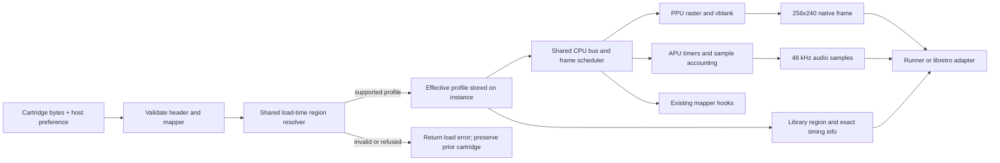

<user_constraints>
## User Constraints (from CONTEXT.md)

### Locked Decisions

DATA_4F8A2D91_START
- **D-01:** The host supplies an `Auto`, `NTSC`, or `PAL` preference for each content load. The host owns persistence, including any per-game setting; the core does not add a preference store.
- **D-02:** Explicit single-region NES 2.0 metadata is authoritative. For multi-region NES 2.0 and legacy iNES, `Auto` resolves to NTSC and an explicit host preference may select NTSC or PAL. Dendy is refused; a host preference cannot treat it as PAL.
- **D-03:** Resolve the effective region during content load and hold it fixed until unload/reload. A changed host option applies to the next load, so emulation clocks and host-reported region cannot diverge during a session.
- Keep selection policy consistent across the library, runner, and libretro adapter through the existing core seams. Planning should choose the smallest API representation that fits the current size-tagged C API and adapter lifecycle; do not add a dependency or a separate region policy in each deliverable.

### PAL output and timing
- **D-04:** Preserve the public 256×240 frame-buffer contract for PAL in both the library and libretro adapter. Do not change callers to 256×239.
- **D-05:** Keep PAL's internal raster/vblank timing separate from output-buffer height. Before defining visual expectations, use pinned permitted sources and/or an owned fixture to establish how the documented 239-line PAL picture is represented at row 239. Do not guess or claim hardware verification.
- **D-06:** Use the exact integer/rational PAL cadence and retain deterministic frame/sample accounting; do not round the frame rate to 50 Hz. Select the matching PAL CPU/PPU/APU cadence and frequency tables across all six currently supported mapper families.
- Protect established NTSC frame, audio, palette, and mapper behavior throughout the phase. Phase 25 must not absorb the 2A07 DMA model or regional state continuation (Phase 26), nor PAL palette/host-presentation completion (Phase 27).
DATA_4F8A2D91_END

### the agent's Discretion

DATA_B57130CE_START
- Choose concrete API field names, option plumbing, and implementation slices using existing C/library/runner/libretro patterns while preserving D-01 through D-06 and the existing load-failure guarantees.
- Use only owned or permitted fixtures, preserve the clean-room and integer-only rules, and keep dependencies unchanged.
DATA_B57130CE_END

### Deferred Ideas (OUT OF SCOPE)

DATA_39D4AC62_START
- The PAL row-239 visual semantics are an in-phase research/evidence task, not a preselected pixel behavior.
- Dendy, additional boards, libfuturo/Playstead integration, 2A07 DMA, regional state continuation, palette/presentation completion, and confirmed scene-specific fixes remain outside Phase 25 under the approved v8 phase boundaries.
- The three reviewed testing todos remain deferred and were not folded into this phase.
DATA_39D4AC62_END
</user_constraints>

<phase_requirements>
## Phase Requirements

| ID | Description | Research Support |
|----|-------------|------------------|
| REG-01 | DATA_1C670AF5_START A host can run supported content with one resolved NTSC or PAL profile: explicit single-region NES 2.0 metadata takes precedence; multi-region and legacy iNES content default to NTSC but accept an explicit host preference; Dendy content is refused. A host preference cannot contradict explicit single-region metadata. DATA_1C670AF5_END `[VERIFIED: .planning/REQUIREMENTS.md:13]` | Shared load-time resolver, exhaustive preference/metadata matrix, and unchanged loader failure guarantees. |
| PAL-01 | DATA_D02B8E41_START A player can run PAL content on each supported mapper family (0, 1, 2, 3, 4 and 7) with PAL CPU/PPU/APU cadence and frequency tables, producing independently checked PAL frame timing and audio pitch. DATA_D02B8E41_END `[VERIFIED: .planning/REQUIREMENTS.md:17]` | One per-instance regional timing profile; integer PAL bus/PPU cadence, sample remainder, APU tables, raster behavior, and independently derived tests for all six mapper families. |
</phase_requirements>

## Summary

The phase is an extension of the existing C17 core and its three current delivery paths. Put one policy resolver at the library cartridge-load boundary, latch the selected effective profile on the instance, and make frame scheduling, bus timing, PPU raster, APU tables, sample production, and host region reporting read that same selection. The host persists the preference; the core resolves it for each load. This follows the locked decisions and the inspected loader/adapter seams. `[VERIFIED: .planning/phases/25-region-selection-and-pal-timing/25-CONTEXT.md:16-26,74-88; src/cartridge.c:286-318; libretro/libretro.c:416-455]`

The supported PAL timing model can be expressed with integer ticks: 32 ticks per CPU bus cycle, 10 per PPU dot, 312 scanlines, and 341 dots per line; this gives 1,063,920 ticks per frame and the exact frame-rate fraction 322445/6448 (about 50.007 Hz). Retain sample-fraction remainder across frames; do not use a rounded 50 Hz clock. The resolved-question dispositions below establish physical row 239 as the active final picture row and translate the PAL APU event table into exact CPU-cursor/GET-PUT edges using pinned permitted sources. Their evidence limits, including source-assumed PAL $4017 write-delay equivalence, remain explicit. These source-derived models are not direct hardware proof. `[CITED: https://www.nesdev.org/wiki/Cycle_reference_chart; https://www.nesdev.org/w/index.php?title=PAL_video&oldid=23684; https://www.nesdev.org/w/index.php?title=APU_Frame_Counter&oldid=23448; https://github.com/emu-russia/breaks/blob/5a55bac/BreakingNESWiki_DeepL/PPU/pal.md]`

**Primary recommendation:** Implement a shared load-time resolver and immutable per-instance NTSC/PAL profile; route existing timing seams through it, then prove the region matrix, exact PAL timing and sample accounting, PAL APU pitch, PAL raster, mapper coverage, and NTSC regression with owned fixtures and independent arithmetic. Keep DMA/state continuation in Phase 26 and palette/presentation completion plus final NTSC acceptance in Phase 27. `[VERIFIED: .planning/phases/25-region-selection-and-pal-timing/25-CONTEXT.md:18-26; .planning/REQUIREMENTS.md:13,17-28; .planning/research/milestone-v8-pal/ARCHITECTURE.md:39-68,120-125]`

## Architectural Responsibility Map

| Capability | Primary Tier | Secondary Tier | Rationale |
|---|---|---|---|
| Region policy and effective-profile selection | API / Backend (shared C library) | Runner and libretro host adapters | Resolve once at the shared content-load boundary; adapters pass a preference and report the selected result. `[VERIFIED: .planning/phases/25-region-selection-and-pal-timing/25-CONTEXT.md:18-20,74-88]` |
| CPU, PPU, APU cadence and mapper-visible timing | API / Backend (emulation core) | — | Machine clock and subsystem state are per-instance core state; mapper implementations share the CPU/bus path. `[VERIFIED: .planning/phases/25-region-selection-and-pal-timing/25-CONTEXT.md:78-88; .planning/preparation/ARCHITECTURE.md:19-24]` |
| Frame/audio buffers and exact native rate metadata | API / Backend (library) | Libretro adapter | The library owns exact integer fractions and output buffers; the adapter converts the fractions at its API boundary. `[VERIFIED: include/nesturbator.h:236-245,247-253; libretro/libretro.c:232-255]` |
| Preference persistence and UI | Host / runner invocation | Library load call | The host owns persisted per-game preferences; the core accepts a load-time value and does not store preference policy. `[VERIFIED: .planning/phases/25-region-selection-and-pal-timing/25-CONTEXT.md:16-20]` |

## Standard Stack

### Core

| Library/tool | Version | Purpose | Why Standard |
|---|---|---|---|
| C | C17 | Core, resolver, timing profile, and owned tests | The current project selects required C17 with extensions disabled. `[VERIFIED: CMakeLists.txt:10-14]` |
| CMake and CTest | CMake minimum 3.25; existing project workflow | Build the library, runner, adapter, and tests | Existing build and test infrastructure already covers the deliverables; no new build system or dependency is needed. `[VERIFIED: CMakeLists.txt:1,55-80; AGENTS.md:37-53]` |
| Existing C fixture helpers | Current repository | Generate in-memory iNES/NES 2.0 inputs and execute guest code | Cartridge, frame, and APU tests already construct input bytes and code in memory, avoiding bundled commercial ROMs and extra packages. `[VERIFIED: tests/core/test_cartridge.c:31-44,68-91; tests/core/test_frame.c:44-65; tests/core/test_apu.c:13-26,39-59]` |

### Supporting

| Library/tool | Version | Purpose | When to Use |
|---|---|---|---|
| Existing test harness and CTest targets | Current repository | Resolver matrix, timing/accounting tests, APU pitch checks, PPU raster checks, adapter parity | Extend existing test targets and fixture builders. Do not add a testing dependency. `[VERIFIED: tests/core/test_cartridge.c:31-44; tests/core/test_frame.c:44-70; tests/core/test_apu.c:13-68]` |

Current language/build settings (verbatim):

DATA_CE2B0741_START
```cmake
project(nesturbator VERSION ${NESTURBATOR_VERSION} LANGUAGES C)

set(CMAKE_C_STANDARD 17)
set(CMAKE_C_STANDARD_REQUIRED ON)
set(CMAKE_C_EXTENSIONS OFF)
```
DATA_CE2B0741_END
`[VERIFIED: CMakeLists.txt:10-14]`

### Alternatives Considered

| Instead of | Could use | Tradeoff |
|---|---|---|
| A shared resolver plus one per-instance profile | Duplicated runner and libretro policy | Duplicated policy risks the profile and reported host region diverging; CONTEXT explicitly asks for one shared selection policy. `[VERIFIED: .planning/phases/25-region-selection-and-pal-timing/25-CONTEXT.md:18-20]` |
| Exact rational cadence | Rounded 50 Hz | Rounding produces a different frame count over time and violates the locked exact-rate/sample-accounting decision. `[CITED: https://www.nesdev.org/wiki/Cycle_reference_chart; VERIFIED: .planning/phases/25-region-selection-and-pal-timing/25-CONTEXT.md:25]` |
| Existing owned fixtures and tables | New package or external ROM bundle | A new package is disallowed absent demonstrated need; an external ROM bundle also conflicts with the project ownership and manifest rules. `[VERIFIED: AGENTS.md:37-53,74-82; .planning/phases/25-region-selection-and-pal-timing/25-CONTEXT.md:28-30]` |

**Installation:** None. This phase adds no external package. `[VERIFIED: .planning/phases/25-region-selection-and-pal-timing/25-CONTEXT.md:28-30; CMakeLists.txt:60-80]`

## Project Constraints (from AGENTS.md)

- Keep all emulation and test code owned by this repository; `libretro.h` is the only vendored file, and the core library links only the C memory functions. `[VERIFIED: AGENTS.md:37-38; CMakeLists.txt:60-79]`
- Keep the three existing deliverables (library, headless runner, libretro adapter); do not add window, audio-device, or input-device code. `[VERIFIED: AGENTS.md:39-40]`
- Keep the tree free of unapproved ROM/BIOS bytes and personal paths, names, or email addresses; use manifest-listed test ROMs only; commits use the GitHub noreply identity and hygiene check. `[VERIFIED: AGENTS.md:41-44]`
- Preserve the clean-room rule: implement from hardware documentation and test behavior; do not open GPL/LGPL emulator source or keep copies in the workspace. `[VERIFIED: AGENTS.md:45-47]`
- Keep the core integer-only and per-instance so the same inputs produce deterministic frame and audio hashes across platforms. `[VERIFIED: AGENTS.md:48-49]`
- Every behavior change lands with tests run through `cmake --workflow --preset ci`, and with README and public-header comments updated in the same change. This is an implementation-phase verification task; this research step did not run tests. `[VERIFIED: AGENTS.md:50-53]`
- Use small modules/plain control flow/fixed-width types, and the existing-code/standard-library/platform ladder before adding a dependency. `[VERIFIED: AGENTS.md:74-82]`

## Architecture Patterns

### System Architecture Diagram



This diagram follows the documented load boundary and existing shared subsystem flow. Preserve the loader's validate/allocate-before-replacement behavior when adding region resolution, so a rejected or failed replacement does not discard the current cartridge. `[VERIFIED: .planning/phases/25-region-selection-and-pal-timing/25-CONTEXT.md:74-88; src/cartridge.c:286-318]`

### Recommended Project Structure

Keep the existing module layout. Add only the smallest internal profile/resolver helper consistent with existing `src/` modules; change the current cartridge-load API surface additively, then thread the effective profile through existing `frame`, `bus`, `ppu`, and `apu` seams. Avoid a second PAL core or a new package. `[VERIFIED: .planning/research/milestone-v8-pal/ARCHITECTURE.md:39-68; .planning/phases/25-region-selection-and-pal-timing/25-CONTEXT.md:20,74-88; CMakeLists.txt:60-79]`

| Component | Planning responsibility |
|---|---|
| Public C API and cartridge loader | Accept a host preference per load, apply NES 2.0/iNES policy in one place, publish the active profile/rates, preserve the old load-failure guarantee. Current API is size-tagged and reports exact fractions. `[VERIFIED: include/nesturbator.h:236-245,390-403; src/cartridge.c:286-318]` |
| Internal profile and timebase | Hold effective region on the instance; centralize CPU-cycle ticks, PPU-dot ticks, raster line values, frame duration/rate, APU table selection, and sample fraction. Current timing constants are NTSC-only. `[VERIFIED: src/internal.h:9-25,253-260; src/frame.c:26-30,49-52; src/apu.c:328-360]` |
| Runner | Parse one user preference and pass it to the shared loader; report the effective selection/rates without changing normal hash output. The current parser and load path have no region preference. `[VERIFIED: runner/main.c:78-124,346-384,1038-1075]` |
| Libretro adapter | Register/read one load-time preference; load through the shared resolver; report the active region and derive AV timing from library info. Current adapter reports NTSC unconditionally and derives AV numbers from library info. `[VERIFIED: libretro/libretro.c:141-148,232-255,416-455,476-480; libretro/libretro.h:442-444]` |

### Pattern 1: Resolve Once, Then Read the Profile

**What:** Parse header class and timing metadata, combine them with the per-load host preference under the locked precedence, reject Dendy/unsupported timing, and store only the effective region/profile selection with the machine. All clock and reporting consumers read that same instance selection. `[VERIFIED: .planning/phases/25-region-selection-and-pal-timing/25-CONTEXT.md:16-20; .planning/research/milestone-v8-pal/ARCHITECTURE.md:39-64]`

**When to use:** Every content load from the library, runner, or libretro adapter; an option change only takes effect on the next load. `[VERIFIED: .planning/phases/25-region-selection-and-pal-timing/25-CONTEXT.md:16-20]`

The current NES 2.0 validator rejects every nonzero timing byte; region support must replace this refusal with explicit decoding under the approved policy (verbatim current condition):

DATA_9CD35E21_START
```c
if (image[7] & 3u || image[13] != 0u || image[14] != 0u || image[15] != 0u ||
    image[12] != 0u)
    return 0;
```
DATA_9CD35E21_END
`[VERIFIED: src/cartridge.c:170-176]`

NES 2.0 byte 12 timing modes are `0` NTSC, `1` PAL, `2` multiple-region, and `3` Dendy. The host override applies only to the ambiguous classes under the locked policy; values identifying one region remain authoritative, and Dendy is refused. `[CITED: https://www.nesdev.org/wiki/NES_2.0; VERIFIED: .planning/phases/25-region-selection-and-pal-timing/25-CONTEXT.md:16-20]`

**API compatibility seam:** The existing config is size-tagged and currently contains only size, ABI, and allocator; `nesturbator_info` is also size-tagged and currently ends after width, height, exact frame-rate fraction, and sample-rate fraction. Prefer an additive load entry point with the existing load function behaving as Auto, or an equivalently size-safe representation. Do not append fields while using the current moving `sizeof(info)` as the legacy minimum; `NESTURBATOR_INFO_SIZE_V1` is defined from `sizeof` today. The exact field/function spelling is a planner discretion choice, not an existing API fact. `[VERIFIED: include/nesturbator.h:193-200,236-245,403,448-450; src/internal.h:27-33]`

Current config schema (verbatim):

DATA_F30A8B2C_START
```c
typedef struct nesturbator_config {
    uint32_t size;                   /* sizeof(nesturbator_config) */
    uint32_t abi;                    /* NESTURBATOR_ABI_VERSION */
    nesturbator_allocator allocator; /* all NULL: malloc and free */
} nesturbator_config;
```
DATA_F30A8B2C_END

Current info size macro (verbatim):

DATA_74DA290B_START
```c
#define NESTURBATOR_INFO_SIZE_V1 ((uint32_t)sizeof(nesturbator_info))
```
DATA_74DA290B_END

Current public info contract (verbatim):

DATA_83E4C150_START
```c
/* Output of nesturbator_get_info. Rates are exact fractions num/den. */
typedef struct nesturbator_info {
    uint32_t size;    /* in: sizeof(nesturbator_info) */
    uint32_t width;   /* pixels per row of the video output: 256 */
    uint32_t height;  /* rows of the video output: 240 */
    uint32_t fps_num; /* frames per second, NTSC: 39375000 / 655171 */
    uint32_t fps_den;
    uint32_t sample_rate_num; /* audio samples per second: 48000 / 1 */
    uint32_t sample_rate_den;
} nesturbator_info;
```
DATA_83E4C150_END

The quote establishes the current output dimensions and fraction fields; preserve the current size-tagged prefix when exposing the active region or PAL timing. `[VERIFIED: include/nesturbator.h:236-245; src/instance.c:49-62]`

### Pattern 2: Exact PAL Clock and Sample Remainders

**What:** Use one integer tick unit that makes CPU bus edges and PPU dot edges integral. The repository's architecture model uses half-master-clock ticks; for PAL the documented CPU divider and PPU divider correspond to 32 ticks per CPU cycle and 10 ticks per dot. PAL M2 rises after 13 ticks and closes at 32 ticks. A 312-line × 341-dot frame has 106,392 dots, or 1,063,920 such ticks. The derived frame rate is exactly 322445/6448 frames/second. `[CITED: https://www.nesdev.org/wiki/Cycle_reference_chart; .planning/preparation/ARCHITECTURE.md:19-24; .planning/research/milestone-v8-pal/ARCHITECTURE.md:59-64]`

**Frame/sample accounting example:** For PAL's constant exact frame period and the existing 48,000/1 samples-per-second output, add a per-instance integer remainder and carry it frame to frame:

```text
accumulated = remainder + sample_rate_num * frame_rate_den
samples_this_frame = accumulated / (sample_rate_den * frame_rate_num)
remainder = accumulated % (sample_rate_den * frame_rate_num)
```

This is equivalent to exact rational samples-per-frame (`48000 × 6448 / 322445`), yielding alternating 959/960 sample counts without rounding the clock to 50 Hz. The public frame sample capacity must cover 960. The existing runner's buffer is sufficient, but preserve per-frame capacity checks in the library. `[CITED: https://www.nesdev.org/wiki/Cycle_reference_chart; VERIFIED: .planning/research/milestone-v8-pal/SUMMARY.md:28; runner/main.c:74-76; src/frame.c:26-35]`

Current runner buffer sizes (verbatim):

DATA_0E5CC619_START
```c
#define WIDTH 256u
#define HEIGHT 240u
#define AUDIO_CAPACITY 1024u
```
DATA_0E5CC619_END

Current fixed NTSC timing baseline (verbatim):

DATA_569ACDF0_START
```c
#define NESTURBATOR_TICKS_PER_FRAME 714732u

/* Audio: 352 samples at 48000 Hz per 13125 CPU cycles, that is per 315000
   ticks (D-09, 01-RESEARCH Pattern 2). */
#define NESTURBATOR_AUDIO_SAMPLES_PER_PERIOD 352u
#define NESTURBATOR_AUDIO_TICKS_PER_PERIOD 315000u

/* Video output size in pixels. */
#define NESTURBATOR_WIDTH 256u
#define NESTURBATOR_HEIGHT 240u
```
DATA_569ACDF0_END

Replace assumptions only through the selected profile; retain the NTSC baseline verbatim in behavior and regression evidence. The current scheduler computes samples from the fixed NTSC frame constant and carries an integer remainder. `[VERIFIED: src/internal.h:9-25; src/frame.c:26-30,49-68]`

### Pattern 3: Region-Specific APU Tables With a CPU-Cycle Cursor

**What:** PAL pulse/triangle pitch follows the faster PAL CPU clock; PAL noise and DMC use their own register-indexed period tables; APU frame sequencer timing also needs PAL values. Keep table choice per effective profile, and use a region-neutral CPU-cycle cursor for events rather than dividing global ticks by the NTSC-only tick count. `[CITED: https://www.nesdev.org/wiki/APU_registers; https://www.nesdev.org/wiki/APU_Noise; https://www.nesdev.org/wiki/DPCM_conflict; https://www.nesdev.org/wiki/CPU_variants; VERIFIED: src/apu.c:328-360; src/internal.h:253-260]`

PAL periods in register order: noise `4, 8, 14, 30, 60, 88, 118, 148, 188, 236, 354, 472, 708, 944, 1890, 3778`; DMC `398, 354, 316, 298, 276, 236, 210, 198, 176, 148, 132, 118, 98, 78, 66, 50`. Use these as source-derived table expectations, but independently test indexed reads and audible period. `[CITED: https://www.nesdev.org/wiki/APU_Noise; https://www.nesdev.org/wiki/DPCM_conflict]`

The preparation table's units and edges are resolved by the original pinned [APU Frame Counter revision 23448](https://www.nesdev.org/w/index.php?title=APU_Frame_Counter&oldid=23448), fetched on 2026-11-01. Its PAL columns explicitly label APU cycles and GET/PUT; see the resolved-question event table below. The PAL equivalence of the $4017 write-delay rule remains a stated source assumption, not hardware evidence. `[CITED: https://www.nesdev.org/w/index.php?title=APU_Frame_Counter&oldid=23448; VERIFIED: src/apu.c:317-350]`

Preparation row (verbatim):

DATA_6B3E21AF_START
```text
|Frame counter steps|3728, 7456, 11185, 14914|4156, 8313, 12469, 16626|rate about 59 Hz|
```
DATA_6B3E21AF_END

### Pattern 4: Separate PAL Raster From Buffer Height

**What:** Make scanline count, pre-render line, vblank transitions, odd-frame handling, visible-pixel emission, sprite evaluation, and PAL OAM refresh profile-driven while leaving native buffer geometry at 256×240. Current PPU timing checks are NTSC-specific: vblank starts on line 241 dot 1, clears on line 261 dot 1, and rendering can skip a pre-render dot on odd frames. `[VERIFIED: src/ppu.c:529-568,580-586; .planning/phases/25-region-selection-and-pal-timing/25-CONTEXT.md:22-26]`

Current NTSC vblank logic (verbatim):

DATA_98F0C154_START
```c
if (nes->ppu.scanline == 241u) {
    if (nes->ppu.vblank_suppress == 0u)
        nes->ppu.status |= 0x80u;
    nes->ppu.vblank_suppress = 0u;
} else if (nes->ppu.scanline == 261u) {
    nes->ppu.status &= 0x1fu;
    /* The reset signal clears with VBlank, sprite 0 and overflow.
       [NESdev Wiki, PPU power up state] */
    nes->ppu.reset_flag = 0u;
}
```
DATA_98F0C154_END

Current odd-frame skip condition (verbatim):

DATA_2A74DE91_START
```c
if (nes->ppu.scanline == 261u && nes->ppu.dot == 340u && nes->ppu.odd_frame != 0u &&
    (nes->ppu.mask & 0x18u) != 0u) {
    nes->ppu.scanline = 0u;
    nes->ppu.dot = 0u;
    nes->ppu.odd_frame = 0u;
    continue;
}
```
DATA_2A74DE91_END

For PAL, the reference set describes 312 total scanlines, a vblank interval beginning at 241, a pre-render line at 311, and OAM refresh/write-window behavior spanning lines 265–310 / the first 24 lines after NMI. Add narrowly scoped PAL checks around the current PPU dot loop. It is documented behavior, not hardware verification. `[CITED: https://www.nesdev.org/wiki/Cycle_reference_chart; https://www.nesdev.org/wiki/OAM; https://www.nesdev.org/wiki/PAL_video; VERIFIED: .planning/research/milestone-v8-pal/ARCHITECTURE.md:64-68]`

**Row 239 resolved from permitted circuit documentation:** the [2C07 V decoder at pin 5a55bac](https://github.com/emu-russia/breaks/blob/5a55bac/BreakingNESWiki_DeepL/PPU/pal.md#v-decoder) gives picture boundaries at lines 1 and 240. [PAL video revision 23684](https://www.nesdev.org/w/index.php?title=PAL_video&oldid=23684) labels render rows 0–239 and identifies the first row as covered by the border. Thus 239 picture lines means lines 1–239; native row 239 maps to physical row 239 with active interior, without shifting, duplicating or deleting a row. Keep the physical-row native convention and 256×240 contract. The exact row/border fixture is still required implementation verification, but no factual row-selection question is deferred to it. These are source-derived model facts, not direct hardware qualification; see the bounded representation disposition below. `[CITED: https://github.com/emu-russia/breaks/blob/5a55bac/BreakingNESWiki_DeepL/PPU/pal.md#v-decoder; https://www.nesdev.org/w/index.php?title=PAL_video&oldid=23684; VERIFIED: .planning/phases/25-region-selection-and-pal-timing/25-CONTEXT.md:22-24]`

### Pattern 5: Keep Host Selection and Reporting Aligned

**What:** The runner parses a preference and passes it to the shared resolver. Libretro registers a small load-time core option, samples it for each game load, and returns active region/rates from the loaded instance. Do not create a second precedence implementation in either adapter. Current libretro code has no core option and always returns NTSC; its AV API already derives frame/audio rates from library fractions. `[VERIFIED: runner/main.c:78-124,346-384,1052-1075; libretro/libretro.c:141-148,232-255,416-455,476-480]`

The existing libretro region constants are `RETRO_REGION_NTSC` and `RETRO_REGION_PAL`; preserve those host API values. `[VERIFIED: libretro/libretro.h:442-444]`

Current definitions (verbatim):

DATA_A16C72B3_START
```c
#define RETRO_REGION_NTSC  0
#define RETRO_REGION_PAL   1
```
DATA_A16C72B3_END

**Phase boundary:** `retro_get_region()` and the library info needed to avoid a region/rate mismatch are minimum consistency work for Phase 25 under D-03. Final PAL palette selection/presentation polish and the full accurate loaded-game AV acceptance belong to Phase 27. Do not use `SET_SYSTEM_AV_INFO` during load; the v8 architecture research notes libretro restricts that reconfiguration callback to `retro_run()`. `[VERIFIED: .planning/phases/25-region-selection-and-pal-timing/25-CONTEXT.md:18,26; .planning/REQUIREMENTS.md:23; .planning/research/milestone-v8-pal/ARCHITECTURE.md:36-37,117]`

### Anti-Patterns to Avoid

- **Treating PAL as an NTSC frame-rate toggle:** it leaves CPU, PPU, and APU timing and lookup tables inconsistent. Route each subsystem through the same profile. `[CITED: https://www.nesdev.org/wiki/Cycle_reference_chart; https://www.nesdev.org/wiki/CPU_variants]`
- **Using rounded 50 Hz or floating-point emulation time:** it breaks exact deterministic frame/sample accounting. Keep integer clocks and fractions in the core; convert to doubles only at the libretro boundary. `[VERIFIED: .planning/phases/25-region-selection-and-pal-timing/25-CONTEXT.md:25; include/nesturbator.h:236-245; libretro/libretro.c:232-255]`
- **Resolving preference in each frontend or live while running:** it permits emulation and host metadata to disagree. Resolve per load and latch the effective region until unload/reload. `[VERIFIED: .planning/phases/25-region-selection-and-pal-timing/25-CONTEXT.md:16-20]`
- **Changing the public PAL buffer to 239 rows or assuming how row 239 looks:** it violates the fixed buffer contract or locks in an unsupported picture mapping. Keep geometry fixed and resolve the row with evidence first. `[VERIFIED: .planning/phases/25-region-selection-and-pal-timing/25-CONTEXT.md:22-24; include/nesturbator.h:236-245; CITED: https://www.nesdev.org/wiki/PAL_video]`
- **Changing region before successful cartridge allocation/replacement is guaranteed:** rejected loads must preserve the current instance. Keep resolution and allocation transactional with the existing loader guarantee. `[VERIFIED: src/cartridge.c:286-318; .planning/phases/25-region-selection-and-pal-timing/25-CONTEXT.md:28-30]`
- **Pulling Phase 26 or Phase 27 into the plan:** DMA and regional state continuation remain Phase 26; PAL palette/presentation completion and final NTSC acceptance remain Phase 27. `[VERIFIED: .planning/phases/25-region-selection-and-pal-timing/25-CONTEXT.md:26; .planning/REQUIREMENTS.md:18-28]`

## Don't Hand-Roll

| Problem | Don't Build | Use Instead | Why |
|---|---|---|---|
| Region precedence | Separate header parsers or frontend-specific policy | One owned resolver at the shared cartridge-load boundary | The locked policy must match across library, runner, and libretro and preserve loader rejection guarantees. `[VERIFIED: .planning/phases/25-region-selection-and-pal-timing/25-CONTEXT.md:18-20,74-88; src/cartridge.c:286-318]` |
| Clock conversion | Floating-point scheduler or rounded frame-rate timer | Existing integer tick timeline with one PAL timing descriptor | Existing tick model makes both bus and PPU events integral under regional ratios. `[VERIFIED: .planning/preparation/ARCHITECTURE.md:19-24; CITED: https://www.nesdev.org/wiki/Cycle_reference_chart]` |
| Fractional audio production | Per-frame rounding without carry | Integer rational sample count with a per-instance remainder | Exact PAL frame/sample relation is fractional and the project already carries remainders. `[VERIFIED: src/frame.c:26-30,67; CITED: https://www.nesdev.org/wiki/Cycle_reference_chart]` |
| PAL sound periods | Runtime floating-point period calculation or reusing NTSC noise/DMC values | Small static source-derived PAL tables selected from the profile | The 2A07 has distinct noise/DMC tables, while pulse/triangle pitch follows CPU cadence. `[CITED: https://www.nesdev.org/wiki/APU_Noise; https://www.nesdev.org/wiki/DPCM_conflict; https://www.nesdev.org/wiki/APU_registers]` |
| Visual row mapping | Guessing crop, duplicate, or blank semantics | Pinned permitted evidence plus an owned row-marker fixture | Source descriptions differ in whether they count picture/raster rows; the 240-row API contract is fixed. `[CITED: https://www.nesdev.org/wiki/Cycle_reference_chart; https://www.nesdev.org/wiki/PAL_video; VERIFIED: .planning/phases/25-region-selection-and-pal-timing/25-CONTEXT.md:22-24]` |

**Key insight:** PAL needs a coherent machine timing profile. Changing only the frame duration creates mixed-region behavior because CPU bus edges, PPU dot cadence/raster, APU sequencer/tables, and output sample counts share the same clock model. `[CITED: https://www.nesdev.org/wiki/Cycle_reference_chart; https://www.nesdev.org/wiki/CPU_variants; VERIFIED: .planning/research/milestone-v8-pal/ARCHITECTURE.md:55-68]`

## Common Pitfalls

### Pitfall 1: Header Class and Host Preference Are Combined Incorrectly

**What goes wrong:** Explicit single-region metadata can be overridden, Dendy can be mistaken for PAL, or legacy/multi-region defaults can change accidentally. `[VERIFIED: .planning/phases/25-region-selection-and-pal-timing/25-CONTEXT.md:16-20]`

**How to avoid:** Build a table-driven resolver test covering NES 2.0 NTSC, PAL, multi-region, Dendy, reserved/invalid timing metadata, iNES, and each host preference. Assert the selected profile, refusal, and conflict precedence. `[VERIFIED: .planning/phases/25-region-selection-and-pal-timing/25-CONTEXT.md:16-20; CITED: https://www.nesdev.org/wiki/NES_2.0]`

**Warning signs:** Region is decided after subsystem initialization, two adapters have distinct policy, or a failed load changes the current game. `[VERIFIED: src/cartridge.c:286-318; .planning/phases/25-region-selection-and-pal-timing/25-CONTEXT.md:18-20]`

### Pitfall 2: NTSC Tick Assumptions Leak Into PAL

**What goes wrong:** Fixed CPU ticks per call, fixed PPU dot advance, NTSC frame length, or `ticks / NTSC_ticks_per_cycle` produce incorrect mapper/APU/PPU event alignment. `[VERIFIED: src/internal.h:9-18; src/bus.c:95-110; src/ppu.c:517-520; src/apu.c:358-360]`

**How to avoid:** Audit every timing literal in bus, frame, PPU, APU, mapper cycle stamping, and no-cartridge test-card advancement; identify which belong in a profile and test exact event edges. Keep the NTSC profile values unchanged. `[VERIFIED: src/bus.c:95-110; src/frame.c:26-68; src/ppu.c:517-586; src/apu.c:328-360; src/internal.h:253-260]`

**Warning signs:** PAL frame length is right but register effects, MMC3 A12 clocks, or audio periods differ from a CPU-cycle-derived expectation. `[VERIFIED: .planning/research/milestone-v8-pal/ARCHITECTURE.md:64-68; CITED: https://www.nesdev.org/wiki/Cycle_reference_chart]`

### Pitfall 3: Audio Rate Is Right but Pitch/Table Selection Is Not

**What goes wrong:** Changing the CPU speed while retaining NTSC noise/DMC periods or NTSC frame sequencer thresholds produces wrong pitch or envelope/length/IRQ timing. `[VERIFIED: src/apu.c:11-14,328-350; CITED: https://www.nesdev.org/wiki/CPU_variants]`

**How to avoid:** Separately test PAL pulse frequency from the CPU clock and timer formula, all 16 PAL noise periods, all 16 PAL DMC periods, frame sequencer event edges, exact sample counts over many frames, and the resulting audio transition/PCM evidence. Keep a known NTSC APU regression. `[CITED: https://www.nesdev.org/wiki/APU_registers; https://www.nesdev.org/wiki/APU_Noise; https://www.nesdev.org/wiki/DPCM_conflict; VERIFIED: tests/core/test_apu.c:13-68]`

**Warning signs:** A single frame produces the expected approximate sample count but long-run sample totals drift, or only one tone channel has a pitch test. `[VERIFIED: src/frame.c:26-30,67-71; .planning/phases/25-region-selection-and-pal-timing/25-CONTEXT.md:25]`

### Pitfall 4: Raster and Output Buffer Are Treated as the Same Dimension

**What goes wrong:** A PAL raster change writes outside the fixed buffer, hides a row, or makes row-239 output undocumented. `[VERIFIED: include/nesturbator.h:236-253; .planning/phases/25-region-selection-and-pal-timing/25-CONTEXT.md:22-24]`

**How to avoid:** Keep raster line values and buffer height independent; test PAL vblank/NMI edges and output row mapping separately. Resolve row 239 before image-based acceptance. `[VERIFIED: src/ppu.c:529-586; .planning/phases/25-region-selection-and-pal-timing/25-CONTEXT.md:22-24; CITED: https://www.nesdev.org/wiki/PAL_video]`

**Warning signs:** The implementation changes the public height, treats line 239 as an assumption, or reports hardware validation without a hardware test. `[VERIFIED: .planning/phases/25-region-selection-and-pal-timing/25-CONTEXT.md:22-24]`

### Pitfall 5: One Mapper Family Is Used as a Proxy for All Six

**What goes wrong:** Shared CPU timing can still interact differently with mapper IRQ/clock behavior; MMC3 is particularly sensitive to PPU address-edge cadence. `[VERIFIED: .planning/REQUIREMENTS.md:17; .planning/research/milestone-v8-pal/ARCHITECTURE.md:64-68]`

**How to avoid:** Run the same PAL frame timing and pulse stimulus across all supported mapper families using owned in-memory fixtures, and keep per-family NTSC regression checks. `[VERIFIED: .planning/REQUIREMENTS.md:17,28; tests/core/test_cartridge.c:31-44]`

**Warning signs:** Mapper ID coverage is asserted from parser acceptance only, with no frames/audio or timing assertion after each mapper loads. `[VERIFIED: .planning/REQUIREMENTS.md:17; .planning/research/milestone-v8-pal/SUMMARY.md:112]`

## Code Examples

### Exact PAL Frame/Audio Fraction

Use the current integer/fraction API shape and the exact derived PAL frame rate in test oracles. The following calculation is independent of elapsed wall time:

```text
frame_rate = 322445 / 6448 frames per second
sample_rate = 48000 / 1 samples per second
samples_per_frame = (sample_rate_num * frame_rate_den) /
                    (sample_rate_den * frame_rate_num)
```

Carry the division remainder across frames; compare summed sample counts after a fixed frame count against the corresponding rational total. PAL timing/fractions are from the cycle reference and the preparation derivation. `[CITED: https://www.nesdev.org/wiki/Cycle_reference_chart; VERIFIED: .planning/preparation/NES-HARDWARE-PPU-CARTRIDGE.md:71-72; .planning/research/milestone-v8-pal/ARCHITECTURE.md:59-64]`

### In-Memory Test Fixture Pattern

Existing tests create headers and guest code in memory, load the resulting image, then run through the public API. Extend this pattern for the region resolver and PAL timing; do not add ROM bytes for a new external suite without verifying license and manifest eligibility. `[VERIFIED: tests/core/test_cartridge.c:31-44,68-91; tests/core/test_frame.c:44-70; tests/core/test_apu.c:13-26,39-68; .planning/preparation/CONFORMANCE.md:14-25; AGENTS.md:41-47]`

### Recommended Independent Checks

- **Resolver:** Exhaustively test header metadata class × host preference; verify explicit single-region precedence, default NTSC for ambiguous classes, PAL override eligibility, Dendy refusal, and unchanged active cartridge on parse/allocation failure. `[VERIFIED: .planning/phases/25-region-selection-and-pal-timing/25-CONTEXT.md:16-20,28-30; src/cartridge.c:286-318; tests/core/test_cartridge.c:68-91]`
- **Clock/frame:** Independently calculate PAL ticks from lines × dots × ticks/dot; compare cumulative instance ticks, CPU bus-cycle count, PPU dots, and exact frame fraction after multiple frames. `[CITED: https://www.nesdev.org/wiki/Cycle_reference_chart; VERIFIED: .planning/preparation/ARCHITECTURE.md:19-24; src/frame.c:49-71]`
- **Audio:** Test the exact sample count/remainder over a long fixed frame count; test pulse period from PAL CPU rate and all PAL noise/DMC table indexes; check transition timestamps or PCM pitch with an oracle calculated independently from the implementation table. Confirm APU frame-counter edges against an explicitly unit-labeled source or permitted fixture first. `[CITED: https://www.nesdev.org/wiki/APU_registers; https://www.nesdev.org/wiki/APU_Noise; https://www.nesdev.org/wiki/DPCM_conflict; VERIFIED: tests/core/test_apu.c:39-68]`
- **Raster:** Test PAL vblank set/clear and NMI edges at documented dots; test no NTSC odd-frame skip on PAL; add an owned row-marker scene after D-05 is settled; model OAM refresh/write-window separately from Phase 26 DMA. `[CITED: https://www.nesdev.org/wiki/Cycle_reference_chart; https://www.nesdev.org/wiki/OAM; VERIFIED: src/ppu.c:529-586; .planning/phases/25-region-selection-and-pal-timing/25-CONTEXT.md:22-26]`
- **Mapper/deliverable parity:** Run the same region/profile cases through library, CLI preference parsing, and libretro load/reporting; exercise all mapper families and preserve NTSC checks. `[VERIFIED: .planning/REQUIREMENTS.md:13,17,23,28; .planning/phases/25-region-selection-and-pal-timing/25-CONTEXT.md:18-20]`
- **Test data:** Prefer owned in-memory fixtures and source-derived arithmetic. The existing AccuracyCoin suite is NTSC-only, does not cover PAL mapper/audio behavior, and is explicitly stopped for this task; do not use it as the PAL acceptance oracle or initiate it. `[VERIFIED: .planning/preparation/CONFORMANCE.md:14-25; .planning/STATE.md:1-40; .planning/phases/25-region-selection-and-pal-timing/25-CONTEXT.md:28-30]`

## State of the Art

| Existing/current approach | Phase 25 approach | Evidence and impact |
|---|---|---|
| NTSC-only fixed frame/bus/APU constants | Shared profile with exact NTSC preservation and PAL integer/rational timing | PAL divider/raster/rate values are documented in the preparation and NESdev cycle references; all existing consumers must use the selected profile. `[VERIFIED: src/internal.h:9-25; src/frame.c:26-30; src/apu.c:328-360; CITED: https://www.nesdev.org/wiki/Cycle_reference_chart]` |
| Region inferred from existing unsupported-header rejection | Load-time policy: authoritative single-region NES 2.0, NTSC default plus eligible preference for ambiguous classes, refuse Dendy | Locked by CONTEXT and REG-01; current loader rejects every nonzero NES 2.0 timing byte. `[VERIFIED: .planning/phases/25-region-selection-and-pal-timing/25-CONTEXT.md:16-20; .planning/REQUIREMENTS.md:13; src/cartridge.c:170-176]` |
| One fixed 240-row image interpreted with NTSC raster | Keep physical rows 0–239 while independently modeling PAL raster and verifying the pinned row mapping | Public geometry stays fixed; physical row 239 has active picture interior and the analog top border explains the 239-line count. `[VERIFIED: include/nesturbator.h:236-253; .planning/phases/25-region-selection-and-pal-timing/25-CONTEXT.md:22-24; CITED: https://www.nesdev.org/w/index.php?title=PAL_video&oldid=23684; https://github.com/emu-russia/breaks/blob/5a55bac/BreakingNESWiki_DeepL/PPU/pal.md#v-decoder]` |

**Deprecated/outdated for this phase:** Treating PAL as exactly 50 Hz or reusing NTSC APU noise/DMC tables is inconsistent with the approved timing profile and references. `[VERIFIED: .planning/phases/25-region-selection-and-pal-timing/25-CONTEXT.md:25; CITED: https://www.nesdev.org/wiki/Cycle_reference_chart; https://www.nesdev.org/wiki/APU_Noise; https://www.nesdev.org/wiki/DPCM_conflict]`

## Open Questions (RESOLVED)

Resolution review: 2026-11-01. The dispositions below close planning questions using permitted documentation and locked scope. Implementation tests and bounded technical review remain required; none of these dispositions claims direct PAL hardware proof.

1. **Which PAL picture row is emitted into native output row 239? (RESOLVED)**
   - Evidence: the permitted [BreakingNESWiki PAL circuit notes, pin 5a55bac, V Decoder](https://github.com/emu-russia/breaks/blob/5a55bac/BreakingNESWiki_DeepL/PPU/pal.md#v-decoder) place PICTURE transitions at lines 1 and 240; the [PAL video scanline table, revision 23684](https://www.nesdev.org/w/index.php?title=PAL_video&oldid=23684) separately lists rendering rows 0–239 with the first row border-covered. Both were fetched on 2026-11-01; tiers T1 circuit analysis and T2 community reference respectively.
   - Derived native mapping: preserve physical raster row order 0–239. Row 239 contains physical line 239, with its active interior; there is no omitted final line. The chart's 239-line picture excludes the top border-covered row, not the final row. The fixed buffer therefore needs no crop, shift, duplicate or final-row fill.
   - Representation boundary: the existing native contract carries palette-entry/raw-emphasis pixels before composite decoding. Keep the 240 generated physical rows at that seam; analog border coverage is documented separately rather than silently remapping native rows. The circuit notes' Video Out section distinguishes the delayed video-output PICTURE signal from the unmodified Color Buffer Control signal. This supports retaining raw row-zero pixel generation while documenting its analog border coverage. Palette/color decode and host presentation remain Phase 27. The owned fixture must independently mark rows 0, 1, 238 and 239, check active final-row samples and rendering-on/off guards, and must not treat emulator output as its oracle. `[VERIFIED: .planning/preparation/NES-HARDWARE-PPU-CARTRIDGE.md:75; .planning/phases/25-region-selection-and-pal-timing/25-CONTEXT.md D-04/D-05; CITED: https://github.com/emu-russia/breaks/blob/5a55bac/BreakingNESWiki_DeepL/PPU/pal.md#video-out]`

2. **What are exact PAL APU frame-counter event edges in CPU-cycle/get-put terms? (RESOLVED)**
   - Evidence: [APU Frame Counter revision 23448](https://www.nesdev.org/w/index.php?title=APU_Frame_Counter&oldid=23448), sections introductory units, Mode 0, Mode 1 and $4017 side effects, fetched on 2026-11-01 (T2). Unlike the abbreviated preparation row, this pin explicitly labels APU-cycle counts and GET/PUT phases.
   - Count origin: use the existing post-reset CPU cursor convention: `frame_cycle=0` at sequence reset; on subsequent CPU clocks increment before threshold comparison. A source APU count A translates to CPU cursor 2A on GET and 2A+1 on PUT. The final reset GET resets the cursor after that edge; it is not a second clock at the start of the following sequence. This translation reproduces the existing NTSC thresholds and does not derive expected PAL values from production tables. `[VERIFIED: src/apu.c:317-350]`

   | PAL source edge | CPU cursor | Four-step behavior | Five-step behavior |
   |---|---:|---|---|
   | 4156 PUT | 8313 | Quarter clock | Quarter clock |
   | 8313 PUT | 16627 | Quarter + half clocks | Quarter + half clocks |
   | 12469 PUT | 24939 | Quarter clock | Quarter clock |
   | 16626 GET | 33252 | IRQ flag assertion when enabled | No clock |
   | 16626 PUT | 33253 | Quarter + half clocks, IRQ assertion when enabled | No clock |
   | 16627 GET | 33254 | Final enabled IRQ assertion, then wrap to zero | Continue |
   | 20782 PUT | 41565 | Not reached | Quarter + half clocks |
   | 20783 GET | 41566 | Not reached | Wrap to zero; no frame IRQ |

   - Register-edge model: the pin specifies $4017 sequence-reset effects 3 CPU cycles after a write during an APU cycle and 4 between APU cycles; five-step mode also clocks quarter/half units at that reset. Reading $4015 returns then clears the frame flag, while an inhibit write clears it and masks future enabled assertions. Test immediately adjacent and coincident clocks using the existing bus/register ordering. Preserve every established NTSC ordering and read-acknowledgment control.
   - Evidence limit: that same pin explicitly describes PAL equivalence of the $4017 delay as assumed. Retain it as the source-backed PAL model with that qualification; the fetch resolves the table's units/count origin, not direct 2A07 hardware qualification or subcycle race measurement. Do not promote NTSC AccuracyCoin coverage to PAL evidence. Remaining hardware qualification is outside the approved claim, not an unanswered choice of model.

3. **What state behavior is promised for PAL before Phase 26? (RESOLVED — locked phase boundary)**
   - Disposition: Phase 25 makes no PAL save/restore compatibility or continuation promise; document PAL continuation as unsupported. Preserve native format 6 and existing NTSC interpretation/tests. Do not add a PAL state format, operation-rejection mechanism or same-instance continuation guarantee in this phase; Phase 26 owns the regional continuation/rejection contract. This resolves scope from existing decisions without inventing a policy for the later phase. `[VERIFIED: .planning/phases/25-region-selection-and-pal-timing/25-CONTEXT.md PAL output and timing, Deferred Ideas; .planning/REQUIREMENTS.md STATE-01; .planning/research/milestone-v8-pal/SUMMARY.md:87-89]`

## Assumptions Log

| # | Claim | Section | Risk if Wrong |
|---|---|---|---|
| A1 | RESOLVED: revision 23448 supplies explicit PAL GET/PUT counts; CPU-cursor conversion is recorded above. Its assumed PAL $4017-delay equivalence remains an explicit model limitation. `[CITED: https://www.nesdev.org/w/index.php?title=APU_Frame_Counter&oldid=23448]` | Pattern 3 / resolved questions | Tests must retain the source assumption and may not claim physical 2A07 confirmation. |
| A2 | RESOLVED: pinned PAL circuit decoder endpoints and scanline table establish active physical row 239 and distinguish raw generated rows from analog border coverage. `[CITED: https://github.com/emu-russia/breaks/blob/5a55bac/BreakingNESWiki_DeepL/PPU/pal.md#v-decoder; https://www.nesdev.org/w/index.php?title=PAL_video&oldid=23684]` | Pattern 4 / resolved questions | Raw-row fixtures must reject a shift or omitted final row without claiming composite display proof. |
| A3 | RESOLVED: no PAL continuation promise in Phase 25; Phase 26 owns that contract. `[VERIFIED: .planning/phases/25-region-selection-and-pal-timing/25-CONTEXT.md PAL output and timing, Deferred Ideas]` | Resolved questions | Documentation must keep PAL continuation unsupported rather than imply compatibility. |
| A4 | The NESdev community references are suitable for source-derived tests but are not direct hardware evidence. `[VERIFIED: .planning/research/milestone-v8-pal/ARCHITECTURE.md:127-137]` | Summary / Sources | Stronger hardware claims would exceed available evidence. |

## Security Domain

Security enforcement is explicitly disabled for this project. Continue to preserve cartridge-header validation-before-replacement and checked size arithmetic. `[VERIFIED: .planning/config.json:49-51; src/cartridge.c:151-180,286-318]`

### Applicable ASVS Categories

| ASVS Category | Applies | Standard control / planning note |
|---|---|---|
| V2 Authentication | No | The approved phase adds no identity or authentication surface. `[VERIFIED: .planning/phases/25-region-selection-and-pal-timing/25-CONTEXT.md:7-10; AGENTS.md:26-40]` |
| V3 Session Management | No | The phase owns no web or authenticated session lifecycle. `[VERIFIED: .planning/phases/25-region-selection-and-pal-timing/25-CONTEXT.md:7-10; AGENTS.md:26-40]` |
| V4 Access Control | No | The phase adds no multi-user or permission boundary. `[VERIFIED: .planning/phases/25-region-selection-and-pal-timing/25-CONTEXT.md:7-10; AGENTS.md:26-40]` |
| V5 Input Validation | Yes | Decode NES 2.0 timing metadata only after existing header/layout validation; preserve checked sizes and failed-load atomicity. `[VERIFIED: src/cartridge.c:151-180,286-318; .planning/phases/25-region-selection-and-pal-timing/25-CONTEXT.md:16-20]` |
| V6 Cryptography | No new control | The phase does not add a security-sensitive cryptographic operation; keep existing deterministic output/hash behavior covered by NTSC regression. `[VERIFIED: .planning/REQUIREMENTS.md:17,28; .planning/phases/25-region-selection-and-pal-timing/25-CONTEXT.md:25-26]` |

### Known Threat Patterns for the C Cartridge Loader

| Pattern | STRIDE | Standard mitigation |
|---|---|---|
| Malformed or contradictory region metadata | Tampering | Validate NES 2.0 header class/timing bits in the shared resolver and reject unsupported/Dendy profiles before replacing active content. `[VERIFIED: .planning/phases/25-region-selection-and-pal-timing/25-CONTEXT.md:16-20; src/cartridge.c:151-180,286-318]` |
| Truncated/oversized image or failed replacement | Denial of Service | Keep current bounds checks and checked allocation arithmetic; validate/allocate fully before releasing the active cartridge. `[VERIFIED: src/cartridge.c:151-180,286-318]` |

Current workflow flags (verbatim):

DATA_30B9D477_START
```json
"workflow": {
  "nyquist_validation": false,
  "security_enforcement": false
}
```
DATA_30B9D477_END

## Sources

### Primary project sources (HIGH confidence for current implementation and approved scope)

- Phase decisions and boundaries: `.planning/phases/25-region-selection-and-pal-timing/25-CONTEXT.md` (read this full file before planning; user constraints and row-239 checkpoint are copied above).
- Requirements: `.planning/REQUIREMENTS.md`.
- Current API and implementation: `include/nesturbator.h`, `src/cartridge.c`, `src/internal.h`, `src/instance.c`, `src/bus.c`, `src/frame.c`, `src/apu.c`, `src/ppu.c`, `runner/main.c`, `libretro/libretro.c`, `libretro/libretro.h`, `CMakeLists.txt`.
- Existing project tests: `tests/core/test_cartridge.c`, `tests/core/test_frame.c`, `tests/core/test_apu.c`, `tests/ppu/test_nmi_races.c`, and libretro host tests.
- Preparation evidence: `.planning/preparation/README.md`, `ARCHITECTURE.md`, `NES-HARDWARE-CPU-APU.md`, `NES-HARDWARE-PPU-CARTRIDGE.md`, `LIBRETRO-AND-RUNNER.md`, `CONFORMANCE.md`.
- Phase context/research: `.planning/research/milestone-v8-pal/SUMMARY.md`, `ARCHITECTURE.md`.

### Secondary community hardware references (MEDIUM confidence; not direct hardware proof)

- [NES 2.0](https://www.nesdev.org/wiki/NES_2.0) — timing-mode header values and multi-region metadata.
- [Cycle reference chart](https://www.nesdev.org/wiki/Cycle_reference_chart) — PAL clock/divider, scanline/dot totals, exact frame rate.
- [CPU variants](https://www.nesdev.org/wiki/CPU_variants) — PAL CPU/APU variant and clock differences.
- [APU registers](https://www.nesdev.org/wiki/APU_registers) — CPU-relative channel pitch basis.
- [APU Noise](https://www.nesdev.org/wiki/APU_Noise) — PAL noise period table.
- [DPCM conflict](https://www.nesdev.org/wiki/DPCM_conflict) — PAL DMC periods and related PAL-specific behavior.
- [PAL video](https://www.nesdev.org/wiki/PAL_video) — PAL raster/picture row and border description.
- [PAL video revision 23684](https://www.nesdev.org/w/index.php?title=PAL_video&oldid=23684) — fetched 2026-11-01; pinned rendering-row/border table for the resolved row disposition (T2).
- [BreakingNESWiki PAL circuit notes, pin 5a55bac](https://github.com/emu-russia/breaks/blob/5a55bac/BreakingNESWiki_DeepL/PPU/pal.md) — fetched 2026-11-01 from its raw Markdown hardware-documentation path; V Decoder picture endpoints and Video Out signal separation (T1 circuit analysis; no emulator source opened).
- [APU Frame Counter revision 23448](https://www.nesdev.org/w/index.php?title=APU_Frame_Counter&oldid=23448) — fetched 2026-11-01; explicitly unit-labeled PAL GET/PUT table and source-assumed PAL write-delay equivalence (T2).
- [OAM](https://www.nesdev.org/wiki/OAM) — PAL OAM refresh and write-window behavior.

### Sources not used as PAL acceptance oracles

- AccuracyCoin is NTSC-focused and does not cover the PAL profile; do not use or execute it for this phase. `[VERIFIED: .planning/preparation/CONFORMANCE.md:14-25; .planning/STATE.md:1-40]`
- The upstream `nes-test-roms` collection has no established redistribution permission in the project prep, so do not add it as a dependency or commit its ROM bytes without license/manifest review. Prefer owned fixtures. `[VERIFIED: .planning/preparation/CONFORMANCE.md:14-25; AGENTS.md:41-47]`

## Metadata

**Confidence breakdown:**
- Standard stack: HIGH — existing C17/CMake/test infrastructure was inspected and no new package is needed. `[VERIFIED: CMakeLists.txt:1,10-15,55-80; AGENTS.md:37-53]`
- Architecture: MEDIUM — current seams are directly inspected; pinned PAL circuit/reference evidence resolves the native final-row mapping without direct hardware qualification. `[VERIFIED: .planning/research/milestone-v8-pal/ARCHITECTURE.md:127-137; CITED: https://github.com/emu-russia/breaks/blob/5a55bac/BreakingNESWiki_DeepL/PPU/pal.md#v-decoder; https://www.nesdev.org/w/index.php?title=PAL_video&oldid=23684]`
- Pitfalls: MEDIUM — API/integration and integer-timing risks are grounded in the code and prep docs; exact APU event units are resolved by the pinned GET/PUT table, while PAL write-delay equivalence retains the source's explicit assumption. `[VERIFIED: src/frame.c:26-68; src/apu.c:328-350; CITED: https://www.nesdev.org/w/index.php?title=APU_Frame_Counter&oldid=23448]`

**Research date:** 2026-11-01  
**Valid until:** 2026-12-01 for tool/library information; hardware reference claims are stable but should be rechecked if the pinned preparation set changes.

**Environment availability:** Skipped because the phase adds no external runtime, service, or package dependency; it uses the existing C/CMake stack. `[VERIFIED: AGENTS.md:26-40; CMakeLists.txt:1,55-80; .planning/phases/25-region-selection-and-pal-timing/25-CONTEXT.md:28-30]`

**Nyquist validation:** Not included because the project configuration sets `workflow.nyquist_validation` to `false`. `[VERIFIED: .planning/config.json:21-26]`
