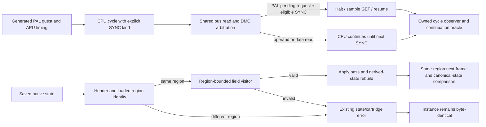

# Phase 26: PAL DMA and Regional State Continuation - Research

**Researched:** 2026-11-02
**Domain:** 2A07 DMC DMA halt eligibility and region-specific native state validation
**Confidence:** MEDIUM

<user_constraints>
## User Constraints (from CONTEXT.md)

### Locked Decisions

<!-- SRCQUOTE_9C42D7E1_START -->
### PAL DMC DMA model and fixture
- **D-01:** Follow the source-backed 2A07 model in which a DMC request may halt on an instruction's first cycle, the opcode fetch/SYNC cycle. Distinguish this from the RP2A03 wrong model that halts on any eligible read. Treat the rule as a documented model, not direct verification of every RP2A07 chip.
- **D-02:** Use an owned, generated fixture through the production CPU/APU/bus path. Arrange a pending request during an operand or data read and show that PAL execution waits for the next opcode fetch; also make the eligible opcode-fetch halt observable. Include a wrong-model control on the same PAL timeline and show that its halt/resume cycle differs. Record only the bus-cycle facts needed to prove this distinction.
- **D-03:** Keep the oracle narrow: assert the opcode-fetch/SYNC halt edge and resulting continuation. Do not assert the bus address or register effects on later no-operation cycles, or unrelated 2A07 abort/reload behavior; the available evidence does not settle those behaviors. A passing fixture is not hardware proof.
- **D-04:** Explain in README and the public DMA contract that the opcode-fetch rule follows a reported PAL hardware trace and its SYNC interpretation, while later no-op-cycle bus behavior and direct hardware proof remain unresolved. Cite the report and separate observed trace from inferred mechanism.

### Regional state identity and compatibility
- **D-05:** Reuse the existing 64-byte state header and region identity byte at offset 23: NTSC is 0 and PAL is 1. The field already identifies region; Phase 26 extends its supported value without changing its serialized meaning or adding a field.
- **D-06:** Keep state format 6. The serializer already stores audio_rem, APU sample_phase, PPU scanline/ticks, and DMC halt/pending state in existing fields. Keep field meanings and widths; validate audio_rem and sample_phase against the loaded region's denominator (NTSC 315000, PAL 709379), allow PAL scanlines through 311, and bound the PPU-to-header tick gap by the loaded region's frame duration (NTSC 714732 ticks, PAL 1063920 ticks). Preserve loading of existing NTSC format-6 saves. A PAL state is only expected to load in a core that supports PAL.
- **D-07:** Advance behavior revision from 16 to 17 for the new PAL DMC behavior. Continue recording that revision in states without making it a load gate. Keep ABI 1 because this phase adds no public API layout or signature change. If implementation research finds that a serialized field's meaning or layout must change, follow the public contract and revisit the format decision before implementation; do not bump solely because PAL becomes a supported region value.
- **D-08:** Compare the saved effective region with the loaded instance as part of cartridge identity, before state application. A cross-region refusal returns the existing state/cartridge identity error and leaves the entire instance unchanged. Same-region save/restore must reproduce subsequent frame, audio, and canonical state bytes, including PAL sample remainders and pending DMC work. Keep libretro serialization size fixed for the loaded content.
- **D-09:** Update the public header, README, and API documentation in the same behavior change. State that format-6 NTSC saves remain supported; state identity is region-specific; the behavior revision is informational for loading; and ABI remains unchanged.
<!-- SRCQUOTE_9C42D7E1_END -->

### the agent's Discretion

<!-- SRCQUOTE_4B83F0A6_START -->
- Choose the smallest internal way to distinguish opcode-fetch/SYNC bus cycles from operand and data reads. The current CPU uses the same bus-read entry point for these cycles, so the distinction must be explicit enough for production behavior and its fixture without adding a public API, runtime option, or second CPU implementation.
- Reuse the existing owned DMA trace and state-fork/refusal patterns. Keep fixtures in memory or generated by the test; add no dependency and do not inspect copyleft emulator implementation source.
<!-- SRCQUOTE_4B83F0A6_END -->

### Deferred Ideas (OUT OF SCOPE)

<!-- SRCQUOTE_B7D15A93_START -->
- Direct 2A07 hardware proof, the later no-op-cycle bus address, and other PAL DMA bug behavior remain unresolved; this phase documents those limits without claiming them.
- General property tests, mutation testing, and runner signal determinism remain deferred outside v8.
- PAL host presentation, modeled 2C07 palette completion, and final NTSC output acceptance remain Phase 27 work.
<!-- SRCQUOTE_B7D15A93_END -->
</user_constraints>

<phase_requirements>
## Phase Requirements

| ID | Description | Research Support |
|----|-------------|------------------|
| DMA-01 | <!-- SRCQUOTE_516E9A72_START -->PAL DMC DMA follows the best source-backed 2A07 model in an owned or permitted fixture with a control that distinguishes the wrong model; documentation states that later no-op-cycle bus behavior and direct hardware proof remain unresolved.<!-- SRCQUOTE_516E9A72_END --> | Source-bounded trace interpretation, the shared CPU/bus seam, and the current owned DMA observer/control pattern support a generated PAL fixture with a wrong-model halt-eligibility control. |
| STATE-01 | <!-- SRCQUOTE_D5A47F0B_START -->A machine state resumes under the same resolved region and is rejected before any state is applied when the loaded machine's region differs; format, behavior-revision and ABI consequences are documented according to the actual serialized and public-contract changes.<!-- SRCQUOTE_D5A47F0B_END --> | The region byte, one-pass field visitor and validate-before-apply loader already provide the right format and atomicity seams; tests already compare same-content continuation and snapshot failed loads. |
</phase_requirements>

## Summary

Use the reported RP2C07A trace as evidence that the DMA halt occurs on the first instruction cycle, and describe SYNC/opcode-fetch gating as the report's interpretation of that trace. The report is evidence of observed trace sequences, not direct proof of the internal signal or an exhaustive RP2A07 contract; the NESdev DMA and DPCM references preserve uncertainty about later no-operation-cycle bus behavior. The implementation and fixture should therefore prove only the modeled eligibility edge, observable halt/resume timing, and resulting continuation. `[CITED: https://forums.nesdev.org/viewtopic.php?p=300930]` `[CITED: https://www.nesdev.org/wiki/DMA]` `[CITED: https://www.nesdev.org/wiki/DPCM_conflict]`

Keep the native serialization format and public ABI stable under the locked no-layout-change design. The existing region byte becomes a true identity check against the already resolved region of the loaded cartridge; region-specific validation bounds apply to the same serialized fields, and all of those checks remain before the loader's apply pass. The PAL fixture should compare next-frame video/audio and canonical saved bytes after a same-region fork, while the refusal case uses the existing byte-identical-instance oracle. `[VERIFIED: .planning/phases/26-pal-dma-and-regional-state-continuation/26-CONTEXT.md:24-29]` `[VERIFIED: src/state.c:31-44, 535-617]` `[VERIFIED: tests/core/test_state_fork.c:333-433]` `[VERIFIED: tests/state_test.h:154-178]`

**Primary recommendation:** Add an internal CPU bus-read kind for opcode-fetch/SYNC cycles and gate PAL DMC halt acceptance on it; extend the shared serializer's validation with the loaded region's existing timing bounds; extend the owned DMA and state fork/refusal fixtures; keep format 6 and ABI 1, advance behavior revision to 17, and update the public header, README, and API guide. `[VERIFIED: .planning/phases/26-pal-dma-and-regional-state-continuation/26-CONTEXT.md:18-29]` `[VERIFIED: src/cpu.c:25-31, 614-654]` `[VERIFIED: src/bus.c:209-240, 243-284]` `[VERIFIED: src/state.c:86-92, 252-296, 343-422]`

## Architectural Responsibility Map

| Capability | Primary Tier | Secondary Tier | Rationale |
|------------|--------------|----------------|-----------|
| PAL DMC halt eligibility | API / Backend | — | CPU cycle kind must reach the shared library bus/DMC arbitration path, where the request is currently accepted. `[VERIFIED: src/cpu.c:614-654]` `[VERIFIED: src/bus.c:243-284]` |
| Native state region identity and bounds | API / Backend | — | The library owns the loaded cartridge's resolved region and performs identity validation, payload validation, and state application. `[VERIFIED: src/internal.h:265-275]` `[VERIFIED: src/state.c:535-617]` |
| Reproducible DMA/state evidence | API / Backend | — | Owned C fixtures compile or call the actual CPU/APU/bus and library state APIs; no host device layer is needed. `[VERIFIED: tests/CMakeLists.txt:2061-2082]` `[VERIFIED: tests/core/test_state_fork.c:333-433]` |
| Host save-state compatibility documentation | API / Backend | — | The library format and identity contract are public; libretro keeps the fixed size already returned for loaded content. `[VERIFIED: include/nesturbator.h:649-681]` `[VERIFIED: .planning/phases/26-pal-dma-and-regional-state-continuation/26-CONTEXT.md:24-29]` |

## Standard Stack

### Core

| Library/tool | Version | Purpose | Why Standard |
|--------------|---------|---------|--------------|
| Existing C core | C17 | CPU/bus/DMC behavior and native state | The project is a C implementation with C17 required by CMake; make the smallest private change in existing modules. `[VERIFIED: CMakeLists.txt:1-13]` |
| Existing CMake/CTest targets | CMake 4.4.3 / CTest 4.4.3 available here | Build and focused owned verification | Existing targets already cover DMA trace, native-state checks, state fork, and refusal; these versions were observed from `cmake --version` and `ctest --version`. `[VERIFIED: cmake --version; ctest --version]` |

The project standard is declared as:

<!-- SRCQUOTE_EC0D74A1_START -->
```cmake
set(CMAKE_C_STANDARD 17)
set(CMAKE_C_STANDARD_REQUIRED ON)
set(CMAKE_C_EXTENSIONS OFF)
```
<!-- SRCQUOTE_EC0D74A1_END -->

### Supporting

| Tool | Version | Purpose | When to Use |
|------|---------|---------|-------------|
| Existing `bus.unit` fixture | repository target | Production CPU/APU/bus trace with test observer | Extend for SYNC/read-kind and wrong-model control. `[VERIFIED: tests/CMakeLists.txt:2061-2082]` |
| Existing `core.state_fork` and `core.state_reject` | repository targets | Same-content continuation and all-or-nothing load refusal | Add the PAL fork path and same-ROM cross-region refusal case. `[VERIFIED: tests/CMakeLists.txt:1057-1111]` |

No external package or new dependency is needed or recommended. This phase is an in-repository C behavior, fixture, state-validation, and documentation change. `[VERIFIED: AGENTS.md:37-53, 74-82]` No package legitimacy audit applies.

## Architecture Patterns

### System Architecture Diagram



`fetch()` is shared by opcode and operand reads, while the top-level CPU step's first fetch is the opcode read. Preserve ordinary read behavior and pass a private kind only at actual opcode/SYNC actions; the IRQ/NMI first discarded cycle is also reported as SYNC by the trace discussion and should be considered when mapping the cycle kind. Do not classify every `fetch()` as SYNC. `[VERIFIED: src/cpu.c:25-31, 487-497, 614-654]` `[CITED: https://forums.nesdev.org/viewtopic.php?p=300930]`

The bus currently clocks a CPU read, checks DMC pending/phase and then enters `dmc_dma`; the narrow production seam is an added private read-kind argument/wrapper used by that eligibility decision. Keep the existing NTSC path and the OAM overlap behavior intact; in PAL allow DMC halt only when the marked cycle is eligible SYNC. In the test, a separate test-only wrong-model control should make any otherwise eligible read acceptable, using the exact same guest and initial PAL timer history. `[VERIFIED: src/bus.c:209-240, 243-284, 347-355]` `[VERIFIED: tests/cpu/test_bus.c:91-171, 1757-1899]` `[VERIFIED: .planning/phases/26-pal-dma-and-regional-state-continuation/26-CONTEXT.md:18-22]`

The existing CPU helper demonstrates why this boundary must be explicit:

<!-- SRCQUOTE_35E1AF80_START -->
```c
/* Reads the byte at PC and steps PC: one cycle. */
static uint8_t fetch(struct nesturbator *nes)
{
    uint8_t v = nesturbator__bus_read(nes, nes->cpu.pc);
    nes->cpu.pc = (uint16_t)(nes->cpu.pc + 1u);
    return v;
}
```
<!-- SRCQUOTE_35E1AF80_END -->

`fetch()` above is used at the opcode dispatch and for operand bytes. A minimal implementation can have the opcode-dispatch read call a SYNC-specific private bus wrapper, and keep operand/data/dummy reads on the generic path. The IRQ/NMI first discarded read currently calls the generic path, so route that action through the SYNC path if adopting the trace's reported interrupt-entry observation. `[VERIFIED: src/cpu.c:25-31, 487-497, 649-654]` `[CITED: https://forums.nesdev.org/viewtopic.php?p=300930]`

### State visitor and source-backed regional bounds

The 64-byte header already assigns the region field at offset 23; the current loader accepts only NTSC there and uses it in the cartridge-identity refusal. Current source definitions and the resolved per-instance timing helpers are:

<!-- SRCQUOTE_61D4C893_START -->
```c
#define NESTURBATOR_TICKS_PER_FRAME 714732u
#define NESTURBATOR_PAL_TICKS_PER_FRAME 1063920u
#define NESTURBATOR_AUDIO_SAMPLES_PER_PERIOD 352u
#define NESTURBATOR_AUDIO_TICKS_PER_PERIOD 315000u
```
<!-- SRCQUOTE_61D4C893_END -->

<!-- SRCQUOTE_A80D5E17_START -->
```c
static inline uint32_t nesturbator__sample_ticks_denominator(const struct nesturbator *nes)
{
    return nesturbator__is_pal(nes) != 0 ? 709379u : NESTURBATOR_AUDIO_TICKS_PER_PERIOD;
}
```
<!-- SRCQUOTE_A80D5E17_END -->

<!-- SRCQUOTE_2FA971B4_START -->
```c
static uint16_t prerender_line(const struct nesturbator *nes)
{
    return nesturbator__is_pal(nes) != 0 ? 311u : 261u;
}

static uint16_t raster_line_count(const struct nesturbator *nes)
{
    return nesturbator__is_pal(nes) != 0 ? 312u : 262u;
}
```
<!-- SRCQUOTE_2FA971B4_END -->

These are source-of-truth quotes from `src/internal.h:13-19, 305-308` and `src/ppu.c:23-31`. The phase decision additionally locks the exact intended validation bounds: `audio_rem` and `sample_phase` must be less than the loaded-region denominator (NTSC `315000`, PAL `709379`); scanline can reach PAL prerender line `311`; the PPU-to-header tick gap must be strictly below the loaded-region frame duration (NTSC `714732`, PAL `1063920`). `[VERIFIED: .planning/phases/26-pal-dma-and-regional-state-continuation/26-CONTEXT.md:24-29]` `[VERIFIED: src/internal.h:13-19, 300-308]` `[VERIFIED: src/ppu.c:23-31]`

Today `core_io` and `apu_io` cap both timing remainders using the NTSC denominator; `ppu_io` caps scanline at the NTSC prerender line and the tick gap below one NTSC frame. The same field visitor drives state sizing/writing/validation/application, so thread the effective-region bounds through the visitor (or its validated state context) without changing field order or widths. The serialized DMC visitor already includes pending/halt state and associated countdown state; keep those fields in place. The APU frame-cycle cap already reaches the PAL sequence and does not need a format change. `[VERIFIED: src/state.c:81-92, 252-296, 343-422]`

Identity comparison must use the saved effective region and the region already resolved on the loaded cartridge, before payload validation or the apply pass. Preserve the current `VALIDATE` then `APPLY` order: `VALIDATE` changes nothing; the actual instance writes begin only after it succeeds. Return the established state/cartridge identity status for the mismatch. The current status contract is:

<!-- SRCQUOTE_09E6C3AB_START -->
```c
NESTURBATOR_ERR_STATE_CARTRIDGE = 9,
```
<!-- SRCQUOTE_09E6C3AB_END -->

The header already describes mapper, submapper, region, and ROM CRC as cartridge identity, so the plan should update the “region” explanation from NTSC-only to resolved-region matching. `[VERIFIED: src/state.c:31-44, 535-589]` `[VERIFIED: include/nesturbator.h:159-169, 660-681]` `[VERIFIED: src/internal.h:265-275]`

### Recommended Project Structure

```text
src/
├── cpu.c       # mark opcode/SYNC read separately from operand/data reads
├── bus.c       # gate PAL DMC halt eligibility on the private cycle kind
└── state.c     # use effective region for existing-field validation and identity
tests/
├── cpu/test_bus.c           # generated PAL trace and distinguishable wrong-model control
└── core/test_state_fork.c   # same-region PAL continuation; test_state_reject.c refusal
include/nesturbator.h        # behavior revision and public state/DMA contract
README.md                    # PAL DMA evidence limits and compatibility summary
docs/api.md                  # detailed revision and state identity contract
```

The file mapping follows the existing shared CPU/bus and state visitor boundaries; keep all state and behavior in the C library and tests, with no adapter-specific region resolution. `[VERIFIED: .planning/phases/26-pal-dma-and-regional-state-continuation/26-CONTEXT.md:36-47]` `[VERIFIED: src/cpu.c:25-31, 614-654]` `[VERIFIED: src/bus.c:243-284]` `[VERIFIED: src/state.c:432-442]`

### Pattern: generated trace plus counterfactual control

Use the existing `tests/cpu/test_bus.c` observer, which already records CPU reads, halt attempts/acceptance, parked cycles, sample GET, resume, CPU cycle and DMC phase. Its existing fresh-sample regression uses a test-local wrong-model control to show a CPU-visible difference. Build a generated PAL NROM whose APU request becomes pending during an operand or data read; assert that the correct model does not halt on that read, later accepts on the next eligible opcode/SYNC fetch, and proceeds with the expected continuation. Run the wrong-model switch over the same PAL schedule and require an earlier/different halt or resume cycle. Avoid relying on the NTSC AccuracyCoin suite as a PAL oracle. `[VERIFIED: tests/cpu/test_bus.c:9-41, 91-171, 1757-1899]` `[VERIFIED: .planning/phases/26-pal-dma-and-regional-state-continuation/26-CONTEXT.md:18-22]` `[VERIFIED: .planning/phases/25-region-selection-and-pal-timing/25-PAL-EVIDENCE.md:55-57]`

Keep the fixture oracle to request-pending read kind, accepted halt point, sample GET/resume timing, and guest-visible/canonical continuation needed to distinguish the models. Do not inspect subsequent no-op bus address or register side effects. One report follow-up interprets the interrupt-entry first cycle as SYNC as well; since that is part of the reported interpretation, mark the corresponding IRQ/NMI first discarded bus action consistently, while the generated fixture itself can avoid interrupts. `[CITED: https://forums.nesdev.org/viewtopic.php?p=300930]` `[CITED: https://www.nesdev.org/wiki/DMA]` `[VERIFIED: src/cpu.c:487-497]`

### Pattern: same-region state fork and atomic opposite-region refusal

Reuse the public-boundary fork: save a PAL state from an owned generated guest at a real frame boundary, load it into a second instance of the same generated PAL content, then compare the next frame pixels, audio samples/count, tick/frame counters and canonical state bytes. Arrange a boundary where DMC work remains pending through actual guest/APU timing; synchronous active DMA is completed inside a bus call and cannot be publicly saved mid-transfer. Existing state tests already exercise pending DMC at cuts without manufacturing APU or bus history. `[VERIFIED: tests/core/test_state_fork.c:333-433]` `[VERIFIED: tests/core/test_state_fork.c:477-530]` `[VERIFIED: .planning/phases/26-pal-dma-and-regional-state-continuation/26-CONTEXT.md:24-29]`

For refusal, extend `core.state_reject` with the same ROM bytes loaded under opposite resolved region profiles, save from one, attempt load into the other, and require the current identity error plus the `st_refused_with` guarantees: byte-identical machine snapshot and unchanged save generation. Cross-region identity must be checked before apply; do not add separate region configuration to the runner or libretro adapter. `[VERIFIED: tests/core/test_state_reject.c:144-176]` `[VERIFIED: tests/state_test.h:154-178]` `[VERIFIED: src/state.c:550-617]`

The existing PAL accounting fixture already loads the same generated image into separate NTSC- and PAL-preference instances, which is the minimal route to a same-ROM region mismatch when the generated image permits the host preference. Its public preference values are:

<!-- SRCQUOTE_F30B8E62_START -->
```c
enum nesturbator_region_preference {
    NESTURBATOR_REGION_PREFERENCE_AUTO = 0,
    NESTURBATOR_REGION_PREFERENCE_NTSC = 1,
    NESTURBATOR_REGION_PREFERENCE_PAL = 2
};
```
<!-- SRCQUOTE_F30B8E62_END -->

`tests/core/test_frame.c` is the existing generated-image example of the same preference on both instances; reuse its image setup rather than add another ROM fixture. `[VERIFIED: include/nesturbator.h:178-184]` `[VERIFIED: tests/core/test_frame.c:461-470]`

## Don't Hand-Roll

| Problem | Don't Build | Use Instead | Why |
|---------|-------------|-------------|-----|
| Instruction-cycle distinction | A second CPU implementation or a public runtime toggle | A small private SYNC/opcode-read kind passed through the current shared bus path | Opcode and operand fetches share `fetch()` today, and all reads converge on one arbitration point. `[VERIFIED: src/cpu.c:25-31, 614-654]` `[VERIFIED: src/bus.c:243-284]` |
| State compatibility | A second PAL serializer, new header field, or compatibility converter | The current canonical visitor and existing region byte | Format and field meanings stay stable under D-05 through D-08. `[VERIFIED: src/state.c:26-44, 432-442]` `[VERIFIED: .planning/phases/26-pal-dma-and-regional-state-continuation/26-CONTEXT.md:24-29]` |
| Regional source of truth | Host-specific duplicate region selection | Loaded cartridge effective region and existing internal timing helpers | The cart owns resolved region and the timing helpers are already per-instance. `[VERIFIED: src/internal.h:265-308]` |
| Hardware oracle | Another emulator implementation or a broad ROM suite | Report-bounded trace interpretation plus the generated owned fixture and its wrong-model control | Clean-room rules prohibit source inspection; external community references do not settle all 2A07 bus details. `[VERIFIED: AGENTS.md:45-47]` `[CITED: https://forums.nesdev.org/viewtopic.php?p=300930]` `[CITED: https://www.nesdev.org/wiki/DMA]` |

**Key insight:** Keep the model boundary small: mark the CPU cycle, gate one DMC acceptance decision, and prove the distinction with one same-timeline counterfactual. State compatibility is a parameterization of validation bounds and identity, not a new serialization format. `[VERIFIED: src/cpu.c:614-654]` `[VERIFIED: src/bus.c:243-284]` `[VERIFIED: src/state.c:535-589]`

## Common Pitfalls

### Treating the SYNC explanation as direct hardware proof

**What goes wrong:** Documentation claims all RP2A07 revisions halt exactly on SYNC or asserts later held/no-op bus behavior.
**Why it happens:** The forum post contains trace observations and a mechanism interpretation; a trace is not exhaustive signal-level proof.
**How to avoid:** Separate observed trace sequence from inferred SYNC rule in README and public DMA comments; cite the report and retain the stated evidence limits.
**Warning signs:** A test asserts later no-op address, register effects, abort/reload, or presents the fixture as console measurement. `[CITED: https://forums.nesdev.org/viewtopic.php?p=300930]` `[CITED: https://www.nesdev.org/wiki/DMA]` `[VERIFIED: .planning/phases/26-pal-dma-and-regional-state-continuation/26-CONTEXT.md:18-22]`

### Marking all calls to `fetch()` as opcode SYNC

**What goes wrong:** DMC can still halt during immediate/address operands, defeating the PAL rule, or the implementation changes unrelated read timing.
**Why it happens:** One helper reads both opcodes and operands.
**How to avoid:** Mark the top-level opcode dispatch read distinctly; leave operand, data, dummy, and other reads generic. Route the reported IRQ/NMI first SYNC action consistently. `[VERIFIED: src/cpu.c:25-31, 487-497, 649-654]` `[CITED: https://forums.nesdev.org/viewtopic.php?p=300930]`

### Keeping NTSC state validation bounds after enabling PAL

**What goes wrong:** Correct PAL save states fail validation near valid PAL sample remainder, scanline, or PPU tick-gap values; or a global maximum accidentally weakens NTSC validation.
**Why it happens:** Current visitor hard-codes NTSC denominators, line and frame duration.
**How to avoid:** Parameterize these three bounds by the loaded instance's effective region and preserve the strict less-than gap invariant. Leave serialized widths/order, other field bounds, and APU frame-cycle bound intact. `[VERIFIED: src/state.c:86-92, 276-296, 405-418]` `[VERIFIED: src/internal.h:13-19, 294-308]` `[VERIFIED: src/ppu.c:23-31]`

### Applying any state data before region identity is known

**What goes wrong:** A cross-region attempt partially changes machine or RAM state before returning an error.
**Why it happens:** Region is handled as a late body field or validation happens after the current apply phase.
**How to avoid:** Compare saved header region to the loaded cartridge region in the existing identity block, then keep body validation read-only and apply only after every check passes. Use the existing snapshot refusal helper. `[VERIFIED: src/state.c:550-589]` `[VERIFIED: tests/state_test.h:154-178]`

### Calling the entire state byte stream unchanged for new saves

**What goes wrong:** Tests expect new NTSC state hashes to remain byte-identical to revision 16 even though the behavior revision is recorded in the header.
**Why it happens:** “Preserve NTSC format-6 saves” is mistaken for “new serialized bytes never change.”
**How to avoid:** Keep old format-6 NTSC states loadable and field layout/meaning stable, while new saves record behavior revision 17 as already required by D-07. Compare canonical continuation between instances running the same revision for fork tests. `[VERIFIED: include/nesturbator.h:110-135, 680-681]` `[VERIFIED: .planning/phases/26-pal-dma-and-regional-state-continuation/26-CONTEXT.md:24-29]`

## Code Examples

### Current header and region values

These exact declarations establish current format/revision/ABI and the enum values; the phase's intended behavior-revision advance and use of PAL region value are locked in the quoted D-05/D-07 decisions above.

<!-- SRCQUOTE_FC9216B8_START -->
```c
#define NESTURBATOR_ABI_VERSION 1
#define NESTURBATOR_BEHAVIOUR_REVISION 16
#define NESTURBATOR_STATE_FORMAT_VERSION 6

enum nesturbator_region {
    NESTURBATOR_REGION_NTSC = 0,
    NESTURBATOR_REGION_PAL = 1
};
```
<!-- SRCQUOTE_FC9216B8_END -->

`src/state.c` declares the header region offset and currently rejects any value other than NTSC in its cartridge identity check. The same block of source also shows the field validation completes before the apply pass:

<!-- SRCQUOTE_73BC10D5_START -->
```c
#define H_REGION 23u
```
<!-- SRCQUOTE_73BC10D5_END -->

<!-- SRCQUOTE_0F68CDA4_START -->
```c
if (inst->cart.bytes == NULL || get_le(b + H_MAPPER, 2u) != inst->mapper.id ||
    b[H_SUBMAPPER] != inst->mapper.submapper || b[H_REGION] != 0u ||
    get_le(b + H_ROM_CRC, 4u) != inst->cart.rom_crc32)
    return NESTURBATOR_ERR_STATE_CARTRIDGE;
```
<!-- SRCQUOTE_0F68CDA4_END -->

Use these as source anchors only; the planner should describe a minimal change to the existing code rather than prescribe a second mechanism. `[VERIFIED: include/nesturbator.h:54, 110, 135, 172-176]` `[VERIFIED: src/state.c:31-44, 550-575]`

### Regional visitor values to preserve

<!-- SRCQUOTE_08D31E74_START -->
```c
nesturbator__sio_u32(io, &nes->audio_rem, NESTURBATOR_AUDIO_TICKS_PER_PERIOD - 1u);
```
<!-- SRCQUOTE_08D31E74_END -->

<!-- SRCQUOTE_6E4B2A91_START -->
```c
nesturbator__sio_u32(io, &a->sample_phase, NESTURBATOR_AUDIO_TICKS_PER_PERIOD - 1u);
```
<!-- SRCQUOTE_6E4B2A91_END -->

<!-- SRCQUOTE_D9A7C305_START -->
```c
nesturbator__sio_check(io, ppu_ticks <= io->ticks && io->ticks <= STATE_TICKS_MAX &&
                               io->ticks - ppu_ticks < NESTURBATOR_TICKS_PER_FRAME);
nesturbator__sio_u16(io, &p->scanline, 261u);
```
<!-- SRCQUOTE_D9A7C305_END -->

Parameterize those existing visitor bounds using the loaded region's helpers while preserving each field's existing width and visitor order; the exact PAL values are in the locked D-06 quote and source helper quotes above. `[VERIFIED: src/state.c:86-92, 276-296, 405-418]` `[VERIFIED: src/internal.h:13-19, 294-308]` `[VERIFIED: src/ppu.c:23-31]`

## State of the Art

| Current contract | Phase 26 contract | Impact |
|------------------|-------------------|--------|
| State format 6; region header byte exists but current writer stores NTSC and current loader only accepts NTSC. | Keep format 6 and the existing header; write and accept the loaded region value. | Existing NTSC format-6 payloads remain loadable; PAL states are region-specific. |
| Behavior revision 16 is recorded but not enforced during load; ABI is 1. | Behavior revision 17; still informational for load; ABI stays 1. | Saved behavior metadata changes, but public layout and state field layout do not. |
| State visitor validates NTSC audio, scanline and PPU gap bounds. | Validate those same fields using region-specific existing timing values. | No new serialized field or new state interpretation is needed. |

The current header documents that a state records behavior revision without enforcing it, and the save body already includes the fields needed for regional continuation. The earlier format-7 proposal in exploratory PAL research is superseded by Phase 26's locked decision after Phase 25 established format 6/revision 16; do not resurrect it unless implementation proves a serialized meaning or layout must change. `[VERIFIED: include/nesturbator.h:110-135, 660-681]` `[VERIFIED: src/state.c:86-92, 252-296, 343-422]` `[VERIFIED: .planning/phases/26-pal-dma-and-regional-state-continuation/26-CONTEXT.md:24-29]` `[VERIFIED: .planning/phases/26-pal-dma-and-regional-state-continuation/26-CONTEXT.md: canonical_refs and phase notes]`

## Environment Availability

| Dependency | Required By | Available | Version | Fallback |
|------------|-------------|-----------|---------|----------|
| CMake | Existing C build and focused targets | ✓ | 4.4.3 | — |
| CTest | Existing focused and full workflow tests | ✓ | 4.4.3 | — |

No new runtime dependency or package is required; CMake and CTest versions were observed in this research session. `[VERIFIED: cmake --version; ctest --version]`

## Focused Verification Commands

The project config explicitly disables Nyquist validation, so the formal `## Validation Architecture` section is omitted. For implementation feedback, build only the existing relevant targets plus the already-owned fork executable, then run the focused registrations. Planning should add a `core.state_fork.pal` CTest entry if the PAL path is split from the current broad fork matrix; extend `core.state_reject` for opposite-region atomic refusal. `[VERIFIED: .planning/config.json:21-25, 49-50]` `[VERIFIED: tests/CMakeLists.txt:1057-1111, 2061-2082]`

The existing registrations and targets include these names:

<!-- SRCQUOTE_3A7E9B10_START -->
```cmake
nesturbator_core_test(core.state core/test_state.c ${PROJECT_SOURCE_DIR}/tests/roms/dabg.nes)
add_executable(core.state_fork core/test_state_fork.c)
nesturbator_core_test(core.state_reject core/test_state_reject.c ${FORK_ROMS})
add_executable(bus.unit cpu/test_bus.c
  ${PROJECT_SOURCE_DIR}/src/bus.c
  ${PROJECT_SOURCE_DIR}/src/instance.c
  ${PROJECT_SOURCE_DIR}/src/cpu.c
  ${PROJECT_SOURCE_DIR}/src/apu.c)
add_test(NAME bus.unit COMMAND bus.unit)
```
<!-- SRCQUOTE_3A7E9B10_END -->

The documentation-oriented registrations selected below are:

<!-- SRCQUOTE_C5D1827A_START -->
```cmake
add_test(NAME state.format_pin
  COMMAND ${CMAKE_COMMAND} -DSOURCE_DIR=${PROJECT_SOURCE_DIR}
    -P ${CMAKE_CURRENT_SOURCE_DIR}/cmake/state_format_pin.cmake)
add_test(NAME state.status_table
  COMMAND ${CMAKE_COMMAND} -DSOURCE_DIR=${PROJECT_SOURCE_DIR}
    -DDOC=${PROJECT_SOURCE_DIR}/docs/api.md
    -P ${CMAKE_CURRENT_SOURCE_DIR}/cmake/status_table.cmake)
add_test(NAME docs.links
  COMMAND ${CMAKE_COMMAND} -DREADME=${PROJECT_SOURCE_DIR}/README.md
    -P ${CMAKE_CURRENT_SOURCE_DIR}/cmake/doc_links.cmake)
```
<!-- SRCQUOTE_C5D1827A_END -->

```sh
cmake --build --preset ci --target bus.unit core.state core.state_fork core.state_reject
ctest --test-dir build/ci --output-on-failure --no-tests=error -R '^(bus.unit|core.state|core.state_reject|core.state_fork.pal|state.format_pin|state.status_table|docs.links)$'
```


The project's exact workflow command is:

<!-- SRCQUOTE_8E2719A4_START -->
`cmake --workflow --preset ci`
<!-- SRCQUOTE_8E2719A4_END -->

## Project Constraints (from AGENTS.md)

- Keep emulator and test code owned in this repository; `libretro.h` is the only vendored file and the core library links only the C memory functions. `[VERIFIED: AGENTS.md:37-40]`
- Preserve the three deliverables (C library, headless runner, libretro adapter); do not add window, audio-device, or input-device code. `[VERIFIED: AGENTS.md:26-28, 39-40]`
- Keep the tree clean of unlisted ROM/BIOS bytes, personal paths, emails, and names; commits must use the GitHub noreply identity and pass repository hygiene. `[VERIFIED: AGENTS.md:41-44]`
- Follow the clean-room rule: use hardware documentation and test behavior, never inspect GPL/LGPL emulator implementation source or retain a copy. `[VERIFIED: AGENTS.md:45-47]`
- Preserve integer-only deterministic behavior with all state per instance. `[VERIFIED: AGENTS.md:48-49]`
- Every behavior change must include an owned test and README/public-header comment updates, with the project CI workflow; checks are automated. `[VERIFIED: AGENTS.md:50-53]`
- Keep this work within Phase 26's boundary; Phase 27 owns PAL host presentation, modeled 2C07 palette, and final NTSC preservation acceptance. `[VERIFIED: .planning/phases/26-pal-dma-and-regional-state-continuation/26-CONTEXT.md:7-10]`
- No new dependencies; prefer the existing code and standard library. `[VERIFIED: AGENTS.md:74-82]`

The project config explicitly sets `workflow.security_enforcement` to `false`, so no Security Domain section is required for this phase. `[VERIFIED: .planning/config.json:49-50]`

## Assumptions Log

| # | Claim | Section | Risk if Wrong |
|---|-------|---------|---------------|
| — | None. Implementation facts were checked against source, and unresolved hardware details remain expressly unresolved. | — | — |

## Open Questions

1. **What happens on later held/no-op-cycle bus accesses on all RP2A07 variants?**
   - **RESOLVED FOR PLANNING / SCOPE ONLY:** D-03/D-04 settle the disposition: leave later no-op-cycle addresses, register effects and variant-wide behavior unasserted. The hardware facts remain genuinely unknown; this marker resolves the planning choice, not the scientific question.
   - What we know: the selected trace report supports the first instruction-cycle halt observation and the SYNC interpretation; the wiki keeps later no-op bus behavior uncertain.
   - What's unclear: the later address and side effects, and whether all chip variants match the report.
   - Recommendation: leave these behaviors unasserted and document them as unresolved, as D-03/D-04 require. `[CITED: https://forums.nesdev.org/viewtopic.php?p=300930]` `[CITED: https://www.nesdev.org/wiki/DMA]` `[VERIFIED: .planning/phases/26-pal-dma-and-regional-state-continuation/26-CONTEXT.md:20-22]`

2. **Can the exact trace be repeated on representative hardware?**
   - **RESOLVED FOR PLANNING / SCOPE ONLY:** D-03/D-04 settle the disposition: make no direct-hardware-proof claim and add no hardware capture/setup task. Representative project-run confirmation remains unknown/unverified; this marker resolves the planning choice, not the hardware question.
   - What we know: the current report is a first-person trace report, not a direct test by this project; Phase 25 PAL sources likewise are source-derived rather than direct hardware verification.
   - What's unclear: direct project-run hardware confirmation is not in evidence.
   - Recommendation: no hardware claim or hardware setup task in this phase; keep direct proof unresolved. `[CITED: https://forums.nesdev.org/viewtopic.php?p=300930]` `[VERIFIED: .planning/phases/25-region-selection-and-pal-timing/25-PAL-EVIDENCE.md:55-57]`

These evidence gaps do not block planning because the user has locked the acceptable model and its limits. `[VERIFIED: .planning/phases/26-pal-dma-and-regional-state-continuation/26-CONTEXT.md:18-22]`

## Sources

### Primary / repository source of truth (HIGH confidence for project implementation)

- `AGENTS.md:37-82` — project ownership, clean-room, determinism, tests/docs and dependency constraints.
- `.planning/REQUIREMENTS.md:15-24` — DMA-01 and STATE-01 requirements.
- `.planning/phases/26-pal-dma-and-regional-state-continuation/26-CONTEXT.md:18-47` — locked decisions, scope, existing code/test seams.
- `.planning/preparation/DECISIONS.md` DEC.09, DEC.16, DEC.17 — shared cycle seam, independent version contracts, canonical validate-before-apply states.
- `.planning/preparation/ARCHITECTURE.md` §§2, 7 — integer tick model and opaque instance/state architecture.
- `.planning/preparation/NES-HARDWARE-CPU-APU.md` §§2.2, 6 — current DMC/regional overview and unresolved 2A07 DMA evidence.
- `.planning/phases/25-region-selection-and-pal-timing/25-PAL-EVIDENCE.md:44-57` and `25-ACCEPTANCE.md` — source-derived PAL arithmetic and evidence limits.
- `src/cpu.c`, `src/bus.c`, `src/internal.h`, `src/ppu.c`, `src/state.c` — inspected implementation seams and regional constants/bounds.
- `tests/cpu/test_bus.c`, `tests/core/test_state_fork.c`, `tests/core/test_state_reject.c`, `tests/state_test.h`, `tests/CMakeLists.txt` — inspected owned fixture patterns and CTest registrations.
- `include/nesturbator.h`, `README.md`, `docs/api.md` — public contracts and existing NTSC-only state description to update.

### Community evidence (MEDIUM confidence; bounded model support)

- [2A07 DMA trace report](https://forums.nesdev.org/viewtopic.php?p=300930) — reported RP2C07A trace sequences and the author's SYNC interpretation; not direct verification by this project or an exhaustive hardware contract.
- [NESdev DMA](https://www.nesdev.org/wiki/DMA) — curated community description of DMA and retained uncertainty about 2A07 later no-op bus behavior.
- [NESdev DPCM conflict](https://www.nesdev.org/wiki/DPCM_conflict) — curated community reference supporting the opcode-fetch distinction for DMC conflict behavior.

## Metadata

**Confidence breakdown:**
- Standard stack: HIGH — existing C17 project and target names read from CMake source; no external dependency added.
- Architecture: HIGH — code paths and visitor/apply order were opened directly in this session.
- Pitfalls: MEDIUM — local state pitfalls are source-grounded; the 2A07 model depends on the community trace and its bounded interpretation.

**Research date:** 2026-11-02
**Valid until:** 2026-12-02 for repository architecture; hardware evidence boundary remains valid until primary measurements or stronger documentation emerge.
