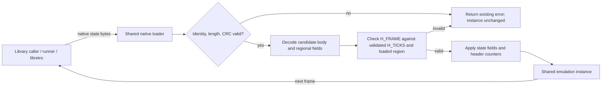

# Phase 27.1: Close STATE-01 regional state validation gaps - Research

**Researched:** 2026-11-02
**Domain:** C17 native save-state validation and regional frame/APU cursors
**Confidence:** HIGH

<user_constraints>
## User Constraints (from CONTEXT.md)

### Locked Decisions

#### PAL five-step APU state boundary
- **D-01:** Validate `apu.frame_cycle` against the effective loaded region and the candidate state's `frame_mode`. Permit PAL five-step states through 41565; the modeled sequence wraps on 41566. Keep the existing 37281 ceiling for NTSC and four-step states, so the fix does not widen unrelated state acceptance.
- **D-02:** Add CRC-correct public-loader controls for the state boundary: PAL five-step accepts 37281, 37282, and 41565; 41565 round-trips and continues; 41566 is rejected. Keep wrong-model controls showing that 37282 remains rejected for NTSC five-step and PAL four-step. Refused loads return `NESTURBATOR_ERR_STATE_INVALID` and leave the whole instance and save generation unchanged.
- The expected PAL cursor values come from the project's source-derived model and owned APU fixture. They do not establish direct PAL hardware proof.

#### Frame counter and tick consistency
- **D-03:** After validating the existing `H_TICKS` limit, compute the quotient `q = H_TICKS / frame_ticks` using the loaded region's frame duration. Require `H_FRAME <= q` for both regions. For PAL also require `q - H_FRAME <= 1`. This bounds PAL's next absolute frame target and prevents ahead-of-time counters or lags larger than one frame from skipping or stretching execution.
- **D-04:** Do not require exact equality for PAL: a reachable JAM sequence can cross the nominal target, return `NESTURBATOR_STOP_JAM` before incrementing `frame_number`, and then be reset without resetting the tick/frame counters. Preserve that one-frame lag. Do not impose a PAL-style lower lag bound on NTSC; its frame target is relative to current ticks and per-call instruction overrun accumulates. The NTSC upper bound preserves generated states while rejecting impossible high frame counters.
- **D-05:** CRC-correct `H_FRAME = UINT64_MAX`, a safely multiplied but ahead-of-ticks value, and PAL values more than one frame behind are invalid. Validate before applying any fields; refusals return `NESTURBATOR_ERR_STATE_INVALID` without changing instance state or save generation. Preserve and test ordinary PAL instruction overshoot and reachable PAL JAM/reset continuation. C unsigned arithmetic wraps modulo its range, so prove the range before the PAL addition and multiplication rather than relying on wrap behavior.

#### Compatibility and contract
- **D-06:** Keep state format 6, behavior revision 17, and ABI 1. These checks use existing header fields and do not change serialized layout or field meaning; behavior revision remains informational during loading. Existing valid NTSC format-6 states continue to load.
- **D-07:** Update the README and public-header state contract alongside the behavior change. Document the PAL five-step bound and the `H_FRAME`/`H_TICKS` validation, including the reachable one-frame PAL lag. Use existing owned tests and no new dependency.

### the agent's Discretion
- Use the smallest local validation helper that fits the existing state field visitor and validate-before-apply flow. Derive the sequencer limit from the serialized candidate mode without mutating the instance during validation.
- Extend the existing regional state-rejection coverage and JAM-state fixtures; keep assertions at the public native-state loader boundary. Runner and libretro use that shared contract and do not need a new API or parallel state policy.
- Run the required local workflow during implementation under the standing resource limits. Keep the older interrupted campaign stopped and unknown.

### Deferred Ideas (OUT OF SCOPE)
- The general owned property-test proposal remains deferred; add only these two direct state-loader regressions.
- DMA-01 remains marked partial by the v8 audit because the Phase 26 summaries lack `requirements_completed` frontmatter. It is an audit-metadata issue outside this focused STATE-01 fix.
- The older interrupted full-CI/AccuracyCoin campaign remains stopped and unknown; this phase does not restart or relabel it.

#### Reviewed Todos (not folded)
- **2026-10-26-add-reproducible-owned-property-tests.md** — the proposal is general-purpose and not required to cover the two audited PAL state defects.
</user_constraints>

## Summary

This phase closes two audited gaps at the shared native-state loader: a single fixed APU cursor ceiling rejects valid modeled PAL five-step states, while the header frame counter currently reaches application without being checked against validated ticks. Keep the fix in the existing loader and extend its regional public-loader rejection/continuation coverage. [VERIFIED: src/state.c:277-294, 540-595; .planning/v8-MILESTONE-AUDIT.md:112-128]

The source-derived APU endpoint and JAM/reset lag are explicit project decisions, not direct PAL hardware proof. The new checks are validation-only: retain the serialized fields, format, behavior revision, ABI, region identity, and validate-before-apply contract. Do not add DMA work, capability surface, dependencies, or parallel runner/libretro state rules. [LOCKED: 27.1-CONTEXT.md `Decisions; VERIFIED: include/nesturbator.h:52-54, 118-143; src/state.c:513-537, 572-595]

**Primary recommendation:** Derive the APU ceiling from the loaded region plus the candidate state's serialized frame mode, and check the header frame counter against the already validated tick count before APPLY; extend the existing regional state tests with valid and malformed CRC-correct cases. [LOCKED: 27.1-CONTEXT.md D-01–D-07; VERIFIED: src/state.c:277-294, 572-595; tests/core/test_state_reject.c:1239-1279]

## Architectural Responsibility Map

| Capability | Primary Tier | Secondary Tier | Rationale |
|---|---|---|---|
| Regional state validation and restoration | API / Backend (shared C library) | Runner and libretro callers | The native loader checks identity, validates the complete state, then applies it; the host adapters share this library contract. [VERIFIED: src/state.c:540-595; .planning/phases/26-pal-dma-and-regional-state-continuation/26-CONTEXT.md:84-93] |

## Project Constraints (from AGENTS.md)

- Keep emulation and tests owned in this repository. `libretro.h` is the sole vendored file; the core library links only C memory functions. Add no dependency for these two arithmetic/validation checks. [AGENTS.md `Rules 1; CONTEXT.md D-07]
- Preserve the three deliverables (library, headless runner, libretro adapter); do not add window, audio-device, or input-device code. Keep policy in the shared loader rather than adapter copies. [AGENTS.md `Rules 2; VERIFIED: src/state.c:540-595]
- Keep the code clean-room: use hardware documentation and test behavior; do not inspect or retain GPL/LGPL emulator source. Commit only permitted/manifest-listed ROM fixtures and keep personal paths and identities out of Git. [AGENTS.md `Rules 3-4]
- Preserve integer-only, per-instance deterministic state. Use fixed-width integer types and the existing small-module style. [AGENTS.md `Rules 5; VERIFIED: src/state.c:28-29, 540-595]
- Every behavior change lands with an owned test, README update, public-header comment update, and `cmake --workflow --preset ci`. The standing local authority covers that workflow for at most 30 minutes, with stricter existing test and fixture caps retained; diagnose failures before any retry. [AGENTS.md `Rules 6 and Standing engineering authority; CONTEXT.md D-07]
- Keep the workflow at one GSD step per command and stop at the phase boundary. Do not expand the phase into hosted workflows, push, PR, merge, release, or device work. [AGENTS.md `Rules 7 and Standing engineering authority]
- Research references are indexed by `.planning/preparation/README.md`; it was opened first, followed by the state/API and CPU/APU references relevant to this loader change. [AGENTS.md `project-doc; VERIFIED: .planning/preparation/README.md]
- No project skill rules were found under `.agents/skills/` or `.codex/skills/`. Nyquist validation is explicitly disabled (the config contains `"nyquist_validation": false`), so omit Validation Architecture. Security enforcement is explicitly disabled (the config contains `"security_enforcement": false`), so no ASVS section applies. [VERIFIED: .planning/config.json:25, 49; agent-skills query and directory listing]

## Verified Code Facts

The quoted source lines below establish the discrete values used elsewhere in this research.

| Fact | Verbatim source | Planning consequence |
|---|---|---|
| Current field visitor reads the candidate mode but applies one fixed cursor bound. | `src/state.c:287-294`: “`nesturbator__sio_u8(io, &a->frame_mode, 1u);`” and “`nesturbator__sio_u32(io, &a->frame_cycle, 37281u);`” [VERIFIED: src/state.c:287-294] | Capture the decoded mode while validating, then pass a region/mode-specific max to the existing visitor. |
| Owned APU model gives PAL five-step its later final event and wrap. | `src/apu.c:364, 379-390`: “`const uint32_t quarter_5 = pal != 0u ? 41565u : 37281u;`” and “`const uint32_t five_step_wrap = pal != 0u ? 41566u : 37282u;`” [VERIFIED: src/apu.c:364-390] | Accept the PAL five-step cursor through its final modeled event; preserve the narrower bound for the other region/mode cases. |
| Owned APU test reaches the modeled endpoint then wraps. | `tests/core/test_apu.c:693-706`: “`nes->apu.frame_cycle = 41563u;`”, “`CHECK_EQ_U64(nes->apu.frame_cycle, 41565u);`”, “`CHECK_EQ_U64(nes->apu.frame_cycle, 0u);`” [VERIFIED: tests/core/test_apu.c:693-706] | Treat these values as the project model's expected cursor behavior, not physical PAL proof. |
| Header stores frame and tick fields at fixed offsets; tick limit is already defined. | `src/state.c:28-29, 42-43`: “`#define STATE_TICKS_MAX (UINT64_C(1) << 62)`”, “`#define H_FRAME 32u`”, “`#define H_TICKS 40u`” [VERIFIED: src/state.c:28-43] | Validate the pair before applying the frame counter or evaluating its next target. |
| Frame duration comes from the loaded region. | `src/internal.h:13-14, 294-298`: “`#define NESTURBATOR_TICKS_PER_FRAME 714732u`”, “`#define NESTURBATOR_PAL_TICKS_PER_FRAME 1063920u`”, and the conditional return of those constants. [VERIFIED: src/internal.h:13-14, 294-298] | Compute the quotient using the region already resolved on the loaded instance. |
| PAL target is absolute; NTSC target is relative to current ticks. | `src/frame.c:57-59`: “`? (inst->frame_number + 1u) * frame_ticks`” and “`: inst->ticks + frame_ticks;`” [VERIFIED: src/frame.c:57-59] | Do not apply a PAL-style lower-lag rule to NTSC. |
| JAM can stop before the successful-frame counter increment. | `src/frame.c:69-75`: “`if (inst->cpu.jammed != 0u) {`”, “`return NESTURBATOR_STOP_JAM;`”, and “`inst->frame_number += 1u;`” [VERIFIED: src/frame.c:69-75] | Test a real reachable JAM/reset continuation with one-frame lag instead of demanding exact PAL equality. |
| C unsigned arithmetic wraps modulo its range. | WG14 C draft N1570 `6.2.5 paragraph 9 states that an unrepresentable result of unsigned arithmetic is reduced modulo one greater than the type's maximum. [CITED: https://www.open-std.org/JTC1/SC22/WG14/www/docs/n1570.pdf] | Prove bounds before the frame increment and multiplication; do not use wrap as validation. |
| State fields validate without writing the instance; APPLY is reached only after validation succeeds. | `src/state.h:100-107`: “`if (io->mode == NESTURBATOR__SIO_APPLY)`” / “`*v = x;`”; `src/state.c:572-595`: “`if (io.bad != 0)`”, “`return NESTURBATOR_ERR_STATE_INVALID;`”, then “`inst->frame_number = get_le(b + H_FRAME, 8u);`”. [VERIFIED: src/state.h:100-107; src/state.c:572-595] | Keep both new checks in the current validate-before-apply path. |
| Compatibility values stay independent. | `include/nesturbator.h:52-54, 118, 140-143`: “`#define NESTURBATOR_ABI_VERSION 1`”, “`#define NESTURBATOR_BEHAVIOUR_REVISION 17`”, “`#define NESTURBATOR_STATE_FORMAT_VERSION 6`”; the behavior revision is recorded but not enforced. [VERIFIED: include/nesturbator.h:52-54, 118-143] | Keep all three values as locked; no state layout or API change is planned. |
| Invalid content has the existing loader status. | `include/nesturbator.h:175-177`: “`NESTURBATOR_ERR_STATE_INVALID = 12`” [VERIFIED: include/nesturbator.h:175-177] | CRC-correct violations return the existing invalid-state status. |

## Standard Stack

### Core

| Library / tool | Version | Purpose | Why Standard |
|---|---|---|---|
| Existing C core, C17 | C17 | Candidate state decoding, regional validation, and restore | CMake says `set(CMAKE_C_STANDARD 17)`; no new framework or library is needed. [VERIFIED: CMakeLists.txt:12-14] |
| Existing state visitor and native loader | Current source; no package version | Single sizing/write/validate/apply path | It already centralizes the serialized field list and atomic load boundary. [VERIFIED: src/state.c:1-11, 540-595; src/state.h:1-5] |
| Existing owned CTest fixtures | Current source; no package version | CRC-correct boundary checks, refusal atomicity, and continuation | CMake's exact registration is `add_test(NAME core.state_reject.regional COMMAND core.state_reject --regional)`; the APU, frame, and state targets are also present. [VERIFIED: tests/CMakeLists.txt:1004-1006, 1087, 1143-1145] |

### Supporting

| Tool | Version | Purpose | When to Use |
|---|---|---|---|
| CMake, Ninja, Apple Clang | CMake 4.4.3; Ninja 1.13.2; Clang 21.0.0 | Existing required local CI workflow | Use the project CI preset during implementation; all three tools are available in this environment. [VERIFIED: command output for `cmake --version`, `ninja --version`, `cc --version`, `c++ --version`] |

### Alternatives Considered

| Instead of | Could Use | Tradeoff |
|---|---|---|
| One loader-level regional policy | Separate runner and libretro validation | Duplicates state policy and can diverge from the public native loader; context locks the shared loader boundary. [LOCKED: 27.1-CONTEXT.md `the agent's Discretion; VERIFIED: src/state.c:540-595] |
| Existing field visitor plus a small pre-apply header check | A new serializer or dependency | Adds parallel layout/range logic for two comparisons that fit existing validation. [VERIFIED: src/state.c:1-11, 572-595; LOCKED: 27.1-CONTEXT.md D-07] |

**Installation:** None. This phase adds no external package. [LOCKED: 27.1-CONTEXT.md D-07]

## Package Legitimacy Audit

No external packages are proposed, so the package legitimacy gate and registry checks are not triggered. [LOCKED: 27.1-CONTEXT.md D-07]

## Architecture Patterns

### System Architecture Diagram

The flow reflects the current loader's identity/checksum ordering and its non-mutating VALIDATE pass before APPLY; only the candidate-frame relation is new. The runner and libretro share the native loader. [VERIFIED: src/state.c:540-595; .planning/phases/26-pal-dma-and-regional-state-continuation/26-CONTEXT.md:84-93]

### Recommended Project Structure

No new directories or serializer are needed. Extend these existing entry points:

    src/state.c                    shared header and candidate-field validation
    src/state.h                    field visitor and cross-field checks
    tests/core/test_state_reject.c  CRC-correct regional loader controls
    tests/core/test_state.c         save/load and JAM fixtures
    tests/core/test_apu.c           modeled sequencer endpoint control
    tests/core/test_frame.c         ordinary PAL overrun control
    include/nesturbator.h           public native-state contract
    README.md                       user-facing state behavior

These files are present and are the existing seams identified by the phase context and current source. [VERIFIED: src/state.c:540-595; src/state.h:1-5; tests/core/test_state_reject.c:1239-1397; tests/core/test_state.c:791-842; tests/core/test_apu.c:657-728; tests/core/test_frame.c:350-439; include/nesturbator.h:693-718; README.md:166-176]

### Pattern 1: Derive the cursor limit from the candidate state

The visitor returns the decoded `frame_mode` during VALIDATE and only writes it during APPLY. Capture that candidate, combine it with the already identity-checked loaded region, then validate `frame_cycle` using the selected ceiling. The expected values are fixed by D-01 and the source-derived cursor quote above; do not use the instance's pre-load mode. [VERIFIED: src/state.c:287-294; src/state.h:100-107; LOCKED: 27.1-CONTEXT.md D-01]

### Pattern 2: Check header progression before APPLY

After the body has passed its existing validation, calculate `q = H_TICKS / frame_ticks(loaded_region)`. Reject when `H_FRAME > q`; for PAL also reject when `q - H_FRAME > 1`. Since `H_FRAME <= q` is checked first, subtraction and the later next-target calculation are bounded. The tick ceiling is validated by the existing cross-field check. [LOCKED: 27.1-CONTEXT.md D-03, D-05; VERIFIED: src/state.c:28-29, 409-420, 572-595; src/internal.h:294-298]

### Anti-Patterns to Avoid

- Do not raise the counter bound for every PAL mode: only PAL five-step uses the later model endpoint; NTSC and four-step cases keep their bound. [LOCKED: 27.1-CONTEXT.md D-01; VERIFIED: src/apu.c:364-390]
- Do not compare or apply the header frame count after mutating the instance. It currently reaches assignment after body validation; put the relationship check before that assignment. [VERIFIED: src/state.c:572-595]
- Do not require `H_FRAME == q` for PAL; the locked reachable JAM/reset case needs one frame of lag. Do not add a PAL lower-lag check to NTSC. [LOCKED: 27.1-CONTEXT.md D-04]
- Do not calculate `(H_FRAME + 1) * frame_ticks` before bounding the header value; C unsigned results wrap modulo the type range. [CITED: WG14 N1570 `6.2.5 p9; VERIFIED: src/frame.c:57-59]

## Don't Hand-Roll

| Problem | Don't Build | Use Instead | Why |
|---|---|---|---|
| State serialization and validation | A second layout walker or custom state format | The existing field visitor plus the loader's pre-apply checks | One list already drives SIZE, WRITE, VALIDATE, and APPLY. [VERIFIED: src/state.c:1-11; src/state.h:1-5] |
| CRC-correct malformed-state controls | A new checksum routine in the regional test | `st_recrc` and raw little-endian test helpers | Existing test helpers recompute the checksum and preserve the independent public-loader boundary. [VERIFIED: tests/state_test.h:199-228] |
| Atomic refusal assertions | Field-by-field snapshots | `st_refused` / `st_refused_with` | They compare the whole instance and save generation around refusal. [VERIFIED: tests/state_test.h:108-190] |
| Region policy in host adapters | Separate runner/libretro checks | The shared native loader | All deliverables consume the same API state contract. [LOCKED: 27.1-CONTEXT.md `the agent's Discretion; VERIFIED: src/state.c:540-595] |

**Key insight:** The hard part is preserving relationships among loaded region, candidate APU mode, header ticks, and frame counter while keeping validation atomic. The existing visitor, regional test path, and no-mutation helpers already supply the needed mechanisms. [VERIFIED: src/state.c:277-294, 572-595; tests/core/test_state_reject.c:1239-1279; tests/state_test.h:154-190]

## Common Pitfalls

### Pitfall 1: Using the pre-load APU mode

**What goes wrong:** A PAL five-step state can be rejected or a four-step state can receive the wider ceiling.
**Why it happens:** VALIDATE decodes candidate bytes without assigning them to the instance.
**How to avoid:** Keep the returned candidate mode locally and derive the ceiling from that plus the loaded region.
**Warning signs:** Controls for PAL five-step pass only when the target instance was already in five-step mode. [VERIFIED: src/state.h:100-107; LOCKED: 27.1-CONTEXT.md D-01]

### Pitfall 2: Requiring exact PAL quotient equality

**What goes wrong:** A valid JAM/reset state whose ticks are one nominal frame ahead of `frame_number` is rejected.
**Why it happens:** A JAM stop returns before the successful frame-number increment; soft reset does not zero the frame/tick counters.
**How to avoid:** Accept the locked PAL lag of at most one frame and test it through a reachable guest JAM and reset sequence.
**Warning signs:** A test fabricates a frame header value rather than producing the state through the core path. [VERIFIED: src/frame.c:62-75; src/instance.c:174-191; LOCKED: 27.1-CONTEXT.md D-04]

### Pitfall 3: Testing only UINT64_MAX

**What goes wrong:** The wrap case is rejected but an in-range yet ahead-of-ticks frame or a PAL multi-frame lag remains accepted.
**Why it happens:** The malformed frame header is independent from the already-tested PPU/tick bounds.
**How to avoid:** Include the three locked negative controls (UINT64_MAX, safely multiplied but ahead, PAL lag greater than one) and valid same-region continuation.
**Warning signs:** Only the extreme-value case appears in the state rejection test. [LOCKED: 27.1-CONTEXT.md D-05; VERIFIED: .planning/v8-MILESTONE-AUDIT.md:123-128; tests/core/test_state_reject.c:1282-1372]

### Pitfall 4: Letting regional tests accept without continuing

**What goes wrong:** A bound can load but fail when the next frame consumes it.
**Why it happens:** A loader-only status does not establish next-frame target behavior.
**How to avoid:** Reuse the success path that runs the accepted state forward; additionally compare the endpoint round-trip bytes as required by D-02.
**Warning signs:** Assertions stop at `nesturbator_load_state == NESTURBATOR_OK`. [VERIFIED: tests/core/test_state_reject.c:1239-1279; LOCKED: 27.1-CONTEXT.md D-02]

## Code Examples

Planning pseudocode for the two checks; this is not an existing helper signature. The value policy is locked in D-01/D-03 and the arithmetic order is grounded in the existing tick cap and loaded-region frame duration.

    candidate_mode = decode frame_mode during VALIDATE
    frame_cycle_max = PAL && candidate_mode != 0 ? 41565 : 37281
    validate frame_cycle <= frame_cycle_max

    q = validated_H_TICKS / frame_ticks(loaded_region)
    reject if candidate_H_FRAME > q
    reject if loaded_region is PAL and q - candidate_H_FRAME > 1
    only then proceed to APPLY

[LOCKED: 27.1-CONTEXT.md D-01, D-03, D-05; VERIFIED: src/state.c:287-294, 572-595; src/internal.h:294-298]

The first code check must use the serialized candidate mode; the second must stay before `inst->frame_number` assignment. Preserve the existing error `NESTURBATOR_ERR_STATE_INVALID` on malformed CRC-correct fields. [VERIFIED: src/state.h:100-107; src/state.c:572-595; include/nesturbator.h:175-177]

## State of the Art

| Existing approach | Target approach | When | Impact |
|---|---|---|---|
| One APU cursor ceiling for every region/mode and no `H_FRAME`/ticks relation | Candidate-mode/region APU ceiling plus pre-apply header/tick validation | Phase 27.1 | Closes the two audited state-loader gaps without changing serialized fields or public ABI. [VERIFIED: src/state.c:287-294, 572-595; LOCKED: 27.1-CONTEXT.md D-06] |

**Deprecated/outdated:**
- The Phase 26 verification's state checks did not cover these two specific controls; the v8 audit leaves them open for this phase. [VERIFIED: .planning/v8-MILESTONE-AUDIT.md:104-128]

## Assumptions Log

No [ASSUMED] technical claims remain; findings are grounded in the current code/tests or official WG14 draft. The initial research init returned TBD for the inserted phase's requirement mapping; the current roadmap explicitly maps Phase 27.1 to the existing STATE-01 requirement. No new requirement ID is inferred or historical traceability rewritten. [VERIFIED: .planning/ROADMAP.md:152-155; .planning/REQUIREMENTS.md:24]

| # | Claim | Section | Risk if Wrong |
|---|---|---|---|
| — | None | — | — |

## Open Questions

1. **RESOLVED: Phase 27.1 maps to the existing STATE-01 requirement.**
   - The initial research init returned TBD. The inserted phase title and scope explicitly identify STATE-01, REQUIREMENTS.md defines its same-region state-continuation contract, and the current Phase 27.1 roadmap entry says `**Requirements**: STATE-01`. [VERIFIED: .planning/ROADMAP.md:152-155; .planning/REQUIREMENTS.md:24; 27.1-CONTEXT.md `Phase Boundary`]
   - The plan uses `requirements: [STATE-01]`; this resolves the initial mapping uncertainty without inventing an ID or changing global traceability history. [VERIFIED: 27.1-01-PLAN.md frontmatter]

No other questions remain. The boundary values, lag policy, docs, compatibility fields, and regression approach are locked in CONTEXT.md. [LOCKED: 27.1-CONTEXT.md `Decisions]

## Environment Availability

| Dependency | Required By | Available | Version | Fallback |
|---|---|---|---|---|
| CMake | Existing `cmake --workflow --preset ci` verification | ✓ | 4.4.3; project minimum is 3.25 | — |
| Ninja | CI preset's configured generator | ✓ | 1.13.2 | — |
| C compiler | Core and native test targets | ✓ | Apple Clang 21.0.0 | — |
| C++ compiler | Existing full test workflow | ✓ | Apple Clang 21.0.0 | — |

The required local toolchain is present; no install step or new external dependency is needed. The project declares `cmake_minimum_required(VERSION 3.25)` and the preset says `"generator": "Ninja"`. [VERIFIED: CMakePresets.json:6-9; CMakeLists.txt:1; command output for tool versions]

## Sources

### Primary (HIGH confidence)

- Current loader and field visitor: `src/state.c:1-11, 277-294, 409-420, 540-595`; `src/state.h:1-5, 100-107`.
- Regional, APU, frame, JAM, and reset tests/source: `tests/core/test_state_reject.c:1239-1397`; `tests/state_test.h:108-228`; `tests/core/test_apu.c:657-728`; `tests/core/test_frame.c:350-439`; `tests/core/test_state.c:791-842`; `src/frame.c:57-75`; `src/instance.c:174-191`.
- Compatibility and public contract: `include/nesturbator.h:52-54, 118-143, 693-718`; `README.md:166-176, 238-243`.
- Project decisions and audited gaps: `.planning/phases/27.1-close-state-01-regional-state-validation-gaps/27.1-CONTEXT.md`; `.planning/v8-MILESTONE-AUDIT.md:112-133`; `.planning/v8-AUDIT-RESUME.md:7-20`; `.planning/VERIFICATION-POLICY.md`.

### Secondary (MEDIUM confidence)

- WG14 C11 draft N1570 `6.2.5 paragraph 9 — unsigned arithmetic reduction rule: https://www.open-std.org/JTC1/SC22/WG14/www/docs/n1570.pdf
- Project's PAL APU evidence records the 41565/41566 cursor derivation as a source-based model and explicitly disclaims direct hardware proof: `.planning/phases/25-region-selection-and-pal-timing/25-PAL-EVIDENCE.md:18-36`.

## Metadata

**Confidence breakdown:**
- Standard stack: HIGH — existing C17 code and build/test tools verified; no new packages.
- Architecture: HIGH — loader and field visitor were read directly; validation/application ordering is explicit.
- Pitfalls: HIGH — both audit defects and existing regression helpers are present in source; PAL physical behavior is not claimed.
- C unsigned arithmetic: MEDIUM — directly checked against official WG14 draft N1570.

**Research date:** 2026-11-02
**Valid until:** 2026-12-02 (stable C/API architecture; recheck source if the state visitor changes before planning)
