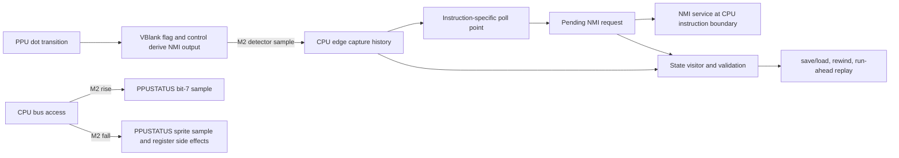

<user_constraints>
## User Constraints (from CONTEXT.md)

### Phase Boundary

Deliver NMI-01, NMI-02, KEEP-02 and KEEP-03: reads of `$2002` and writes to
`$2000` around NTSC VBlank start/end observe the correct flag and interrupt
behavior; the six named AccuracyCoin rows pass at `6bee919`; new machine
history survives save/load, rewind and run-ahead. Protect the current PASS set.

The six rows are `$2002 flag timing`, `NMI Control`, `NMI Timing`,
`NMI Suppression`, `NMI at VBlank end` and `NMI disabled at VBlank`.
Phase 20 includes the NMI polling needed by NMI Control 8/9. Phase 21 retains
IRQ I-flag latency, the corresponding branch/IRQ cases, and BRK/IRQ vector
hijacking. A necessary shared seam may support both phases without claiming
Phase 21's outcomes here.

### Locked Decisions

The owner selected all four areas and delegated further decisions: consider
relevant stakeholder perspectives, tradeoffs, primary sources and adversarial
cases to diminishing returns, then automatically adopt one coherent set of
recommendations. Three specialist reviews covered race evidence, timing and
alignment, and state/host proof; the orchestrator covered attribution and
reconciled their conclusions. These are adopted constraints for research and
planning, not claims of implemented or measured improvements.

### Race-test evidence

- **D-01:** Use three complementary layers: owned PPU-dot tests for flag
  transitions; owned CPU bus/program tests for CPU-visible reads, writes and
  NMI delivery; pinned AccuracyCoin as integration evidence. No layer alone
  establishes the whole contract. Reuse `ppu_fixture.h`, `ines.h`, `check.h`
  and the existing campaign rather than adding a test framework or dependency.
- **D-02:** Derive expectations from the pinned test's assembly/comments and
  hardware documentation, never from the current implementation's output.
  Record source, coordinate convention, initial state, event order and any
  derivation beside each expected table. AccuracyCoin is primary evidence of
  test intent, not independent proof that every outcome was hardware-measured.
  Curated NESdev explanations corroborate hardware behavior; distinguish
  transistor-analysis observations from general wiki summaries.
- **D-03:** Cover both VBlank-set and pre-render-clear boundaries, including
  points before, on and after each transition and normal-operation controls
  outside the race window. For the start window, distinguish flag suppressed,
  flag observed but NMI suppressed, and flag observed with NMI retained.
  Express offsets relative to a named sample event, not an ambiguous `dot`.
  Exercise ordinary and mirrored register addresses through the real decoder.
- **D-04:** Cover both `$2002 flag timing` subtests: flag clearing and flag
  setting. VBlank bit 7 is sampled at M2 rise; sprite bits 6/5 are sampled at
  M2 fall. The pinned assembly documents this distinction. Preserve status
  low-bit/open-bus behavior, write-toggle reset and register side effects.
  Direct PPU-register helper tests cannot establish the split bus read.
- **D-05:** Cover `$2000` disabled/enabled, unchanged `$80` rewrites, `$00`
  then `$80` re-enabling during VBlank, enabling after `$2002` cleared the
  flag, and enabling/disabling around both VBlank transitions. Include the
  extra-NMI pattern associated with Bases Loaded II without bundling a game
  or making a title-specific exception. NMI Control 8/9 must distinguish the
  handler running after the instruction following `STA $2000` from running
  before that instruction after `INC $2000`; preserve both RMW writes.
- **D-06:** Write defect reproducers before their fixes. Already-correct
  cases remain passing guards, following Phase 19's D-10 amendment; do not
  falsely require every new test to fail first. If an intermediate commit
  needs expected-failure handling, make the expected assertion/outcome
  explicit, distinguish it from a crash or setup failure, and remove that
  handling with the fix. Final `ci` has ordinary passing assertions.
- **D-07:** Use a bounded set of controls that distinguish plausible wrong
  models: move flag set/clear by one dot; sample all three status bits at one
  edge; revoke an already captured NMI on a read/disable/clear; create an
  extra NMI on unchanged `$80`; omit the RMW dummy write; service an NMI one
  instruction early. Each selected control must trip its intended oracle.
  A tolerated AccuracyCoin shift is not a substitute for an absolute-dot
  owned test. No generic mutation-testing project is added.

### CPU/PPU alignment and NMI ordering

- **D-08:** Use one physical NMI-line model plus CPU capture and polling
  history. Distinguish the PPU flag, NMI enable, asserted line, sampled edge,
  pending request and instruction poll result. A shorter pulse can miss
  capture; lowering the line later must not erase an already captured
  request. Clear/consume history only at its documented reset/service event,
  not indiscriminately at `$2002`, `$2000` disable or pre-render clear.
  Document active-low hardware polarity versus any asserted-high boolean.
- **D-09:** Keep the existing integer half-master-clock timeline and eager
  PPU catch-up at the two M2 edges. Make `$2002`'s early VBlank sample and
  later sprite sample explicit. Preserve one access's side effects and the
  original bus cycle count; do not perform a second register read merely to
  obtain the second sample. Keep APU phase, mapper stamps and DMA repeated
  accesses coherent with that timeline.
- **D-10:** Treat PPUSTATUS sampling and CPU NMI-input sampling as separate
  events. The old research alternately prescribes M2 rise, M2 fall or an
  alignment shift without resolving same-edge ordering. Research must map
  CPU detector stages to the existing M2 events from primary analysis and
  pinned test behavior, then probe flag-set/read-clear/sample/poll ordering.
  M2 fall is the source-backed detector candidate from the specialist review;
  same-edge side-effect ordering remains to be demonstrated. Do not mistake
  the proven bit-7 read sample at M2 rise for proof of NMI detector timing.
- **D-11:** First test the existing deterministic alignment. AccuracyCoin's
  relative synchronization and accepted table shifts do not establish a
  unique boot/reset alignment or justify adding a constant. Add/change one
  machine-wide fixed phase only if a minimal reproducer shows a residual
  alignment defect after correct event ordering, and the result satisfies
  every target table and regression guard. Never select alignment per row,
  program counter, title or run; never randomize it.
- **D-12:** A table's documented alignment alternative applies to the whole
  sequence, except entries the pinned source explicitly ignores. Do not
  choose an alternative independently for each byte, loosen the oracle or
  shift VBlank itself to fit a table. Any persistent phase/history needed
  for continuation belongs to the instance and save-state contract.
- **D-13:** Keep changes local to existing PPU, bus and CPU seams. Prefer a
  small owned helper or justified duplication to a new dependency. Do not
  introduce a generalized scheduler, second accuracy mode, public trace API,
  configurable chip profiles or cycle-stepping CPU rewrite for this phase.
  Exact helper/field layout is planner discretion, constrained by evidence.
  Keep the PPU-to-CPU link boundary and the IRQ line's existing single writer.
  Review the NMI poll against instruction classes, including branch exceptions
  where necessary for NMI; do not expand into Phase 21's IRQ fixes.

### Save-state race coverage

- **D-14:** Keep the approved state format **1 to 2** and behavior revision
  **7 to 8**. Phase 19 already took revision 7; older research's Phase 20
  `6 to 7` wording is superseded. Update version pins, README and public-header
  comments with the behavior that changes. Preserve the existing format-error
  precedence and reject format 1 without mutating the instance or save state.
- **D-15:** Serialize every historical value needed to continue: detector
  history, pending/polled NMI and any persistent suppression/read-sample/phase
  state. Reuse the existing state visitor and validation path. A genuinely
  derived current line can be recomputed; an earlier sampled line or edge
  cannot be reconstructed from current PPUCTRL/PPUSTATUS. A local temporary
  fully consumed inside one synchronous bus call need not become state.
  Prefer one source of truth over redundant serialized booleans.
- **D-16:** Validate field bounds and actual reachable combinations before
  applying state. Historical latches may legitimately differ from the live
  line, so a validator must not reject the race it is meant to preserve.
  Extend existing rejection tests with CRC-correct malformed fields and
  format-1 rejection; retain whole-instance/continuation-unchanged checks.
  Canonical save/load/save equality supplements behavioral continuation.
- **D-17:** Separate exact race-state proof from public host replay. The
  public API saves a whole machine between frames, and `cpu_step` completes
  an instruction; it cannot pause a caller mid-instruction. Use owned
  internal fixtures to exercise set-dot, clear-dot and edge-before-poll
  state, using the production state visitor/loader wherever a resumable,
  valid machine state can be established. Prove and label whether each
  cutpoint is reached by execution or constructed as a valid fixture; resume
  only where all CPU execution state is represented. No asynchronous save,
  thread sampling, production callback or debugger API is authorized.
- **D-18:** The researcher/planner must resolve exact cutpoint feasibility
  explicitly; do not assume whole CPU cycles make event-dot snapshots
  impossible. With rendering off and origin `(261,0)`, set-dot ordinals are
  `82523 + n*89342`, and clear-dot ordinals are `1 + n*89342`. Some are
  divisible by three: set ordinal 261207 and clear ordinal 89343 can coincide
  with CPU-cycle ends. This is a derived candidate, not a run result; account
  for reset cycles, instruction lengths, PPU phase and synthesizer history
  in the actual fixture. A nearest-frame snapshot does not satisfy an exact-dot claim,
  and a made-up mid-instruction state cannot prove full-machine continuation.
  If a requested cutpoint cannot be represented, record the specific limit
  and the required acceptance clarification before claiming KEEP-03. Preserve
  exact transition/latch tests plus public replay coverage; do not silently
  weaken the roadmap or implement a CPU state machine to hide the mismatch.
- **D-19:** Extend `core.state_fork.*`, `runner.state.*`, core run-ahead and
  `libretro.runahead` using owned NMI-sensitive programs and existing helpers.
  Compare uninterrupted, restored and speculative runs with native state,
  frame/tick/audio results and a guest-observable NMI counter or event marker.
  Host equality alone can share the same core bug; the race tests provide
  independent expectations. Exercise real save/load work, stale/omitted-load
  controls, and at least a targeted omitted-history control. Preserve the
  existing multi-board matrix; detailed race sweeps can use the smallest NROM
  fixture rather than multiplying identical PPU tests across all boards.
  Include two instances with different latch histories to catch shared state.

### Change attribution, CI and delivery

- **D-20:** Use one Phase 20 branch/PR and ordered green changes: reproducers;
  split register sampling and NMI line/capture with their state implications;
  NMI polling; final evidence refresh. Exact subdivision follows dependencies,
  but each causal behavior change carries its tests, README/header comments,
  moved hash explanations and measured campaign diff. Keep state format and
  behavior revision coherent throughout the PR; no release with unsaved latches.
- **D-21:** The actual starting scoreboard is **108 pass / 38 fail**, all 146
  scored rows terminal, with five DRAW entries outside the score. Protect
  Phase 19's newly passing rows, not just v5 opening's 101. Preserve the cold,
  same-invocation protected-main comparison and existing result provenance.
  Six target passes alone imply 114/32 if nothing else changes; this is an
  expectation, never a hard-coded verdict or a reason to chase neighbors.
  Record incidental improvements and investigate every lost PASS.
- **D-22:** Keep the AccuracyCoin pin, schemas, guest caps and current CI
  placement. Use focused tests while iterating; run the full campaign at
  causal behavior milestones and final `cmake --workflow --preset ci`.
  Preserve protected PASS checks on every supported lane, six-platform hash
  equality, CPU vectors, MMC3, Holy Mapperel and boot-to-play. Reuse existing
  sanitizer/performance/host checks; do not add a full campaign to every lane,
  loosen the +1% performance policy or raise a timeout without its required
  measurement. New tests must catch a distinct failure, not mirror code.
- **D-23:** Re-pin only observed frame/audio/state hashes in the causal change,
  with old/new values and a hardware/state reason. Explain audio movement
  through CPU/APU event timing; it is not automatically justified by a video
  fix. Refresh scoreboard, activation revision, fingerprint and metadata from
  the actual campaign, preserving source-dirty status honestly. Existing dirty
  local baseline provenance is not clean hosted evidence; retain that debt
  until an identified clean hosted run supplies the missing confirmation.
- **D-24:** Keep the core integer-only, allocation-free while running, and
  independent per instance. No new runtime/test dependency, bundled ROM,
  window/device code, special-case title fix or global mutable latch. Preserve
  clean-room boundaries: documentation and permitted test behavior only;
  reference emulators, if needed, are released binaries, never source.
  Keep existing model-config edits out of the discussion commits. This
  command ends after context capture; planning, implementation, PR and merge
  remain separate steps.

### the agent's Discretion

- Helper names, minimal latch representation, exact fixture layout, diagnostic
  formatting and bounded sweep size are implementation choices.
- Research must establish same-edge clear/capture order, verify the default
  alignment against the complete pinned tables, and demonstrate the selected
  reachable serialization cutpoints (including audio state). No runtime probes or implementation tests were
  run during this discussion; no target row is newly claimed passing.
- Older research's global alignment-shift recommendation, conflated sample
  phases, stale behavior revision and Phase 19 sprite hypotheses are not locked
  choices. The pinned NMI-at-end source also does not support the earlier
  `PLA` versus `NOP` description; use its actual two sequences when deriving
  the reproducer. Reconcile these in phase research rather than propagating them.

### Deferred Ideas (OUT OF SCOPE)

- Phase 21: I-flag IRQ latency and shared interrupt entry/vector hijack.
- DMA/OAM/open-bus clusters, PAL, additional hardware profiles and any new
  public arbitrary-cycle stepping/debug API remain outside Phase 20.
- Fetch-only nightly blargg expansion remains future scope; no unlicensed
  blargg ROM is committed.

#### Reviewed Todos (not folded)

- `.planning/todos/pending/2026-10-26-add-reproducible-owned-property-tests.md`
  — generic seeded helper/shrinking has not demonstrated additional value
  for this phase; reuse existing deterministic state tests.
- `.planning/todos/pending/2026-10-26-make-runner-signal-checks-deterministic.md`
  — unrelated process/signal contract; preserve separate proposed scope.
- `.planning/todos/pending/2026-10-26-evaluate-scoped-nightly-mutation-testing.md`
  — tool/nightly pilot is separate; scoped owned negative controls suffice here.
</user_constraints>

<phase_requirements>
## Phase Requirements

| ID | Description | Research support |
|---|---|---|
| NMI-01 | A game that reads `$2002` around the start of VBlank sees the console's flag value and gets or loses NMI as the console does; the `$2002 flag timing`, `NMI Timing` and `NMI Suppression` rows pass. | Pinned source tables and event timing below specify the sample split, accepted complete-array alternatives, ignored cells and owned dot/bus test seams. Same-edge detector ordering and actual row passes remain execution evidence. |
| NMI-02 | A game that enables or disables NMI around the start or end of VBlank gets NMIs exactly when the console would, including the extra NMI Bases Loaded II relies on; the `NMI Control`, `NMI at VBlank end` and `NMI disabled at VBlank` rows pass. | Pinned NMI control sequences and expected arrays plus set/end dot behavior guide local PPU/bus/CPU tests. Detector capture and poll behavior remain to be demonstrated by bounded execution. |
| KEEP-02 | A frame or audio hash that moves is re-pinned in the same change with its reason, and stays identical on all six platforms. | Existing campaign, pin, hash metadata and cross-platform CI are the measurement seams; current values cannot be predicted from research. |
| KEEP-03 | A save state taken at any frame, including during the VBlank race or an interrupt sequence, loads back to the same run under rewind and run-ahead; a state from an earlier format is refused with the existing version error. | Production state visitor/validator and host replay seams exist. Probe demonstrates executable exact set/clear instruction-boundary state with APU history. Edge-before-poll feasibility and the final target matrix still require implementation evidence. |
</phase_requirements>

# Phase 20: NMI line and VBlank flag — Research

**Researched:** 2026-10-26
**Domain:** NES RP2A03G/RP2C02G interrupt and PPU register timing; deterministic C emulator state
**Confidence:** MEDIUM overall; exact project/test values HIGH, hardware same-edge order unresolved

## Summary

Phase 20 should model the PPU's VBlank flag and NMI output line as separate state, then model the CPU's edge capture and instruction polling separately from both. Keep the work in the existing PPU, bus, CPU and state visitor seams. The hardware PPUSTATUS bit-7 sample occurs at M2 rise and sprite status at M2 fall; the CPU's NMI input detector is a separate event. The pinned AccuracyCoin test establishes its own expected data and allowances, but it does not settle same-edge side-effect order or prove all outcomes were measured on hardware. [CITED: `src/bus.c:16-33`, `src/ppu.c:487-516`, AccuracyCoin pinned assembly]

The deterministic internal cutpoint probe in `probes/20-cutpoint-probe.c` reaches both context candidate dots with whole three-cycle JMP instructions, then exercises the production save/load path and compares canonical continuation state. It has NMI disabled, starts from a constructed rendering-off `(261,0)` fixture origin, and carries nonzero APU/synth history. It does not establish normal cartridge-reset reachability, NMI detector state at edge-before-poll, or any AccuracyCoin pass. Preserve this distinction in planning and verification. [VERIFIED: `probes/20-cutpoint-probe-output.txt`]

**Primary recommendation:** First implement source-grounded PPU dot and CPU-bus reproducers, then test the existing fixed alignment against every complete pinned table. Probe D-10 ordering with a bounded set of same-edge variations before selecting the NMI capture event. Serialize and validate persistent history, update versions and explain measured hash changes in the same causal change that introduces that history; add complete host replay after capture and polling are correct. Do not apply a global timing shift based on one table.

## Architectural Responsibility Map

| Capability | Primary tier | Secondary tier | Rationale |
|---|---|---|---|
| VBlank flag and `$2002` register sample | PPU/bus emulation core | owned PPU and bus tests | PPU owns dot transitions; bus has two ordered M2 catch-ups and the real mirrored-register decoder. |
| NMI output, edge capture and CPU poll | PPU-to-CPU/core boundary | owned CPU program tests | PPU derives the physical output; CPU retains captured edge and decides instruction-boundary service. Keep separate states to preserve a short pulse. |
| Save/load, rewind and run-ahead | per-instance state visitor and host integration | core/runner/libretro replay tests | Every persistent history value must survive state restore; public saves remain frame-boundary operations. |
| Accuracy and hash evidence | existing runner/campaign | six CI platforms | The pinned ROM tests integration; six-platform campaigns establish hash stability and protected PASS retention. |

## Standard Stack

### Core

| Component | Version or pin | Purpose | Why standard |
|---|---|---|---|
| Existing C core | C17 project build | Integer-only instance-local CPU, PPU, bus and state changes | Project rule; no new language/runtime layer. |
| Existing CMake/CTest workflow | configured `ci` preset | Focused owned tests and final project gate | Existing build/test harness. |
| AccuracyCoin test source | commit `6bee919529289c555803b612b8c9e4f7eaaeeabb` | Integration target tables and acceptance logic | Locked project pin; do not substitute another ROM revision. |
| Existing test helpers | `tests/ppu/ppu_fixture.h`, `tests/ines.h`, `tests/check.h`, `tests/state_test.h` | Valid in-memory NROM and state test fixtures | Reuse already-owned helpers; no test framework or ROM bytes required. |

No dependency installation is required or recommended. No package versions are applicable. Use the existing command `cmake --workflow --preset ci` for the eventual full gate; research did not run the full campaign.

## Source-grounded behavior and expected tables

### PPU and bus timing

- The project already advances an integer half-master-clock timeline at M2 rise and fall. The CPU bus cycle calls `ppu_catch_up` after `ticks += 9`, samples the current IRQ line, clocks the APU, then calls `ppu_catch_up` after another 15 ticks before completing the read/write. The PPU increments one dot per eight half-master-clock ticks. [VERIFIED: `src/bus.c:16-33`; exact source: “`nes->ticks += 9u;`”, “`ppu_catch_up(nes);`”, “`nes->ticks += 15u;`”, “`ppu_catch_up(nes);`”; `src/ppu.c:487-490`: “`nes->ppu.ppu_ticks += 8u;`”]
- NTSC VBlank sets at scanline 241 dot 1 and clears at pre-render scanline 261 dot 1. A `$2002` read samples bit 7 at M2 rise; bits 6/5 reflect M2 fall, about 1.875 PPU dots later for RP2A03G. This split is directly documented in the pinned assembly. [CITED: [AccuracyCoin `TEST_2002FlagTiming`](https://github.com/100thCoin/AccuracyCoin/blob/6bee919529289c555803b612b8c9e4f7eaaeeabb/AccuracyCoin.asm#L1776-L1793); [NESdev PPU frame timing](https://www.nesdev.org/wiki/PPU_frame_timing)]
- Current `$2002` decoder returns status and clears VBlank, read toggle and `cpu.nmi_pending` together after the whole bus cycle. Current set/clear also directly mutate `nmi_pending`; `$2000` bit-7 disable directly clears it. These are direct-pending shortcuts the phase must replace with line and capture semantics, while preserving unrelated open-bus and register effects. [VERIFIED: `src/ppu.c:574-585`, `src/ppu.c:499-516`, `src/ppu.c:646-659`; exact source: “`nes->ppu.status &= 0x7fu;`”, “`nes->cpu.nmi_pending = 0u;`”, “`nes->ppu.status |= 0x80u;`”, “`nes->ppu.status &= 0x1fu;`”]
- NESdev describes a `$2002` read one dot before VBlank set as returning clear and suppressing that frame's flag/NMI; at/on/after the set dot it reads set and suppresses the NMI pulse. Use the pinned test's precise sample event and its own ignored points for the executable oracle. [CITED: [NESdev PPU frame timing](https://www.nesdev.org/wiki/PPU_frame_timing); [AccuracyCoin `TEST_NMI_Suppression`](https://github.com/100thCoin/AccuracyCoin/blob/6bee919529289c555803b612b8c9e4f7eaaeeabb/AccuracyCoin.asm#L6721-L6767)]

### AccuracyCoin acceptance tables

The source is primary evidence for what its tests accept. These arrays are not by themselves independent hardware measurements. Implement the source's checker behavior exactly; do not infer a universal alignment shift.

| Target | Pinned expected result and precise acceptance rule | Source |
|---|---|---|
| `$2002 flag timing` clear | Full four-byte sequence must equal either `[E0,E0,80,00]` or `[E0,80,80,00]`; those are whole-sequence alternatives. | [`AccuracyCoin.asm` 1839–1900](https://github.com/100thCoin/AccuracyCoin/blob/6bee919529289c555803b612b8c9e4f7eaaeeabb/AccuracyCoin.asm#L1839-L1900) |
| `$2002 flag timing` set | After mask `E0`, `$53 == 00`, `$54 == 00 or 40` (source says alignments 0/1 vs 2/3), and `$55 == 60`. The set subtest does not accept a global sequence shift. | [`AccuracyCoin.asm` 1862–1887](https://github.com/100thCoin/AccuracyCoin/blob/6bee919529289c555803b612b8c9e4f7eaaeeabb/AccuracyCoin.asm#L1862-L1887) |
| `NMI Timing` | Ten samples, x=0..9. Whole-sequence alternatives are `[03,02,02,02,02,02,02,01,01,01]` or `[02,02,02,02,02,02,01,01,01,01]` (the source table has an eleventh byte used by the shifted comparison). | [`AccuracyCoin.asm` 6688–6718](https://github.com/100thCoin/AccuracyCoin/blob/6bee919529289c555803b612b8c9e4f7eaaeeabb/AccuracyCoin.asm#L6688-L6718) |
| `NMI Suppression` | Source array `[FF,02,02,FF,00,01,FF,03,03,03]`; checker starts at x=1 and skips x=3 and x=6. Thus x=1/2 must be 2, x=4 must be 0, x=5 must be 1, and x=7/8/9 must be 3. Do not treat skipped cells as an array shift. | [`AccuracyCoin.asm` 6742–6767](https://github.com/100thCoin/AccuracyCoin/blob/6bee919529289c555803b612b8c9e4f7eaaeeabb/AccuracyCoin.asm#L6742-L6767) |
| `NMI at VBlank end` | Both source sequences independently compare to `[01,01,01,00,00,00,00]`. The second actual sequence writes `$80` then uses two `NOP`s before disabling; the older `PLA` vs `NOP` summary is not the source sequence. | [`AccuracyCoin.asm` 6775–6839](https://github.com/100thCoin/AccuracyCoin/blob/6bee919529289c555803b612b8c9e4f7eaaeeabb/AccuracyCoin.asm#L6775-L6839) |
| `NMI disabled at VBlank` | Array `[00,00,00,FF,01,01,01]`; only x=3 (`FF`) is skipped. | [`AccuracyCoin.asm` 6842–6886](https://github.com/100thCoin/AccuracyCoin/blob/6bee919529289c555803b612b8c9e4f7eaaeeabb/AccuracyCoin.asm#L6842-L6886) |

`NMI Control` cases 1–7 check disabled/enabled, enable during active VBlank, flag clearing, repeated `$80`, and disable/re-enable behavior. Case 8 checks service after the instruction following `STA $2000`; case 9 checks service immediately after `INC $2000` because the poll occurs between its two writes. Preserve the RMW dummy write and the source's cycle sequence. [CITED: [AccuracyCoin `TEST_NMI_Control`](https://github.com/100thCoin/AccuracyCoin/blob/6bee919529289c555803b612b8c9e4f7eaaeeabb/AccuracyCoin.asm#L6521-L6640); [pinned README](https://github.com/100thCoin/AccuracyCoin/blob/6bee919529289c555803b612b8c9e4f7eaaeeabb/README.md#L612-L633)]

The source's `VblSync_Plus_A` maps each increment of A to 29,781 CPU cycles/one additional PPU dot and syncs at VBlank dot 0. These are relative test phases. The source documents four possible CPU/PPU alignments; neither synchronization nor a whole-table alternative proves a global boot/reset phase. [CITED: [AccuracyCoin sync routine](https://github.com/100thCoin/AccuracyCoin/blob/6bee919529289c555803b612b8c9e4f7eaaeeabb/AccuracyCoin.asm#L18949-L18967); [NESdev PPU frame timing](https://www.nesdev.org/wiki/PPU_frame_timing)]

## Architecture Patterns

### Recommended event flow



### Pattern 1: Separate physical line, detector history and CPU request

**What:** Keep PPU status/control as inputs to one logical NMI-output calculation; sample that signal at the selected detector event; retain a captured edge independently of the current line; let CPU polling/service consume the request according to the existing CPU's instruction-level model. Document the active-low pin and any asserted-high internal representation.

**When to use:** Every VBlank set/clear, `$2002` read, `$2000` write and CPU poll that may race with the NMI line.

**Implementation evidence:** Current fields include `nmi_prev`, `nmi_pending`, `irq_line` and `poll_latch`, while `nmi_prev` is currently documented as unused until the bus samples lines. PPU state already contains `control`, `status` and `vblank_suppress`. Quote from source: `struct nesturbator__cpu { ... uint8_t nmi_prev, nmi_pending, irq_line, poll_latch; ... }` and `struct nesturbator__ppu { uint8_t control, mask, status, oam_addr; ... uint8_t vblank_suppress; }`. [VERIFIED: `src/internal.h:35-49`, `src/internal.h:121-126`]

### Pattern 2: Keep sub-cycle samples at the bus seam

**What:** Reuse two eager PPU catch-ups already in each bus cycle. Sample `$2002` bit 7 at the earlier M2-rise point and sprite bits at the later M2-fall point; apply the one read's side effects once. Put CPU NMI input sampling at its evidence-backed edge after D-10 experiment, not at whichever point is easiest to implement.

**When to use:** CPU-visible PPU status reads and line transitions near VBlank start/end.

### Pattern 3: State tests use executed cutpoints plus public boundary replay

**What:** Create exact owned internal fixture states using production save/load, and separately replay public frame-boundary states through core, runner and libretro/run-ahead paths. Compare native state/continuation and guest-visible NMI marker, plus frame/tick/audio evidence. Keep fixtures per-instance.

**When to use:** New persistent NMI history, edge-before-poll race and the format bump.

### Existing test seams

- `tests/ppu/ppu_fixture.h` builds and loads an in-memory one-bank NROM with `JMP $8000` and vectors set to `$8000`; `tests/ines.h` and `tests/check.h` provide cartridge construction and assertions. [VERIFIED: `tests/ppu/ppu_fixture.h:1-42`]
- `tests/ppu/test_registers.c` and `tests/core/test_nmi_edge.c` cover current register/NMI behavior; add explicit PPU dot cases and real bus read/write cases there or in focused owned files registered in `tests/CMakeLists.txt`.
- `tests/core/test_state_fork.c`, `tests/core/test_state_reject.c`, `tests/core/test_state_runahead.c`, `tests/runner` state tests, `tests/libretro/libretro_host.c` and `tests/runahead_model.h` already exercise state forks, rejection, runner and host speculative replay. Reuse `tests/state_test.h` for snapshots, canonical equality and CRC-correct mutation.
- `src/frame.c` advances complete `cpu_step` calls until a frame target and then catches the PPU up. The public header promises whole-machine save/load at a frame boundary. Quote: “`A state is the whole machine at a frame boundary`.” [VERIFIED: `src/frame.c:52-59`; `include/nesturbator.h:499-502`]

## Exact cutpoint feasibility evidence

The context derives candidates from a rendering-off `(261,0)` origin. The probe source uses the candidate set ordinal 261207 (`261207 / 3 = 87069` CPU cycles) and clear ordinal 89343 (`89343 / 3 = 29781` CPU cycles). Each loop instruction is `JMP $8000`, exactly three CPU cycles, so the endpoint is a completed instruction boundary. The PPU clock advances three dots per CPU cycle; the printed PPU-tick counter is in half-master-clock ticks and equals the CPU tick counter here.

The measured output is preserved verbatim in [`20-cutpoint-probe-output.txt`](probes/20-cutpoint-probe-output.txt); reproduce it with the command in that file. At the exact checkpoints the probe observes set `(241,1)` with `status=80`, and clear `(261,1)` with `status=00`. Both use PPUCTRL `$00` and show no `nmi_pending`. The production save/load succeeds, canonical state bytes match immediately after load and after seven more complete CPU instructions, and saved audio history is nonzero (`audio_phase`, `synth_level`, `impulse0`) while the frame-scoped PCM count remains zero. This establishes set/clear serialization feasibility under the constructed fixture, including synth/APU history.

**Fixture qualification:** This is a whitebox internal fixture constructed at the phase context's rendering-off `(261,0)` origin, not a walk from ordinary cartridge load/reset. It begins with in-range clock/PPU fields; the reported transition cutpoint is reached by actual production `cpu_step` execution, and the production state loader accepts the resulting endpoint. It does not synthesize a mid-instruction state. `load_cartridge` initializes the PPU at `(0,0)`, while the no-cartridge power-on helper starts at scanline 261. Therefore do not present this probe as proof of a normal cartridge-reset path. It is also explicitly an NMI-disabled feasibility proof, not NMI-edge or edge-before-poll coverage.

`edge-before-poll` remains unmeasured. Add a bounded execution probe with the same owned NROM and real bus, target a known NMI-producing transition during the final/second-to-last CPU cycles of NMI Control 8/9, and attempt save/load only at an actually completed instruction boundary where the edge is captured but not yet serviced. Record the exact PC/opcode, bus-cycle ordinal, PPU point, poll state and serialized continuation. If no valid full-machine instruction-boundary cutpoint represents that intermediate history, state the specific representation limit and obtain the roadmap's required acceptance clarification before claiming KEEP-03. Do not fabricate CPU mid-instruction internals.

## Recommended implementation sequence for planning

1. Add absolute PPU-dot VBlank set/clear tests (before/on/after), normal controls and bounded wrong-model controls. Keep their expected coordinates/event conventions beside the assertions.
2. Add CPU bus/program tests for `$2002` split sampling and `$2000` enable/disable/unchanged-write/RMW cases through real register mirrors; verify status/open-bus side effects independently from NMI delivery.
3. Add a small D-10 same-edge experiment around (a) VBlank set coincident with `$2002` early bit-7 sample and later clear, (b) detector sample at the candidate M2-fall point before/after that read side effect, and (c) the CPU's next legal poll point. Keep the fixed alignment unchanged while comparing the few order variants. Choose one only if an owned observable and the pinned tables distinguish it; otherwise document remaining ambiguity and do not claim the target rows.
4. Run the six pinned rows at commit `6bee919` with unchanged campaign policy. Compare each complete table/checker exactly as above against existing deterministic alignment. Change a single global phase only after order is correct and a minimal reproducer demonstrates residual need; re-run all six tables and protected regressions. Do not hard-code per-row/per-program offsets.
5. Include NMI-specific serialized history and reachable-combination validation in the existing state visitor with each causal capture/poll change above, never as a later unsaved-history step. Keep historical detector/request state distinct from a recomputable live line. Bump format 1→2 and behavior revision 7→8, preserve format-error precedence/all-or-nothing rejection, update hash pins and README/public-header comments with observed causal behavior.
6. Extend the existing fork/reject/runner/core run-ahead/libretro replay tests with the NMI event marker, stale/omitted-load controls, two instances with different histories, exact set/clear fixtures and the edge-before-poll finding. Re-pin only observed frame/audio/state hashes, then run the final campaign and `cmake --workflow --preset ci` as required by the locked context.

## Don't Hand-Roll

| Problem | Don't build | Use instead | Why |
|---|---|---|---|
| Register sub-cycle timeline | Separate scheduler, cycle-stepping rewrite or second clock mode | Existing half-master tick counter and two `ppu_catch_up` points in `src/bus.c` | Existing call structure already represents both M2 edges and keeps APU/mapper stamps in the bus timeline. |
| ROM/test fixtures | New framework, third-party package or bundled external ROM | In-memory NROM via `tests/ines.h` and current fixture helpers; pinned AccuracyCoin campaign | Project ownership, clean-room and no-dependency constraints; local fixtures make exact dots deterministic. |
| Save-state format handling | Second serializer or host-specific snapshots | Existing `src/state.c` visitor, validator and byte-exact save/load path | One field list drives serialize/validate/apply and preserves refusal atomicity. |
| Global alignment | Per-test, per-ROM or randomized phase fudge | Existing alignment first, source-approved whole-table alternatives, one documented machine-wide phase only if demonstrated | Avoids matching individual target rows while creating regressions elsewhere. |

## Common Pitfalls

1. **Conflating the sampled status byte with NMI edge capture.** Bit 7 is sampled at M2 rise; sprite bits at M2 fall; CPU detector is a third event. Keep the three events explicit and test the detector order.
2. **Clearing a captured request when the live line falls.** `$2002`, `$2000` disable or pre-render VBlank clear can change the line after edge capture. Preserve capture history until the source-backed CPU service/clear event.
3. **Treating accepted table alternatives as a global shift.** `$2002` clear and NMI Timing accept whole-sequence alternatives; suppression and disabled-at-start explicitly skip selected entries. The `$2002` set subtest allows only one cell's `$00/$40` alternatives. Encode exactly that.
4. **Using host frame equality as the only oracle.** A host and core can share the same error. Include guest-visible NMI count/marker and exact PPU dot/bus expectations.
5. **Calling a constructed or nearest-frame state an exact executed cutpoint.** The preserved probe clearly labels its fixture origin, NMI-disabled status and actual instruction-boundary execution. Edge-before-poll still needs its own measured feasibility evidence.
6. **Using only a zero-audio fixture for save/load.** The probe proves that nonzero synth impulse and sample-phase history survives at set/clear; implementation tests must also include meaningful frame-boundary audio/frame parity and should keep PCM/frame-scoped fields within their documented contract.
7. **Copying stale phase/revision or NMI-at-end descriptions.** Phase 19 already took behavior revision 7; use 7→8. The NMI end test's second sequence is `$80`, two `NOP`s, then disable, not a generalized PLA/NOP pair.
8. **Chasing unrelated campaign rows.** Protect every existing PASS and investigate any regression, but do not add speculative adjacent fixes or alter timeout/performance policy without measurements.

## Code Examples

The planned assertions should use existing test helpers and real bus entry points. Verbatim in-repo examples:

```c
static const uint8_t jmp_self[3] = {0x4cu, 0x00u, 0x80u};
spec.nmi_vector = 0x8000u;
spec.reset_vector = 0x8000u;
spec.irq_vector = 0x8000u;
```

These values are quoted from the existing NROM fixture and should be reused rather than introducing a new ROM format. [VERIFIED: `tests/ppu/ppu_fixture.h:16-34`]

```c
nes->ticks += 9u;
ppu_catch_up(nes);
nes->ticks += 15u;
ppu_catch_up(nes);
```

This is the existing two-edge bus-cycle structure. New sample ordering belongs at those catch-up points and the one register access, not in a second read. [VERIFIED: `src/bus.c:16-33`]

The probe command and measured output are in `probes/20-cutpoint-probe-output.txt`. It links the existing CI library and has no new dependencies.

## State of the Art

| Established baseline | Phase 20 direction | Impact |
|---|---|---|
| Directly set `cpu.nmi_pending` from VBlank and `$2000` writes; clear it on status read, disable and pre-render clear. | One PPU-derived NMI output, separately sampled/captured by CPU detector and separately polled/serviced. | A short edge and a later falling line can be represented without revoking captured history. |
| `$2002` status bits are read and cleared after the bus cycle. | Split VBlank bit-7 early sample from sprite/status later sample while performing one read's side effects once. | Required by pinned `$2002 flag timing` and the existing M2 timeline. |
| CPU `cpu_step` completes instructions; public state API promises a frame boundary. | Use internal executed fixtures for exact-dot cutpoints and public frame states for rewind/run-ahead. | No public cycle-stepping API or mid-instruction state machine is needed. |
| State format 1, behavior revision 7. | State format 2, behavior revision 8, same causal change as field serialization and observed pin updates. | Older format is rejected with existing format error before mutation. |

## Project Constraints (from AGENTS.md)

- Own all emulator and test code; `libretro.h` is the only vendored file. The core library links only C memory functions.
- Ship the C library, headless runner and libretro adapter; do not add a window, audio-device or input-device layer.
- Keep the tree clean: no ROM/BIOS bytes outside the ROM manifest, no personal paths/names/email addresses; commits use noreply identity and hygiene checks run on commit/push.
- Clean room: work from hardware documentation and test behavior; never open or retain GPL/LGPL emulator source. Reference emulators, if needed, are released binaries only.
- Keep the core deterministic and integer-only, with all state per instance; identical inputs must produce identical frame/audio hashes across platforms.
- Behavior changes require tests through `cmake --workflow --preset ci` and same-change README/public-header comment updates. Checks are automated.
- This command is one planning step; do not implement, branch-switch or commit in research.
- Use small C modules/plain control flow/fixed-width types; hardware comments state behavior and cite their source. Add no dependency unless existing code, standard library and platform cannot meet a demonstrated need simply.

## Assumptions Log

| # | Claim | Section | Risk if wrong |
|---|---|---|---|
| A1 | AccuracyCoin's listed alternatives and ignored cells define test acceptance, not every physical console's behavior. | Source-grounded behavior | A test could be overfit or incorrectly treated as independent hardware proof. Source code and hardware evidence are separate oracles. |
| A2 | Visual6502/NESdev interrupt sampling analysis supports M2 fall as a detector candidate but does not settle this core's same-edge order. | Open Questions | Choosing a point without an observable test would make suppression and instruction polling nondeterministic relative to hardware. |
| A3 | The context's `(261,0)` rendering-off fixture is the right origin for exact cutpoint tests. | Cutpoint feasibility | Probe measured the specified offsets, not ordinary cartridge-reset reachability; executor must retain this distinction. |

## Open Questions and bounded execution gates

1. **D-10 same-edge ordering — unresolved, bounded experiment required.** Hardware references establish the `$2002` bit-7 sample at M2 rise and a CPU NMI detector sampled during φ2; the source-backed detector candidate is M2 fall. They do not establish whether line capture at the coincident set dot happens before or after `$2002` clear/`$2000` disable side effects in this implementation. Add one owned real-bus program with a guest NMI marker and vary only the event ordering at the shared dot among: PPU set → detector capture → read side effect; PPU set → read side effect → detector capture; detector at next candidate sample. Run same-dot and ±1-dot controls through the actual decoder. Record status return, capture/poll marker and cycle count. Compare against relevant pinned rows. If the test does not distinguish variants, record the ambiguity; do not assert a passing hardware result or invent further offsets.
2. **Complete table alignment — no global shift established.** Run the existing deterministic alignment against the exact tables and checker rules above, for all six target rows. `$2002` clear and NMI Timing permit whole-sequence alternatives; `NMI Suppression` and `NMI disabled at VBlank` skip specified cells; `$2002` set has a single `$54` alternative. Any proposed phase change is one global integer shift and must keep all target tables plus protected regressions valid. Research did not claim a new target result.
3. **Edge-before-poll serialization — set/clear pass; this remains open.** The probe proves set/clear cutpoint feasibility. Run one bounded candidate sweep over NMI Control 8/9's actual instruction sequence and poll window, logging completed instruction boundary, PC/opcode, PPU coordinate, CPU edge/capture/poll history and serialized state. Either demonstrate an execution-reached full-state cutpoint and replay it through production load, or record the precise state-machine representation limit and obtain acceptance clarification before KEEP-03 is claimed.

## Environment Availability

Skipped: the phase adds no external runtime, service or package dependency. The existing C/CMake build and tests are project-local. The final phase gate remains the locked `cmake --workflow --preset ci` command.

## Validation Architecture

Skipped because `.planning/config.json` explicitly sets `workflow.nyquist_validation` to `false`. Implementation still follows the locked phase requirements and project CI rule.

## Security Domain

Skipped because `.planning/config.json` explicitly sets `security_enforcement` to `false`. Clean-room source handling and repository hygiene remain mandatory project constraints.

## Sources

### Primary sources and project evidence

- AccuracyCoin `AccuracyCoin.asm` and `README.md`, commit `6bee919529289c555803b612b8c9e4f7eaaeeabb` — flag sampling note and target arrays, NMI Control 8/9 and actual NMI-at-end sequences. [Pinned assembly](https://github.com/100thCoin/AccuracyCoin/blob/6bee919529289c555803b612b8c9e4f7eaaeeabb/AccuracyCoin.asm); [pinned README](https://github.com/100thCoin/AccuracyCoin/blob/6bee919529289c555803b612b8c9e4f7eaaeeabb/README.md)
- Project sources read for this research: `src/bus.c`, `src/ppu.c`, `src/cpu.c`, `src/frame.c`, `src/state.c`, `src/internal.h`, `include/nesturbator.h`, `tests/ppu/ppu_fixture.h`, state test helpers, target scoreboard and state/hash metadata.
- Owned executable probe and exact captured output: [`20-cutpoint-probe.c`](probes/20-cutpoint-probe.c), [`20-cutpoint-probe-output.txt`](probes/20-cutpoint-probe-output.txt).

### Hardware references (curated, confidence MEDIUM)

- NESdev [PPU frame timing](https://www.nesdev.org/wiki/PPU_frame_timing) and [PPU registers](https://www.nesdev.org/wiki/PPU_registers) — VBlank set/clear and `$2002` suppression/enable behavior.
- NESdev [CPU interrupts](https://www.nesdev.org/wiki/CPU_interrupts) and [CPU pinout](https://www.nesdev.org/wiki/CPU_pinout) — φ2 interrupt recognition/polling and M2 timing; CPU interrupt stages reference Visual6502 analysis.
- Visual 2A03 transistor simulator source reference: [qmtpro Visual 2A03](https://www.qmtpro.com/~nes/chipimages/visual2a03/). This research did not run the simulator; use the candidate with the bounded owned behavior experiment.
- Project reference index and hardware source maps: `.planning/preparation/README.md`, `.planning/preparation/NES-HARDWARE-CPU-APU.md`, `.planning/preparation/NES-HARDWARE-PPU-CARTRIDGE.md`, `.planning/preparation/CONFORMANCE.md`, `.planning/preparation/ARCHITECTURE.md`, `.planning/preparation/DECISIONS.md`, `.planning/preparation/ENGINEERING.md`, `.planning/preparation/LIBRETRO-AND-RUNNER.md`, `.planning/preparation/GSD-HANDOFF.md`.

## Metadata

**Confidence breakdown:**
- Pinned test intent and accepted arrays: HIGH — read the pinned source and checker implementation.
- Current code/test seams and cutpoint feasibility: HIGH — inspected source and executed the preserved owned probe.
- NMI detector exact edge/order: LOW/unresolved — the docs give a candidate and test intent but same-edge order has not been established by this research.
- Recommended architecture and plan structure: MEDIUM — constrained by project decisions, but final field layout depends on the experiment.

**Research date:** 2026-10-26
**Valid until:** Stable for this pinned phase; revisit if the AccuracyCoin pin or hardware documentation revision changes.
