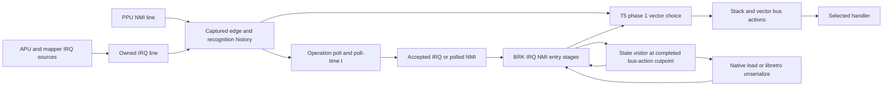

<user_constraints>
## User Constraints (from CONTEXT.md)

### Locked Decisions

The owner selected all relevant areas and delegated their resolution: fan out
across relevant roles, examine primary sources, alternatives and adversarial
cases, then adopt a coherent recommendation without routine questions.
Three parallel reviews covered polling, vector takeover and state/acceptance;
a bounded cross-review challenged the combined state/entry recommendation.
These are adopted planning constraints, not measured implementation results.

### IRQ acceptance and instruction polls

- **D-01:** Decide IRQ eligibility at the documented instruction poll using
  the I flag applicable to that poll. Service accepted history at the next
  dispatch; do not gate it again with live architectural I. Keep the live
  IRQ level, captured level and accepted decision conceptually distinct;
  exact minimal representation is researcher/planner discretion.
- **D-02:** CLI, SEI and PLP use the pre-change I value at their poll; RTI
  uses its restored I. Test both PLP transitions, both RTI outcomes, pending
  IRQ across SEI, CLI/SEI combinations and immediate RTI retrigger when an
  unacknowledged IRQ remains asserted. Stacked P reflects architectural
  flags, which can differ from the I used to accept the request.
- **D-03:** Apply branch exceptions to IRQ as well as NMI: retain the first
  legal poll for not-taken and taken same-page branches; on page crossing,
  preserve an earlier accepted request as well as any acceptance at the
  second legal poll. No invented poll in the same-page extra cycle. Cover
  all eight branch opcodes and forward/backward crossings. Derive the exact
  numbered-cycle table from the pinned sources before writing expectations.
- **D-04:** Preserve Phase 20's integer timeline, split PPUSTATUS sampling,
  ordinary-loop NMI capture/retention and single global equal-timestamp
  policy. Keep `nesturbator__irq_update` as the sole production IRQ-line
  writer combining APU/DMC/mapper sources. Reopen alignment or sampling only
  for a minimal demonstrated defect; no per-row/title phase, second accuracy
  mode, generic scheduler or randomized alignment.

### Shared entry and vector takeover

- **D-05:** Use one small owned BRK/IRQ/NMI entry mechanism. Keep entry
  **origin** separate from selected **vector**: BRK retains its skipped byte,
  opcode+2 return PC and stacked B=1 under hijack; hardware IRQ/NMI retain
  their interrupted PC and B=0. Preserve U/I semantics, stack wrapping,
  dummy accesses and the seven-cycle sequence. Do not conflate vector
  takeover with changing the entry's original stack semantics.
- **D-06:** Choose a coherent NMI or IRQ/BRK vector pair at a source-qualified
  takeover boundary; do not fix the vector at entry or independently change
  its high byte after the low byte was fetched. Research must explicitly map
  circuit T-states and phi phases, input recognition, external bus actions
  and this core's numbered cycles. Preparation's "after cycle 4" and older
  research's "at vector-low fetch" are not equivalent implementation rules.
- **D-07:** Model entry-phase recognition and consumption from its own
  evidence. Phase 20's six-case ordinary-loop circuit oracle explicitly
  does not establish entry/hijack windows. The primary hijack analysis describes
  recognition inhibition that prevents a mixed vector, a sufficiently late
  sustained NMI following a handler instruction, and a short pulse that can
  be missed. Distinguish raw line, capture, recognition and service; do not
  erase retained history on line release, promise every raw entry pulse is
  retained, or indiscriminately disable every detector stage during entry.
- **D-08:** Preserve NMI priority and the IRQ source's acknowledgment rules.
  Service consumption happens once at its documented event. A held NMI
  level is not a second edge; a new eligible edge must not be erased by
  completion of an older entry. Entry bus calls must not accidentally turn
  their overwritten poll temporaries into a new ordinary instruction poll.
  Do not introduce an unbounded interrupt queue or extend into reset-pin
  hijacking. Soft reset must coherently terminate any partial entry.

### Source-derived tests and adversarial evidence

- **D-09:** Write owned reproducers before fixes, using three complementary
  layers: CPU test-bus access/stack assertions, production-bus guest programs
  with observable markers, and complete pinned AccuracyCoin tables/campaign.
  `tests/cpu/vector_bus.*` currently logs accesses without production sampling;
  use it for sequence evidence, never as sole proof of detector timing.
  Reuse owned fixtures and CTest; add no framework or dependency.
- **D-10:** Expected tables must state source/pin, initial machine, numbered
  cycles/phase convention, scheduled event and expected PC/P/stack/vector/
  handler order. Derive them from hardware analysis and test assembly, never
  from this core's output. AccuracyCoin is primary evidence of test intent;
  distinguish that from circuit observations and unmeasured physical ties.
  Keep already-correct cases as passing guards; only defect reproducers are
  expected to fail initially. Final CI has ordinary passing assertions.
- **D-11:** Cover IRQ assertion and acknowledgment before/on/after legal
  polls, including acknowledgment between two branch polls. Exercise a real
  IRQ source through production bus sampling, with existing mapper checks
  retained. For BRK and IRQ sweep NMI arrival at every distinct entry cycle,
  and include ordinary NMI entry, selected-vector boundaries, late sustained
  and short-pulse cases, simultaneous priority, new-edge versus held-level
  cases, PC wrap and stack wrap. Observe exact accesses and guest handler
  order, not only the final vector or aggregate campaign score.
- **D-12:** Pin whole-table alignment alternatives exactly as the test
  assembly allows. The overlap tests pair NMI and BRK/IRQ answer tables;
  an allowed shift must apply coherently to both tables, never per byte or
  independently per handler. Diagnose first divergence if latency subtests
  encounter DMA/open-bus prerequisites; a nearby failure is not permission
  to expand into a new DMA cluster or weaken the expected table.
- **D-13:** Use a bounded set of discriminating wrong-model controls: live-I
  recheck, delayed RTI, extra/missing branch poll, lost earlier acceptance,
  wrong priority/B/return PC, early/late takeover, mixed vector, duplicate or
  lost request, and omitted entry-history restore. Each selected control
  must fail its intended assertion or verdict path. Choose controls for
  distinct failures; do not build generic mutation infrastructure.

### Genuine mid-entry save/load with the existing public frame contract

- **D-14:** Introduce **narrowly resumable interrupt entry only**. This is a
  Phase 21 exception to Phase 20's exclusion of mid-instruction state, required
  by Phase 21's stronger mid-entry continuation criterion. Ordinary opcodes
  remain instruction-based; normal `cpu_step` and frame calls still drain
  entry synchronously. No public stepping API, runtime callback, asynchronous
  snapshot or frame-deadline suspension is added; input sampling and crossing
  instruction completion retain their documented meanings.
- **D-15:** The same production entry-stage mechanism must serve normal
  execution and owned internal fixtures. Persist all history necessary to
  resume: origin, next unperformed action, partial vector data/selection and
  consumption history where not derivable. Exact fields are not prescribed.
  Resume an active entry before fetching an opcode, reevaluating I/priority
  or starting another entry. BRK's opcode fetch already counts as cycle 1;
  IRQ/NMI have their two discarded reads. Never repeat/omit a push, dummy
  access, vector read, clock advance or service event after load.
- **D-16:** Prove normal BRK/IRQ/NMI initiation with complete `cpu_step`
  tests. Fixtures may construct and explicitly label the entry origin, then
  execute the production stages to genuine completed-bus-action cutpoints.
  Save with the production visitor, load with the native loader, and resume
  through ordinary `cpu_step`/frame execution. Do not serialize an incomplete
  C stack or fabricate partial pushes and call that executed continuation.
  Sampling halfway through one bus call remains unsupported.
- **D-17:** Exercise every distinct resumable entry stage for all three
  origins, particularly after partial pushes, on both sides of vector
  selection, between vector bytes and around consumption. Compare against
  uninterrupted entry from the same origin: exact machine bytes, accesses,
  ticks and guest markers, then frame/audio continuation. Extend
  `core.state_fork.*`; retain multi-board coverage while using a small NROM
  fixture for the detailed entry sweep. Include nonzero synthesis history
  and interleaved instances with different entry/latch histories.
- **D-18:** Load those compatible native cutpoint states into an actual
  libretro adapter instance via its real unserialize path; extend
  `libretro.runahead` across existing depths with committed/speculative state,
  ticks, video, PCM and guest-marker comparisons. Preserve ordinary
  boundary-origin rewind/run-ahead too. Include stale/omitted-load and
  omitted-history controls. Label the proof **internally reached cutpoints
  loaded through public APIs**: ordinary public frame calls do not expose
  exact mid-entry stops. This satisfies saved-state replay, not a public
  cycle-stepping capability. A boundary-only substitute is insufficient.
- **D-19:** Move state format **2 to 3** and behavior revision **8 to 9** in
  the causal implementation; leave ABI unchanged. New entry history and
  changed poll semantics need explicit compatibility, even if an existing
  byte could be reused. Use the existing SIZE/WRITE/VALIDATE/APPLY/RECORD
  visitor and validate bounds and source-established reachable combinations
  before any mutation. Preserve legitimate historical latches differing from
  live inputs, revisiting `nmi_polled => nmi_pending` if consumption
  changes its reachable meaning. Reject formats 1/2 with existing version
  error precedence and unchanged instance/save generation. Extend CRC-correct
  rejection and save/load/save tests; refresh pins and owned corpus states,
  README and public-header explanations together.

### Regression, attribution and delivery

- **D-20:** The starting campaign is **114 PASS / 32 FAIL**, all 146 scored
  rows terminal, plus five DRAW entries outside the denominator. Protect all
  114 starting PASS keys, including Phase 19/20 gains, and freshly authenticate
  protected-main authority in the same CI invocation. Phase 20's old hosted
  comparison protected 108 keys; that historical count is not Phase 21's
  protection ceiling. No three-target-only or aggregate-score substitute.
- **D-21:** All eleven v5 rows must pass: the three Phase 21 targets; `$2002
  flag timing`, `NMI Control`, `NMI Timing`, `NMI Suppression`, `NMI at VBlank
  end`, `NMI disabled at VBlank`; `Sprite 0 Hit behavior`, `Arbitrary Sprite
  zero`. Three additional passes alone would yield 117/29, an arithmetic
  expectation rather than a hard-coded verdict. Record incidental changes
  and investigate every lost PASS.
- **D-22:** Retain pin `6bee919`, the 1800-frame cap, schemas and current
  CI placement. Focus tests during iteration; run full campaign comparisons
  at causal milestones and final `cmake --workflow --preset ci`. Preserve
  six-platform hash equality, CPU vectors, nightly full vectors/MMC3, Holy
  Mapperel, boot-to-play, sanitizer and host checks. Keep the existing +1%
  performance gate and measured-timeout policy. No new full campaign per
  lane, speculative cap increase or unrelated CI redesign.
- **D-23:** Keep polling and shared-entry behavior attributable in ordered
  green changes, with their tests, README/header comments, measured campaign
  diff and observed moved hashes in the same causal change. Re-pin only
  actual changed frame/audio/state values with reasons; state-byte movement
  is not proof of a timing improvement, and audio changes need a CPU/APU
  explanation. Keep format and behavior version coherent throughout the PR.
- **D-24:** New hosted acceptance must bind candidate, tested merge, protected
  base, effective inputs/modes and run/attempt/artifact identities. Phase 20's
  418-input accepted bundle is prerequisite history, not proof of changed
  Phase 21 source. Reuse existing evidence machinery with documented limits
  and run-specific mitigations. Preserve collector CR-01/WR-03/WR-04 debt;
  do not silently expand into collector maintenance or claim an unmeasured
  paired-chip physical-tie winner.
- **D-25:** Keep all runtime state instance-owned, integer-only and
  allocation-free during execution; the core links only C memory functions.
  All emulation/test code remains owned; `libretro.h` remains the only vendor
  file. No new runtime/test dependency, ROM asset, device code, copied
  emulator implementation or global mutable latch. Read documentation and
  permitted tests; reference emulators only as released binaries.
- **D-26:** Work on `gsd/phase-21-interrupt-latency-and-hijack`, based on
  merged Phase 20. Keep the owner's existing config edit out of commits.
  One GSD step per command remains in force: stop after context/log/session
  capture, with planning and implementation as separate invocations. No
  auto-chain setting, PR, push or merge is part of this discussion step.

### Agent discretion and evidence still required

- Helper/field names, minimal continuation encoding, fixture organization and
  bounded control selection remain implementation choices. Prefer a small
  owned helper or justified local duplication over another dependency.
- Research must derive the exact poll/recognition/cutoff crosswalk and test
  expected tables, prove stage sufficiency and host fixture compatibility,
  and reconcile stale pre-Phase-20 research. Do not turn an unresolved analog
  tie into a prerequisite to independent work. Contradictory finite-margin
  evidence or failed target/protected rows still blocks acceptance.
- No product-behavior or performance improvement is established by this
  discussion. The exact production cutpoint fixtures still need construction
  and verification; no existing state format currently resumes partial entry.

### Deferred Ideas (OUT OF SCOPE)

- DMA/OAM/open-bus clusters, PAL, reset-pin hijacking, chip profiles, public
  exact-cycle/debug APIs and whole-CPU sequencing.
- New fetch-only `cpu_interrupts_v2`/`ppu_vbl_nmi` nightly scope; existing
  licensed/pinned test policy and MMC3 lane remain intact.
- Collector CR-01/WR-03/WR-04 and earlier sprite/JAM-cache advisories remain
  recorded debt; repair only through separately scoped work.

#### Reviewed Todos (not folded)

- `.planning/todos/pending/2026-10-26-add-reproducible-owned-property-tests.md`
  — general helper/shrinking proposal stays deferred; reuse deterministic
  state equality and existing rejection helpers within this phase.
- `.planning/todos/pending/2026-10-26-evaluate-scoped-nightly-mutation-testing.md`
  — a new mutation tool/lane is outside interrupt scope; bounded owned
  wrong-model controls are sufficient here.
- `.planning/todos/pending/2026-10-26-make-runner-signal-checks-deterministic.md`
  — process/signal redesign is unrelated; preserve its current tests.

The matcher gave all three 0.6 on generic test keywords. Scope review takes
precedence over keyword overlap; none is promoted or marked completed.
</user_constraints>

# Phase 21: Interrupt latency and hijack - Research

**Researched:** 2026-10-28
**Domain:** RP2A03 interrupt recognition, C17 CPU sequencing, deterministic state replay
**Confidence:** HIGH for source/test expectations and owned-code seams; MEDIUM for the circuit-to-project phase alignment, which is a crosswalk inference rather than a console measurement.

<phase_requirements>
## Phase Requirements

| ID | Description | Research Support |
|----|-------------|------------------|
| INT-01 | Source quote: "- [ ] **INT-01**: An IRQ is taken on the same instruction as on the console after CLI, SEI, PLP, RTI and branches; the `Interrupt flag latency` row passes." [VERIFIED: .planning/REQUIREMENTS.md:17] | The poll table and AccuracyCoin subtest map in 21-INTERRUPT-TIMING-ANNEX.md separate close-edge IRQ level capture, operation-specific poll, poll-time I, and later service. |
| INT-02 | Source quote: "- [ ] **INT-02**: An NMI arriving during BRK or an IRQ takes over its vector as on the console; the `NMI Overlap BRK` and `NMI Overlap IRQ` rows pass." [VERIFIED: .planning/REQUIREMENTS.md:18] | The circuit T-state to bus-action table identifies the vector-pair selection point and its inhibition window; paired AccuracyCoin tables provide exact allowed whole-table alignments. |
| KEEP-01 | Source quote: "- [ ] **KEEP-01**: Every AccuracyCoin row that passes today still passes on every CI lane, and the CPU vectors, blargg MMC3, Holy Mapperel and boot-to-play checks stay green." [VERIFIED: .planning/REQUIREMENTS.md:27] | Preserve the fresh 114-key protected-main comparison, all eleven v5 passing rows, existing vector/MMC3/Holy Mapperel/boot-to-play gates, hash equality and performance cap. |
</phase_requirements>

## Summary

Use a poll-time decision record for IRQ acceptance, keeping the current IRQ line, its sampled history, and the decision made with the poll's I value distinct. The present dispatch instead tests poll_latch against architectural I at the next dispatch; the exact source line is quoted as "if (nes->cpu.poll_latch != 0u && (nes->cpu.p & FLAG_I) == 0u) {" [VERIFIED: src/cpu.c:522-525]. The CPU struct currently declares "uint8_t nmi_prev, nmi_pending, nmi_polled, irq_line, irq_captured, poll_latch;" [VERIFIED: src/internal.h:48-53]; there is no explicit accepted-IRQ result or resumable entry cursor. Poll/I and branch expectations are in the annex and come from pinned AccuracyCoin test intent plus Visual6502 circuit analysis, not this core's output. [CITED: https://raw.githubusercontent.com/100thCoin/AccuracyCoin/6bee919529289c555803b612b8c9e4f7eaaeeabb/AccuracyCoin.asm] [CITED: https://www.nesdev.org/wiki/Visual6502wiki/6502_Interrupt_Recognition_Stages_and_Tolerances]

Implement entry as a small production state machine shared by BRK, IRQ and NMI, with original entry cause separate from the vector ultimately selected. Current NMI reads 0xFFFAu/0xFFFBu and IRQ reads 0xFFFEu/0xFFFFu [VERIFIED: src/cpu.c:501-540]; software BRK reads 0xFFFEu/0xFFFFu after advancing past the signature byte and pushing status with B/U set [VERIFIED: src/cpu.c:1059-1069]. Circuit analysis makes NMI vector selection late enough to hijack at T5 phase 1 while protection inhibits a later half-hijack. On this core's external bus-action numbering, the selection boundary falls after PCL push and before P push, with both vector reads still ahead. This is an inference from the circuit's internal-command-to-pin delay and the owned BRK sequence, not a measured 2A03 bus capture. [CITED: https://www.nesdev.org/w/index.php?title=Visual6502wiki/6502_Interrupt_Hijacking&oldid=19268] [CITED: https://www.nesdev.org/wiki/Visual6502wiki/6502_Timing_States]

Make the same staged entry mechanism saveable only between completed bus actions. Phase 20 already has a production NROM guest/marker fixture, native public save/load, and real libretro serialize/unserialize seams; extend these so a private fixture runs production entry stages to a genuine cutpoint, saves through the public API, then resumes with ordinary CPU/frame execution and the adapter's real unserialize path. Public frame calls remain synchronous and do not expose exact-cycle stops. [VERIFIED: include/nesturbator.h:414-425,522-565] [VERIFIED: src/frame.c:51-64] [VERIFIED: libretro/libretro.c:359-399]

**Primary recommendation:** Plan polling/acceptance and entry/state as ordered, independently attributable slices. Start with source-derived access/stack reproducers, add production-bus guest cases for detector timing, then use the complete pinned rows and protected campaign. Use the annex tables as the expectation source.

## Architectural Responsibility Map

| Capability | Primary Tier | Secondary Tier | Rationale |
|------------|-------------|----------------|-----------|
| IRQ level aggregation and close-edge capture | API / Backend (emulation core) | — | APU owns the OR of frame, DMC and mapper IRQ state; the bus captures that line at its internal cycle seam. The declaration is "void nesturbator__irq_update(struct nesturbator *nes)" and it computes the aggregate line [VERIFIED: src/apu.c:107-113]. |
| Instruction polls and accepted-interrupt history | API / Backend (CPU core) | — | Opcode execution determines legal polls and the I value visible at each poll; later dispatch consumes accepted history. |
| Entry, vector choice, stack writes and bus actions | API / Backend (CPU core) | Database / Storage (serialized machine state) | CPU owns cause/vector progression and bus accesses; the state visitor owns deterministic continuation after load. No window, audio-device or input-device tier belongs to this phase. |
| AccuracyCoin, owned bus and guest fixtures | API / Backend (test harness) | — | CTest executes the owned CPU, production-bus, state and runner fixtures; the pinned campaign remains governed by the existing manifest. |
| libretro continuation evidence | API / Backend (adapter) | Browser / Client (host callbacks) | The adapter delegates native serialization to the library and does not own a second emulation-state format. The bridge calls the native loader [VERIFIED: libretro/libretro.c:383-399]. |

## Standard Stack

### Core

| Library | Version | Purpose | Why Standard |
|---------|---------|---------|--------------|
| Owned C core | C17 | Integer-only CPU/bus and machine state | The project sets "set(CMAKE_C_STANDARD 17)" and "set(CMAKE_C_EXTENSIONS OFF)" [VERIFIED: CMakeLists.txt:10-14]; project rules prohibit a runtime dependency. |
| CMake + CTest | Existing project presets | Build library, runner, adapter and owned regressions | Existing workflow is the gate; tests belong in current CTest structure rather than a new framework [VERIFIED: .planning/preparation/ENGINEERING.md:35-63]. |

### Supporting

| Library | Version | Purpose | When to Use |
|---------|---------|---------|-------------|
| Existing tests/check.h, tests/ines.h, tests/nmi_fixture.h | In-repo | Assertions and synthetic NROM guests | Reuse for exact stack/access assertions and production-bus guest markers. |
| Existing libretro host harness | In-repo | Load built adapter and invoke frontend entry points | Extend run-ahead/serialization coverage with internally reached native cutpoints. |

No external package or installation is required. No Package Legitimacy Audit applies.

### Alternatives Considered

| Instead of | Could Use | Tradeoff |
|------------|-----------|----------|
| Small owned poll and entry state | A CPU framework or interrupt dependency | Adds a runtime dependency and abstraction for hardware behavior this project already owns. |
| Completed-action internal cutpoint fixture | Public CPU single-cycle API | Violates the locked API contract and broadens the phase into whole-CPU sequencing. |

## Architecture Patterns

### System Architecture Diagram

This flow is the recommended separation, inferred from sources and current code. Bus time uses one cycle per read/write and an NTSC 24 half-master-tick cycle [VERIFIED: src/bus.c:1-14,45-89].

### Recommended Project Structure

Keep work in existing CPU/bus/state/header/libretro/test modules rather than creating a new package or subsystem. CPU state is quoted as "uint8_t nmi_prev, nmi_pending, nmi_polled, irq_line, irq_captured, poll_latch;" [VERIFIED: src/internal.h:48-53]. Main poll/entry and BRK seams are src/cpu.c:493-543,1059-1069; sampling is src/bus.c:28-38,65-83; serialization uses src/state.c:94-119,460-540; adapter load is libretro/libretro.c:373-399.

### Pattern 1: Poll-time IRQ acceptance

**What:** At each legal poll, combine the captured IRQ level with the I value that applies to that poll and preserve acceptance until the next dispatch. An accepted IRQ survives later SEI or source acknowledgment; a not-yet-accepted source can be cleared before another poll. Branches retain the first result, and a page-cross branch may add a second legal result.

**When to use:** IRQ decisions for ordinary instruction completion and all eight branch opcodes.

**Example:** Use the operation schedule and AccuracyCoin subtest map in the annex. [CITED: https://raw.githubusercontent.com/100thCoin/AccuracyCoin/6bee919529289c555803b612b8c9e4f7eaaeeabb/AccuracyCoin.asm] [CITED: https://www.nesdev.org/wiki/CPU_interrupts]

### Pattern 2: Cause-preserving resumable entry

**What:** Represent entry origin, next unperformed bus action, selected/coherent vector pair, partial vector bytes and one-time consumption state as per-instance continuation. Normal cpu_step begins and drains all actions synchronously; an internal test driver may stop only after a complete production bus action.

**When to use:** BRK, hardware IRQ, hardware NMI, native save/load and actual adapter restore at tested mid-entry points.

**Example:** On BRK-origin takeover, select NMI vector reads while retaining BRK's return PC and B-set stack image. On IRQ-origin takeover, retain interrupted PC and B-clear stack image. The origin/stack distinction is locked in D-05; bus ordering is in the annex.

### Anti-Patterns to Avoid

- **Recheck live I at dispatch:** loses an IRQ accepted before SEI and makes CLI/PLP effective at the wrong instruction. Use the poll-time decision.
- **Keep only the last bus-cycle poll:** drops earlier branch acceptance when the IRQ line is acknowledged or low at the later poll. Accumulate only over the source-allowed legal polls.
- **Choose at entry start or external vector-low read:** entry-start choice misses late NMI takeover; deciding after low-byte access permits mixed vector bytes. Choose at the source-qualified stage before the external low-byte read.
- **Clear all NMI state at entry start or disable all capture during entry:** can lose late sustained edges or erase a new edge during an older entry. Track capture, recognition, selected vector and service consumption separately.
- **Use the CPU-only vector bus as detector proof:** its bus functions replace production sampling. Use it for access and stack assertions, then production-bus guest fixtures for timing.
- **Fabricate a partial stack for state testing:** execute production entry stages to the cutpoint, save through public API, then resume ordinary execution.

## Don't Hand-Roll

| Problem | Don't Build | Use Instead | Why |
|---------|-------------|-------------|-----|
| CPU test framework | New assertion/test package | Existing CTest executables and tests/check.h | Project uses plain C tests and prohibits a new dependency. |
| Synthetic guest image generation | New ROM or copied copyrighted test program | Owned tests/ines.h and NROM fixture helpers | Express source-derived cases as owned guest bytes. |
| Emulation scheduler | Generic event queue or randomized phase system | Existing integer bus timeline and small per-instance entry progression | One local hardware sequence is needed; D-04 excludes generic scheduling/alignment variation. |
| State serialization | Adapter-specific snapshot format | Existing native visitor and libretro wrappers | One canonical byte format already provides validation and platform-independent identity. |

**Key insight:** IRQ acceptance, entry origin and NMI vector selection are separate historical decisions. Explicitly storing each in a small owned state machine avoids turning recognition into a live-line check or coupling origin-specific stack semantics to the selected handler.

## Common Pitfalls

### Pitfall 1: Correct capture but wrong poll/I convention

**What goes wrong:** CLI, SEI or PLP uses updated I at the poll, RTI uses pre-restore I, or the decision is recomputed at dispatch.
**Why it happens:** The current dispatcher tests architectural P after the instruction [VERIFIED: src/cpu.c:522-540]; pinned cases exercise poll-before-change versus RTI-restore-before-poll [CITED: https://raw.githubusercontent.com/100thCoin/AccuracyCoin/6bee919529289c555803b612b8c9e4f7eaaeeabb/AccuracyCoin.asm].
**How to avoid:** Capture IRQ level and poll-I at the defined poll; store acceptance separately; test both PLP and RTI transitions and accepted-before-SEI.
**Warning signs:** Latency error code 2 passes while code 3/4/5/6/7 or branch controls diverge.

### Pitfall 2: One poll-result slot erases branch history

**What goes wrong:** An IRQ accepted at the first branch poll disappears when the source is acknowledged or low at the second poll.
**Why it happens:** Bus overwrites poll_latch and nmi_polled each cycle [VERIFIED: src/bus.c:72-75]; branch() explicitly retains NMI history around branch-only cycles [VERIFIED: src/cpu.c:402-426], but IRQ does not yet have equivalent accumulation.
**How to avoid:** First poll applies to not-taken and taken same-page branches; preserve it over operand/dummy access. For page crossing, add the legal second poll without clearing earlier acceptance.
**Warning signs:** Page-cross cases pass only if the IRQ line remains asserted through both polls.

### Pitfall 3: T-state, poll and external bus cycles are mixed

**What goes wrong:** Vector is fixed before late NMI recognition or the low/high bytes are selected independently.
**Why it happens:** Visual6502 defines T5/T6 by internal vector commands; each command appears at the external pins one cycle later [CITED: https://www.nesdev.org/wiki/Visual6502wiki/6502_Timing_States].
**How to avoid:** Use the annex crosswalk: choose at T5 phase 1, before the P push external action; external low vector read follows, then external high vector read. This is a source-based phase mapping, not a direct timing experiment.
**Warning signs:** NMI low is paired with IRQ high, or an NMI arriving during inhibition changes the selected vector.

### Pitfall 4: Late NMI is erased or manufactured

**What goes wrong:** Every raw entry pulse is promised service, pending history is cleared at entry start, or a held-low NMI during inhibition is serviced twice.
**Why it happens:** NMI line edge, stage-1 recognition, vector selection and service are distinct. Circuit analysis documents inhibited half-hijack, a missed short pulse and late sustained NMI recognized after the first handler instruction [CITED: https://www.nesdev.org/w/index.php?title=Visual6502wiki/6502_Interrupt_Hijacking&oldid=19268].
**How to avoid:** Keep entry recognition/consumption separate from the Phase 20 ordinary-loop oracle; include late sustained, short pulse, held line and new edge during older entry.
**Warning signs:** Handler ordering or request count diverges while vector bytes look correct.

### Pitfall 5: State tests stop at frame boundaries

**What goes wrong:** Public frame replay passes while a stage stopped after a push or between vector bytes repeats/skips access after load.
**Why it happens:** Frame execution loops complete cpu_step calls [VERIFIED: src/frame.c:51-64]; current state visitor bounds polled NMI against pending NMI [VERIFIED: src/state.c:94-119].
**How to avoid:** Internally drive production entry stages to completed-bus-action cutpoints, save/load through public native API, then compare subsequent accesses, ticks, bytes, guest markers and frame/audio. Derive visitor bounds from reachable combinations.
**Warning signs:** State field tests pass but cutpoint continuation changes stack data, vector fetch count or future frame output.

### Pitfall 6: Prerequisite failures expand the scope

**What goes wrong:** An adjacent AccuracyCoin subtest failure triggers new DMA/open-bus implementation.
**Why it happens:** Later IFlagLatency tests deliberately use DMC IRQ timing and PPU/open-bus behavior as setup; the assembly has explicit PPU open-bus and DMC data-bus prerequisites before test E [CITED: https://raw.githubusercontent.com/100thCoin/AccuracyCoin/6bee919529289c555803b612b8c9e4f7eaaeeabb/AccuracyCoin.asm].
**How to avoid:** Record first divergence and prerequisite result; retain current DMC/mapper checks; do not add a DMA cluster or loosen pinned tables.
**Warning signs:** Result depends on altered DMC synchronization, open-bus contents or a higher frame cap.

## Code Examples

No new library/API example is appropriate. Use the annex as a test schedule specification: each row names source/pin, CPU access cycle, scheduled event, poll decision and guest-visible proof. It separates source-derived expectations from emulator measurements. [CITED: https://raw.githubusercontent.com/100thCoin/AccuracyCoin/6bee919529289c555803b612b8c9e4f7eaaeeabb/AccuracyCoin.asm] [CITED: https://www.nesdev.org/w/index.php?title=Visual6502wiki/6502_Interrupt_Hijacking&oldid=19268]

## State of the Art

| Old Approach | Current Approach | When Changed | Impact |
|--------------|------------------|--------------|--------|
| Current instruction-boundary dispatcher tests poll_latch against live I. Exact current predicate: "if (nes->cpu.poll_latch != 0u && (nes->cpu.p & FLAG_I) == 0u) {" [VERIFIED: src/cpu.c:522-525]. | Record acceptance at legal poll with applicable I; use a staged entry path that keeps cause when NMI takes over vector. | Phase 21 planned change; not implemented or measured. | Poll latency and vector redirect become independently testable while normal instruction/frame calls stay synchronous. |
| Earlier research proposed choosing from an NMI edge after pushes; a stale pitfall says "Choose the vector at the vector-low fetch." [VERIFIED: .planning/research/ARCHITECTURE.md:46-56; .planning/research/PITFALLS.md:33-36] | Use T5 phase-1 recognition as coherent-pair decision, mapped to the core's action sequence before P push and before external low-byte read [CITED: https://www.nesdev.org/w/index.php?title=Visual6502wiki/6502_Interrupt_Hijacking&oldid=19268]. | Reconciled here against circuit internal-command-to-pin delay and current C bus actions. | Keeps both bytes from one choice and preserves origin-specific PC/P semantics. |
| Phase 20 NMI oracle covers ordinary polling only. | Keep line/capture/poll model for ordinary instruction paths; build separate entry recognition and consumption evidence. | Phase 20 → Phase 21. | Avoids transferring ordinary-loop pulse timing to the inhibited entry window. |

**Deprecated/outdated:**
- .planning/research/PITFALLS.md #5's "at vector-low fetch" is not a safe cutoff: the circuit source says internal vector commands at T5/T6 become external accesses one cycle later. Keep exact phase crosswalk in the annex.
- .planning/research/ARCHITECTURE.md describes state format 1 and behavior revision 6; current source says "#define NESTURBATOR_BEHAVIOUR_REVISION 8" and "#define NESTURBATOR_STATE_FORMAT_VERSION 2" [VERIFIED: include/nesturbator.h:72-88]. Phase 21 target versions are locked in copied context, not implementation evidence.

## Research Question Dispositions

These three planning questions have bounded owners and acceptance conditions. This disposition records the source contract and implementation obligations; it does not claim execution evidence that has not been produced.

1. **Mapped transition — BOUNDED pending finite-margin execution**
   - Source contract: Annex §§1/3 distinguish internal T5 phase-1 recognition, external C4 PCL/C5 P actions and the delayed C6/C7 vector reads, using the pinned Visual6502 hijacking analysis and AccuracyCoin tables. The proposed after-C4/before-C5 mapping remains A1, a source-derived inference. The current core's phi2-opening history and close capture are inspected facts [VERIFIED: src/bus.c:28-38,65-83], not proof that A1 is already correct.
   - Test owner: Plan 21-03 Task 1 owns fixed finite-margin early/late schedules in tests/core/test_interrupt_entry.c and tests/interrupt_fixture.h; they must discriminate entry-start, mapped-T5 and external-C6 policies against independently sourced access/stack/vector/handler expectations. Task 2 owns complete paired BRK/IRQ tables and recognition/lifetime cases. Plan 21-04 consumes that evidence and must not accept a contradicted mapping or tune independent table phases (D-04/D-06/D-07/D-10/D-12).
   - Boundary: Select the integer implementation point only after those source-qualified discriminators agree; any finite-margin contradiction or failed target/protected row blocks affected implementation acceptance. No new physical experiment is a prerequisite. A1 remains inferential until that execution evidence exists.
2. **Reachable entry encoding — BOUNDED implementation choice with matrix validation**
   - Contract: D-15/D-19 settle the semantic fields: origin, next unperformed completed-bus action, coherent vector selection/partial byte and nonderivable consumption/new-edge history. Exact field names and minimal encoding are delegated choices; format3/revision9 and unchanged ABI are already approved. The existing loader validates before APPLY and refuses old versions [VERIFIED: src/state.c:468-472].
   - Implementation owner: Plan 21-04 Tasks 1/2 must enumerate idle and every active origin/stage/selection/partial-byte/consumption combination before wiring the visitor. Derive canonical inactive fields and legitimate retained-history disagreement from the actual source-qualified transitions; do not assume current-line equality or a universal nmi_polled-implies-nmi_pending relation.
   - Validation owner: Plan 21-05 records 21-STATE-MATRIX.md and supplies a production-reached legal sibling plus CRC-correct rejected illegal sibling for each invariant, with no mutation/generation change. Plans 21-06/07 prove every-stage native and actual-adapter continuation. Encoding sufficiency is established by those tests, not claimed by research; ordinary opcodes and public frames retain their existing synchronous contract (D-14–D-19).
3. **Campaign checkpoints — RESOLVED by the existing ordered causal plans**
   - Plan 21-02 Task 3 runs the complete pinned campaign and full ci before the poll causal commit. Plan 21-04 Task 3 repeats them after shared-entry/state integration and before its causal commit. Each checkpoint carries tests, README/header, observed hash reasons, pins and corpus together (D-19/D-22/D-23).
   - Plan 21-08 Task 3 runs fresh final local ci/ASAN after all source/test/acceptance changes; Plan 21-09 requires fresh separately delivered, source-bound hosted CI/Nightly content. Historical Phase20 acceptance cannot certify Phase21 source. Focused tests remain the iteration loop; pin6bee919, cap1800, existing campaign placement, all114 protected keys and all11 final target rows are unchanged (D-20–D-24).

### Out-of-scope physical timing limit

Exact zero-margin paired-chip CPU/PPU tie precedence remains unmeasured and outside Phase21. Preserve Phase20's single global equal-timestamp policy and disclose that evidence limit; neither these dispositions nor future finite-margin fixtures establish a physical tie winner. This limit does not reopen a planning question or block independent source-derived work.

## Environment Availability

| Dependency | Required By | Available | Version | Fallback |
|------------|-------------|-----------|---------|----------|
| CMake | Existing workflow build/test gate | ✓ | 4.4.3 [VERIFIED: local cmake --version output] | None; use project preset. |
| CTest | Existing C test matrix | ✓ | 4.4.3 [VERIFIED: local ctest --version output] | None. |
| Ninja | Existing local build tooling | ✓ | 1.13.2 [VERIFIED: local ninja --version output] | Configured CMake generator. |
| Clang | Core compiler/sanitizer lane | ✓ | Apple clang 21.0.1 [VERIFIED: local clang --version output] | Existing GCC/MSVC CI lanes. |
| Physical NES / logic analyzer | Not required for source-derived CI acceptance | Not measured | — | Leave analog tie unresolved; it does not block planning. |

This is a research-environment snapshot, not a claim about hosted runner versions.

## Security Domain

Security enforcement is explicitly disabled for this phase: config value is quoted exactly as "security_enforcement": false, [VERIFIED: .planning/config.json:49]. The phase changes deterministic CPU state, not an external input parser or trust boundary; no ASVS gate is needed. State-loader rejection and no-partial-mutation remain correctness/memory-safety behavior covered by existing validation and locked D-19 requirements.

## Project Constraints (from AGENTS.md)

- Own all emulation and test code in this repository; libretro.h is the sole vendored file, and the core library links only C memory functions.
- Preserve the three deliverables: C library, headless runner and libretro adapter. Add no window/audio-device/input-device code.
- Keep the tree free of ROM/BIOS bytes outside the manifest; no personal paths, email addresses or names. Commits use the GitHub noreply identity; hygiene checks run on commits and pushes.
- Follow clean-room restrictions: hardware documents and test behavior only, no GPL/LGPL emulator source or copies; reference emulators only as released binaries.
- Keep the core deterministic, integer-only and instance-owned so identical inputs give identical frame/audio hashes on each platform.
- Every behavior change lands with the prescribed CI test run and README/public-header comments in the same change; checks are automated.
- Use one GSD step per command, work on the phase branch, and use a pull request with a Conventional Commit title for merging.
- Keep modules small, use fixed-width integers and source-cited hardware comments. Follow the project dependency ladder and prefer owned helpers/local duplication over dependencies.
- No product roadmap lifecycle work is part of phase research; follow Phase 21's one-step scope and preserve existing config edits.

## Assumptions Log

| # | Claim | Section | Risk if Wrong |
|---|-------|---------|---------------|
| A1 | Mapping circuit T5 phase 1 to beginning of core's fifth external bus action is the correct phase correspondence for the integer tick model. This is crosswalk inference, not a physical tie result. | Summary / annex | A one-phase mapping error shifts the takeover window and invalidates entry tests; construct finite-margin cases against source tables before locking it. |
| A2 | Existing internal fixture helpers can expose a private entry-stage runner without changing normal CPU or public frame semantics. | Architecture Patterns | If production stages cannot be driven safely at complete bus-action boundaries, find another internal test seam without a public step API. |
| A3 | Existing libretro_host can load a native-format state from identical synthetic NROM bytes and compare restored future output. | Architecture Patterns | If adapter ROM identity/lifecycle blocks this, adjust fixture/host harness while keeping real retro_unserialize path. |

## Sources

### Primary / source-proximate

- [AccuracyCoin pinned assembly at 6bee919529289c555803b612b8c9e4f7eaaeeabb](https://raw.githubusercontent.com/100thCoin/AccuracyCoin/6bee919529289c555803b612b8c9e4f7eaaeeabb/AccuracyCoin.asm) — subtests, branch schedules, stack/PC evidence, paired overlap tables and whole-table shift logic.
- [Visual6502 interrupt hijacking, revision 19268](https://www.nesdev.org/w/index.php?title=Visual6502wiki/6502_Interrupt_Hijacking&oldid=19268) — late NMI vector selection, coherent vector inhibition, late sustained/short-pulse outcomes.
- [Visual6502 interrupt recognition stages and tolerances](https://www.nesdev.org/wiki/Visual6502wiki/6502_Interrupt_Recognition_Stages_and_Tolerances) — stage 0/1/2 timing, branch versus non-branch recognition and edge reset.
- [Visual6502 timing states](https://www.nesdev.org/wiki/Visual6502wiki/6502_Timing_States) — T5/T6 definitions and distinction between internal-state labels and opcode-fetch counting.
- [NESdev CPU interrupts](https://www.nesdev.org/wiki/CPU_interrupts) — IRQ/NMI polling and common operation timing.

### Local primary evidence read this session

- src/cpu.c, src/bus.c, src/internal.h, src/apu.c, src/state.c, src/frame.c, include/nesturbator.h and libretro/libretro.c — current poll/entry/bus/state/adapter seams; local discrete values are quoted alongside claims.
- tests/cpu/vector_bus.*, tests/nmi_fixture.h, tests/core/test_nmi_poll.c, tests/core/test_nmi_state.c, tests/core/test_state_fork.c, tests/core/test_state_reject.c, tests/libretro/libretro_host.c, tests/runahead_model.h and tests/CMakeLists.txt — owned test and fixture integration points.
- .planning/preparation/README.md, NES-HARDWARE-CPU-APU.md, ARCHITECTURE.md, CONFORMANCE.md, ENGINEERING.md, DECISIONS.md, GSD-HANDOFF.md; Phase 20 context, oracle, verification, reverification and review disposition — project contract and Phase 20 evidence boundary.
- .planning/research/ARCHITECTURE.md, FEATURES.md and PITFALLS.md — stale pre-Phase-20 guidance reconciled above; not treated as current where it conflicts with source or locked decisions.

## Metadata

**Confidence breakdown:**
- Poll schedule: HIGH — pinned test assembly and subtest behavior were opened; table is source-derived.
- Hijack sequence: HIGH for Visual6502's stated T-state behavior and paired-table expectation; MEDIUM for mapping it into this project's integer timestamp convention.
- State and host integration: HIGH for existing API/visitor/adapter contracts; MEDIUM for the proposed internal stage fixture until constructed.

**Research date:** 2026-10-28
**Valid until:** 2026-11-27 for stable CPU/source behavior; refresh if the pinned AccuracyCoin source or CPU/bus architecture changes.

## Detailed source-derived schedules

See 21-INTERRUPT-TIMING-ANNEX.md for the circuit/phi/input/cycle crosswalk, poll and hijack expected tables, and compact encoding of both paired AccuracyCoin overlap sweeps.
