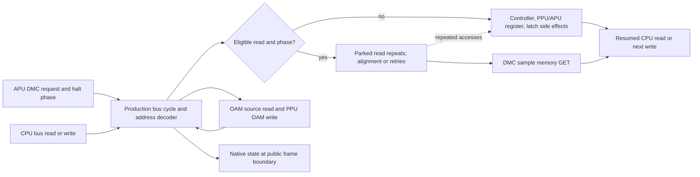

# Phase 24: Correct Remaining NTSC DMA Behavior - Research

**Researched:** 2026-10-31  
**Domain:** NES NTSC DMC/OAM DMA timing, bus side effects, and native state continuation  
**Confidence:** MEDIUM

<user_constraints>
## User Constraints (from CONTEXT.md)

### Locked Decisions

<!-- DATA_F4mQ8sZ2_START -->
### Causal evidence and regression design

- **D-01:** Localize each selected row independently and record its first causal divergence before grouping fixes. Share a fix only when traces establish a common cause; similar aggregate failure codes do not establish one. Phase 21's DMC retry/open-bus repair is a prerequisite, not completion of these remaining failures.
- **D-02:** Add small owned C fixtures at the existing bus/core seam for each distinct corrected behavior. Assert the relevant access kind/address, GET/PUT phase, halt and retry, actual sample read, side effects, and continuation; include a named wrong-model control. Reuse existing test and CMake patterns. A shared test helper is justified only if the traces demonstrate a shared need.
- **D-03:** Keep hardware references, pinned AccuracyCoin expectations, and observed core behavior as separate evidence. AccuracyCoin is the compatibility gate, not proof of silicon correctness. The pinned README identifies RP2A03G as its design target and accepts both pre-mid-1990 and mid-1990-or-later outcomes for `Implicit DMA Abort`; document any narrower revision assumption without claiming one universal RP2A03G behavior. See the [pinned AccuracyCoin README](https://github.com/100thCoin/AccuracyCoin/blob/6bee919529289c555803b612b8c9e4f7eaaeeabb/README.md).
- **D-04:** Keep tests and emulation code owned, integer-only, instance-local, and dependency-free. Prefer an existing seam, a small helper, or justified local duplication. Do not add a public exact-cycle API, general scheduler, or test framework.

### State compatibility, documentation, and verification

- **D-05:** Preserve the existing state format when the serialized layout and meaning stay unchanged. Change the format version if a serialized field is added, removed, resized, reordered, or changes meaning; change the behavior revision when emulated output changes. The loader has no old-format converter, and the behavior revision is recorded but not enforced by the loader.
- **D-06:** If a correction changes in-flight DMA state, save and load at production-reachable affected boundaries and compare resumed behavior and frame/audio output with uninterrupted execution. Decide version changes from the actual fields and semantics touched; do not add a converter or make a compatibility promise beyond the existing contract.
- **D-07:** Every behavior change lands with its owned test and README/public-header comments. Preserve the pin, protected PASS keys, deterministic hashes, and existing performance limits.
- **D-08:** Do not run full CI or an AccuracyCoin campaign as discovery, automatic verification, review repair, or a push/PR side effect while the stop is active. Planning may inspect test selection and configuration without executing the workflow. If required project CI would schedule `accuracycoin.campaign`, stop before that command and record the exact command, selected tests, missing evidence, and separate authorization needed. No campaign or tests were run during this discussion.
<!-- DATA_F4mQ8sZ2_END -->

### The agent's Discretion

<!-- DATA_B9rT1vK6_START -->
The researcher and planner choose the trace order, minimal fixture/helper organization, exact test file placement, and implementation task grouping. They must not presume shared causes or make a wider hardware claim than the evidence supports.
<!-- DATA_B9rT1vK6_END -->

### Deferred Ideas (OUT OF SCOPE)

<!-- DATA_C2pL7wN5_START -->
No new ideas were raised.

### Reviewed Todos (not folded)

- `2026-10-26-add-reproducible-owned-property-tests.md` — no confident Phase 24 requirement match; keep unlinked.
- `2026-10-26-evaluate-scoped-nightly-mutation-testing.md` — no confident Phase 24 requirement match; keep unlinked.
- `2026-10-26-make-runner-signal-checks-deterministic.md` — no confident Phase 24 requirement match; keep unlinked.
<!-- DATA_C2pL7wN5_END -->
</user_constraints>

## Summary

Treat the five failing AccuracyCoin rows as five independent investigations. For each row, plan a short trace at the existing bus/core seam that records the earliest mismatch between the test's pinned expectation, the cited hardware model, and the core's observed bus sequence. Only combine fixes after those traces show the same causal divergence. Phase 21's write-retry/open-bus change is useful baseline behavior, but its audit explicitly does not close this cluster. [VERIFIED: .planning/phases/24-correct-remaining-ntsc-dma-behavior/24-CONTEXT.md:20-21, .planning/research/milestone-dma-discovery/SCOPE.md:22-30]

The pinned AccuracyCoin ROM is the required compatibility gate for an RP2A03G/RP2C02G target; its README/source are evidence of what the tests assert, not direct proof of silicon behavior. The checked-in scoreboard is a starting record, not a fresh result. Use owned C fixtures to make each causal claim inspectable, keep the existing state/API and build model, and leave the full-CI/campaign stop intact. [CITED: https://github.com/100thCoin/AccuracyCoin/blob/6bee919529289c555803b612b8c9e4f7eaaeeabb/README.md] [VERIFIED: .planning/preparation/CONFORMANCE.md:15-18,38; .planning/phases/24-correct-remaining-ntsc-dma-behavior/24-CONTEXT.md:22-30; .planning/STATE.md:56-60]

**Primary recommendation:** Plan five separately reviewable traces and wrong-model fixtures around the production bus read/write, DMC request, and OAM transfer paths. Do not infer a common cause from the repeated `0x0a` status or treat any current code path as the proven cause before tracing it. [VERIFIED: .planning/research/milestone-dma-discovery/SCOPE.md:8-20,26-32; tests/accuracy/scoreboard.txt:89-103]

## Architectural Responsibility Map

| Capability | Primary Tier | Secondary Tier | Rationale |
|---|---|---|---|
| CPU read/write cycles and RDY halt/retry | API / Backend (core bus) | — | Each CPU cycle is one bus call; DMC arbitration is inside reads and failed write halts are recorded in the write path. [VERIFIED: .planning/preparation/ARCHITECTURE.md:19-24,31-39; src/bus.c:195-215,237-255] |
| DMC request/load/abort timing | API / Backend (APU + bus) | — | The APU schedules the request and phase; the bus performs halt, alignment, sample GET and continuation. [VERIFIED: src/apu.c:250-300,418-439; src/bus.c:150-192] |
| DMC/OAM overlap and OAM resumption | API / Backend (bus) | — | OAM source reads pass through the ordinary CPU bus read path, where DMC arbitration can occur. [VERIFIED: src/bus.c:217-235] |
| DMA side effects, bus latches and external sample reads | API / Backend (bus decoder) | — | Parked CPU reads are decoded repeatedly, while sample GET uses the mapper read and updates open bus separately. [VERIFIED: src/bus.c:118-147,158-180] |
| In-flight DMA state persistence | Database / Storage (native state bytes) | API / Backend | The state visitor saves GET/PUT phase, queued OAM, and DMC pending/halt/load fields; public save/load is fixed-size and versioned. [VERIFIED: src/state.c:194-205,250-280; include/nesturbator.h:83-101,574-598] |
| Accuracy and regression evidence | API / Backend (owned tests/CTest) | — | Existing tests execute the real core; the AccuracyCoin protected gate checks fresh observations against exact keys. [VERIFIED: tests/CMakeLists.txt:901-918,950-968,2047-2068] |

<phase_requirements>
## Phase Requirements

| ID | Description | Research Support |
|----|-------------|------------------|
<!-- DATA_D8kM3qR1_START -->
| DMA-01 | At the existing AccuracyCoin pin `6bee919529289c555803b612b8c9e4f7eaaeeabb`, the core passes `DMA Landing on Write`, `DMC DMA + OAM DMA`, `DMC DMA Bus Conflicts`, `Explicit DMA Abort`, and `Implicit DMA Abort` for the declared RP2A03G target. | Pinned test contract, separate row trace plans, protected-key baseline and verification stop. |
| DMA-02 | Every distinct corrected behavior has source-backed cycle-level evidence and an owned fixture with a wrong-model control; hardware behavior, test expectations, and observed core behavior are recorded separately. | Per-row evidence sections below; trace fields tie back to the bus/APU seams and the pinned ROM source. |
| DMA-03 | `DMA + $4015 Read`, `Misaligned OAM DMA`, `INC $4014`, and every other protected PASS key remain passing at the same pin, with deterministic output and existing performance limits preserved. | Exact checked-in PASS records, `accuracycoin.protected`, cross-platform hash equality, and the existing Cachegrind limit are identified below. |
| DMA-04 | If a fix changes in-flight DMA state, native save/load resumes identically and the state-format/behavior-revision impact is explicit; README and public-header comments describe the changed behavior. | Current serialized fields, version rules, production-reachable frame-boundary fork pattern, and docs landmarks are documented below. |
<!-- DATA_D8kM3qR1_END -->

Source: [REQUIREMENTS.md](../../REQUIREMENTS.md#ntsc-dma-accuracy) lines 13-19. [VERIFIED: .planning/REQUIREMENTS.md:13-19]
</phase_requirements>

## Standard Stack

### Core

| Library / Tool | Version | Purpose | Why Standard |
|---|---|---|---|
| C | C17 | Core and owned fixtures | The project sets C17 with extensions disabled. The current task needs no language/runtime addition. [VERIFIED: CMakeLists.txt:10-14] |
| CMake + CTest | Repository's existing presets | Build, register and select focused C fixtures and the protected AccuracyCoin checks | Existing tests use plain C executables and CTest; keep registration in `tests/CMakeLists.txt`. [VERIFIED: .planning/preparation/DECISIONS.md:47-54,60-62; tests/CMakeLists.txt:950-968,2047-2068] |
| `tests/check.h` and synthetic cartridge helpers | In-repository | Assertions and small owned bus/core programs | Existing APU and bus tests already use the production seams; no new test framework is justified. [VERIFIED: tests/core/test_apu.c:310-356; tests/CMakeLists.txt:2047-2068] |

### Supporting

| Tool / Facility | Purpose | When to Use |
|---|---|---|
| AccuracyCoin pinned at `6bee919529289c555803b612b8c9e4f7eaaeeabb` | External test contract and protected score key | Keep the exact pin and raw-key gate for later authorized acceptance. [CITED: https://github.com/100thCoin/AccuracyCoin/blob/6bee919529289c555803b612b8c9e4f7eaaeeabb/README.md] |
| Existing native state fork test | Compare uninterrupted and restored continuation | Extend only if a production-reachable DMA-affecting state boundary is found. [VERIFIED: tests/core/test_state_fork.c:1-11,141-175] |
| Existing Cachegrind performance gate | Compare instruction count per frame against parent | Preserve the current +1% gate and its existing ROM set; do not add DMA logging to the release hot path. [VERIFIED: .planning/preparation/ENGINEERING.md:71-80] |

### Alternatives Considered

| Instead of | Could Use | Tradeoff |
|---|---|---|
| Existing bus/APU seams and CTest patterns | New scheduler, public exact-cycle API, test framework or dependency | The phase context and scope exclude those expansions; the production bus already advances per CPU cycle and exposes DMC/OAM interactions internally. [VERIFIED: .planning/phases/24-correct-remaining-ntsc-dma-behavior/24-CONTEXT.md:21-23; src/bus.c:195-255] |
| Small owned trace fixtures | Infer fixes from aggregate AccuracyCoin status codes | Aggregate codes do not identify first divergence; fixtures can isolate access, phase, side effects and continuation. [VERIFIED: .planning/research/milestone-dma-discovery/SCOPE.md:10,18,24,28-30] |

**Installation:** None. This phase adds no external package. [VERIFIED: .planning/phases/24-correct-remaining-ntsc-dma-behavior/24-CONTEXT.md:23; .planning/research/milestone-dma-discovery/SCOPE.md:30,48]

## Architecture Patterns

### System Architecture Diagram



This diagram follows the current CPU-driven cycle model and the existing DMC/OAM path; it is a conceptual trace boundary, not a claim that all five failing rows share one control branch. [VERIFIED: .planning/preparation/ARCHITECTURE.md:19-24; src/bus.c:150-180,195-235]

### Recommended Project Structure

Keep implementation work within `src/bus.c` and `src/apu.c` unless a trace proves a distinct neighboring module owns the behavior. Put focused owned assertions in the existing `tests/core/test_apu.c` or `tests/cpu/test_bus.c` patterns, and use `tests/core/test_state_fork.c` for native public-boundary continuation. Add a new fixture file only where separation makes the oracle clearer; register it through the existing `nesturbator_core_test` or bus-unit CMake pattern. These are recommendations based on the current ownership and registration landmarks. [VERIFIED: .planning/phases/24-correct-remaining-ntsc-dma-behavior/24-CONTEXT.md:21,34,75-87; src/bus.c:150-255; tests/CMakeLists.txt:950-968,2047-2068]

### Component Responsibilities

| Landmark | Current responsibility | Planning use |
|---|---|---|
| `src/bus.c:62-115` | Advances CPU-cycle time, APU GET/PUT phase and APU clocks | Record phase at the actual bus-cycle boundary, not from elapsed totals alone. [VERIFIED: src/bus.c:62-115] |
| `src/bus.c:118-147` | CPU read decoder for RAM, PPU/APU registers, controller and open bus | Trace parked-read address and each repeat's side effects. [VERIFIED: src/bus.c:118-147] |
| `src/bus.c:150-192` | DMC halt eligibility, repeated parked reads, optional alignment, sample GET and request completion | Trace request versus halt versus actual sample access as distinct events. [VERIFIED: src/bus.c:150-192] |
| `src/bus.c:195-215` | Ordinary bus read and resumed CPU read after a DMC transfer | Distinguish the memory GET from the CPU's resumed access. [VERIFIED: src/bus.c:195-215] |
| `src/bus.c:217-255` | OAM transfer through ordinary reads; failed DMC halt while CPU writes | Inspect DMC/OAM collision, final-write return and write retry independently. [VERIFIED: src/bus.c:217-255] |
| `src/apu.c:250-300,418-439` | Schedules DMC request and changes request/load state on output clock or `$4015` writes | Trace buffer-empty/reload/disable timing before attributing a bus-path cause. [VERIFIED: src/apu.c:250-300,418-439] |
| `src/state.c:194-205,250-280` | Serializes bus phase, pending OAM, DMC phase and request fields | Audit actual serialized field changes if an implementation fix alters in-flight state. [VERIFIED: src/state.c:194-205,250-280] |

### Per-row evidence and fixture direction

The source and test oracle below are intentionally separate. AccuracyCoin's README identifies the test target and accepted result semantics; its assembly describes what each row checks. NESdev's DMA page is the project's curated timing reference, while the pinned circuit analysis is a separate hardware-oriented source. Neither a test pass nor a circuit diagram should be reported as a fresh silicon measurement. [CITED: https://github.com/100thCoin/AccuracyCoin/blob/6bee919529289c555803b612b8c9e4f7eaaeeabb/README.md; https://github.com/100thCoin/AccuracyCoin/blob/6bee919529289c555803b612b8c9e4f7eaaeeabb/AccuracyCoin.asm; https://www.nesdev.org/w/index.php?title=DMA&oldid=23450; https://github.com/emu-russia/breaks/blob/5a55bac/BreakingNESWiki_DeepL/APU/dpcm.md] [CITED: https://manuals.plus/m/d15abdf9e249f9242c042d33c930fc9dd9a7ec0030a04db05ddab0f313fb49fb]

#### 1. DMA Landing on Write

- **Pinned test contract:** The pinned test sweeps DMC request/load placement around CPU writes, retries and transfer length; the upstream assembly includes phase-sensitive load/reload timing checks. [CITED: https://github.com/100thCoin/AccuracyCoin/blob/6bee919529289c555803b612b8c9e4f7eaaeeabb/AccuracyCoin.asm#L3145-L3300]
- **Hardware reference:** The project's DMA note says RDY cannot stop a write, a failed halt waits for a later read, and DMA GET/PUT alignment controls the extra cycle. This is a curated timing model, not a measurement for this row. [CITED: https://www.nesdev.org/w/index.php?title=DMA&oldid=23450] [VERIFIED: .planning/preparation/NES-HARDWARE-CPU-APU.md:35-40,120-129]
- **Observed core starting point:** The checked-in row is below as historical evidence. The current implementation toggles `dma_halt_phase` after a write-side collision, then tests eligibility on a subsequent read; existing APU coverage sweeps one through three writes and both phase starts, but that coverage alone does not localize this row's first mismatch. [VERIFIED: src/bus.c:247-255; tests/core/test_apu.c:310-356]
- **Candidate trace and fixture:** Record when the APU creates `dma_pending`; every intervening CPU access kind/address; phase and target halt phase; rejected write attempts; first successful read halt; repeated parked read(s); sample GET address/data; transfer cycles; resumed CPU read. Use an owned synthetic NROM sample with explicit `GET`/`PUT` histories and one-/two-write delay cases. A named wrong model should treat a write as a successful halt or omit the retry on the next eligible cycle. This fixture direction follows the scope's requested evidence; it is not a claim about the cause. [VERIFIED: .planning/research/milestone-dma-discovery/SCOPE.md:16,28-30; src/bus.c:150-180,195-215,247-255; tests/core/test_apu.c:310-356]

#### 2. DMC DMA + OAM DMA

- **Pinned test contract:** The upstream assembly separately places DMC DMA at different points in OAM DMA and checks resumed OAM work and complete cycle timing, including a late/final transfer position. [CITED: https://github.com/100thCoin/AccuracyCoin/blob/6bee919529289c555803b612b8c9e4f7eaaeeabb/AccuracyCoin.asm#L12824-L12942]
- **Hardware reference:** NESdev's model describes DMC GET priority when DMC and OAM need a get, with OAM resuming after the DMC access. The project scope explicitly treats the final-write resumption as a separate observation point. [CITED: https://www.nesdev.org/w/index.php?title=DMA&oldid=23450] [VERIFIED: .planning/research/milestone-dma-discovery/SCOPE.md:17,22]
- **Observed core starting point:** OAM source bytes call `bus_read_cycle`; each destination write consumes its own cycle; DMC handling can run inside a source read. The checked-in row is still a historical failure record and does not establish whether collision arbitration, phase, final-write handling or another detail diverges. [VERIFIED: src/bus.c:195-235; tests/accuracy/scoreboard.txt:90]
- **Candidate trace and fixture:** Sweep a DMC request through an interior OAM byte and through the final source/destination pair. Capture OAM source address/read, destination put, GET/PUT phase, DMC parked access and sample GET, OAM offset before/after, first resumed OAM access, and total CPU cycles. A named wrong model should pause or restart OAM as a whole during DMC, or incorrectly advance the OAM byte at the collision; which wrong model is useful should be matched to the first observed divergence. [VERIFIED: .planning/research/milestone-dma-discovery/SCOPE.md:17,28-30; src/bus.c:217-235]

#### 3. DMC DMA Bus Conflicts

- **Pinned test contract:** The assembly checks internal CPU register selection during DMC activity, external sample fetch, IRQ acknowledgement, and controller/open-bus behavior. Its comments explicitly limit what it can establish about data entering the DMC shift register. [CITED: https://github.com/100thCoin/AccuracyCoin/blob/6bee919529289c555803b612b8c9e4f7eaaeeabb/AccuracyCoin.asm#L11439-L11544]
- **Hardware reference:** The hardware note describes split address sourcing and separate internal/external bus-latch behavior, while the pinned transistor-level circuit notes explain the DMC's RDY/sample-address control. Treat these as hardware-oriented explanation; they do not settle the test's individual first-divergence result. [CITED: https://github.com/emu-russia/breaks/blob/5a55bac/BreakingNESWiki_DeepL/APU/dpcm.md] [VERIFIED: .planning/preparation/NES-HARDWARE-CPU-APU.md:35-40,125-145]
- **Observed core starting point:** CPU read decoding and side effects are in `bus_read_data`; the DMC sample GET instead uses `nesturbator__map_cpu_read` and updates `open_bus`. The current scoreboard row has the same aggregate code as three other failures, which is not evidence of a common cause. [VERIFIED: src/bus.c:118-147,158-180; tests/accuracy/scoreboard.txt:90-103]
- **Candidate trace and fixture:** Log parked CPU address and access type, internal register-select address, external sample address and returned byte, internal/external open-bus values, controller shift before/after, `$4015`/frame-counter IRQ state before/after, and value returned to the CPU. Include an owned fixture for at least one observable register/controller side effect and one separate sample GET. A named wrong model should collapse the internal parked read and external sample GET into one memory-only access; assert which side effect or latch differs. Do not claim the test proves the DMC shift-register input if the test does not observe that value. [VERIFIED: .planning/research/milestone-dma-discovery/SCOPE.md:18,28-30; src/bus.c:118-147,158-180]

#### 4. Explicit DMA Abort

- **Pinned test contract:** The assembly disables DMC playback around a scheduled reload window and checks the explicit abort timing/cycle result. [CITED: https://github.com/100thCoin/AccuracyCoin/blob/6bee919529289c555803b612b8c9e4f7eaaeeabb/AccuracyCoin.asm#L12944-L13010]
- **Hardware reference:** The project's DMA reference describes a one-cycle aborted window when stopping at the relevant point immediately before reload. Treat the timing condition as a hypothesis to verify in the focused trace; do not conflate it with CPU-write halt deferral. [CITED: https://www.nesdev.org/w/index.php?title=DMA&oldid=23450] [VERIFIED: .planning/preparation/NES-HARDWARE-CPU-APU.md:37-40]
- **Observed core starting point:** `$4015` disable clears remaining length, enable delay and load-wait state; it does not explicitly clear `dma_pending` in the shown branch. DMC DMA returns early if `remaining == 0`, while a pending request is otherwise consumed in the bus read path. This is a code landmark for tracing, not proof that this is the bug. [VERIFIED: src/apu.c:418-424; src/bus.c:150-156,174-192]
- **Candidate trace and fixture:** Schedule a one-byte reload, disable playback at offsets around the expected reload, and separately put a CPU write immediately before the candidate halt. Record `$4015` write cycle, buffer-empty/request/remaining state, phase, whether RDY halts, whether the sample GET happens, transfer length, and following CPU access. The wrong-model control should either always complete the reload after disable or cancel before the documented aborted window; select and name the control after the trace establishes the contract. [VERIFIED: .planning/research/milestone-dma-discovery/SCOPE.md:19,28-30; src/apu.c:418-439; src/bus.c:150-192,247-255]

#### 5. Implicit DMA Abort

- **Pinned test contract:** The assembly tests a one-byte non-looping sample and a looping control; it includes a CPU-write collision where the one-cycle abort is not supposed to be delayed like a normal DMA halt. The pinned README accepts both historical/revision-dependent implicit-abort result codes. [CITED: https://github.com/100thCoin/AccuracyCoin/blob/6bee919529289c555803b612b8c9e4f7eaaeeabb/AccuracyCoin.asm#L13011-L13075; https://github.com/100thCoin/AccuracyCoin/blob/6bee919529289c555803b612b8c9e4f7eaaeeabb/README.md]
- **Hardware reference:** The project's curated notes record unexpected reload behavior for RP2A03H and later RP2A03G units, and warn that the implicit case is revision-sensitive. Preserve both pinned accepted outcomes unless a narrower profile assumption is separately justified; do not make a universal RP2A03G claim. [CITED: https://www.nesdev.org/w/index.php?title=DMA&oldid=23450] [VERIFIED: .planning/preparation/NES-HARDWARE-CPU-APU.md:37-40; .planning/phases/24-correct-remaining-ntsc-dma-behavior/24-CONTEXT.md:22]
- **Observed core starting point:** The current code schedules pending work from DMC output/buffer state and processes the same pending field in the bus path; the current score row is a starting failure record, not a fresh run. No present evidence identifies whether length, timer phase, halt eligibility, disable handling or the chip-revision outcome is the first divergence. [VERIFIED: src/apu.c:250-300,418-439; src/bus.c:150-192; tests/accuracy/scoreboard.txt:103]
- **Candidate trace and fixture:** Use an empty-buffer, one-byte non-looping program with a looping control; sweep the final output clock/reload against CPU writes. Capture remaining length, buffer state, pending/halt phase, exact write delay, abort duration, sample address/data, and subsequent CPU/OAM continuation. A named wrong model should apply the normal multi-cycle write-retry path to the one-cycle abort, or force only one of the accepted revision outcomes. [VERIFIED: .planning/research/milestone-dma-discovery/SCOPE.md:20,28-30; src/apu.c:250-300,418-439; src/bus.c:150-192,247-255]

### Trace record shape

Keep any extra observations in test-only trace helpers or compile-time test instrumentation; do not add a public exact-cycle API or permanent logging to the release hot path. A useful per-event row contains: CPU access kind/address; CPU cycle and GET/PUT phase; DMC pending/target halt phase; parked address and repeat count; actual sample GET address/data; OAM source/destination and byte index where applicable; bus latch values; relevant controller/PPU/APU side effect; and resumed CPU access. This is a recommended test schema, not a proposed public interface. [VERIFIED: .planning/phases/24-correct-remaining-ntsc-dma-behavior/24-CONTEXT.md:21,23; .planning/preparation/ARCHITECTURE.md:19-24,58-69; src/bus.c:118-235]

## Don't Hand-Roll

| Problem | Don't Build | Use Instead | Why |
|---|---|---|---|
| DMA timing and arbitration | General scheduler or second timing engine | Existing one-call-per-cycle bus and APU request seam | Current architecture puts DMA inside bus reads and the APU owns request scheduling. [VERIFIED: .planning/preparation/ARCHITECTURE.md:19-24,31-39; src/bus.c:150-255] |
| Test traces | External framework or public cycle API | Small in-repo C fixtures and the existing CTest registration helpers | Existing fixtures already build synthetic NROM and call production bus/APU code. [VERIFIED: tests/core/test_apu.c:310-356; tests/CMakeLists.txt:950-968,2047-2068] |
| State schema compatibility | Converter for old state formats | Existing exact-size, versioned native format; audit serialized fields and bump only as required | The header says the loader accepts only the current format and has no converter. [VERIFIED: include/nesturbator.h:83-101,574-598] |
| Hardware claims | Infer silicon behavior from a single ROM result or emulator agreement | Keep pinned test contract, hardware reference, and observed core trace in separate fields | The conformance notes say AccuracyCoin's stated target is not proof of measured hardware behavior. [VERIFIED: .planning/preparation/CONFORMANCE.md:15-18,38] |

**Key insight:** The shared bus seam makes these rows easy to observe together, but observation locality does not establish shared causality. First-divergence traces are the evidence for grouping implementation tasks. [VERIFIED: .planning/research/milestone-dma-discovery/SCOPE.md:8,24,28-30]

## Current Scoreboard and Protected Passes

The following exact records are in the checked-in scoreboard. They are the historical starting evidence identified by the phase scope, not fresh observations from this research. [VERIFIED: .planning/ROADMAP.md:51-60; .planning/phases/24-correct-remaining-ntsc-dma-behavior/24-CONTEXT.md:9-11,61]

Selected failures:

<!-- DATA_E3vN6xH1_START -->
```text
accuracycoin/DMA Landing on Write	fail	0x26	128	-
accuracycoin/DMC DMA + OAM DMA	fail	0x0a	526	-
accuracycoin/DMC DMA Bus Conflicts	fail	0x0a	526	-
accuracycoin/Explicit DMA Abort	fail	0x0a	526	-
accuracycoin/Implicit DMA Abort	fail	0x0a	526	-
```
<!-- DATA_E3vN6xH1_END -->
[VERIFIED: tests/accuracy/scoreboard.txt:89-103]

Protected DMA passes called out by DMA-03:

<!-- DATA_G7wK2pM9_START -->
```text
accuracycoin/DMA + $4015 Read	pass	0x01	526	-
accuracycoin/INC $4014	pass	0x01	558	-
accuracycoin/Misaligned OAM DMA	pass	0x01	537	-
```
<!-- DATA_G7wK2pM9_END -->
[VERIFIED: tests/accuracy/scoreboard.txt:86,102,114]

The existing `accuracycoin.protected_observation`/`accuracycoin.protected` CTest fixture checks fresh cold invocations and exact protected keys; keep the full protected-key set intact, not only the three named DMA neighbors. [VERIFIED: tests/CMakeLists.txt:901-918; .planning/preparation/DECISIONS.md:47-50]

## State Compatibility and Native Continuation

The public header currently declares the exact revisions below:

<!-- DATA_H5nC8tR3_START -->
```c
#define NESTURBATOR_BEHAVIOUR_REVISION 9
#define NESTURBATOR_STATE_FORMAT_VERSION 3
```
<!-- DATA_H5nC8tR3_END -->
[VERIFIED: include/nesturbator.h:81,101]

The bus state visitor serializes `apu_get_put_phase`, `oam_dma_pending` and `oam_dma_page`; the DMC visitor serializes pending, halt phase, load waiting and enable delay along with the playback fields. The implementation should inspect the exact field and meaning changes rather than assume every timing fix affects format bytes. [VERIFIED: src/state.c:194-205,250-280]

Follow the locked version rule: keep state format version 3 if serialized layout and meaning are unchanged; bump it for any serialized field add/remove/resize/reorder or meaning change. An output-only emulation change needs a behavior-revision decision. The loader has no old-format converter and records behavior revision without enforcing it. No converter or broader compatibility promise is in scope. [VERIFIED: .planning/phases/24-correct-remaining-ntsc-dma-behavior/24-CONTEXT.md:27-28; include/nesturbator.h:83-101,574-598]

If a correction changes an in-flight condition, use a production-reachable public boundary. `core.state_fork.stress` already runs synthetic DMA programs and forks at frame boundaries; extend that route or add a focused owned case so one instance continues uninterrupted while another loads the same native state, then compare subsequent video/audio digests, ticks, frame number, and final state bytes. Do not manufacture an impossible mid-bus state or expose an internal-cycle save API. [VERIFIED: tests/core/test_state_fork.c:1-11,141-175; tests/CMakeLists.txt:1077-1078; include/nesturbator.h:574-598; .planning/preparation/ARCHITECTURE.md:58-69]

## Common Pitfalls

### Pitfall 1: Grouping failures by status code

**What goes wrong:** Similar aggregate result codes are treated as one root cause.  
**Why it happens:** The scoreboard reports row-level outcome, not the first bus divergence.  
**How to avoid:** Trace each row through its own expected/observed cycle sequence and group only when evidence aligns.  
**Warning signs:** One fixture purports to explain multiple rows before each row has its own trace. [VERIFIED: .planning/research/milestone-dma-discovery/SCOPE.md:10,24,28-30; tests/accuracy/scoreboard.txt:89-103]

### Pitfall 2: Using elapsed cycles as the sole oracle

**What goes wrong:** A total duration matches while the wrong address, GET/PUT phase, repeated side effect or resumed operation is wrong.  
**How to avoid:** Assert event order and actual bus accesses as well as elapsed CPU cycles.  
**Warning signs:** A test contains only a final cycle-count assertion. [VERIFIED: .planning/research/milestone-dma-discovery/SCOPE.md:17-20,28-30]

### Pitfall 3: Confusing test expectation with silicon evidence

**What goes wrong:** AccuracyCoin pass is described as measured hardware proof, or a curated DMA page as a transistor-level trace.  
**How to avoid:** Keep hardware source, pinned test contract and core observation separately cited. Preserve both pinned implicit-abort outcomes unless a narrower revision choice is evidenced.  
**Warning signs:** Documentation claims one universal RP2A03G implicit-abort result. [VERIFIED: .planning/preparation/CONFORMANCE.md:15-18,38; .planning/phases/24-correct-remaining-ntsc-dma-behavior/24-CONTEXT.md:22; .planning/preparation/NES-HARDWARE-CPU-APU.md:35-40]

### Pitfall 4: Losing side effects while optimizing repeated reads

**What goes wrong:** A DMA repeat is treated as an inert delay, so controller shifts, PPU status/data accesses or open-bus behavior diverge.  
**How to avoid:** Keep the parked CPU read decoded at the production bus seam and assert row-specific side effects.  
**Warning signs:** A test verifies only the DMC sample buffer and ignores the parked access. [VERIFIED: src/bus.c:118-147,158-172; .planning/preparation/NES-HARDWARE-CPU-APU.md:35-40]

### Pitfall 5: Changing the saved-state schema or performance path unintentionally

**What goes wrong:** A new serialized flag is added without a format bump, or permanent trace work slows every bus cycle.  
**How to avoid:** Audit the state visitor and use test-only/compile-time observation; keep output-only revision decisions separate from format changes.  
**Warning signs:** State bytes differ without a documented version disposition, or the existing Cachegrind gate crosses its +1% limit. [VERIFIED: src/state.c:194-205,250-280; include/nesturbator.h:83-101; .planning/preparation/ENGINEERING.md:79]

## Code Examples

No new production code pattern is recommended. The useful fixture pattern is already in the repository: build a small owned synthetic cartridge, call the real bus path, and assert phase, elapsed cycles and returned sample data. The existing write-retry case illustrates this seam, but its current assertions are not evidence that all five selected rows are fixed. [VERIFIED: tests/core/test_apu.c:310-356; tests/CMakeLists.txt:965,2047-2068]

## State of the Art

| Older pattern | Current project pattern | Consequence |
|---|---|---|
| Infer DMA result from a final row code or total cycle count | Keep a per-event bus trace and an owned wrong-model control | The first divergent access identifies whether timing, address, side effect or continuation differs. [VERIFIED: .planning/research/milestone-dma-discovery/SCOPE.md:16-30] |
| Serialize new timing state without checking the public schema | One canonical state visitor feeds size, write, validate and apply paths; state format and behavior revision are distinct | Decide compatibility from fields and semantics touched. [VERIFIED: src/state.c:1-18,194-205,250-280; include/nesturbator.h:83-101] |
| Run the campaign as an exploratory probe | Respect the active verification stop and inspect selection/configuration without executing | Missing fresh campaign evidence remains an explicit gate until separate authorization. [VERIFIED: .planning/STATE.md:56-60; .planning/phases/24-correct-remaining-ntsc-dma-behavior/24-CONTEXT.md:30] |

**Deprecated/outdated:** No external package or framework is proposed. A generalized DMA scheduler or public exact-cycle API would conflict with the locked project scope unless future independent evidence demonstrates the current seam cannot express a required behavior. [VERIFIED: .planning/phases/24-correct-remaining-ntsc-dma-behavior/24-CONTEXT.md:23; .planning/REQUIREMENTS.md:30-33]

## Project Constraints (from AGENTS.md)

- Keep all emulation and test code owned in this repository; `libretro.h` is the only vendored file and the core library links only C memory functions. [VERIFIED: AGENTS.md:28-29]
- Preserve the three deliverables: C library, headless runner and libretro adapter; add no window, audio-device or input-device code. [VERIFIED: AGENTS.md:30-31]
- Keep ROM/BIOS bytes limited to the manifest, avoid personal paths/names/email in the tree, use GitHub noreply commit identity, and retain the hygiene hook. Any fixture ROM must follow `tests/roms/manifest.txt`. [VERIFIED: AGENTS.md:32-35; .planning/phases/24-correct-remaining-ntsc-dma-behavior/24-CONTEXT.md:64]
- Maintain the clean-room boundary: do not open or retain GPL/LGPL emulator source. Hardware references and AccuracyCoin behavior are allowed sources for this work. [VERIFIED: AGENTS.md:36-38; .planning/phases/24-correct-remaining-ntsc-dma-behavior/24-CONTEXT.md:22-23]
- Keep the core deterministic, integer-only and per-instance; same inputs must retain cross-platform frame/audio hashes. [VERIFIED: AGENTS.md:39-40]
- Every behavior change lands with an owned test run through the normal project CI, README and public-header comments. The active Phase 24 stop adds a separate restriction: if required CI schedules the campaign, stop before execution and leave the phase incomplete. [VERIFIED: AGENTS.md:41-44; .planning/STATE.md:56-60; .planning/phases/24-correct-remaining-ntsc-dma-behavior/24-CONTEXT.md:30]
- Run one GSD step per command, work on the phase branch, and stop/report at the step boundary; merge via PR with a Conventional Commit title. [VERIFIED: AGENTS.md:45-48]
- Milestone-only product-roadmap reconciliation runs before new/complete-milestone steps; it is not part of this phase research step. [VERIFIED: AGENTS.md:50-59]
- Use small modules, plain control flow, fixed-width types, hardware comments with citations, and prefer removing/reusing/standard library/platform before adding code or dependencies. [VERIFIED: AGENTS.md:61-71]
- Personal playtest guidance is not triggered: Phase 24 is limited to five accuracy tests and explicitly excludes broad game playtesting. [VERIFIED: AGENTS.md:73-93; .planning/phases/24-correct-remaining-ntsc-dma-behavior/24-CONTEXT.md:9-11]

## Environment Availability

| Dependency | Required By | Available | Version | Fallback |
|---|---|---|---|---|
| CMake | Existing core/test build | ✓ | 4.4.3 | — |
| Ninja | Existing project presets | ✓ | 1.13.2 | — |
| C compiler | Core and owned C fixtures | ✓ | Apple clang 21.0.0.101 | — |

These were version probes only. No configure, build, test or campaign was run. The phase has no external service dependency. [VERIFIED: environment probe, 2026-10-31; .planning/preparation/DECISIONS.md:60-62]

## Security Domain

The current config values are:

<!-- DATA_J6rW9pA4_START -->
```json
"nyquist_validation": false,
"security_enforcement": false
```
<!-- DATA_J6rW9pA4_END -->
[VERIFIED: .planning/config.json:25,49]

Nyquist validation is explicitly disabled, so omit the Validation Architecture section. Security enforcement is explicitly disabled, so the security-enforcement/ASVS section is not applicable. The clean-room boundary, owned-code requirement, ROM inventory rule and avoidance of private artifacts still apply because they are direct project constraints. [VERIFIED: .planning/config.json:25,49; AGENTS.md:28-38,89-93]

## Verification Stop

- No tests, builds, full-CI workflow or AccuracyCoin campaign were run for this research. The interrupted full-CI/campaign outcome remains unknown and the stop remains active; planning approval does not renew execution authority. [VERIFIED: .planning/STATE.md:56-60; .planning/phases/24-correct-remaining-ntsc-dma-behavior/24-CONTEXT.md:30]
- The phase's documented acceptance command is `cmake --workflow --preset ci`. In the hosted Linux x64 CI lane, configuration explicitly turns `NESTURBATOR_ACCURACYCOIN_FULL` on before the workflow; CMake then registers `accuracycoin.campaign` and connects `accuracycoin.activation` to its report fixture. Do not execute a workflow/configuration that schedules this stopped campaign. [VERIFIED: .planning/ROADMAP.md:89-97; .github/workflows/ci.yml:145-154; tests/CMakeLists.txt:780-781,886-899]
- Before any attempted acceptance, record the exact command and selected CTest names from the actual configuration. If campaign is selected, the missing evidence remains a fresh full pinned result, all five expected PASS rows, all protected PASS keys, required cross-platform deterministic hashes and existing performance gates. Stop and request separate owner authorization; do not weaken the gate or substitute focused results for acceptance. [VERIFIED: .planning/ROADMAP.md:83-97; .planning/REQUIREMENTS.md:13-19; .planning/preparation/ENGINEERING.md:76-80]
- Focused owned fixtures and state-fork cases are future implementation/verification work, not permission to run them during this research. [VERIFIED: .planning/phases/24-correct-remaining-ntsc-dma-behavior/24-CONTEXT.md:21,30]

## Assumptions Log

| # | Claim | Section | Risk if Wrong |
|---|---|---|---|
| — | No unverified package, hardware outcome or root-cause claim is recommended. First causal divergence for all five rows remains an open implementation finding. | Per-row evidence | The plan must not treat any candidate wrong model as established core behavior before a trace. |

## Open Questions

1. **What is the first causal divergence for each selected row?** The scoreboard and pinned test source identify outcomes/expectations, while production code gives candidate observation points; no fresh trace was permitted or run. Recommendation: assign five independent bounded traces before grouping fixes. [VERIFIED: tests/accuracy/scoreboard.txt:89-103; .planning/research/milestone-dma-discovery/SCOPE.md:16-20,28-30]
2. **Which exact implicit-abort outcome applies to the declared profile?** The pinned test accepts both pre-mid-1990 and mid-1990-or-later outcomes; the project targets RP2A03G but does not claim a universal revision result. Recommendation: preserve the source's allowed outcomes and state any narrowed profile assumption explicitly. [CITED: https://github.com/100thCoin/AccuracyCoin/blob/6bee919529289c555803b612b8c9e4f7eaaeeabb/README.md] [VERIFIED: .planning/phases/24-correct-remaining-ntsc-dma-behavior/24-CONTEXT.md:22]
3. **Will a fix change serialized in-flight state?** Existing bus/APU fields are already serialized; the implementation change is unknown. Recommendation: make the format/revision call after inspecting changed fields and semantics, then exercise a production-reachable frame boundary if state behavior is affected. [VERIFIED: src/state.c:194-205,250-280; .planning/phases/24-correct-remaining-ntsc-dma-behavior/24-CONTEXT.md:27-28]
4. **When can the campaign gate be run?** STATE preserves an unknown interrupted outcome and requires separate authorization if configured project CI schedules the campaign. Recommendation: stop at that point with exact selected tests, missing evidence and command; keep phase requirements incomplete until authorization and verification are resolved. [VERIFIED: .planning/STATE.md:56-60; .planning/ROADMAP.md:89-97]

## Sources

### Primary

- [Pinned AccuracyCoin README](https://github.com/100thCoin/AccuracyCoin/blob/6bee919529289c555803b612b8c9e4f7eaaeeabb/README.md) — declared target, pin and accepted result semantics. [CITED]
- [Pinned AccuracyCoin assembly](https://github.com/100thCoin/AccuracyCoin/blob/6bee919529289c555803b612b8c9e4f7eaaeeabb/AccuracyCoin.asm) — row-level test contracts for DMA landing, bus conflicts, OAM collision and abort cases. [CITED]
- [BreakingNESWiki DPCM circuit analysis at pin `5a55bac`](https://github.com/emu-russia/breaks/blob/5a55bac/BreakingNESWiki_DeepL/APU/dpcm.md) — circuit-level DMC/RDY/address-control context, separate from the test oracle. [CITED]
- [MOS Technology MCS6500 Family Hardware Manual mirror](https://manuals.plus/m/d15abdf9e249f9242c042d33c930fc9dd9a7ec0030a04db05ddab0f313fb49fb) — general RDY/write-cycle behavior; not evidence for every NES-specific DMA detail. [CITED]

### Secondary / curated project references

- [NESdev DMA page at project-recorded revision 23450](https://www.nesdev.org/w/index.php?title=DMA&oldid=23450) — curated timing model; not transistor-level proof. [CITED]
- `.planning/preparation/NES-HARDWARE-CPU-APU.md` §2.2 and source table — DMA timing, known revision-sensitive cases, and HWC.01/HWC.19/HWC.25 source classification. [VERIFIED: .planning/preparation/NES-HARDWARE-CPU-APU.md:35-40,115-145]
- `.planning/preparation/CONFORMANCE.md` — AccuracyCoin target and oracle limits, including no per-test hardware verification. [VERIFIED: .planning/preparation/CONFORMANCE.md:15-18,22-38]
- `.planning/preparation/ARCHITECTURE.md` §§2, 7 and `.planning/preparation/DECISIONS.md` — per-cycle bus model, public state/API and locked ownership choices. [VERIFIED: .planning/preparation/ARCHITECTURE.md:19-24,58-69; .planning/preparation/DECISIONS.md:19-21,29-38,47-62]
- `.planning/research/milestone-dma-discovery/SCOPE.md` and Phase 21 DMC audit — row-specific trace needs and boundary of the prior retry/open-bus correction. [VERIFIED: .planning/research/milestone-dma-discovery/SCOPE.md:12-32; .planning/milestones/v5-phases/21-interrupt-latency-and-hijack/21-DMC-PHASE-AUDIT.md]
- Current code and scoreboard: `src/bus.c`, `src/apu.c`, `src/state.c`, `include/nesturbator.h`, `tests/core/test_apu.c`, `tests/core/test_state_fork.c`, `tests/CMakeLists.txt`, `tests/accuracy/scoreboard.txt`. [VERIFIED: cited inline]

## Metadata

**Confidence breakdown:**
- Standard stack: HIGH — verified in the repository's CMake and test registration.
- Architecture and state contract: HIGH — traced to the bus/APU/state source and public header.
- Pinned test expectations: HIGH — checked against the official AccuracyCoin files at the required pin.
- Hardware interpretation: MEDIUM — project references distinguish curated timing guidance from circuit analysis; no new physical trace was taken.
- Root causes: LOW / unknown — no tests or campaigns were run, and the five failures remain independently unlocalized.

**Research date:** 2026-10-31  
**Valid until:** 2026-11-30 for the stable project architecture; recheck source pin and campaign configuration before execution.
