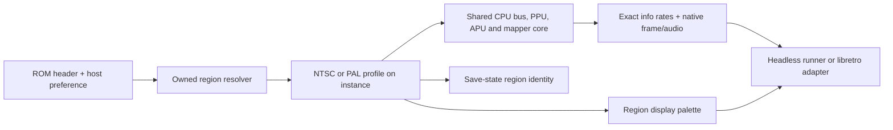

# Architecture: PAL region support

**Domain:** PAL machine timing in an existing deterministic NES core  
**Researched:** 2026-11-01  
**Overall confidence:** MEDIUM. Current-code seams are directly inspected; PAL clock and format facts are cross-checked against NESdev references. The wiki explicitly leaves part of 2A07 DMA unresolved, and the 2C07 display palette is a modeled composite decode rather than one universally calibrated output.

## System-level contract

These are project decisions for v8, not open implementation alternatives:

- Resolve NES 2.0 timing mode 0 as NTSC and 1 as PAL. Mode 2 is multi-region: consult the host's NTSC/PAL preference, defaulting to NTSC. Treat legacy iNES as ambiguous and apply the same preference/default. Mode 3 (Dendy) is refused; a PAL profile must not be used as a Dendy substitute. NES 2.0 byte 12 defines those four modes, and “multiple” specifically means software adapts to either supported timing. [NES 2.0](https://www.nesdev.org/wiki/NES_2.0#CPU/PPU_Timing)
- The effective region is an instance property selected when a cartridge is loaded. All six existing mapper families (0, 1, 2, 3, 4 and 7) use that shared machine profile; this work does not add mapper-specific timing forks.
- Keep the core integer-only and deterministic, the 48 kHz host audio rate fixed, and the 256×240 caller-owned output buffers. Preserve the current NTSC frame/audio output and NTSC palette table byte-for-byte.
- A 2C07 display palette is an owned approximation with an explicit color-accuracy caveat. A 2A07 DMA model uses only source-backed observable behavior and clearly leaves unresolved chip behavior unclaimed.
- Machine states identify the effective region. A state can resume on the same ROM and region; loading it into the same ROM configured for the other region must fail before applying any field.
- Keep all emulation, fixtures and helpers owned in this repository. Do not add a runtime dependency, import an emulator implementation, or build a cross-project adapter.

## Existing seams traced

| Area | Current seam | Region consequence |
|---|---|---|
| Public API | `nesturbator_config` currently carries allocator only. `nesturbator_load_cartridge()` validates and selects a board. `nesturbator_info` reports fixed NTSC FPS and 48 kHz. `nesturbator_get_palette(inst, ...)` already reserves `inst` for per-PPU tables. | Add a per-load preference path and expose the effective region plus exact FPS in the existing info result. The region must be resolved before machine reset and its profile used by all later calls. |
| Loader | `src/cartridge.c::validate_image()` recognizes NES 2.0 but currently requires byte 12 to be zero. It validates six mapper IDs and allocates only after validation. | Permit only byte 12's low two timing bits, resolve them with the host preference, and reject Dendy before allocation. Keep explicit NTSC/PAL metadata authoritative; a preference applies only to multi-region or legacy iNES. Do not infer legacy region from unreliable header leftovers. |
| CPU/bus/PPU | `src/internal.h` states that one tick is half a master-clock period. `src/bus.c` advances 9 ticks to M2 rise and 15 more to close; `src/ppu.c` steps every 8 ticks and embeds NTSC line numbers 241/261/262 and the odd-frame skip. | The time unit already represents PAL exactly, but the constants and scanline state machine are NTSC-specific. PAL requires 13 ticks to M2 rise, 19 to close, 10 ticks per PPU dot, 312 scanlines, PAL vblank/pre-render handling and no NTSC odd-frame dot skip. |
| APU/audio | `src/apu.c` has NTSC noise/DMC tables and frame-counter thresholds; sample scheduling assumes 24 ticks per CPU cycle and a 315,000-tick/352-sample period. `src/frame.c` computes frame duration and audio buffer capacity from NTSC constants. `src/synth.c` uses that sample phase for interpolation. | PAL must select 2A07 period/frame tables and schedule 48 kHz samples from PAL CPU time. Keep PCM synthesis and host sample rate shared. Transition timestamps currently use `ticks / 24`; pass the already region-independent `cpu_cycle` seam instead. |
| Mappers | Mapper writes and MMC3's A12-low filter use `cpu_cycle`; the MMC3 code already documents that this clock count is correct across regions. | Preserve mapper modules and their cycle-count semantics. PPU A12 events get PAL spacing from the PPU profile, while their filter stays in CPU cycles. Exercise all six supported boards under PAL. |
| Palette | `src/palette.c` always copies `palette_ntsc[512]`; native frame pixels are palette index plus raw emphasis bits, and hashes are taken before display conversion. | Select a PAL lookup table only in display conversion. Keep native pixel representation and NTSC palette untouched; map PAL's swapped red/green emphasis interpretation in the PAL table/generator. |
| Save states | `src/state.c` already reserves header byte 23 as region, writes zero, and rejects any other value. The state header also binds mapper, submapper and ROM CRC before body validation/application. | Reuse byte 23 for effective NTSC/PAL identity. Make range validation profile-aware. Bump the format because time-dependent APU/PPU state is now interpreted with a region profile; document that old states are refused rather than silently resumed with different clocks. |
| Runner | `runner/main.c` creates one core instance, calls the ordinary cartridge loader, uses fixed 1024-sample storage, hashes native frame/audio output, and converts dumps with the selected palette. It has no region option today. | Add `--region auto|ntsc|pal` as a preference input; pass it to the core and query effective info for diagnostics. Existing 1024-sample storage fits PAL's approximately 960 samples per frame. Keep existing hash-line output stable; an opt-in info line can identify region and exact rates. |
| Libretro | `libretro/libretro.c::retro_load_game()` loads through the ordinary library API and refreshes the palette. `retro_get_system_av_info()` reports the library's exact fraction as doubles; `retro_get_region()` is currently a constant NTSC. Audio buffers are already 1024 samples. | Register/read a small load-time region preference, load with it, refresh the palette, then report the selected rate and PAL/NTSC from the same instance. The libretro docs say AV info is queried after successful content load; `SET_SYSTEM_AV_INFO` is restricted to `retro_run()` and can reinitialize drivers, so do not use it during load. |

## Recommended architecture

Keep one machine and add one small, immutable per-instance region profile selected by the loader. Do not build PAL copies of CPU, PPU, APU, or mapper code.



### Timing model

Add an internal `region`/`timing profile` helper returning a pointer to one of two `static const` records. Store only the effective region enum in the instance; derive the descriptor from it. This retains the existing no-mutable-globals, no-allocation-while-running design and avoids serializing pointers or duplicating defaults across modules. Keep fields small and hardware-specific: CPU ticks per bus cycle, M2 rise/close offsets, PPU ticks per dot, scanlines/frame, pre-render/vblank lines, nominal frame ticks, PAL refresh interval, audio clock ratio, and pointers to region APU tables. Static descriptors and small helpers belong in owned `src/` code; no package is needed.

| Profile | CPU / PPU clocks | Internal ticks | Raster | Reported frame rate |
|---|---|---|---|---|
| NTSC (preserve) | master ÷12 / ÷4 | 24 ticks/CPU, 8 ticks/dot, M2 rise at +9 | 262 lines; existing render-dependent odd-frame skip | 39,375,000 / 655,171 |
| PAL 2A07/2C07 | master ÷16 / ÷5; 3.2 PPU dots per CPU cycle | 32 ticks/CPU, 10 ticks/dot, M2 rise at +13 and close at +32 | 312 lines / 106,392 dots; no odd-frame skip; 1,063,920 ticks/frame | 322,445 / 6,448 (about 50.007 Hz) |

The PAL rate and ratios follow the NESdev cycle chart. Keep the common time unit because both profiles' bus and dot edges remain integral. Change timing only by reading the instance profile at the existing bus/PPU/frame seams; avoid floating-point clocks or a new generic scheduler. The NTSC record should copy current constants exactly so a profile lookup alone cannot perturb NTSC.

Changing line counts is not only an end-of-frame constant: replace the hard-coded NTSC pre-render, vblank-clear, total-line, sprite-evaluation and fetch-line checks with profile-derived values. PAL also has 2C07 OAM refresh during scanlines 265–310, beginning 24 lines after NMI, with OAM address activity and blocked writes; this is additional PPU behavior, not implied by changing the frame length. Keep that exception in a small PAL-only helper around the existing PPU dot loop. [Cycle reference chart](https://www.nesdev.org/wiki/Cycle_reference_chart), [OAM](https://www.nesdev.org/wiki/OAM)

The cycle chart lists 239 PAL picture scanlines while the public API and adapter are fixed at 240 rows. Keep the external buffer and libretro geometry at 256×240 for this milestone, but isolate visible-raster length from buffer height and pin the 2C07 row-239 treatment with permitted evidence before changing it. This prevents a PAL timing patch from silently changing the C and host output contract.

### Audio and 2A07 boundary

Keep pulse/triangle/noise/DMC state and the integer synthesizer per instance. Select PAL noise and DMC period tables and PAL frame-sequencer events from the profile; the lower 2A07 CPU rate naturally changes CPU-clocked pulse/triangle pitch. Preserve 48 kHz PCM by using an integer regional sample accumulator, with exact ratios (no float in the core), and carry its remainder through frame calls and save states. PAL nominal frame duration yields about 959.87 samples, so frame buffers receive 959 or 960 samples according to the carried remainder; the existing 1024-sample adapter/runner buffers have room.

Use the common source-backed DMA cadence for OAM and DMC, but model the documented 2A07 observable difference: DMC halt on an instruction opcode fetch avoids the NTSC register-read conflicts, and PAL does not clock the other joypad merely because a DMA address matches its low register bits. The CPU/bus seam may need to identify opcode-fetch reads so a pending DMC request can wait for the eligible read. Keep this in the shared bus scheduler under the PAL profile, not in mapper code. NESdev explicitly says it is unknown whether the 2A07 has the 2A03 sample-stop/abort and unexpected-reload bugs. Therefore the chosen model must not claim those behaviors are settled; do not promote the current early-RP2A03G assumptions into 2A07 facts. Acceptance should cover only the documented model and label the unresolved window. [DMA](https://www.nesdev.org/wiki/DMA), [DPCM conflict](https://www.nesdev.org/wiki/DPCM_conflict), [CPU variants](https://www.nesdev.org/wiki/CPU_variants)

### Region resolution and API shape

Keep a single resolver at cartridge load, before allocating or replacing the current cartridge. It takes NES 2.0 timing bits plus a host preference and returns either NTSC, PAL, or unsupported Dendy. This preserves the loader's existing “validate before replacement” behavior.

Recommended narrow public API:

```c
enum nesturbator_region_preference {
    NESTURBATOR_REGION_AUTO,
    NESTURBATOR_REGION_PREFER_NTSC,
    NESTURBATOR_REGION_PREFER_PAL
};

nesturbator_status nesturbator_load_cartridge_with_region(
    nesturbator *inst, const void *data, size_t size,
    enum nesturbator_region_preference preference);
```

Retain `nesturbator_load_cartridge()` as the AUTO wrapper so existing callers keep their current path. AUTO means explicit NES 2.0 NTSC/PAL is honored, multi-region and iNES fall back to NTSC, and Dendy is refused. A preference changes only multi-region or iNES. Append the effective `region` to `nesturbator_info`, whose FPS fraction already varies per machine; keep sample rate 48,000/1. The region field lets the runner, library host and libretro adapter use one source of truth.

There is one size-tag compatibility detail to keep explicit before appending `info.region`: `nesturbator_get_info()` already copies only the smaller of the caller's size and the library's struct size, so the existing prefix can remain readable. The internal `NESTURBATOR_INFO_SIZE_V1` macro currently expands to `sizeof(nesturbator_info)` and is unused; do not later use that moving size as a minimum V1 check. Keep the old V1 prefix fixed (the old size, equivalently the offset of the appended field), and expose/write the new tail only when `out->size` includes it. This honors the project's size-tagged API without bumping ABI 1. Adding a loader function is source/binary additive; do not change the existing loader signature or config layout.

The runner should parse the preference once, use the region-aware loader, and take effective region/rates from `nesturbator_get_info()`. Keep AccuracyCoin runs on default NTSC so the existing NTSC pin and campaign contract cannot accidentally inherit a PAL option. The libretro adapter can expose a small `Region preference` core option and read it in `retro_load_game()`; apply changes on the next load, not midway through a machine's timers. `retro_get_system_av_info()` already derives its values from library info, and `retro_get_region()` should return the same active region (NTSC when no game is loaded). Standard libretro documentation says AV info is queried after a valid ROM loads; its full AV reconfiguration callback is only for drastic runtime changes and may reset frontend drivers. [Libretro core development](https://docs.libretro.com/development/cores/developing-cores/#retro_get_system_av_info), [vendored API contract](../../../libretro/libretro.h)

### Palette conversion

Leave native pixels (`palette entry | raw emphasis`) and all native frame hashes unchanged in shape. Have `nesturbator_get_palette(inst, ...)` select the NTSC or PAL table using the effective profile. Keep the NTSC table bytes fixed and extend the owned offline `tools/palgen` path to generate a PAL table. PAL has a 15° hue-reference shift, alternating-line PAL correction, and red/green emphasis-bit swap. NESdev's 2C07 palette is algorithmically generated from a model; analog decoder, phase distortion, saturation and display colorimetry vary, so identify it as a modeled display palette, not as calibrated universal RGB output. This keeps all hardware timing decisions in the core and display interpretation at the existing adapter boundary. [PPU palettes](https://www.nesdev.org/wiki/PPU_palettes), [PAL video](https://www.nesdev.org/wiki/PAL_video)

### State identity and versioning

Write effective region to existing header byte 23 (`0` NTSC, `1` PAL), and compare it with the loaded instance before size/body validation or any apply pass. The same header CRC/ROM identity remains, while the region byte distinguishes one multi-region image loaded under two profiles. Use region-specific PPU bounds and audio phase limits during state validation; static timing descriptors are derived, never serialized as pointers.

Recommend state format 7 and behavior revision 15. The region byte was previously hard-coded to zero, and sample-phase / raster field interpretations are now profile-dependent. This deliberately rejects format-6 saves, including NTSC ones, rather than guessing whether the serialized phase and new profile semantics match; document this migration cost. Keep the libretro API version unchanged because its existing entry points and structures do not change. The core state format remains independently versioned from public ABI, as the current header already specifies.

## Acceptance seams for the phase plan

- Resolver matrix: NES 2.0 explicit NTSC/PAL, multi-region default and both preferences, legacy iNES default and both preferences, Dendy refusal, and reserved timing bits rejection. Test loader failure without replacing an already loaded cartridge.
- Profile clock checks: exact PAL CPU/PPU ratios, 312-line cadence, vblank/pre-render edges, no odd-frame skip, PAL OAM refresh window, and exact reported `322445/6448` FPS. Keep all existing NTSC frame/audio tests and protected native hashes unchanged.
- APU/output checks: PAL frame/noise/DMC timing uses owned source-backed tables; fixed 48 kHz output gives bounded 959/960 samples per PAL frame; sample phase survives same-region state continuation. Test PAL palette selection and PAL emphasis ordering separately from native pixel hashes.
- Six-board coverage: generated test content for mapper 0, 1, 2, 3, 4, and 7 loads, executes, and resumes under both regions. Board register semantics remain shared; specifically retain the MMC3 CPU-cycle filter.
- State checks: same-region fork/replay matches; identical multi-region ROM state cannot cross-load NTSC↔PAL; rejected load leaves target state unchanged; format 6 is explicitly refused if format 7 is selected.
- Adapter checks: runner preference reaches the same resolver and reports effective region; libretro timing and `retro_get_region()` agree with library info after load, palette changes with the selected profile, and existing NTSC callback output stays fixed.
- Evidence limits: demonstrate the chosen PAL DMA observable rules without claiming undocumented 2A07 abort/reload behavior. Keep emulator-to-emulator agreement as diagnosis only; use hardware documentation and owned fixtures for claims.

## Open research points

- A source-backed model does not close the 2A07 sample-stop DMA question. Hardware evidence or a permitted PAL test may narrow it later; universal 2A07 claims stay out of v8.
- The 2C07 palette source is a synthesis/model rather than a reference capture tied to a defined decoder. A later measured calibration project would need named hardware, capture chain and display assumptions.
- Confirm how the fixed 240-row native output represents the chart's PAL 239-line picture before a visual acceptance target is written.
- The selected v8 acceptance ROM/test fixtures should be generated or otherwise permitted by the test ROM manifest; the NTSC AccuracyCoin suite does not validate PAL timing.

## Sources and confidence

| Source | Tier / confidence | Supports |
|---|---|---|
| [Current public header](../../../include/nesturbator.h), [`src/internal.h`](../../../src/internal.h), [`src/cartridge.c`](../../../src/cartridge.c), [`src/bus.c`](../../../src/bus.c), [`src/ppu.c`](../../../src/ppu.c), [`src/apu.c`](../../../src/apu.c), [`src/frame.c`](../../../src/frame.c), [`src/state.c`](../../../src/state.c), [`runner/main.c`](../../../runner/main.c), [`libretro/libretro.c`](../../../libretro/libretro.c) (inspected 2026-11-01) | T1 / HIGH | Actual API, constants, NTSC assumptions, region byte, mapper cycle seam, runner/libretro flow. |
| [NESdev NES 2.0](https://www.nesdev.org/wiki/NES_2.0#CPU/PPU_Timing) | T2 / MEDIUM | Header timing values and meaning of multiple-region mode. |
| [NESdev Cycle reference chart](https://www.nesdev.org/wiki/Cycle_reference_chart), [CPU variants](https://www.nesdev.org/wiki/CPU_variants) | T2 / MEDIUM | Region clock/divider, raster, M2 duty and PAL APU differences. |
| [NESdev DMA](https://www.nesdev.org/wiki/DMA), [DPCM conflict](https://www.nesdev.org/wiki/DPCM_conflict) | T2 / MEDIUM | Shared DMA timing, 2A07 opcode-fetch halt behavior, and the explicit uncertainty around PAL sample-stop bugs. |
| [NESdev OAM](https://www.nesdev.org/wiki/OAM), [OAMDMA](https://www.nesdev.org/wiki/OAMDMA) | T2 / MEDIUM | 2C07 forced refresh and PAL OAM write window. |
| [NESdev PPU palettes](https://www.nesdev.org/wiki/PPU_palettes), [PAL video](https://www.nesdev.org/wiki/PAL_video) | T2 / MEDIUM | 2C07 hue phase, PAL correction and why RGB output depends on modeled decoder assumptions. |
| [Libretro core development](https://docs.libretro.com/development/cores/developing-cores/), [vendored `libretro.h`](../../../libretro/libretro.h) (RetroArch v1.22.2; see `PROVENANCE.md`) | T1 / MEDIUM | AV info query timing, active content region reporting and runtime AV reconfiguration restrictions. |
| [Project preparation architecture](../../preparation/ARCHITECTURE.md), [CPU/APU references](../../preparation/NES-HARDWARE-CPU-APU.md), [PPU/cartridge references](../../preparation/NES-HARDWARE-PPU-CARTRIDGE.md), [current project scope](../../PROJECT.md) | T1/T2 / HIGH for project decisions | Existing half-master-tick design, source pins, output contracts, six boards and approved v8 boundary. |
