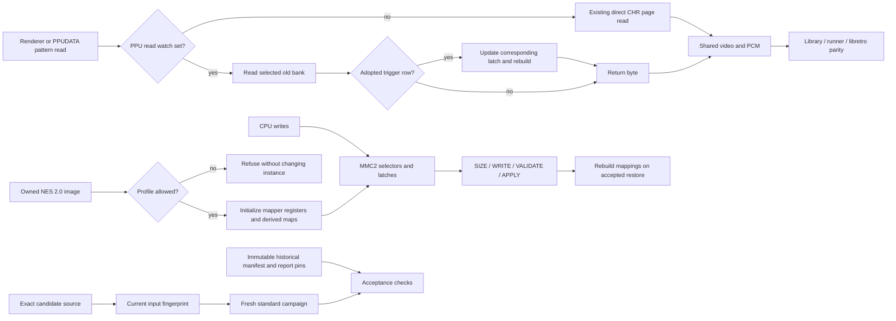

# Phase 30: MMC2 mainline compatibility and delivery - Research

**Researched:** 2026-11-19
**Domain:** Owned C mapper port, PPU reads, native state compatibility, source-bound CTest acceptance and delivery
**Confidence:** MEDIUM overall; source findings directly inspected, hardware decoder claim remains the locked secondary-reference model.

<user_constraints>
## User Constraints (from CONTEXT.md)

The following block copies the implementation decisions, discretion and deferred ideas verbatim. These are project decisions, not newly verified hardware facts.

<!-- DATA_c7f821a9_START -->
## Implementation Decisions

### Mainline baseline and compatibility
- Revalidate live `main` before planning source edits. The 2026-11-19 reviewed
  head is `8923b66cca16739c5b402643798515cf5537ae22`, release 0.1.13, ABI 1,
  behavior revision 9 and state format 3. If live main moves, stop source work
  and derive the delta from its actual compatibility contract.
- For that exact baseline, advance behavior revision to 10 and state format to
  4 while retaining ABI 1. Refuse incompatible prior state formats. Do not copy
  v10's revision 18 or format 7.
- Port only necessary MMC2 implementation, tests, integration and compatibility
  changes. Do not merge or cherry-pick the v10 branch wholesale.

### Bounded MMC2 behavior and state
- Support only the selected NES 2.0 mapper 9/submapper 0 profile: PRG banking,
  mirroring, both CHR latches, and trigger/non-trigger PPU reads. Preserve the
  already adopted latch model as secondary-reference evidence, not silicon
  proof. Unsupported variants keep transactional refusal.
- Exercise actual pattern reads and owned direct markers through the library,
  runner and libretro adapter. Save/load must preserve all mutable selectors
  and both latches, rebuild derived maps, and continue deterministically.
- Preserve existing mapper behavior and protected outputs. Explain only
  necessary state-hash changes; keep AccuracyCoin inputs, historical baselines,
  campaign evidence and acceptance rules unchanged.

### Automated acceptance and protected evidence
- Before expensive acceptance, run a cheap source-bound preflight for the base
  identity, allowed source/test delta, registrations, version/state fields and
  protected evidence. Run focused controls first.
- Run the existing `cmake --workflow --preset ci` on the same candidate with
  the AccuracyCoin full campaign explicitly enabled, within the approved
  1500-second plan gate, 30-minute workflow ceiling and stricter configured
  check limits. Do not re-anchor historical AccuracyCoin metadata or pass
  mismatches by changing protected rules.
- Preserve the current target campaign's historical input manifest and report
  pins. If its source-closure checker must admit MMC2 files, make the smallest
  exact allowlist change and bind it to the current-candidate campaign
  fingerprint; do not weaken historic protection.

### Delivery and evidence claims
- Use a reviewed Conventional Commit PR. Require green exact-candidate checks
  before merge and green resulting-main checks before publication. Verify
  published contents, checksums and source identity.
- Keep the separate RM-017 publisher receipt and LibFuturo consumer/host/gameplay
  gates blocked on their own evidence. This MMC2 port does not satisfy them.
- Do not restart Phase 29 CI or terminal attempts, add attempt-09, import its
  recovery scaffolding, add a new dependency or CI lane, run a performance
  capture, expand hardware/title scope, or claim broad mapper-9, MMC4 or
  Punch-Out!! compatibility.

### the agent's Discretion
- Choose the smallest source changes and test decomposition that fit the
  existing C, mapper, state, runner, libretro and CMake patterns. Keep useful
  one-off checks local unless recurring independent value is demonstrated.
- Keep formatting, commit organization and routine implementation details
  consistent with repository conventions and the reviewed release path.


## Deferred Ideas

Other mapper families or MMC2 variants, MMC4, commercial title claims, hardware
or silicon validation, performance work, and LibFuturo/Playstead consumer,
host, gameplay or receipt acceptance remain outside this phase. No owner
decision is unresolved within the approved Phase 30 scope.

<!-- DATA_c7f821a9_END -->
</user_constraints>

## Summary

Port the reviewed owned implementation as a source delta onto the exact live-main baseline, retaining the target's existing NTSC API and state layout apart from the new mapper payload. A fresh read-only remote query during this research returned the context's reviewed main identity; the selected phase branch has that main commit as its merge base, and its inspected product files have no delta against that base. This confirms the planning baseline at research time; execution must repeat the live-head check before source edits. [VERIFIED: read-only git ls-remote, merge-base and scoped git diff, 2026-11-19]

The principal integration risk is the protected AccuracyCoin source closure: its current validator expects the historical source paths and hashes, not simply unchanged ROM bytes or report output. Adding the mapper and changing PPU/cartridge/build/header files requires a narrowly reviewed current-source admission while preserving historical evidence. Another significant risk is accidentally importing region APIs and tests from the newer v10 tree. [VERIFIED: target tests/cmake/accuracycoin_input_fingerprint.cmake:331-405, quoted below; target src/cartridge.c:170-189 and v10 tests/core/test_mapper_mmc2.c:418-440, quoted below]

**Primary recommendation:** Implement one coherent port with three dependent planning units: mapper/state/docs and owned tests; exact source admission plus cheap/focused/full acceptance; then independent review and normal PR/release delivery. This decomposition is a planning recommendation, not an additional scope decision.

## Architectural Responsibility Map

| Capability | Primary tier | Secondary tier | Rationale |
|---|---|---|---|
| Header admission and transactional refusal | Core cartridge loader | Owned fixture tests | Validate before allocation/replacement. [VERIFIED: target src/cartridge.c:219-230,286-317] |
| PRG/CHR/nametable bank selection | Core mapper | CPU/PPU page tables | Preserve existing board abstraction and derived maps. [VERIFIED: target src/mapper.h:32-50,98-112] |
| Latch transition on real pattern reads | Core PPU read boundary | MMC2 callback | Renderer and CPU-visible PPUDATA reads converge here. [VERIFIED: target src/ppu.c:108-112,473-493,642-651] |
| Portable state validation and restoration | Core state visitor | Mapper state callback | Validate before applying; rebuild maps after restore. [VERIFIED: target src/state.c:420-437,562-610] |
| Runner and libretro use | Existing deliverable adapters | Shared core | Prove exercised video/PCM and restored-state parity at real client boundaries. [VERIFIED: v10 tests/libretro/libretro_host.c:4464-4606] |
| Immutable baseline and new candidate admission | Existing CMake evidence checks | Same-run campaign metadata | Historical pins and current-source fingerprint are separate identities. [VERIFIED: target tests/cmake/accuracycoin_input_fingerprint.cmake:203-213,331-405; tests/cmake/accuracycoin_campaign.cmake:181-184] |
| Qualified public delivery | Existing GitHub CI/release | Local packages and review | Release publication depends on exact release-commit CI. [VERIFIED: target .github/workflows/release.yml:58-79] |

<phase_requirements>
## Phase Requirements

Descriptions below are copied from the selected requirements document. [VERIFIED: .planning/workstreams/mmc2/REQUIREMENTS.md, v11 requirement bullets]

| ID | Description | Research support |
|---|---|---|
| MMC2-07 | Starting from the revalidated live `main` baseline, the core supports the same single NES 2.0 mapper 9/submapper 0 profile selected in v10, with direct owned-marker coverage for PRG banking, mirroring, both CHR latches and trigger/non-trigger PPU reads through the library, runner and libretro adapter. | Existing mapper seam, literal marker tests and exercised parity harness. |
| MMC2-08 | Save/load preserves every mutable MMC2 selector and both latches, rebuilds derived mappings, refuses incompatible prior state formats, and produces deterministic continuation through all three deliverables. Derive compatibility identities from the target baseline: for the reviewed 0.1.13 head this means behavior revision 10 and state format 4, retaining ABI 1; do not copy v10's revision 18 or format 7. | Four-pass state visitor; bounded mapper payload; explicit prior-format rejection; target-specific compatibility sweep. |
| MMC2-09 | Existing supported mapper behavior and protected output evidence remain unchanged. Any state-hash updates are limited to the necessary serialized-format change and are explained; do not re-anchor AccuracyCoin inputs, baselines or campaign evidence to hide a mismatch. | Split output pins from state-header changes; preserve historical manifest/report; exact current source admission with negative controls. |
| MMC2-10 | README and public-header comments describe the supported mapper 9 profile and the new state compatibility boundary, retain the current public ABI, and make no Punch-Out!!, broad mapper-9, hardware-verification or consumer-integration claim. | Same-change documentation; NTSC public API retained; stale v10 future-work wording corrected locally. |
| MMC2-11 | A cheap source-bound preflight verifies the pinned base, MMC2-only source/test delta, test registration, version/state identities and protected AccuracyCoin bindings before expensive acceptance. Focused controls pass, then the existing `cmake --workflow --preset ci` passes completely on the same candidate and produces the library, runner and libretro packages within the configured limits. | Executable sequence below; full campaign enabled before unchanged workflow; fixture-aware test inventory. |
| MMC2-12 | The reviewed port lands through the normal Conventional Commit pull-request path; exact-candidate required checks pass before merge, then resulting-main checks pass before publication. If the milestone produces a release-worthy change, publish through the normal release path and verify package contents, checksums and source identity. This release does not by itself satisfy the separate LibFuturo receipt or consumer gates. | Existing release workflow; worktree cleanliness/ownership gate; distinct receipt and consumer boundaries. |
</phase_requirements>

## Project Constraints (from AGENTS.md)

These are authoritative project directives, not proposed implementation choices. [VERIFIED: AGENTS.md, Working preferences, Workflow handoffs, Rules, Style and Standing engineering authority]

- Read preparation references before subsystem design; use owned code and only the existing vendored libretro header. Core links only C memory functions. No new dependency is selected.
- Three deliverables only: C library, headless runner and libretro adapter; no device/window implementation.
- Clean-room implementation from hardware documentation and test behavior. Do not open GPL/LGPL emulator source; reference emulators are released binaries only.
- Integer-only deterministic core; every mutable emulation field belongs to an instance. Small modules, fixed-width integers and plain control flow; cite hardware claims in comments.
- No unauthorized ROM/BIOS bytes, personal identifiers or paths; hygiene runs on commit/push; use GitHub noreply commit identity.
- Behavior changes require tests in the standard CI workflow, README updates and public-header comments in the same change.
- Use a phase branch and Conventional Commit PR; preserve unrelated dirty work. Check project-owned worktree ownership/cleanliness before release.
- Discussion precedes planning; selected autonomous authority carries routine implementation, verification and review forward, subject to real decisions and preserved boundaries.
- Apply verification/discussion policies: cheapest useful independent checks first; bounded review; no new maintained test lane without recurring value; inspect timing; prefer automated evidence over avoidable human UAT.
- Run automated checks in the background. Full workflow ceiling is 30 minutes; preserve the stricter configured plan gate and existing per-check caps. Diagnose failures before bounded retries; no failed historical allowance is renewed.
- Preserve all terminal Phase 29 attempts and independent capture/campaign/consumer stops. No protected evidence re-anchoring.
- At actual handoff update selected STATE/resume and give one exact next autonomous command with actor/blocker. The parent orchestrator owns that bookkeeping; this research task changes only this artifact.
- At milestone closeout read product roadmap, audit, seeds, release evidence, current consumer evidence and playtesting lessons; reconcile direction within closeout rather than starting another lifecycle step. No personal play or consumer qualification is selected here.

## Standard Stack

| Component | Version/baseline | Use | Provenance |
|---|---|---|---|
| Owned C core | Target's C17 build conventions | Mapper, shared state visitor, CPU/PPU integration | Target root build and existing mapper source inspected; no external package required. [VERIFIED: target CMakeLists.txt:41-78; src/mapper.h:32-50] |
| CMake/CTest/CPack + Ninja | Minimum CMake 3.25; local CMake 4.4.3, Ninja 1.13.2 | Existing configure/build/test/package workflow | Quote: `cmake_minimum_required(VERSION 3.25)`. [VERIFIED: target CMakeLists.txt:1; tool version probes, 2026-11-19] |
| Owned comparison macros and fixtures | Existing | Direct literal oracles, state corruption, actual client parity | Quote: `nesturbator_core_test(core.mapper core/test_mapper.c)`. [VERIFIED: target tests/CMakeLists.txt:1022-1032] |
| Existing GitHub CI/release workflows | Exact target source | Required checks, release-please and package publication | Existing workflow source inspected; no workflow redesign selected. [VERIFIED: target .github/workflows/ci.yml:103-122; .github/workflows/release.yml:21-79] |

**Installation / Package Legitimacy Audit:** No package installation is required or recommended. The legitimacy gate is inapplicable. Do not install a newer framework or external mapper/test library. This follows the locked no-dependency scope and owned-code rules.

## Architecture Patterns

### System Architecture Diagram



Diagram is an implementation recommendation derived from the inspected cartridge/mapper/PPU/state seams; it introduces no service or persistent database.

### Component Responsibilities and Minimal Delta

“Target” means the exact mainline product files; “v10” means the completed owned implementation available in the originating checkout. Do not use line numbers across these two trees interchangeably.

| Area | Required action | Source facts / evidence |
|---|---|---|
| Board implementation | Port the owned module and its eight bounded selector/latch bytes; retain initial FE latches and header-derived mirroring as project policy. Remove stale staged-plan prose. | v10 quotes: `uint8_t position = 0u;`; `nesturbator__sio_u8(io, &m->reg.mmc2.prg, 15u);`; CHR maxima `31u`, mirror/latch maxima `1u`. [VERIFIED: v10 src/mapper_mmc2.c:99-136] |
| Mapper seam | Activate the reserved read-watch bit, add mapper registers and ops declaration, leave unwatched hooks NULL. | Target quotes: `#define NESTURBATOR_WATCH_CPU_WRITE 1u`, `#define NESTURBATOR_WATCH_BUS_CONFLICT 2u`, `#define NESTURBATOR_WATCH_PPU_A12 4u`; `uint8_t (*ppu_read)(struct nesturbator *nes, uint16_t addr);`. [VERIFIED: target src/mapper.h:25-50] |
| Admission and init | Preserve validation-before-allocation and target NTSC policy. Pass enough parsed facts to require the bounded NES2 profile, no trainer/RAM/battery/four-screen and exact selected ROM shape. Add dispatch and loader defaults. | Target quote: `image[12] != 0u` is a refusal condition. Target quote: `if (!validate_image(image, size, &layout))` precedes allocation. [VERIFIED: target src/cartridge.c:170-189,286-317] |
| Pattern reads | Add watch-gated callback only inside pattern-read branch; read old bank before triggering latch update; retain direct path for other boards. | Target quote: `addr &= 0x3fffu;` then `if (addr < 0x2000u)`; direct read is `return page != NULL ? page[addr & 0x3ffu] : 0u;`. [VERIFIED: target src/ppu.c:473-493] |
| Build closure | Register new mapper in shipped static library AND directly compiled bus test; register new owned mapper test and actual deliverable parity test. | Target quote: `add_library(nesturbator STATIC` and mapper list. [VERIFIED: target CMakeLists.txt:60-78]. v10 quote: `add_executable(bus.unit cpu/test_bus.c` with `${PROJECT_SOURCE_DIR}/src/mapper_mmc2.c`. [VERIFIED: v10 tests/CMakeLists.txt:2145-2160] |
| State handling | Use existing mapper callback; avoid broad state rewrite. Preserve validate-before-apply and mapping reconstruction. | Target quotes: `nes->map.ops.state(&nes->mapper, io);`; `(void)nesturbator__mapper_load(inst);`. [VERIFIED: target src/state.c:420-437,562-610] |
| Runner | Add mapper to supported/help/refusal text and exact expected stderr tests; reuse native load/save/frame/audio hash commands. | Target quote: `supported mappers are 0, 1, 2, 3, 4 and 7`. [VERIFIED: target tests/CMakeLists.txt:90-108; runner/main.c:651-678] |
| Libretro host | Port only MMC2 parity mode and its necessary owned hash/parser helpers. Keep existing target palette, frame contract and NTSC core. | v10 cold/resume commands and assertions compare frame/state/PCM digests and PPM output. [VERIFIED: v10 tests/libretro/libretro_host.c:4578-4606]. Target host inspected: existing batch sample capture can be reused. [VERIFIED: target tests/libretro/libretro_host.c:165-169,233-242,928-977] |
| Compatibility/docs | Update header, README, live provider compatibility and current-source test literals together; retain historical descriptions. | Concrete literals listed in compatibility sweep below. |

### Compatibility Sweep Before Build

Verbatim current values (not proposed values):

<!-- DATA_59b1d8a4_START -->
`#define NESTURBATOR_BEHAVIOUR_REVISION 9`
`#define NESTURBATOR_STATE_FORMAT_VERSION 3`
`"abi": 1,`
`"behaviour_revision": 9,`
`"state_format": 3`
<!-- DATA_59b1d8a4_END -->

[VERIFIED: target include/nesturbator.h:81-101; docs/provider-ntsc.json:9-12]

Apply the locked new behavior/state identities from User Constraints, retaining ABI. The header explicitly says changing state bytes raises format and that recorded behavior revision is not enforced by load; format is the refusal boundary. [VERIFIED: target include/nesturbator.h:83-100]

- API test quote: `CHECK_EQ_U64(v.behaviour_revision, 9);`. Update this current expectation. [VERIFIED: target tests/core/test_api.c:85-96]
- Board dispatch quotes: `int want = id == 0u || id == 1u || id == 2u || id == 3u || id == 4u || id == 7u;` and `CHECK_EQ_U64(boarded, 6u);`. Update both the membership oracle and board count. [VERIFIED: target tests/core/test_cartridge.c:776-791]
- Refusal test quotes: `for (unsigned v = 0u; v <= 2u; ++v)` and `put_raw(b + H_VERSION, 4u, 2u);`. Its next-version negative test becomes the new valid format. Make the test reject all previous formats plus the next unsupported format, with unchanged instance/continuation assertions. [VERIFIED: target tests/core/test_state_reject.c:177-199]
- Provider synthetic runtime quotes: `"abi":1,"behaviour_revision":9,"state_format":3` and `"abi":1,"behaviour_revision":9`. Update the current-runtime fixture with the live provider profile; do not alter historical consumer evidence or pending receipt status. [VERIFIED: target tests/cmake/provider_profile.cmake:1013-1032]
- Golden state inventory is tied to public format by the existing format-pin script; it does not justify replacing frame/audio/tick pins. Quote: `REGEX "^state_format [0-9]+$"`. [VERIFIED: target tests/cmake/state_format_pin.cmake:14-27]
- Search current-source helper controls for compatibility literals before execution. Do not mechanically replace all old revisions in historical artifacts. This is a prescriptive cheap consistency check, not evidence that every historical number should change.

### Hardware Model and Test Oracle

The selected profile and full-row read-before-update latch behavior are retained decisions. The owned v10 implementation returns the byte first and updates only its selected latch afterward. Quotes: `if (addr >= 0x0fd0u && addr <= 0x0fdfu)`, `addr >= 0x0fe0u && addr <= 0x0fefu`, `addr >= 0x1fd0u && addr <= 0x1fdfu`, `addr >= 0x1fe0u && addr <= 0x1fefu`. [VERIFIED: v10 src/mapper_mmc2.c:99-126]

These quotes verify the implemented software policy, not the silicon decoder. The local hardware index says MMC2 switches CHR on FD/FE tile reads and assigns the NESdev reference a secondary tier. [VERIFIED: .planning/preparation/NES-HARDWARE-PPU-CARTRIDGE.md:46-54,147]. The pinned page could not be retrieved in this research session; the historical summary records an earlier successful excerpt but explicitly limits it. Quote: `PPU reads $0FD8: latch 0 is set to $FD`. [VERIFIED: .planning/workstreams/mmc2/milestones/v10-phases/29-bounded-mmc2-banking-and-continuation/29-01-SUMMARY.md:113]. Do not promote historical source retrieval into a new hardware-verification claim. [CITED: https://www.nesdev.org/w/index.php?title=MMC2&oldid=22483]

## Don't Hand-Roll

| Problem | Don't build | Reuse |
|---|---|---|
| Mapper dispatch or special renderer | Separate mapper-id branch in renderer | Existing watch-gated PPU hook and page tables. [VERIFIED: target src/mapper.h:1-15,32-50; src/ppu.c:473-493] |
| Serialization | Struct memcpy or pointer save | Existing portable visitor, field bounds, validate/apply passes and rebuild. [VERIFIED: target src/state.h:1-9; src/state.c:562-610] |
| Fixture/test framework | Third-party ROM or test framework | Owned generated MMC2 marker fixture plus current comparison macros/CTest. [VERIFIED: v10 tests/mmc2_fixture.h:20-71; target tests/CMakeLists.txt:950-957] |
| State fork engine | New replay subsystem | Existing state snapshot/poison/refusal helpers and MMC2-specific tests. [VERIFIED: v10 tests/core/test_mapper_mmc2.c:855-955; target tests/core/test_state_reject.c:131-149] |
| Acceptance scheduler | Historical recovery wrapper or new CI lane | Existing standard workflow, current CTest fixtures and bounded process supervision. [VERIFIED: target CMakePresets.json:156-163; User Constraints] |

## AccuracyCoin Source Closure and Fingerprint Contract

This is a required implementation seam, not a reason to rerun Phase 29 or change its evidence.

1. **Historical identity stays immutable.** The validator pins historical metadata, scoreboard, manifest identity and report digest, with exact schema/duplicate-field checks. Representative quote: `"historical_input_count|NUMBER|56"`; `"campaign_report_sha256|STRING|56ebd01adb97b3916fde36f8739602284d951a1fd00d84285bb4ef441fb463a3"`. [VERIFIED: target tests/cmake/accuracycoin_input_fingerprint.cmake:174-224,265-302]
2. **Current closure already includes the changed product inputs.** Quotes: `"${source_dir}/src/*.c" "${source_dir}/src/*.h"`, `"${source_dir}/runner/*.c" "${source_dir}/runner/*.h"`, and `"${source_dir}/include/*.h" "${source_dir}/cmake/*.cmake"`; explicit root/test build files are appended. Header hashing normalizes release semver only; behavior/state fields and comments remain measured bytes. [VERIFIED: target tests/cmake/accuracycoin_input_fingerprint.cmake:3-34]
3. **Adding a source name alone is insufficient.** Current quote: `if(NOT input_count EQUAL 56)`; current paths are paired by index with historical rows, and non-maintenance current hashes must equal historical hashes. Quotes: `set(maintenance_paths` followed by `tests/CMakeLists.txt`, `tests/cmake/accuracycoin_activation.cmake`, `tests/cmake/accuracycoin_input_fingerprint.cmake`; `if(NOT relative_path IN_LIST maintenance_paths AND NOT current_hash STREQUAL historical_hash)`. [VERIFIED: target tests/cmake/accuracycoin_input_fingerprint.cmake:331-405]
4. **Registration/checker identities are exact too.** Quote: `"current registration CMake bytes differ from the exact four-entry delta"`; binding verifies checker hashes. Change the current reviewed registration binding deliberately after final test registration; keep original/historical hashes. Do not reuse v10 binding values. [VERIFIED: target tests/cmake/accuracycoin_input_fingerprint.cmake:305-329]
5. **Current campaign metadata is emitted but not consumed for freshness by target activation.** Quotes: `"build_inputs_sha256=${build_inputs_sha256}\nbuild_inputs_count=${build_inputs_count}\n"` and `"campaign_report_sha256=${campaign_report_sha256}\n"`. Activation currently checks report bytes, while its full-enabled branch does not read those current-input fields. [VERIFIED: target tests/cmake/accuracycoin_campaign.cmake:181-184; tests/cmake/accuracycoin_activation.cmake:244-260]
6. **Controls also assume equal historical/current path count.** Quote: `NOT expected_count STREQUAL current_count`. Existing negative controls mutate ordinary source, historical metadata, scoreboard, checker bytes and caller-selected exemptions. Preserve those protections and extend them for the approved MMC2 delta rather than merely making the positive case pass. [VERIFIED: target tests/cmake/accuracycoin_input_fingerprint_controls.cmake:46-77,99-156]

**Prescriptive implementation:** Keep the historical manifest and evidence byte-identical. Distinguish historical paths from the exact added mapper path. Admit only explicitly reviewed changes to existing product/build/header inputs using exact target-current hashes; unaffected paths must retain historical hashes. Keep measured current closure complete, including newly added source. Authenticate the updated current registration/checker identities without rewriting their historical identities. Require the full campaign metadata's current fingerprint and count to equal a fresh recomputation and the recorded report digest to match its actual report. Reject missing/duplicate/malformed/stale metadata and source edits after the run. Keep caller-selected exemptions forbidden.

This is an implementation design derived from the inspected mismatch, not a claim that target code already implements it. Narrow extension of existing controls has recurring independent value because it prevents later candidates borrowing historical acceptance. Do not copy the excluded v10 recovery machinery.

**Important freeze detail:** Current fingerprint includes the fingerprint helper itself. Avoid a self-referential hash constant inside the file it hashes; keep reviewed checker hashes in the existing external current binding. Finalize source, registrations, helper and binding before capturing the acceptance candidate. Existing normalization permits release-semver changes only, not arbitrary later source edits. [VERIFIED: target tests/cmake/accuracycoin_input_fingerprint.cmake:3-13,17-31,312-327]

## Runtime State Inventory

This phase changes saved-state compatibility, not an application/service rename.

| Category | Items found / visibility | Required action |
|---|---|---|
| Stored data | Existing external save states can carry the previous public format; loader admits exactly current format. Quote: `get_le(b + H_VERSION, 2u) != NESTURBATOR_STATE_FORMAT_VERSION`. [VERIFIED: target src/state.c:541-545]. Personal save locations were not inspected. | Reject prior formats transactionally; document boundary. No converter or deletion. |
| Live service config | Existing target CI enables full campaign on primary lane; release job waits for exact-source CI. [VERIFIED: target .github/workflows/ci.yml:113-122; release.yml:58-79] | Retain workflows; recheck required candidate/main checks during delivery. No service rename selected. |
| OS-registered state | None identified in this source-only port; OS registrations were not inspected. [ASSUMED] | No OS mutation planned; executor must not invent setup work. |
| Secrets/env vars | None needs renaming under the selected delta; secrets were not inspected. [ASSUMED] | Reuse existing hosted release authority/config; no secret reads or changes. |
| Build artifacts | Existing originating checkout has old build/test output; source tree and compatibility baseline differ. [VERIFIED: worktree identity inspection; existing local CTest cost data] | Configure/build in exact-main phase worktree. Never reuse old acceptance logs/packages as Phase 30 qualification. |

## Common Pitfalls

### Importing newer region contracts

v10 test quotes: `nesturbator_get_region(inst)`, `NESTURBATOR_REGION_PAL`, and `image[12] = 1u;` followed by successful load. Target refusal quote: `image[12] != 0u`. [VERIFIED: v10 tests/core/test_mapper_mmc2.c:418-440; target src/cartridge.c:170-176]

Keep exponent-size admission coverage, but adapt non-NTSC headers to the target's existing refusal policy. Do not import the newer public region API, runtime info parser or unrelated host changes. This preserves the phase's no-ABI-expansion constraint.

### Losing independent behavior evidence

The owned tests hold expected markers outside the image generator, sweep each adopted trigger-row byte, check adjacent/non-pattern addresses, exercise buffered PPUDATA and rendering, and preserve per-instance/reset behavior. Keep those tests; parity alone can match identical defects in three shared-core clients. [VERIFIED: v10 tests/mmc2_fixture.h:20-22; tests/core/test_mapper_mmc2.c:516-548,551-699,701-768]

### Copying old state hashes or broad output refreshes

The target state header stores format, behavior and checksum; these change state hashes even on existing boards without changing their bodies or video/PCM. Quote: `put_le(b + H_BEHAVIOUR, NESTURBATOR_BEHAVIOUR_REVISION, 4u);`. [VERIFIED: target src/state.c:505-527]

Regenerate only affected state rows after proving expected header/CRC differences; preserve existing frame/audio/tick expectations. Keep a small before/after explanation of state changes. A cheap offline header-transform comparison can demonstrate whether old-board hashes change only through format/revision/CRC; that is a recommended local probe, not an existing result.

### Running a hidden expensive fixture in “cheap” checks

Full-enabled activation requires the campaign fixture. Quotes: `FIXTURES_SETUP accuracycoin_full_report` and `FIXTURES_REQUIRED accuracycoin_full_report`. [VERIFIED: target tests/CMakeLists.txt:886-898]. CTest automatically adds fixture prerequisites. [CITED: https://cmake.org/cmake/help/v3.25/manual/ctest.1.html]

Use the standalone input-fingerprint control for cheap binding checks; do not include activation or target-score controls casually in the focused selection once full campaign is enabled. Inspect generated test JSON before running.

### Using an invented development preset

The target presets define ordinary development and CI routes; they do not define the originating branch's later quick preset. Target quote: `"name": "dev"`; workflow quote: `"name": "ci"` with configure/build/test/package steps. [VERIFIED: target CMakePresets.json:12-22,147-163]. Use the commands below against the target inventory.

## Code Examples

Existing target pattern, preserve unchanged except adding the narrowly gated callback before the direct pattern-page read:

<!-- DATA_3a065cf1_START -->
```c
/* Existing target source: src/ppu.c:473-479 */
addr &= 0x3fffu;
if (addr < 0x2000u) {
    const uint8_t *page = nes->map.chr_r[addr >> 10];
    return page != NULL ? page[addr & 0x3ffu] : 0u;
}
```
<!-- DATA_3a065cf1_END -->

[VERIFIED: target src/ppu.c:473-479]

Existing owned mapper serialization pattern to port; field bounds are the implemented profile, not universal board capability:

<!-- DATA_86b41a27_START -->
```c
nesturbator__sio_u8(io, &m->reg.mmc2.prg, 15u);
for (unsigned i = 0u; i < 4u; ++i)
    nesturbator__sio_u8(io, &m->reg.mmc2.chr[i], 31u);
nesturbator__sio_u8(io, &m->reg.mmc2.mirror, 1u);
nesturbator__sio_u8(io, &m->reg.mmc2.latch[0], 1u);
nesturbator__sio_u8(io, &m->reg.mmc2.latch[1], 1u);
```
<!-- DATA_86b41a27_END -->

[VERIFIED: v10 src/mapper_mmc2.c:129-136]

Existing parity registration to adapt into the target, without importing surrounding tests:

<!-- DATA_7f20d3ac_START -->
```cmake
add_test(NAME libretro.mmc2.parity
  COMMAND libretro.host --mmc2-parity $<TARGET_FILE:nesturbator_libretro>
    $<TARGET_FILE:nesturbator-run> ${NESTURBATOR_MMC2_PARITY_DIR})
set_tests_properties(libretro.mmc2.parity PROPERTIES TIMEOUT 30)
```
<!-- DATA_7f20d3ac_END -->

[VERIFIED: v10 tests/CMakeLists.txt:1967-1972; preceding directory creation is `file(MAKE_DIRECTORY ${NESTURBATOR_MMC2_PARITY_DIR})`]

## Executable Verification Sequence for the Planner

This section is an executable proposed sequence, not a record of checks run. No build, test, CI or campaign was started by this researcher. Keep the parent plan's source freeze, limits and stop semantics explicit.

### 1. Source-bound cheap preflight before expensive work

- Recheck remote main and compare to the exact reviewed base; verify branch merge base, scoped clean source and all worktree ownership. Read the selected workstream state from the phase checkout; workspace selection alone does not change checkout. Stop source work if base moved.
- Use a small local script or bounded review to compare changed source/test/build/docs against an explicit approved-file list. Catch accidental CPU/APU/region/API imports and historical recovery machinery. A file allowlist is a scope guard; inspect hunks independently.
- Check new mapper registration in static library and bus unit source lists; compare added test names to generated CTest inventory. Check behavior/state/public/provider/current fixture literals together.
- Hash protected historical ROM, scoreboard, metadata and historical manifest against the untouched base. Verify current source admission and its rejection controls before full campaign.
- Configure with campaign enabled, build only focused targets, and inspect fixture-expanded selection before running. CMake's official workflow options do not accept arbitrary cache definitions; configure cache first. Cache persists unless a fresh configure deletes it. [CITED: https://cmake.org/cmake/help/v3.25/manual/cmake.1.html]

Proposed commands (from the exact phase worktree):

```sh
git ls-remote origin refs/heads/main
git merge-base HEAD 8923b66cca16739c5b402643798515cf5537ae22
git diff --check
cmake --preset ci -DNESTURBATOR_ACCURACYCOIN_FULL=ON
cmake --build --preset ci --target core.api core.cartridge core.mapper core.mapper_discrete core.mapper_mmc1 core.mapper_mmc3 core.mapper_mmc2 core.state core.state_reject bus.unit libretro.host
ctest --preset ci --show-only=json-v1
```

The base hash is copied verbatim from the context and independently revalidated by the remote query during research. Existing target names quote: `core.api`, `core.cartridge`, `core.mapper`, `core.mapper_discrete`, `core.mapper_mmc1`, `core.mapper_mmc3`, `core.state`, `core.state_reject`, `bus.unit`, `libretro.host`. [VERIFIED: target tests/CMakeLists.txt:959-969,1023-1045,1091-1095 and target/ v10 direct bus/host registrations inspected]. Added names quote: `core.mapper_mmc2`, `libretro.mmc2.parity`. [VERIFIED: v10 tests/CMakeLists.txt:1100-1102,1969-1972]

### 2. Cheap binding controls and focused mapper/state/parity

Use existing controls after their minimal extension; do not invoke activation here because it adds full campaign:

```sh
cmake -DSOURCE_DIR=. -DWORK=build/ci/phase30-input-controls -P tests/cmake/accuracycoin_input_fingerprint_controls.cmake
ctest --preset ci --output-on-failure --no-tests=error -R '^(state[.]format_pin|provider[.]profile([.]controls)?|core[.](api|cartridge|mapper(_discrete|_mmc1|_mmc3|_mmc2)?|state|state_reject)|bus[.]unit|libretro[.]mmc2[.]parity)$'
```

The scratch location is a proposed local output, not an existing artifact. The control creates/removes only its designated work directory; quote: `file(REMOVE_RECURSE "${WORK}")` then `file(MAKE_DIRECTORY "${WORK}")`. Use an absolute source directory if invoking outside the root. [VERIFIED: target tests/cmake/accuracycoin_input_fingerprint_controls.cmake:3-11]

Before execution inspect the regex-expanded JSON: expected new tests must exist, focused existing controls must remain, and full campaign must not appear. The regex is a proposal; generated registrations are authoritative. Existing provider checks have `TIMEOUT 15`, state-pin/fingerprint controls `TIMEOUT 30`, and owned mapper/parity checks retain their existing short caps. [VERIFIED: target tests/CMakeLists.txt:694-699,814-819,2408-2420; v10 tests/CMakeLists.txt:1100-1102,1969-1972]

The test map is: direct marker/refusal/read sweep for MMC2-07; bounded corrupt-state/rebuild/native continuation for MMC2-08; unchanged existing-board outputs and binding negatives for MMC2-09; provider/API/docs consistency for MMC2-10; full standard workflow for MMC2-11; exact-head hosted checks and artifact verification for MMC2-12. These are recommended plan acceptance assignments, not completed tests.

### 3. Freeze candidate and run full standard workflow once

After implementation and focused fixes, commit/freeze all measured inputs and bindings, record current source fingerprint and package identity, and confirm campaign remains enabled in cache and generated inventory. Clear only the generated combined hash-output file as existing CI does; never delete historical evidence. Quote: `cmake -E rm -f "build/${{ matrix.preset }}/tests/hashes.txt"`. [VERIFIED: target .github/workflows/ci.yml:120-122]

```sh
cmake --workflow --preset ci
```

Run in the background under a process-group deadline of at most 1500 seconds; the stricter plan gate wins over the 30-minute global ceiling. Retain per-test limits rather than replacing them with one global timeout. Full campaign quotes: `-DBOOT_CAP=32 -DNAVIGATION_CAP=5 -DEXECUTION_CAP=1800`, `-DPAGE_TIMEOUT=15 -DCOLLECT_TIMEOUT=10`, and `TIMEOUT 370`. [VERIFIED: target tests/CMakeLists.txt:886-898]. Fixture-aware activation must compare fresh current metadata and unchanged report pin. No source edits during the run; after completion recheck fingerprint, exact source and packages.

Do not treat an unsuccessful preflight as a consumed campaign, or a failed campaign as permission for a fresh attempt. Preserve failed evidence, diagnose against that plan's exact limits, and escalate only a genuinely new authority/risk decision. No Phase 29 run or terminal attempt is reopened.

### 4. Delivery and timing evidence

Review source/docs and acceptance evidence independently; verify all requirements before PR. Existing CI configures full campaign on its primary lane and executes its normal preset; preserve that lane and release behavior. [VERIFIED: target .github/workflows/ci.yml:113-122]. After green exact-candidate checks, merge through the existing PR route; after green resulting-main/release checks, verify archives/checksums/source identity. Release workflow explicitly says `needs: [release-please, ci]` for publication. [VERIFIED: target .github/workflows/release.yml:58-79]

Available originating-checkout CTest cost data records a serial session-control test as the largest local item (about 236 seconds), followed by run-ahead/state work (about 35–42 seconds); those observations belong to the old tree and do not predict exact-main acceptance. [VERIFIED: originating build/ci/Testing/Temporary/CTestCostData.txt, read-only sort during research]. Use existing timing logs and new candidate logs to avoid duplicate full runs. Keep full local session controls and existing hosted separation intact; no evidence here supports introducing caches, concurrency changes, new lanes or removing coverage. Maintained source-admission negatives fit an existing control because they cover a recurring evidence boundary; one-off base/hunk consistency should remain a local probe.

## State of the Art

| Existing pattern | Phase action | Reason |
|---|---|---|
| Reserved mapper PPU-read callback | Activate narrowly for selected mapper | Fits current architecture without PPU special casing. [VERIFIED: target src/mapper.h:25-50] |
| Four-pass state visitor | Add bounded mapper payload; advance declared format | Preserves portability, transactional validation and rebuild. [VERIFIED: target src/state.h:1-9; src/state.c:562-610] |
| Historical-source equality gate | Separate immutable historical evidence from exact current admission | Port intentionally changes measured source; evidence provenance must remain inspectable. [VERIFIED: target tests/cmake/accuracycoin_input_fingerprint.cmake:331-405] |
| Existing workflow preset | Explicit cache configuration followed by unchanged workflow | Keeps campaign included without inventing a wrapper or lane. [VERIFIED: target CMakePresets.json:156-163; tests/CMakeLists.txt:780-781] |

No package upgrade or deprecation response is needed for this code-only phase.

## Assumptions Log

| ID | Claim | Risk if wrong | Disposition |
|---|---|---|---|
| A1 | No OS registration requires a change. [ASSUMED] | Unidentified host setup could need separate work. | No OS action is proposed; external machine state is not needed to plan this core port. |
| A2 | No secret/env name requires a change. [ASSUMED] | Delivery configuration might need an existing operator fix. | Do not change or expose secrets; inspect actual hosted gate state during delivery. |

The full-row hardware claim is an inherited explicit policy with a stated evidence limitation, not a new assumption to ask the owner to approve again. Proposed task decomposition, checks and exact-source admission design are recommendations for the planner, not empirical results or unlocked product decisions.

## Open Questions and Material Risks

1. **Final exact current-source admission design/hashes.** The old checker demonstrably rejects the intended source delta; current file hashes cannot be fixed until implementation settles. Plan a dedicated bounded evidence-control task before expensive acceptance. Preserve immutable historical metadata/manifest/report. No owner decision is presently required by the recorded context.
2. **Minimal parity helper closure.** The v10 parity function references newer owned presentation/state-hash helpers absent in target. Trace helper dependencies and port only the necessary NTSC hash parsing/palette logic. Compile/link focused targets before running. Do not take the whole host file.
3. **Target campaign report stability.** The target's unchanged AccuracyCoin output should remain byte-identical, but this research ran no campaign. A mismatch is a stop for diagnosis, not authority to update baseline. Retain source fingerprint and same-run provenance.
4. **Publication worktree cleanliness.** Historical handoff records unrelated dirty project worktrees. This is a delivery gate separate from implementation. Resolve ownership without discarding work; the parent orchestrator owns release decisions and bookkeeping.
5. **Reference precision.** Pinned MMC2 page fetch failed this session and historical excerpt does not establish complete decoder width. Retain the adopted model/evidence tier and no hardware/title claim; do not reopen locked source-policy decisions without contrary material evidence.

## Environment Availability

| Dependency | Available | Observed version | Fallback/action |
|---|---|---|---|
| CMake / CTest / CPack distribution | Yes | CMake 4.4.3 | Reuse existing presets; minimum is quoted above. |
| Ninja | Yes | 1.13.2 | No install needed. |
| C compiler | Yes | Apple clang 21.0.0, arm64 target | Existing local toolchain. |
| Python | Yes | 3.14.4 | Available for local throwaway consistency/deadline supervision; no package install selected. |
| Git / remote read | Yes | Git 2.41.0; live-main query succeeded | Recheck before edits/delivery. |
| Context7 / ctx7 | Not available to this agent | Tool discovery returned no Context7 tool; CLI command lookup returned no executable | Official CMake docs fetched through web tool; no tool installation. |
| Hosted required checks / publication access | Not probed by this research | — | Parent delivery workflow checks actual authenticated capability and exact-head status. |

[VERIFIED: read-only tool discovery, version/availability probes and git remote query during research, 2026-11-19]. No required local dependency is missing. This is an availability observation, not a successful build or test claim.

## Sources

- Current exact-main source files read with line numbers: mapper interface, cartridge loader, shared PPU reads, state visitor, public compatibility header, root/test build registration, presets, runner diagnostics, provider profile/controls, state rejection tests, AccuracyCoin fingerprint/control/activation/campaign code, CI and release workflows. Source-of-truth citations and verbatim discrete values appear beside each finding.
- Owned v10 implementation and tests read with line numbers: mapper module, generated MMC2 fixture, marker/state tests, public tracer, actual library/runner/libretro parity and its registration. These show reusable software behavior, not new acceptance on main.
- Preparation index, architecture, engineering, PPU/cartridge reference and runner/libretro reference; selected v11 state/roadmap/requirements/handoffs and context; project verification/discussion policies.
- [CMake 3.25 CLI](https://cmake.org/cmake/help/v3.25/manual/cmake.1.html) — cache and workflow semantics. [CITED]
- [CTest 3.25 CLI](https://cmake.org/cmake/help/v3.25/manual/ctest.1.html) — non-executing JSON inventory and fixture selection. [CITED]
- [Pinned NESdev MMC2 reference](https://www.nesdev.org/w/index.php?title=MMC2&oldid=22483) — fresh retrieval failed; retained as inherited secondary-reference pointer only.
- External searches were discovery only. No emulator source was opened and no source-search snippet is promoted into hardware proof.

## Metadata

**Confidence:** Repository integration facts are directly inspected. Overall recommendation is MEDIUM because no implementation/tests ran, current admission values await the implementation, and the adopted hardware model remains secondary-reference evidence. Official CMake source confirmation received MEDIUM from the confidence seam for verified web search; direct fetch alone received LOW, so it is used as a citation rather than inflated to independent verification. The seam returned LOW for an unrecognized local provider; repository source tags reflect direct file inspection rather than a claim of provider ranking.

**Research routing:** Research-plan seam returned Context7 for CMake and web search for hardware; Context7/CLI unavailable, so official CMake docs were fetched directly and digests cached. Graph context was skipped because the graph status command reported disabled. Agent skill query returned no configured skills; project skill directories were not present.

**Validation/Security sections:** Omitted under explicit project configuration: quotes `"nyquist_validation": false` and `"security_enforcement": false`. [VERIFIED: .planning/config.json, workflow object]. Clean-room, input-validation and transactional-state risks are still covered above.

**Scope of this research:** Read-only source/documentation/tool-availability inspection plus this artifact. No source, plans, protected evidence, tests/CI, commits, release or user contact. The orchestrator retains commit/handoff ownership.

**Valid until:** Source movement, relevant implementation/contract change, or 30 days; revalidate live main immediately before source edits regardless.

